# Roadmapa

Kolejność modułów, zależności między nimi i trzy ścieżki nauki. Szacowany czas to czas na zrozumienie i odpowiedzenie na pytania z modułu, bez prac praktycznych.

[← README](README.md)

---

## Trzy ścieżki

| Ścieżka | Dla kogo | Moduły | Czas |
|---------|----------|--------|------|
| **SEP** | Egzamin na świadectwo grupy 1, stanowisko eksploatacji (E), do 1 kV, z pomiarami | 21 modułów + [sep/](sep/README.md) | ok. 109 h |
| **Dom** | Zrozumienie i samodzielne prace przy instalacji w domu i mieszkaniu | 00–22 + 26 | ok. 124 h |
| **Pełna** | Obie powyższe i rozszerzenia (dozór, sieci SN) | 00–34 | ok. 177 h |

Ścieżki w dużej części się pokrywają. Jeśli celem są i egzamin, i praca w domu, przerabiaj ścieżkę „dom”, a potem dołóż moduły 23–24 i 28–32.

### Ścieżka SEP

<!-- sciezka-sep:start -->
- [ ] [00 — Zanim dotkniesz czegokolwiek](modules/00-bezpieczenstwo-najpierw/README.md)
- [ ] [01 — Prąd, napięcie, opór, moc i energia](modules/01-prad-napiecie-opor/README.md)
- [ ] [02 — Prąd przemienny i sieć 230/400 V](modules/02-prad-przemienny-230-400/README.md)
- [ ] [04 — Prąd a człowiek](modules/04-prad-a-czlowiek/README.md)
- [ ] [05 — Przewody i kable](modules/05-przewody-i-kable/README.md)
- [ ] [07 — Zabezpieczenia nadprądowe](modules/07-zabezpieczenia-nadpradowe/README.md)
- [ ] [08 — Wyłączniki różnicowoprądowe](modules/08-wylaczniki-roznicowopradowe/README.md)
- [ ] [11 — Układy sieci: TN, TT, IT](modules/11-uklady-sieci/README.md)
- [ ] [12 — Ochrona przeciwporażeniowa](modules/12-ochrona-przeciwporazeniowa/README.md)
- [ ] [13 — Uziemienia i połączenia wyrównawcze](modules/13-uziemienia-i-wyrownanie/README.md)
- [ ] [14 — Od słupa do gniazdka](modules/14-od-slupa-do-gniazdka/README.md)
- [ ] [15 — Rozdzielnica mieszkaniowa](modules/15-rozdzielnica-mieszkaniowa/README.md)
- [ ] [20 — Diagnostyka usterek](modules/20-diagnostyka-usterek/README.md)
- [ ] [22 — Przyrządy pomiarowe](modules/22-przyrzady-pomiarowe/README.md)
- [ ] [23 — Pomiary odbiorcze i okresowe](modules/23-pomiary-odbiorcze-i-okresowe/README.md)
- [ ] [24 — Silniki i napędy](modules/24-silniki-i-napedy/README.md)
- [ ] [28 — BHP przy urządzeniach elektrycznych](modules/28-bhp-przy-urzadzeniach/README.md)
- [ ] [29 — Eksploatacja urządzeń i instalacji](modules/29-eksploatacja/README.md)
- [ ] [30 — Pożar i awaria](modules/30-pozar-i-awaria/README.md)
- [ ] [31 — Pierwsza pomoc przy porażeniu](modules/31-pierwsza-pomoc/README.md)
- [ ] [32 — Przepisy i normy](modules/32-przepisy-i-normy/README.md)
<!-- sciezka-sep:end -->

Na końcu: [sep/pytania.md](sep/pytania.md) na głos i [sep/powtorka-48h.md](sep/powtorka-48h.md) przed egzaminem.

### Ścieżka „dom”

<!-- sciezka-dom:start -->
- [ ] [00 — Zanim dotkniesz czegokolwiek](modules/00-bezpieczenstwo-najpierw/README.md)
- [ ] [01 — Prąd, napięcie, opór, moc i energia](modules/01-prad-napiecie-opor/README.md)
- [ ] [02 — Prąd przemienny i sieć 230/400 V](modules/02-prad-przemienny-230-400/README.md)
- [ ] [03 — Elektromagnetyzm w praktyce](modules/03-elektromagnetyzm-w-praktyce/README.md)
- [ ] [04 — Prąd a człowiek](modules/04-prad-a-czlowiek/README.md)
- [ ] [05 — Przewody i kable](modules/05-przewody-i-kable/README.md)
- [ ] [06 — Osprzęt instalacyjny](modules/06-osprzet-instalacyjny/README.md)
- [ ] [07 — Zabezpieczenia nadprądowe](modules/07-zabezpieczenia-nadpradowe/README.md)
- [ ] [08 — Wyłączniki różnicowoprądowe](modules/08-wylaczniki-roznicowopradowe/README.md)
- [ ] [09 — Ochrona przeciwprzepięciowa](modules/09-ochrona-przeciwprzepieciowa/README.md)
- [ ] [10 — Aparatura modułowa](modules/10-aparatura-modulowa/README.md)
- [ ] [11 — Układy sieci: TN, TT, IT](modules/11-uklady-sieci/README.md)
- [ ] [12 — Ochrona przeciwporażeniowa](modules/12-ochrona-przeciwporazeniowa/README.md)
- [ ] [13 — Uziemienia i połączenia wyrównawcze](modules/13-uziemienia-i-wyrownanie/README.md)
- [ ] [14 — Od słupa do gniazdka](modules/14-od-slupa-do-gniazdka/README.md)
- [ ] [15 — Rozdzielnica mieszkaniowa](modules/15-rozdzielnica-mieszkaniowa/README.md)
- [ ] [16 — Planowanie obwodów](modules/16-planowanie-obwodow/README.md)
- [ ] [17 — Pomieszczenia i miejsca szczególne](modules/17-pomieszczenia-szczegolne/README.md)
- [ ] [18 — Oświetlenie](modules/18-oswietlenie/README.md)
- [ ] [19 — Prace krok po kroku](modules/19-prace-krok-po-kroku/README.md)
- [ ] [20 — Diagnostyka usterek](modules/20-diagnostyka-usterek/README.md)
- [ ] [21 — Stare instalacje](modules/21-stare-instalacje/README.md)
- [ ] [22 — Przyrządy pomiarowe](modules/22-przyrzady-pomiarowe/README.md)
- [ ] [26 — Fotowoltaika, pompy ciepła, wallboxy i magazyny energii](modules/26-fotowoltaika-pompy-wallboxy/README.md)
<!-- sciezka-dom:end -->

Przed pierwszą pracą przy instalacji wróć do modułu 00. Nowe obwody i zmiany w rozdzielnicy kończą się pomiarami (moduł 23) — jeśli nie masz miernika i uprawnień, zleć je osobie ze świadectwem.

---

## Zależności między modułami

Strzałka oznacza „warto znać wcześniej”. To nie jest sztywna kolejność: moduł z pustymi zależnościami można zacząć w dowolnej chwili.

```mermaid
graph TD
  M00["00 Zanim dotkniesz czegokolwiek"]
  M01["01 Prąd, napięcie, opór, moc i energia"]
  M02["02 Prąd przemienny i sieć 230/400 V"]
  M03["03 Elektromagnetyzm w praktyce"]
  M04["04 Prąd a człowiek"]
  M05["05 Przewody i kable"]
  M06["06 Osprzęt instalacyjny"]
  M07["07 Zabezpieczenia nadprądowe"]
  M08["08 Wyłączniki różnicowoprądowe"]
  M09["09 Ochrona przeciwprzepięciowa"]
  M10["10 Aparatura modułowa"]
  M11["11 Układy sieci: TN, TT, IT"]
  M12["12 Ochrona przeciwporażeniowa"]
  M13["13 Uziemienia i połączenia wyrównawcze"]
  M14["14 Od słupa do gniazdka"]
  M15["15 Rozdzielnica mieszkaniowa"]
  M16["16 Planowanie obwodów"]
  M17["17 Pomieszczenia i miejsca szczególne"]
  M18["18 Oświetlenie"]
  M19["19 Prace krok po kroku"]
  M20["20 Diagnostyka usterek"]
  M21["21 Stare instalacje"]
  M22["22 Przyrządy pomiarowe"]
  M23["23 Pomiary odbiorcze i okresowe"]
  M24["24 Silniki i napędy"]
  M25["25 Transformatory, zasilacze, UPS i agregaty"]
  M26["26 Fotowoltaika, pompy ciepła, wallboxy i magazyny energii"]
  M27["27 Inteligentny dom"]
  M28["28 BHP przy urządzeniach elektrycznych"]
  M29["29 Eksploatacja urządzeń i instalacji"]
  M30["30 Pożar i awaria"]
  M31["31 Pierwsza pomoc przy porażeniu"]
  M32["32 Przepisy i normy"]
  M33["33 Dozór (D)"]
  M34["34 Sieci SN i stacje transformatorowe"]
  M01 --> M02
  M02 --> M03
  M01 --> M04
  M02 --> M04
  M01 --> M05
  M02 --> M05
  M05 --> M06
  M01 --> M07
  M05 --> M07
  M04 --> M08
  M07 --> M08
  M07 --> M09
  M03 --> M10
  M07 --> M10
  M08 --> M10
  M02 --> M11
  M04 --> M11
  M04 --> M12
  M07 --> M12
  M08 --> M12
  M11 --> M12
  M11 --> M13
  M12 --> M13
  M02 --> M14
  M07 --> M14
  M11 --> M14
  M07 --> M15
  M08 --> M15
  M09 --> M15
  M10 --> M15
  M11 --> M15
  M05 --> M16
  M07 --> M16
  M08 --> M16
  M15 --> M16
  M08 --> M17
  M12 --> M17
  M13 --> M17
  M06 --> M18
  M00 --> M19
  M06 --> M19
  M15 --> M19
  M16 --> M19
  M08 --> M20
  M11 --> M20
  M15 --> M20
  M22 --> M20
  M11 --> M21
  M12 --> M21
  M15 --> M21
  M02 --> M22
  M04 --> M22
  M12 --> M23
  M13 --> M23
  M22 --> M23
  M03 --> M24
  M07 --> M24
  M10 --> M24
  M03 --> M25
  M12 --> M25
  M09 --> M26
  M12 --> M26
  M15 --> M26
  M06 --> M27
  M10 --> M27
  M18 --> M27
  M00 --> M28
  M04 --> M28
  M28 --> M29
  M28 --> M30
  M04 --> M31
  M28 --> M32
  M29 --> M33
  M32 --> M33
  M12 --> M34
  M28 --> M34
```

<!-- graf:start -->

<!-- graf:end -->

Kilka zależności idzie „pod prąd” numeracji — na przykład diagnostyka usterek (20) korzysta z przyrządów pomiarowych (22). W takich miejscach wystarczy przejrzeć wcześniej odpowiednie tematy z modułu o wyższym numerze.

---

## Proponowany plan na 10 tygodni (ścieżka SEP)

| Tydzień | Moduły | Cel tygodnia |
|---------|--------|--------------|
| 1 | 00, 01, 02 | Bezpieczeństwo i podstawy: U, I, R, P, sieć 230/400 V |
| 2 | 04, 05 | Skutki porażenia, przewody i ich dobór |
| 3 | 07, 08 | Zabezpieczenia nadprądowe i różnicowoprądowe |
| 4 | 11, 12 | Układy sieci i ochrona przeciwporażeniowa — najważniejszy tydzień |
| 5 | 13, 14, 15 | Uziemienia, przyłącze, rozdzielnica |
| 6 | 20, 22 | Diagnostyka i przyrządy |
| 7 | 23 | Pomiary odbiorcze i okresowe |
| 8 | 24 | Silniki i napędy |
| 9 | 28, 29, 30, 31 | BHP, eksploatacja, pożar, pierwsza pomoc |
| 10 | 32 + `sep/` | Przepisy, pytania na głos, powtórka 48 h |

---

## Kiedy moduł jest „zaliczony”

- Potrafisz wyjaśnić każde pojęcie z modułu komuś, kto się na tym nie zna.
- Odpowiadasz na głos na wszystkie pytania SEP z modułu, zanim rozwiniesz odpowiedź.
- Rozpoznajesz na zdjęciu elementy omawiane w module i wskazujesz błędy na schematach z sekcji „Sprawdź się”.
- Umiesz podać, z którego przepisu albo której normy wynikają liczby ze ściągi.
