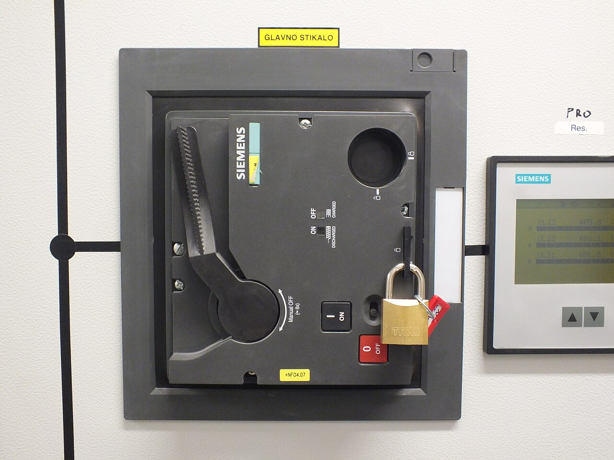
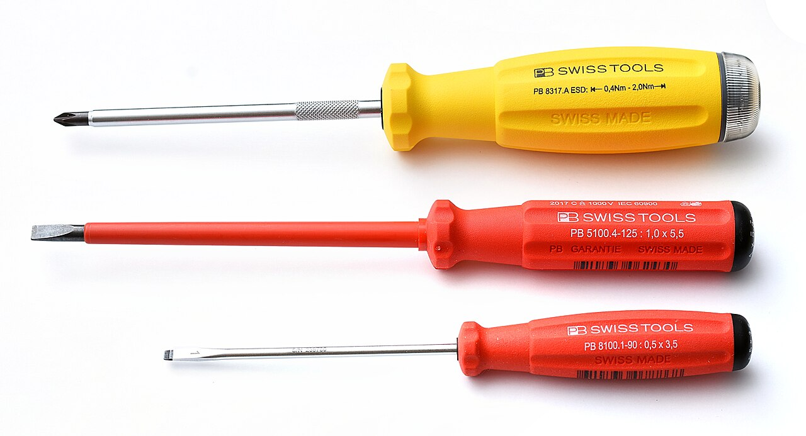
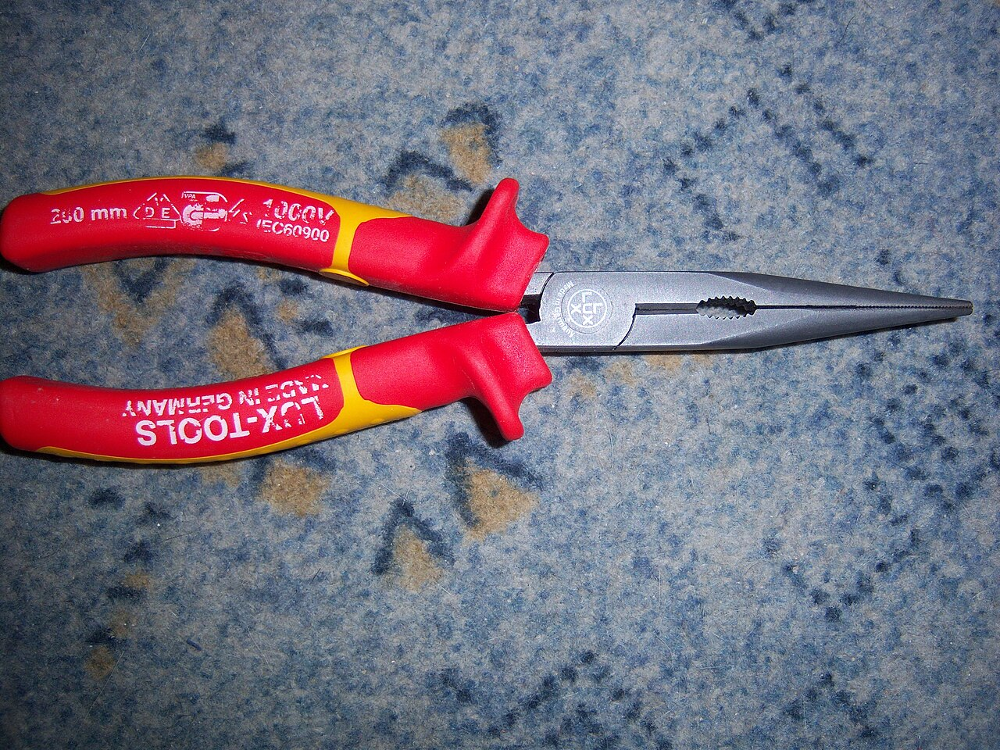
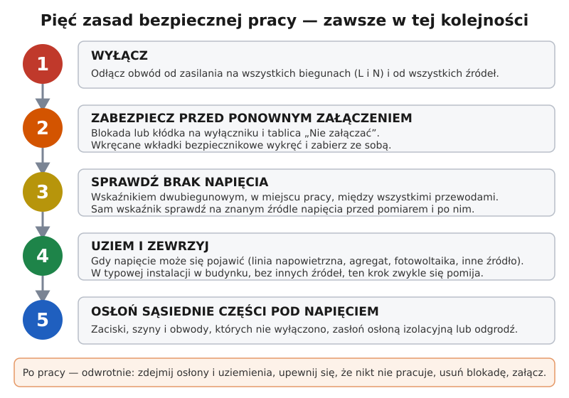
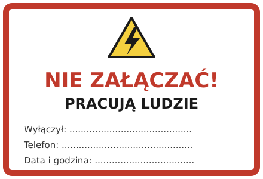

# 00.01 — Pięć zasad bezpiecznej pracy przy urządzeniach elektrycznych

> **Moduł:** [00 — Zanim dotkniesz czegokolwiek](README.md) · **Oznaczenia:** 🟢🏠📋 · **Zakres SEP:** (c) (d) · **Status:** ✅ pełny
>
> **Czytaj:**
>
> - Rozporządzenie Ministra Energii z 28 sierpnia 2019 r. w sprawie bezpieczeństwa i higieny pracy przy urządzeniach energetycznych ([Dz.U. 2019 poz. 1830](https://eli.gov.pl/eli/DU/2019/1830/ogl)) — § 24 i § 25 (przygotowanie do pracy przy urządzeniach odłączonych od napięcia)
> - PN-EN 50110-1 *Eksploatacja urządzeń elektrycznych — Część 1: Wymagania ogólne*, rozdz. 6.2 — prace w stanie beznapięciowym (omówienie własnymi słowami, norma nie jest cytowana)
> - Pełna organizacja pracy (polecenia, dopuszczenie, zespoły): [moduł 28](../28-bhp-przy-urzadzeniach/README.md)

← (początek modułu) · [spis modułu](README.md) · [następny temat →](00.02-sprawdzanie-braku-napiecia-probnik-dwubiegunowy.md)

## Po co to jest

Prawie każdy wypadek przy instalacji domowej ma tę samą przyczynę: ktoś był pewien, że „tam nie ma prądu”. Pięć zasad to ustalona kolejność czynności, która zastępuje pewność sprawdzeniem. Obowiązuje przy każdej pracy, od wymiany gniazdka po rozbudowę rozdzielnicy. Na egzaminie kwalifikacyjnym to jedno z najpewniejszych pytań. Komisja oczekuje wymienienia zasad **w kolejności** i wyjaśnienia, po co jest każda z nich.

## Po ludzku

Wyobraź sobie, że masz naprawić kran w mieszkaniu. Najpierw zakręcasz zawór. Potem dbasz, żeby nikt go nie odkręcił, kiedy masz rozkręconą baterię. Potem odkręcasz kurek i sprawdzasz, czy naprawdę nic nie leci. Dopiero wtedy rozkręcasz. Z prądem jest tak samo, tylko błąd nie kończy się mokrą podłogą.

1. **Wyłącz.** Odłącz zasilanie obwodu, przy którym będziesz pracować. Odłącz je ze wszystkich stron, z których może przyjść.
2. **Zabezpiecz przed ponownym załączeniem.** Ktoś w domu nie wie, że pracujesz, widzi wyłączony „bezpiecznik” i go włącza. Ten krok to blokada, tablica i informacja dla domowników.
3. **Sprawdź brak napięcia.** Nie zakładaj, że wyłączyłeś właściwy obwód, tylko to sprawdź. Służy do tego wskaźnik dwubiegunowy, w miejscu pracy, na wszystkich przewodach. Jak to zrobić dobrze, opisuje [następny temat](00.02-sprawdzanie-braku-napiecia-probnik-dwubiegunowy.md).
4. **Uziem i zewrzyj.** Połącz wszystkie przewody robocze ze sobą i z ziemią. Jeśli mimo wszystko pojawi się na nich napięcie, wyłącznik w rozdzielnicy natychmiast zadziała, a Ty nie znajdziesz się pod napięciem. W domowej instalacji bez innych źródeł zasilania ten krok zwykle się pomija.
5. **Osłoń sąsiednie części pod napięciem.** Rzadko da się wyłączyć wszystko. W rozdzielnicy zaciski zasilające wyłącznika głównego są pod napięciem także wtedy, gdy wyłącznik główny jest wyłączony. Takie miejsca zasłania się osłoną izolacyjną.

Po skończonej pracy kolejność jest **odwrotna**. Zdejmujesz osłony i uziemienia, sprawdzasz, że nikt nie pracuje i nie zostawiłeś narzędzi, usuwasz blokadę i dopiero wtedy załączasz.

## Jak to wygląda

*Na co patrzeć: dźwignia wyłącznika głównego jest w pozycji „wyłączone”, a kłódka uniemożliwia jej przestawienie. Klucz ma tylko osoba, która pracuje. To krok 2 w praktyce. W domu odpowiednikiem jest plastikowa blokada zakładana na dźwignię wyłącznika nadprądowego (dostępna w sklepach elektrycznych) albo przynajmniej taśma i kartka.*

*Na co patrzeć: trzonek jest pokryty izolacją prawie do samego grotu. Narzędzia izolowane mają na rękojeści oznaczenie „1000 V” i symbol podwójnego trójkąta. Nie zastępują wyłączenia napięcia. Chronią przed skutkami pomyłki, na przykład przypadkowego dotknięcia sąsiedniego zacisku.*

*Na co patrzeć: dwukolorowa rękojeść z napisem „1000 V”. Jeśli zewnętrzna warstwa jest przetarta i widać spod niej inny kolor, narzędzie trzeba wymienić.*

## Schemat

*Tablicę można wydrukować i przykleić przy wyłączonym wyłączniku. Pola „Wyłączył” i „Telefon” mówią każdemu, kogo zapytać, zanim cokolwiek załączy.*

## Pojęcia

| Pojęcie | Po ludzku | Termin normowy / symbol |
|---------|-----------|-------------------------|
| Odłączenie | Rozłączenie obwodu od wszystkich źródeł zasilania | odłączenie od napięcia, stan beznapięciowy |
| Zabezpieczenie przed załączeniem | Zrobienie wszystkiego, żeby nikt przypadkiem nie włączył obwodu z powrotem | zabezpieczenie przed ponownym załączeniem |
| Wskaźnik napięcia | Przyrząd do sprawdzenia, czy jest napięcie, z dwiema sondami | dwubiegunowy wskaźnik napięcia (PN-EN 61243-3) |
| Uziemienie i zwarcie | Połączenie przewodów ze sobą i z ziemią na czas pracy | uziemiacz przenośny, uziemienie ochronne robocze |
| Część czynna | Element, który w normalnej pracy jest pod napięciem (także przewód N) | część czynna |
| Strefa pracy | Miejsce przygotowane do pracy, w którym się pracuje | strefa pracy (§ 2 rozporządzenia BHP z 2019 r.) |
| Osoba upoważniona | Osoba, której pracodawca pozwolił wykonywać prace przy urządzeniach | osoba upoważniona (§ 6 rozporządzenia BHP z 2019 r.) |

## Liczby do zapamiętania

| Co | Wartość | Kiedy obowiązuje | Źródło |
|----|---------|------------------|--------|
| Liczba zasad | **5**, zawsze w tej samej kolejności | każda praca przy urządzeniu odłączonym od napięcia | PN-EN 50110-1, rozdz. 6.2 |
| Kolejność po pracy | **odwrotna**: osłony → uziemienia → blokada → załączenie | zakończenie pracy | jw. |
| Ile biegunów odłączać | **wszystkie przewody czynne** (L i N; w trójfazowym L1, L2, L3, N) | odłączanie obwodu | jw. |
| Uziemienie | jeśli wymaga tego technologia prac; w instalacji nN bez ryzyka pojawienia się napięcia zwykle pomijane | instalacje nN w budynkach | rozporządzenie BHP 2019, § 25 ust. 1 |
| Widoczność uziemienia | co najmniej jedno uziemienie widoczne z miejsca pracy | gdy uziemienie jest zakładane | rozporządzenie BHP 2019, § 25 ust. 2 |

## W praktyce

**Przykład: wymiana gniazda w pokoju.**

1. **Wyłącz.** Sprawdź w opisie rozdzielnicy, który wyłącznik zasila ten pokój. Opis bywa nieaktualny, więc podłącz do gniazda lampkę albo radio i wyłączaj kolejne wyłączniki, aż zgaśnie. Jeśli nie masz pewności, wyłącz wyłącznik główny mieszkania.
2. **Zabezpiecz.** Na dźwignię wyłącznika załóż blokadę albo zaklej ją taśmą i przyklej [tablicę](../../assets/schematy/00-tablica-nie-zalaczac.svg). Powiedz domownikom, że pracujesz. Jeśli rozdzielnica ma drzwiczki zamykane na klucz, zamknij je i zabierz klucz.
3. **Sprawdź brak napięcia** wskaźnikiem dwubiegunowym na zaciskach gniazda, po zdjęciu osłony. Najpierw sprawdź wskaźnik na innym, działającym gnieździe, potem zmierz, potem sprawdź wskaźnik znowu (szczegóły w [00.02](00.02-sprawdzanie-braku-napiecia-probnik-dwubiegunowy.md)).
4. **Uziemienie i zwarcie** w tej sytuacji pomijasz, bo obwód nie ma innego źródła zasilania. Jeśli w domu jest fotowoltaika, agregat albo magazyn energii, zastanów się, czy na pewno.
5. **Osłoń.** W puszce za gniazdem mogą być przewody innego obwodu, który nadal jest pod napięciem. Nie zakładaj, że wszystko, co widzisz w puszce, jest wyłączone. Sprawdź każdy przewód, a te pod napięciem odsuń i zaizoluj.

**Po pracy:** zamknij gniazdo, sprawdź, czy nie zostały narzędzia ani odcinki przewodów, zdejmij blokadę i tablicę, załącz. Sprawdź działanie, najlepiej testerem gniazd, a przy wyłączniku różnicowoprądowym naciśnij przycisk TEST.

**Skąd może przyjść napięcie, choć „wszystko wyłączone”:**

- z drugiego wyłącznika — płyty indukcyjne i kuchenki bywają zasilane z dwóch lub trzech wyłączników jednocześnie,
- z innego obwodu, którego przewody przechodzą przez tę samą puszkę,
- z fotowoltaiki, magazynu energii, agregatu albo UPS-a,
- od sąsiada albo z części wspólnej budynku (zdarza się w starych blokach przy przeróbkach),
- z kondensatorów, na przykład w zasilaczach LED i silnikach. Ładunek może utrzymywać się chwilę po wyłączeniu.

## Błędy i zagrożenia

- ⚠️ **Wyłączenie łącznikiem na ścianie zamiast w rozdzielnicy.** Łącznik światła przerywa zwykle tylko jeden przewód. Jeśli ktoś pomylił L z N, po wyłączeniu łącznika na oprawie nadal jest faza. Do pracy wyłączaj obwód w rozdzielnicy.
- ⚠️ **Pominięcie kroku 3, bo „przecież wyłączyłem”.** Opisy w rozdzielnicach często są błędne, a w puszkach bywają przewody z kilku obwodów. To najczęstsza droga do porażenia.
- ⚠️ **Sprawdzanie neonówką.** Neonówka może nie zaświecić mimo napięcia (dlaczego — w [00.02](00.02-sprawdzanie-braku-napiecia-probnik-dwubiegunowy.md)).
- ⚠️ **Wyłączony wyłącznik główny ≠ martwa rozdzielnica.** Zaciski zasilające wyłącznika głównego i przewody, które do niego dochodzą, są nadal pod napięciem.
- **Brak informacji dla domowników.** Wyłączony wyłącznik i ciemny pokój to dla wielu osób sygnał „coś wybiło, trzeba włączyć”.
- **Pośpiech przy kończeniu pracy.** Załączenie przed zamknięciem gniazda albo z narzędziem w puszce to zwarcie z łukiem tuż przy rękach.

## Przykład

**Sytuacja.** Wymieniasz lampę sufitową w przedpokoju. Wyłączyłeś łącznik na ścianie i wyłącznik opisany jako „Oświetlenie przedpokój”. Wskaźnik dwubiegunowy między dwoma przewodami w suficie (brązowym i niebieskim) pokazuje 0 V. Między brązowym a żółto-zielonym pokazuje 230 V.

**Co to znaczy?** Brązowy przewód jest pod napięciem względem ziemi. Wyłącznik z opisu nie zasila tej lampy albo zasila ją tylko częściowo. Brak napięcia między L i N wynika z tego, że przewód niebieski w tej puszce nie jest przewodem neutralnym tego obwodu albo jest przerwany. Gdybyś sprawdził tylko jedną parę przewodów, uznałbyś, że możesz pracować.

**Wniosek.** Brak napięcia sprawdza się **między wszystkimi parami przewodów**, także względem PE. Tu trzeba znaleźć właściwy wyłącznik (albo wyłączyć główny) i powtórzyć pomiar. Opis w rozdzielnicy trzeba poprawić.

## Pytania SEP

1. **Wymień pięć zasad bezpiecznej pracy przy urządzeniach elektrycznych w odpowiedniej kolejności.**

Odpowiedź

Wyłączyć, czyli odłączyć urządzenie od wszystkich źródeł zasilania na wszystkich biegunach. Zabezpieczyć przed ponownym załączeniem, czyli zablokować łącznik, wywiesić tablicę ostrzegawczą i wyjąć wkładki bezpiecznikowe. Sprawdzić brak napięcia wskaźnikiem dwubiegunowym w miejscu pracy. Uziemić i zewrzeć, jeśli wymaga tego technologia prac albo napięcie może się pojawić. Osłonić lub wygrodzić sąsiednie części, które pozostają pod napięciem. Po pracy wykonuje się te czynności w odwrotnej kolejności.

2. **Na czym polega zabezpieczenie przed ponownym załączeniem?**

Odpowiedź

Na takim zabezpieczeniu miejsca odłączenia, żeby nikt nie mógł załączyć napięcia przypadkiem ani celowo. Stosuje się blokady mechaniczne i kłódki na napędach łączników, wyjęcie wkładek bezpiecznikowych, zamknięcie rozdzielnicy na klucz oraz tablice ostrzegawcze typu „Nie załączać — pracują ludzie”. Rozporządzenie BHP z 2019 r. wymaga też widocznego oznaczenia miejsc odłączenia (§ 25 ust. 1).

3. **Kiedy przy pracach w instalacji niskiego napięcia zakłada się uziemienie i zwarcie?**

Odpowiedź

Gdy istnieje ryzyko pojawienia się napięcia na odłączonej części, na przykład przy liniach napowietrznych, przy zasilaniu z kilku stron, przy agregacie lub fotowoltaice, albo gdy wymaga tego instrukcja i technologia prac. Uziemienie i zwarcie sprawia, że pojawienie się napięcia wywoła zwarcie i zadziałanie zabezpieczenia, a nie porażenie pracownika. Uziemienie zakłada się tak, żeby co najmniej jedno było widoczne z miejsca pracy. W typowej instalacji wewnętrznej bez innych źródeł zasilania ten krok zwykle się pomija.

4. **Dlaczego po wyłączeniu wyłącznika głównego w rozdzielnicy nie wolno uznać, że cała rozdzielnica jest bez napięcia?**

Odpowiedź

Wyłącznik główny odłącza tylko to, co jest za nim. Jego zaciski zasilające i przewody zasilające rozdzielnicę (WLZ) nadal są pod napięciem, bo są przed nim. Rozdzielnica może też mieć obwody zasilane z innego miejsca albo z dodatkowego źródła, na przykład z fotowoltaiki. Dlatego przed pracą trzeba sprawdzić brak napięcia w miejscu pracy i osłonić części, które pozostają pod napięciem.

5. **Jaka jest kolejność czynności po zakończeniu pracy?**

Odpowiedź

Odwrotna do przygotowania. Usuwa się osłony i uziemienia, sprawdza, czy wszyscy opuścili strefę pracy i nie zostały w niej narzędzia, zdejmuje blokady i tablice, a dopiero na końcu załącza napięcie. W pracach zorganizowanych pracę kończy się formalnie zgodnie z poleceniem ([moduł 28](../28-bhp-przy-urzadzeniach/README.md)).

## Sprawdź się

1. Ułóż w kolejności: *osłonić sąsiednie części czynne*, *sprawdzić brak napięcia*, *wyłączyć*, *uziemić i zewrzeć*, *zabezpieczyć przed ponownym załączeniem*.

Odpowiedź

Wyłączyć → zabezpieczyć przed ponownym załączeniem → sprawdzić brak napięcia → uziemić i zewrzeć → osłonić sąsiednie części czynne.

2. Na zdjęciu [zablokowanego wyłącznika głównego](../../assets/foto/00-wylacznik-glowny-zablokowany.jpg) widać kłódkę. Którą zasadę realizuje? Czego jeszcze brakuje, żeby przygotowanie było kompletne?

Odpowiedź

Zasadę 2, czyli zabezpieczenie przed ponownym załączeniem. Brakuje tablicy z informacją, kto pracuje (sama kłódka nie mówi, kogo pytać). Zostają też dalsze kroki: sprawdzenie braku napięcia w miejscu pracy, ocena potrzeby uziemienia i osłonięcie części, które pozostają pod napięciem.

3. Płyta indukcyjna jest podłączona do rozdzielnicy przez dwa wyłączniki opisane „Płyta 1” i „Płyta 2”. Wyłączyłeś „Płyta 1”. Co pokaże wskaźnik między przewodem brązowym a PE na zaciskach płyty, jeśli brązowy jest zasilany z „Płyta 1”? A co między czarnym a PE?

Odpowiedź

Między brązowym a PE: 0 V. Między czarnym a PE: około 230 V, bo czarny jest zasilany z drugiego wyłącznika. Dlatego trzeba wyłączyć oba wyłączniki i sprawdzić brak napięcia na wszystkich zaciskach.

## Źródła

- Rozporządzenie Ministra Energii z 28 sierpnia 2019 r. w sprawie bezpieczeństwa i higieny pracy przy urządzeniach energetycznych, [Dz.U. 2019 poz. 1830](https://eli.gov.pl/eli/DU/2019/1830/ogl): § 6 (prace wykonują osoby upoważnione), § 24 (wyłączenie napięcia w sposób uniemożliwiający jego pojawienie się), § 25 ust. 1 (zabezpieczenie przed załączeniem, oznaczenie miejsc odłączenia, sprawdzenie braku napięcia, uziemienie, oznaczenie strefy pracy), § 25 ust. 2 (widoczne uziemienie).
- PN-EN 50110-1 *Eksploatacja urządzeń elektrycznych — Część 1: Wymagania ogólne*, rozdz. 6.2 — pięć zasad przy pracach w stanie beznapięciowym.
- PN-EN 61243-3 — dwubiegunowe wskaźniki napięcia niskiego (szczegóły w [00.02](00.02-sprawdzanie-braku-napiecia-probnik-dwubiegunowy.md) i [module 22](../22-przyrzady-pomiarowe/README.md)).

---

← (początek modułu) · [spis modułu](README.md) · [następny temat →](00.02-sprawdzanie-braku-napiecia-probnik-dwubiegunowy.md)
