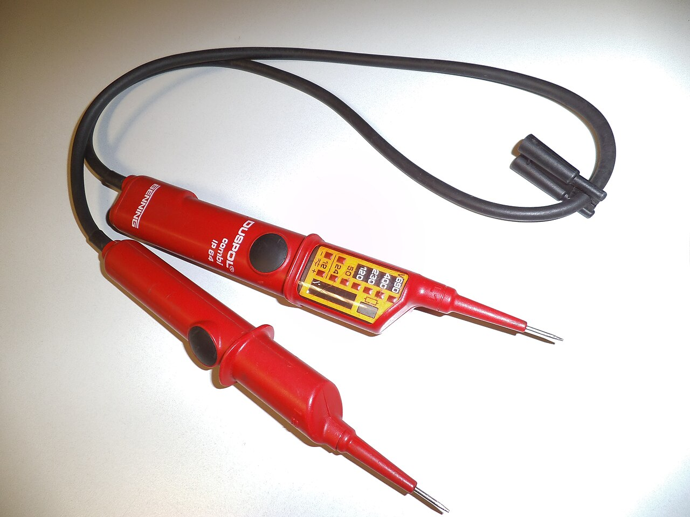
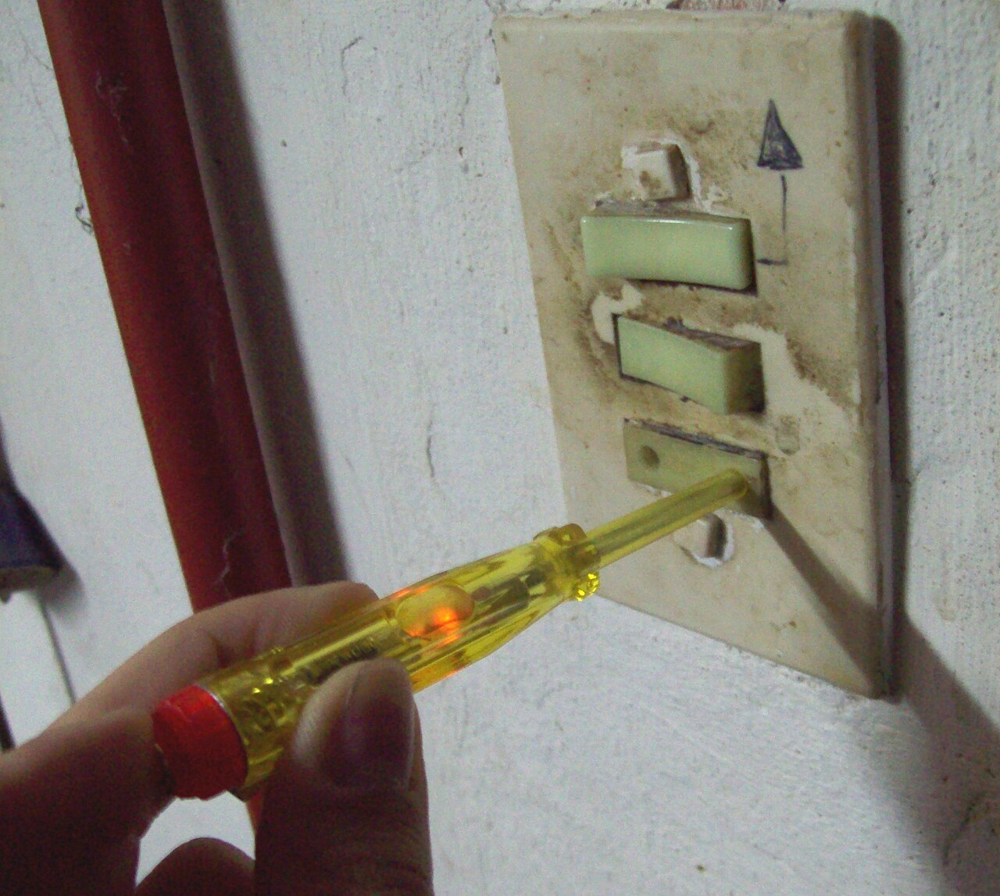
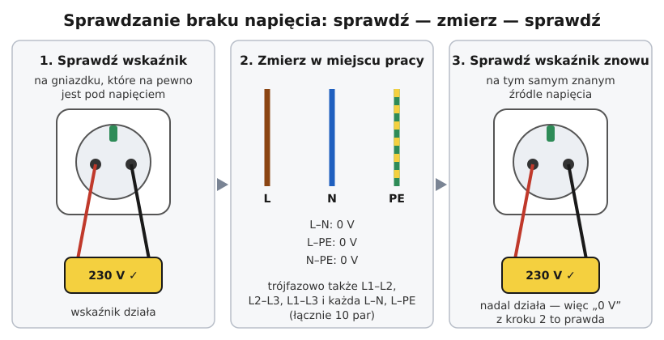
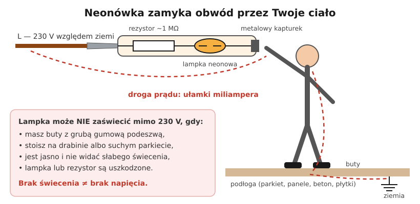

# 00.02 — Sprawdzanie braku napięcia: próbnik dwubiegunowy a śrubokręt z neonówką

> **Moduł:** [00 — Zanim dotkniesz czegokolwiek](README.md) · **Oznaczenia:** 🟢🏠📋 · **Zakres SEP:** (c) (d) · **Status:** ✅ pełny
>
> **Czytaj:**
>
> - PN-EN 61243-3 *Prace pod napięciem — Wskaźniki napięcia — Część 3: Dwubiegunowe wskaźniki napięcia niskiego* (omówienie własnymi słowami)
> - Rozporządzenie BHP przy urządzeniach energetycznych z 2019 r. ([Dz.U. 2019 poz. 1830](https://eli.gov.pl/eli/DU/2019/1830/ogl)), § 25 ust. 1 — obowiązek sprawdzenia braku napięcia
> - Instrukcja Twojego wskaźnika: zakres napięć, kategoria pomiarowa, działanie bez baterii
> - Przyrządy pomiarowe szerzej: [moduł 22](../22-przyrzady-pomiarowe/README.md)

[← poprzedni temat](00.01-piec-zasad-bezpiecznej-pracy-przy-urzadzeniach.md) · [spis modułu](README.md) · [następny temat →](00.03-co-wolno-zrobic-samemu-a-co-wymaga-uprawnien-i.md)

## Po co to jest

Sprawdzenie braku napięcia to trzecia z pięciu zasad i jedyny moment, w którym zamieniasz „wydaje mi się” na „wiem”. Jeśli zrobisz je źle, pozostałe cztery zasady nic nie dają. W domu oznacza to zakup jednego przyrządu za kilkadziesiąt–kilkaset złotych i nauczenie się trzech kroków. Na egzaminie komisja prawie zawsze pyta, czym się sprawdza brak napięcia i dlaczego nie neonówką.

## Po ludzku

**Napięcie zawsze mierzy się między dwoma punktami** (więcej w [01.02](../01-prad-napiecie-opor/01.02-napiecie-roznica-cisnien-miedzy-dwoma-punktami.md)). Wskaźnik dwubiegunowy ma dwie sondy: przykładasz je do dwóch przewodów i przyrząd mówi, czy jest między nimi napięcie. Wynik nie zależy od tego, w jakich butach stoisz ani czy trzymasz się kaloryfera.

**Neonówka** (śrubokręt z lampką) ma jedną sondę. Drugim „biegunem” jesteś Ty: prąd płynie z przewodu przez lampkę, przez Twoją rękę, ciało, buty i podłogę do ziemi. Jest bardzo mały, bo ogranicza go rezystor w rękojeści, ale to i tak Ty zamykasz obwód. Jeśli stoisz na drabinie w gumowych butach, prąd może być za słaby, żeby lampka zaświeciła, choć na przewodzie jest 230 V. **Ciemna neonówka niczego nie dowodzi.**

**Sprawdź — zmierz — sprawdź.** Przyrząd może się zepsuć: pęknięty przewód sondy, rozładowana bateria, uszkodzony wyświetlacz. Zepsuty wskaźnik pokaże „brak napięcia” zawsze. Dlatego:

1. przed pomiarem przyłóż sondy do miejsca, gdzie **na pewno** jest napięcie (inne gniazdo) — wskaźnik musi je pokazać,
2. zmierz w miejscu pracy,
3. po pomiarze sprawdź wskaźnik znowu na tym samym znanym źródle — wtedy wiesz, że działał także w chwili pomiaru.

**Między którymi przewodami?** Między **wszystkimi parami**. W obwodzie jednofazowym to trzy pary: L–N, L–PE, N–PE. W trójfazowym z N i PE jest ich dziesięć: L1–L2, L2–L3, L1–L3, każda faza z N, każda faza z PE i N–PE. Sprawdzenie samego L–N nie wystarczy. Jeśli przewód neutralny jest przerwany albo podłączony gdzie indziej, L–N pokaże zero, choć L względem ziemi ma pełne 230 V ([przykład w 00.01](00.01-piec-zasad-bezpiecznej-pracy-przy-urzadzeniach.md#przykład)).

## Jak to wygląda

*Na co patrzeć: dwie sondy połączone przewodem, a na korpusie skala diod z kolejnymi progami napięcia. Taki przyrząd pokazuje napięcie między sondami, niezależnie od tego, gdzie stoisz. Na obudowie powinny być: zakres napięć, kategoria pomiarowa (np. CAT III lub CAT IV) i oznaczenie zgodności z PN-EN 61243-3.*

*Na co patrzeć: lampka w przezroczystej rękojeści świeci, bo palec dotyka metalowej końcówki, a ciało zamyka obwód do ziemi. Świecenie mówi „tu jest napięcie względem ziemi”. Brak świecenia nie mówi nic, bo mogło go zabraknąć z powodu butów, podłogi albo słońca.*

## Schemat

## Pojęcia

| Pojęcie | Po ludzku | Termin normowy / symbol |
|---------|-----------|-------------------------|
| Wskaźnik dwubiegunowy | Przyrząd z dwiema sondami, pokazuje napięcie między nimi | dwubiegunowy wskaźnik napięcia, PN-EN 61243-3 |
| Neonówka | Wkrętak z lampką, świeci przy dotyku fazy, obwód zamyka ciało | wskaźnik jednobiegunowy (próbnik jednobiegunowy) |
| Sprawdź–zmierz–sprawdź | Test przyrządu przed pomiarem i po nim | potwierdzenie sprawności wskaźnika |
| Napięcie indukowane („fantomowe”) | „Duch” napięcia na wyłączonym przewodzie, który biegnie obok przewodu pod napięciem | napięcie indukowane (sprzężenie pojemnościowe) |
| Wskaźnik z obciążeniem | Wskaźnik, który przy pomiarze pobiera trochę prądu i dzięki temu „gasi” napięcia fantomowe | wskaźnik o małej impedancji wejściowej (LoZ) |
| Kategoria pomiarowa | Odporność przyrządu na przepięcia w danym miejscu instalacji | CAT II, CAT III, CAT IV (PN-EN 61010-1) |

## Liczby do zapamiętania

| Co | Wartość | Kiedy obowiązuje | Źródło |
|----|---------|------------------|--------|
| Pary do sprawdzenia, jednofazowo | **3**: L–N, L–PE, N–PE | obwód z L, N, PE | zasada: wszystkie przewody czynne i PE |
| Pary do sprawdzenia, trójfazowo | **10**: 3 × L–L, 3 × L–N, 3 × L–PE, N–PE | obwód z L1, L2, L3, N, PE | jw. |
| Napięcie fantomowe na multimetrze | może sięgać **kilkudziesięciu V** | wyłączony przewód obok przewodu pod napięciem, przyrząd o dużej impedancji wejściowej | zjawisko fizyczne; [moduł 22](../22-przyrzady-pomiarowe/README.md) |
| Kategoria wskaźnika w instalacji domowej | co najmniej **CAT III** (najlepiej CAT IV przy złączu i liczniku) | wybór przyrządu | PN-EN 61010-1; [moduł 22](../22-przyrzady-pomiarowe/README.md) |
| Kolejność | **sprawdź → zmierz → sprawdź** | każde sprawdzanie braku napięcia | dobra praktyka i instrukcje producentów |

## W praktyce

**Sprawdzanie braku napięcia na zaciskach gniazda (obwód jednofazowy):**

1. Obwód jest wyłączony i zabezpieczony (zasady 1–2 z [00.01](00.01-piec-zasad-bezpiecznej-pracy-przy-urzadzeniach.md)).
2. Weź wskaźnik i obejrzyj go: przewód sond bez pęknięć, osłony na końcówkach, czysta obudowa.
3. **Sprawdź** wskaźnik na gnieździe innego obwodu, które działa. Ma pokazać około 230 V.
4. Zdejmij osłonę gniazda, nie dotykając zacisków.
5. **Zmierz**: sondy na L i N, potem L i PE, potem N i PE. Za każdym razem wynik ma być „brak napięcia”.
6. Jeśli w puszce są inne przewody, sprawdź także je, każdy względem PE i względem pozostałych.
7. **Sprawdź** wskaźnik znowu na tym samym znanym gnieździe. Pokazuje napięcie? Dopiero teraz wynik z kroku 5 jest wiarygodny.

**Gdy pomiar L–PE wyłącza różnicówkę:** niektóre wskaźniki z obciążeniem przy pomiarze między fazą a PE przepuszczają przez PE prąd, który wystarcza do zadziałania wyłącznika różnicowoprądowego 30 mA. To normalne zachowanie przyrządu, a nie usterka instalacji. Wiele wskaźników ma przycisk do włączania obciążenia, więc zwykły pomiar można zrobić bez niego.

**Multimetr zamiast wskaźnika?** Można, ale łatwiej o błąd. Trzeba mieć dobry przyrząd (kategoria CAT III, bezpieczne przewody pomiarowe), ustawić właściwą funkcję (napięcie przemienne) i mieć przewody w gniazdach do pomiaru napięcia, a nie prądu. Multimetr ma bardzo dużą impedancję wejściową, więc pokazuje napięcia fantomowe. Wskaźnik dwubiegunowy nie wymaga wybierania zakresu i jest do tego zadania zrobiony.

**Do czego wolno używać neonówki?** Do szybkiej orientacji, gdy wiesz, że obwód jest pod napięciem, i chcesz znaleźć przewód fazowy. Nigdy do stwierdzenia, że napięcia nie ma. Grot neonówki jest zwykle słaby i nie nadaje się do dokręcania zacisków.

## Błędy i zagrożenia

- ⚠️ **„Neonówka nie świeci, więc nie ma prądu”.** To klasyczny wypadek. Lampka może nie zaświecić z powodu izolujących butów, podłogi, drabiny, jasnego światła albo uszkodzenia.
- ⚠️ **Pomiar tylko L–N.** Przy przerwanym albo cudzym przewodzie N pokaże 0 V, a na L względem ziemi będzie 230 V.
- ⚠️ **Brak testu przyrządu przed pomiarem i po nim.** Zepsuty wskaźnik zawsze pokazuje „bezpiecznie”.
- ⚠️ **Multimetr z przewodem w gnieździe „A” przyłożony do 230 V.** To zwarcie przez przyrząd, łuk i poparzenia dłoni. Przed pomiarem napięcia sprawdzaj, w których gniazdach są przewody.
- **Pomiar w rozdzielnicy zamiast w miejscu pracy.** Między rozdzielnicą a puszką może być inny obwód albo inne zasilanie. Mierzy się tam, gdzie pracujesz.
- **Panika przy napięciu fantomowym.** Multimetr pokazuje kilkadziesiąt woltów na wyłączonym przewodzie? Sprawdź wskaźnikiem z obciążeniem. Jeśli pokazuje zero, to sprzężenie z sąsiednim przewodem. Jeśli pokazuje napięcie, obwód nie jest wyłączony.

## Przykład

**Sytuacja.** W puszce rozgałęźnej wyłączonego obwodu oświetlenia multimetr pokazuje między brązowym przewodem a PE **63 V**. Wskaźnik dwubiegunowy z obciążeniem między tymi samymi przewodami nie pokazuje napięcia, a po teście na gnieździe działa poprawnie.

**Analiza.** Brązowy przewód biegnie w jednej rurce z przewodem innego obwodu, który jest pod napięciem. Między przewodami jest niewielka pojemność. Przez nią na odłączony przewód „przecieka” trochę napięcia, ale za tym napięciem nie stoi prawie żaden prąd. Multimetr ma impedancję wejściową około 10 MΩ i nie obciąża przewodu, więc pokazuje sporą wartość. Wskaźnik z obciążeniem pobiera prąd i napięcie „siada” do zera.

**Wniosek.** To napięcie indukowane, a nie zasilanie. Gdyby jednak wskaźnik z obciążeniem pokazał około 230 V, przewód byłby zasilany i pracy nie wolno zaczynać.

## Pytania SEP

1. **Jakim przyrządem sprawdza się brak napięcia w instalacji niskiego napięcia?**

Odpowiedź

Dwubiegunowym wskaźnikiem napięcia, zgodnym z PN-EN 61243-3, o zakresie i kategorii pomiarowej odpowiednich do miejsca pomiaru. Wskaźnik pokazuje napięcie między dwiema sondami, więc wynik nie zależy od stanowiska ani obuwia pracownika. Przed pomiarem i po nim sprawdza się jego działanie na znanym źródle napięcia. Brak napięcia sprawdza się w miejscu pracy, na wszystkich przewodach.

2. **Dlaczego wskaźnik napięcia sprawdza się przed pomiarem i po pomiarze?**

Odpowiedź

Uszkodzony wskaźnik pokazuje brak napięcia niezależnie od rzeczywistego stanu, na przykład z powodu przerwy w przewodzie sondy albo rozładowanej baterii. Sprawdzenie przed pomiarem potwierdza, że przyrząd działa. Sprawdzenie po pomiarze potwierdza, że nie zepsuł się w trakcie, więc wynik „brak napięcia” był prawdziwy.

3. **Dlaczego wkrętak z lampką neonową nie nadaje się do sprawdzania braku napięcia?**

Odpowiedź

To wskaźnik jednobiegunowy: obwód zamyka się przez ciało człowieka do ziemi. Jeśli człowiek stoi na izolującym podłożu, w butach z grubą podeszwą albo na drabinie, prąd jest za mały, żeby lampka zaświeciła, mimo że napięcie jest. Słabe świecenie trudno też zauważyć w jasnym świetle. Neonówka nie pokazuje też napięcia między przewodami, na przykład między fazami. Jej brak świecenia nie dowodzi braku napięcia.

4. **Między którymi przewodami sprawdza się brak napięcia w obwodzie trójfazowym z przewodami N i PE?**

Odpowiedź

Między wszystkimi parami: L1–L2, L2–L3, L1–L3, każdą fazą a N, każdą fazą a PE oraz między N a PE, czyli dziesięć pomiarów. Samo sprawdzenie faz względem siebie nie wystarczy. Pojedyncza faza może być pod napięciem względem ziemi, a przewód N może mieć napięcie przy przerwie w obwodzie lub błędzie połączeń.

5. **Co to jest napięcie indukowane na odłączonym przewodzie i jak je odróżnić od napięcia zasilania?**

Odpowiedź

To napięcie, które pojawia się na odłączonym przewodzie biegnącym obok przewodu pod napięciem, wskutek sprzężenia pojemnościowego. Przyrząd o dużej impedancji, na przykład multimetr, pokazuje je jako kilkadziesiąt woltów. Za tym napięciem nie stoi jednak praktycznie żaden prąd. Wskaźnik z obciążeniem, czyli o małej impedancji, „rozładowuje” je do zera, a napięcie zasilania pokaże w pełnej wysokości.

## Sprawdź się

1. Elektryk stoi na drewnianej drabinie i dotyka neonówką przewodu w suficie. Lampka nie świeci. Co możesz powiedzieć o napięciu na tym przewodzie?

Odpowiedź

Nic pewnego. Drewniana drabina izoluje, więc obwód przez ciało do ziemi może być zbyt słaby, żeby lampka zaświeciła. Trzeba sprawdzić wskaźnikiem dwubiegunowym między tym przewodem a pozostałymi (N, PE).

2. Wskaźnik dwubiegunowy pokazuje: L–N 0 V, L–PE 0 V, N–PE 0 V. Potem nie da się go przetestować, bo w całym mieszkaniu nie ma prądu. Czy możesz zaczynać pracę?

Odpowiedź

Nie masz potwierdzenia, że wskaźnik działa, więc wynik nie jest pewny. Potrzebne jest inne znane źródło napięcia: gniazdo w części wspólnej, u sąsiada albo tester napięcia (sprawdzacz wskaźników) do tego przeznaczony. Po teście zmierz jeszcze raz.

3. Na [zdjęciu wskaźnika dwubiegunowego](../../assets/foto/00-wskaznik-dwubiegunowy.jpg) jedna sonda ma skalę diod. Dlaczego wskaźnik pokazuje kilka progów napięcia, a nie tylko „jest / nie ma”?

Odpowiedź

Po to, żeby odróżnić napięcie bezpieczne od niebezpiecznego oraz 230 V od 400 V (faza–faza). Dzięki temu od razu wiesz, między jakimi przewodami mierzysz. Na przykład 400 V oznacza dwie różne fazy, a nie fazę i N.

## Źródła

- PN-EN 61243-3 — wymagania dla dwubiegunowych wskaźników napięcia niskiego.
- PN-EN 61010-1 — kategorie pomiarowe przyrządów (szerzej w [module 22](../22-przyrzady-pomiarowe/README.md)).
- Rozporządzenie BHP przy urządzeniach energetycznych z 2019 r., [Dz.U. 2019 poz. 1830](https://eli.gov.pl/eli/DU/2019/1830/ogl), § 25 ust. 1 — sprawdzenie braku napięcia na odłączonych urządzeniach.
- Instrukcje obsługi wskaźników dwubiegunowych producentów (np. Benning, Fluke, Sonel) — rozdziały o teście przed użyciem i o pomiarze z obciążeniem.

---

[← poprzedni temat](00.01-piec-zasad-bezpiecznej-pracy-przy-urzadzeniach.md) · [spis modułu](README.md) · [następny temat →](00.03-co-wolno-zrobic-samemu-a-co-wymaga-uprawnien-i.md)
