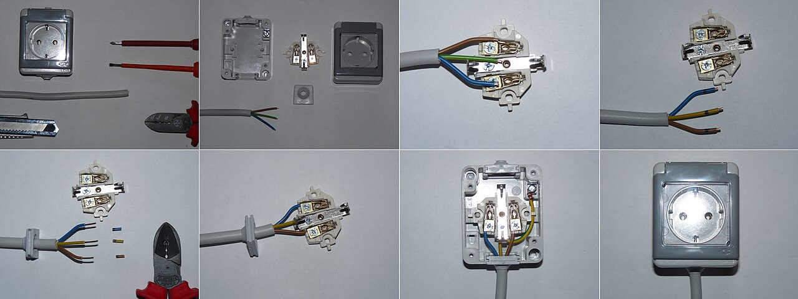
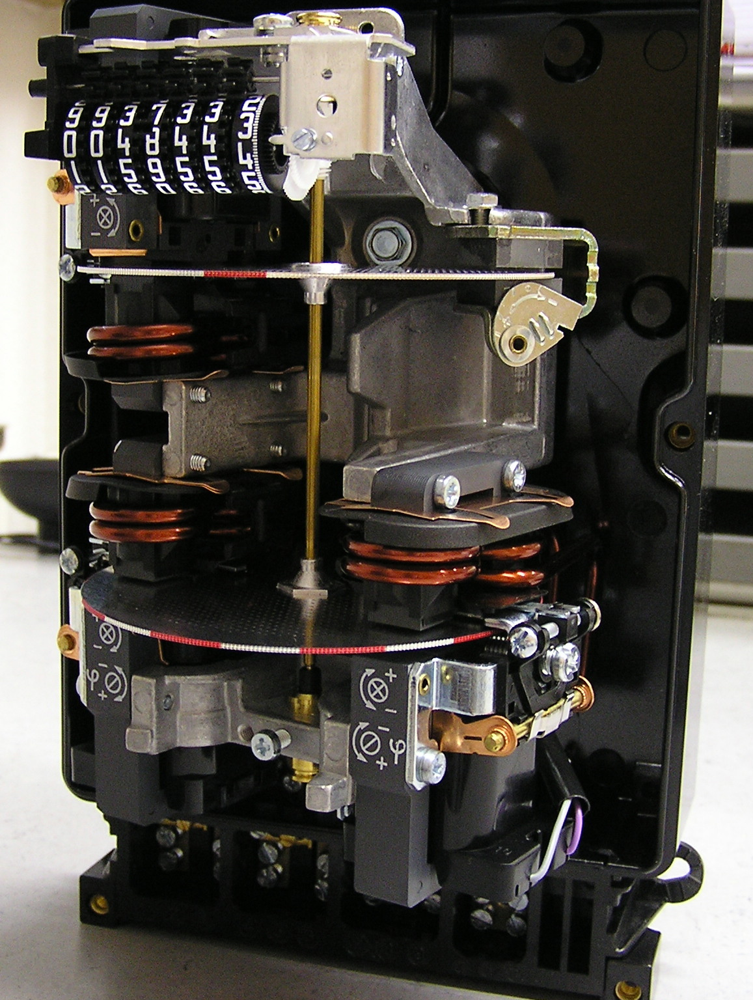
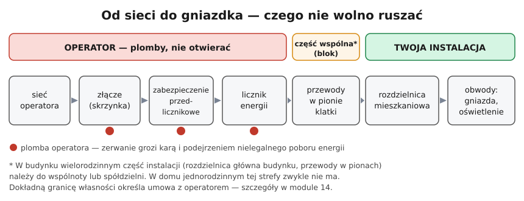

# 00.03 — Co wolno zrobić samemu, a co wymaga uprawnień i pomiarów

> **Moduł:** [00 — Zanim dotkniesz czegokolwiek](README.md) · **Oznaczenia:** 🟢🏠📋 · **Zakres SEP:** (c) (d) · **Status:** ✅ pełny
>
> **Czytaj:**
>
> - Ustawa z 10 kwietnia 1997 r. — Prawo energetyczne, art. 54 ust. 1 i 1aa (obowiązek świadectwa, ważność 5 lat)
> - Rozporządzenie Ministra Klimatu i Środowiska z 1 lipca 2022 r. ([Dz.U. 2022 poz. 1392](https://eli.gov.pl/api/acts/DU/2022/1392/text.html)) — § 4 (rodzaje prac), § 5 (kiedy świadectwo nie jest wymagane)
> - Ustawa z 7 lipca 1994 r. — Prawo budowlane, art. 62 ust. 1 pkt 2 i ust. 5 (kontrola instalacji co 5 lat i kto ją wykonuje)
> - Grupy, punkty i stanowiska E/D: [sep/README.md](../../sep/README.md)

[← poprzedni temat](00.02-sprawdzanie-braku-napiecia-probnik-dwubiegunowy.md) · [spis modułu](README.md) · [następny temat →](00.04-czerwone-flagi-kiedy-przerwac-prace-i-wezwac.md)

> ℹ️ Ten temat opisuje przepisy na poziomie potrzebnym do nauki i egzaminu. Nie jest poradą prawną. W konkretnej sprawie (ubezpieczenie, odbiór budynku, spór z wykonawcą) sprawdź aktualny tekst przepisów albo zapytaj prawnika.

## Po co to jest

Zanim weźmiesz wkrętak do ręki, warto wiedzieć trzy rzeczy. Czy przepisy wymagają do tej pracy świadectwa kwalifikacyjnego. Kto odpowiada, jeśli coś pójdzie źle. Kiedy po pracy potrzebne są pomiary, których bez przyrządu i kwalifikacji nie zrobisz. Na egzaminie kwalifikacyjnym pada pytanie o to, kiedy świadectwo nie jest wymagane, na jak długo jest wydawane i kto może badać instalacje w budynkach.

## Po ludzku

**Prawo** wymaga świadectwa kwalifikacyjnego od osób, które zajmują się eksploatacją urządzeń, instalacji i sieci. Eksploatacja to obsługa, konserwacja, remont i naprawa, montaż i demontaż oraz czynności kontrolno-pomiarowe. Przepisy są pisane z myślą o pracy zawodowej: dla pracodawców, firm wykonawczych i ich pracowników. Nie mówią wprost, czy właściciel może sam wymienić gniazdko we własnym mieszkaniu, i ten temat bywa różnie interpretowany. Jedno jest pewne: **za skutki odpowiada ten, kto pracę wykonał**, a pożar od źle dokręconego zacisku wybucha niezależnie od interpretacji przepisów.

**Obsługa jest wolna.** Załączanie i wyłączanie urządzeń, naciśnięcie przycisku TEST na różnicówce czy włączenie wyłącznika po zadziałaniu to obsługa. Rozporządzenie zwalnia ją z obowiązku świadectwa przy urządzeniach do 1 kV i 20 kW, jeśli instrukcja urządzenia opisuje zasady obsługi.

**Zmiana instalacji = pomiary.** Wymiana gniazda na identyczne to naprawa. Nowe gniazdo, nowy obwód, przeróbka w rozdzielnicy to zmiana instalacji. Norma o sprawdzaniu instalacji wymaga, żeby każdą nową instalację i każdą zmianę sprawdzić przed oddaniem do użytku: oględziny, ciągłość przewodów ochronnych, rezystancja izolacji, skuteczność ochrony (moduł 23). Bez miernika instalacji i kwalifikacji nie zrobisz tego samodzielnie.

**Przed licznikiem nic nie jest Twoje.** Złącze, zabezpieczenie przedlicznikowe i licznik należą do operatora sieci i są zaplombowane. Zerwanie plomby może skończyć się karą i podejrzeniem nielegalnego poboru energii.

**Budynek ma badania okresowe.** Prawo budowlane wymaga kontroli stanu technicznego budynku co najmniej raz na 5 lat, razem z badaniem instalacji elektrycznej i piorunochronnej. Dotyczy to także domów jednorodzinnych. Te kontrole mogą przeprowadzać osoby z kwalifikacjami wymaganymi przy **dozorze** (świadectwo D).

## Jak to wygląda

*Na co patrzeć: wymiana gniazda to praca, którą wiele osób robi samodzielnie: zdjęcie osłony, odkręcenie zacisków, podłączenie tych samych żył do nowego gniazda. Na zdjęciach jest gniazdo z bocznymi stykami ochronnymi (typ niemiecki), w Polsce standardem jest gniazdo z bolcem. Nawet tak prosta praca zaczyna się od pięciu zasad, a kończy sprawdzeniem.*

*Na co patrzeć: tak wygląda licznik w środku, ale w normalnych warunkach zobaczysz go tylko zamkniętego i zaplombowanego. Licznik należy do operatora sieci, a każda ingerencja w niego albo w zabezpieczenie przedlicznikowe jest zabroniona.*

## Schemat

**Sygnalizator: co wolno w domu.**

| Poziom | Przykłady prac | Warunki |
|--------|----------------|---------|
| 🟢 **obsługa** | włączanie i wyłączanie wyłączników, przycisk TEST różnicówki, wymiana żarówki, ponowne załączenie wyłącznika po zadziałaniu (gdy znasz przyczynę), odczyt licznika, oględziny | brak świadectwa (§ 5 rozporządzenia z 2022 r.); zdrowy rozsądek |
| 🟡 **naprawa 1:1** | wymiana gniazda lub łącznika na taki sam, wymiana oprawy oświetleniowej w tym samym miejscu, wymiana wtyczki w przedłużaczu | wiedza z modułów 00–06, pięć zasad, sprawdzenie po pracy (co najmniej tester gniazd, a najlepiej pomiar); przy wątpliwościach — elektryk |
| 🔴 **zmiana instalacji** | nowy obwód, nowe gniazda i łączniki tam, gdzie ich nie było, prace w rozdzielnicy, wymiana zabezpieczeń, łazienka, płyta indukcyjna na nowym obwodzie, fotowoltaika, pompa ciepła, ładowarka samochodu, agregat | osoba ze świadectwem kwalifikacyjnym; po pracy pomiary odbiorcze i protokół (moduł 23) |
| ⛔ **nigdy** | złącze, zabezpieczenie przedlicznikowe, licznik, zrywanie plomb; prace pod napięciem | wyłącznie operator sieci; prace pod napięciem tylko przy specjalnych procedurach (moduł 28) |

## Pojęcia

| Pojęcie | Po ludzku | Termin normowy / symbol |
|---------|-----------|-------------------------|
| Eksploatacja | Wszystko, co się robi z instalacją po jej zbudowaniu | eksploatacja: obsługa, konserwacja, remont, naprawa, montaż, demontaż, czynności kontrolno-pomiarowe (§ 4 rozporządzenia z 2022 r.) |
| Obsługa | Włączanie, wyłączanie, zmiana nastaw | obsługa — czynności wpływające na zmiany parametrów pracy |
| Świadectwo kwalifikacyjne | Dokument po egzaminie, potocznie „uprawnienia SEP” | świadectwo kwalifikacyjne (art. 54 Prawa energetycznego) |
| Stanowisko E / D | Wykonujesz prace / kierujesz i nadzorujesz | eksploatacja (E), dozór (D) |
| Sprawdzenie odbiorcze | Oględziny i pomiary nowej lub zmienionej instalacji przed użytkowaniem | sprawdzanie odbiorcze (PN-HD 60364-6) |
| Kontrola okresowa | Przegląd budynku i instalacji co najmniej raz na 5 lat | kontrola okresowa (art. 62 ust. 1 pkt 2 Prawa budowlanego) |
| Plomba | Zabezpieczenie operatora na liczniku i zabezpieczeniu przedlicznikowym | plomba, oznaczenie zabezpieczające |

## Liczby do zapamiętania

| Co | Wartość | Kiedy obowiązuje | Źródło |
|----|---------|------------------|--------|
| Obsługa bez świadectwa — urządzenia elektryczne | **do 1 kV i do 20 kW** | gdy dokumentacja urządzenia określa zasady obsługi; dotyczy tylko obsługi | rozporządzenie z 2022 r., § 5 pkt 1 |
| Obsługa bez świadectwa — urządzenia cieplne | **do 50 kW** | tylko obsługa | rozporządzenie z 2022 r., § 5 pkt 2 |
| Ważność świadectwa kwalifikacyjnego | **5 lat** od dnia wydania | świadectwa dla osób zajmujących się eksploatacją | Prawo energetyczne, art. 54 ust. 1aa |
| Kontrola okresowa budynku z badaniem instalacji elektrycznej | **co najmniej raz na 5 lat** | każdy obiekt budowlany, także dom jednorodzinny | Prawo budowlane, art. 62 ust. 1 pkt 2 |
| Kto może badać instalację w ramach kontroli | osoba z kwalifikacjami **dozoru** | kontrola z art. 62 ust. 1 pkt 2 | Prawo budowlane, art. 62 ust. 5 |

## W praktyce

**Zanim zaczniesz, odpowiedz na pięć pytań:**

1. **Czy to obsługa, naprawa 1:1, czy zmiana instalacji?** Zmiana instalacji (nowy punkt, nowy obwód, rozdzielnica) wymaga pomiarów po pracy.
2. **Czy wiem, jak to działa?** Jeśli nie umiesz narysować schematu tego, co podłączasz, nie podłączaj.
3. **Czy mogę zastosować pięć zasad?** Masz wskaźnik dwubiegunowy, wiesz, który wyłącznik wyłączyć, i możesz go zablokować.
4. **Czy instalacja jest w stanie, który pozwala pracować?** Aluminium, brak przewodu ochronnego, ślady przegrzania to [czerwone flagi](00.04-czerwone-flagi-kiedy-przerwac-prace-i-wezwac.md).
5. **Jak sprawdzę efekt?** Tester gniazd sprawdzi biegunowość i obecność PE. Rezystancji izolacji ani skuteczności ochrony nim nie zmierzysz.

**Współpraca z elektrykiem.** Pracę przygotowawczą (bruzdy, puszki, przeciąganie przewodów) można często zrobić samemu. Trzeba to wcześniej uzgodnić z elektrykiem, który podłączy instalację, wykona pomiary i podpisze protokół. Wiele osób nie zgodzi się na odbiór pracy, której nie widziało w trakcie.

## Błędy i zagrożenia

- ⚠️ **„Tylko dołożę gniazdko” z najbliższej puszki.** Nowe gniazdo to dodatkowe obciążenie obwodu (moduł 01.05) i często przewód o innym przekroju niż reszta obwodu. To zmiana instalacji, która wymaga sprawdzenia.
- ⚠️ **Praca w rozdzielnicy „na czuja”.** Wymiana wyłącznika na „mocniejszy”, bo wybija, to najprostsza droga do pożaru. Zabezpieczenie chroni przewód, a nie odwrotnie (moduł 07).
- ⚠️ **Zrywanie plomb** albo zmiany przed licznikiem. Grozi to karą i jest niebezpieczne: zabezpieczenie przedlicznikowe ma bardzo dużą zdolność zwarciową, a po stronie zasilania nie ma czego wyłączyć.
- **Brak dokumentacji zmian.** Po kilku latach nikt nie wie, co gdzie jest podłączone. Każdą zmianę dopisz do opisu rozdzielnicy i schematu.
- **Pominięcie przeglądu pięcioletniego.** Obowiązek dotyczy także domów jednorodzinnych. Przy szkodzie ubezpieczyciel może zapytać o stan instalacji.

## Przykład

**Sytuacja.** Remontujesz mieszkanie. Plan: (a) wymienić wszystkie stare gniazda i łączniki na nowe w tych samych miejscach, (b) dołożyć dwa gniazda nad blatem w kuchni z istniejącego obwodu gniazd, (c) poprowadzić nowy obwód do piekarnika z nowym wyłącznikiem w rozdzielnicy, (d) przenieść kinkiet w łazience.

**Klasyfikacja.**

- (a) **naprawa 1:1** 🟡: możliwa samodzielnie z pięcioma zasadami, ale przy wymianie wszystkiego warto zamówić pomiary. Przy okazji wyjdą na jaw stare błędy (brak PE, zamienione L/N).
- (b) **zmiana instalacji** 🔴: zwiększasz obciążenie obwodu i dokładasz punkty w kuchni, gdzie pracują urządzenia dużej mocy. Trzeba sprawdzić przekrój, zabezpieczenie i ochronę różnicowoprądową.
- (c) **zmiana instalacji** 🔴: praca w rozdzielnicy. Obowiązkowe pomiary odbiorcze i protokół.
- (d) **zmiana instalacji w pomieszczeniu szczególnym** 🔴: w łazience obowiązują strefy (moduł 17). To zadanie dla osoby z kwalifikacjami.

**Wniosek.** Najrozsądniej przygotować bruzdy i puszki samemu, a podłączenia, rozdzielnicę i pomiary zlecić jednej osobie ze świadectwem, która zrobi dokumentację całości.

## Pytania SEP

1. **Jakie prace zalicza się do eksploatacji urządzeń, instalacji i sieci?**

Odpowiedź

Według § 4 rozporządzenia z 2022 r. są to czynności w zakresie: obsługi (zmiany parametrów pracy), konserwacji (utrzymanie należytego stanu technicznego), remontu lub naprawy (usuwanie usterek i awarii), montażu lub demontażu (instalowanie, przyłączanie i odłączanie) oraz czynności kontrolno-pomiarowych (oględziny, ocena stanu technicznego, pomiary). Prace wykonuje się z zachowaniem zasad BHP i ochrony środowiska.

2. **Kiedy świadectwo kwalifikacyjne nie jest wymagane?**

Odpowiedź

Według § 5 rozporządzenia z 2022 r. nie jest wymagane do czynności związanych z obsługą urządzeń elektrycznych o napięciu znamionowym nie wyższym niż 1 kV i mocy znamionowej nie wyższej niż 20 kW, jeżeli dokumentacja urządzenia określa zasady jego obsługi. Nie jest też wymagane do obsługi urządzeń i instalacji cieplnych o mocy do 50 kW. Wyjątek dotyczy tylko obsługi, a nie montażu, napraw czy pomiarów.

3. **Na jaki okres wydaje się świadectwo kwalifikacyjne?**

Odpowiedź

Świadectwa osób zajmujących się eksploatacją tracą ważność po upływie 5 lat od dnia wydania (art. 54 ust. 1aa Prawa energetycznego). Żeby dalej wykonywać prace, trzeba ponownie zdać egzamin przed komisją. Pracodawca, inspektor pracy lub Prezes URE mogą też zażądać ponownego sprawdzenia kwalifikacji wcześniej, jeśli stwierdzono, że urządzenia są eksploatowane niezgodnie z przepisami (art. 54 ust. 1b).

4. **Jak często trzeba badać instalację elektryczną w budynku i kto może to robić?**

Odpowiedź

Prawo budowlane (art. 62 ust. 1 pkt 2) wymaga kontroli okresowej co najmniej raz na 5 lat. Obejmuje ona badanie instalacji elektrycznej i piorunochronnej w zakresie stanu sprawności połączeń, osprzętu, zabezpieczeń i środków ochrony przeciwporażeniowej, rezystancji izolacji i uziemień. Obowiązek dotyczy także domów jednorodzinnych. Wyłączenie z art. 62 ust. 2 dotyczy tylko kontroli rocznej. Kontrolę instalacji mogą przeprowadzać osoby z kwalifikacjami wymaganymi przy dozorze nad eksploatacją urządzeń, instalacji i sieci energetycznych (art. 62 ust. 5).

5. **Kiedy instalację trzeba poddać sprawdzeniu odbiorczemu?**

Odpowiedź

Przed oddaniem do użytku nowej instalacji oraz po każdej rozbudowie lub zmianie istniejącej instalacji. Sprawdzenie obejmuje oględziny oraz próby i pomiary: ciągłość przewodów ochronnych, rezystancję izolacji, skuteczność samoczynnego wyłączenia zasilania, działanie wyłączników różnicowoprądowych. Wymagania podaje PN-HD 60364-6, a wynik dokumentuje się w protokole (moduł 23).

## Sprawdź się

1. Przypisz poziom (🟢 / 🟡 / 🔴 / ⛔): wymiana bezpiecznika gwintowego przed licznikiem; naciśnięcie TEST na różnicówce; dołożenie gniazda na balkonie; wymiana łącznika schodowego na identyczny; przeniesienie rozdzielnicy do przedpokoju.

Odpowiedź

Bezpiecznik przed licznikiem: ⛔ (operator). TEST różnicówki: 🟢. Gniazdo na balkonie: 🔴 (nowy punkt, w dodatku na zewnątrz — moduł 17). Łącznik schodowy 1:1: 🟡. Przeniesienie rozdzielnicy: 🔴.

2. Twój pracodawca jest firmą sprzątającą. Pracownik ma obsługiwać szorowarkę 2 kW na 230 V zgodnie z instrukcją producenta. Czy potrzebuje świadectwa kwalifikacyjnego?

Odpowiedź

Nie. To obsługa urządzenia o napięciu do 1 kV i mocy do 20 kW, a dokumentacja określa zasady obsługi (§ 5 pkt 1 rozporządzenia z 2022 r.). Gdyby miał naprawiać szorowarkę albo wymieniać w niej przewód, to już nie byłaby obsługa.

3. Na schemacie [„od sieci do gniazdka”](../../assets/schematy/00-czyje-co-jest.svg) wskaż, gdzie są plomby i od którego miejsca zaczyna się Twoja instalacja.

Odpowiedź

Plomby są na złączu, zabezpieczeniu przedlicznikowym i liczniku, czyli w strefie operatora. Twoja instalacja zaczyna się zwykle za licznikiem. W bloku przewody w pionach klatki mogą należeć do wspólnoty lub spółdzielni. Dokładną granicę określa umowa z operatorem (moduł 14).

## Źródła

- Ustawa z 10 kwietnia 1997 r. — Prawo energetyczne (tekst jednolity Dz.U. 2026 poz. 43), art. 54 ust. 1 (obowiązek kwalifikacji potwierdzonych świadectwem), ust. 1aa (ważność 5 lat), ust. 1b (ponowne sprawdzenie).
- Rozporządzenie Ministra Klimatu i Środowiska z 1 lipca 2022 r., [Dz.U. 2022 poz. 1392](https://eli.gov.pl/api/acts/DU/2022/1392/text.html): § 4 (rodzaje prac i stanowisk), § 5 (wyjątki dla obsługi).
- Ustawa z 7 lipca 1994 r. — Prawo budowlane, art. 62 ust. 1 pkt 2 (kontrola co najmniej raz na 5 lat, badanie instalacji elektrycznej i piorunochronnej), ust. 2 (wyłączenia dotyczą kontroli rocznej), ust. 5 (kwalifikacje osób kontrolujących).
- PN-HD 60364-6 — sprawdzanie odbiorcze i okresowe instalacji (szczegóły w [module 23](../23-pomiary-odbiorcze-i-okresowe/README.md)).

---

[← poprzedni temat](00.02-sprawdzanie-braku-napiecia-probnik-dwubiegunowy.md) · [spis modułu](README.md) · [następny temat →](00.04-czerwone-flagi-kiedy-przerwac-prace-i-wezwac.md)
