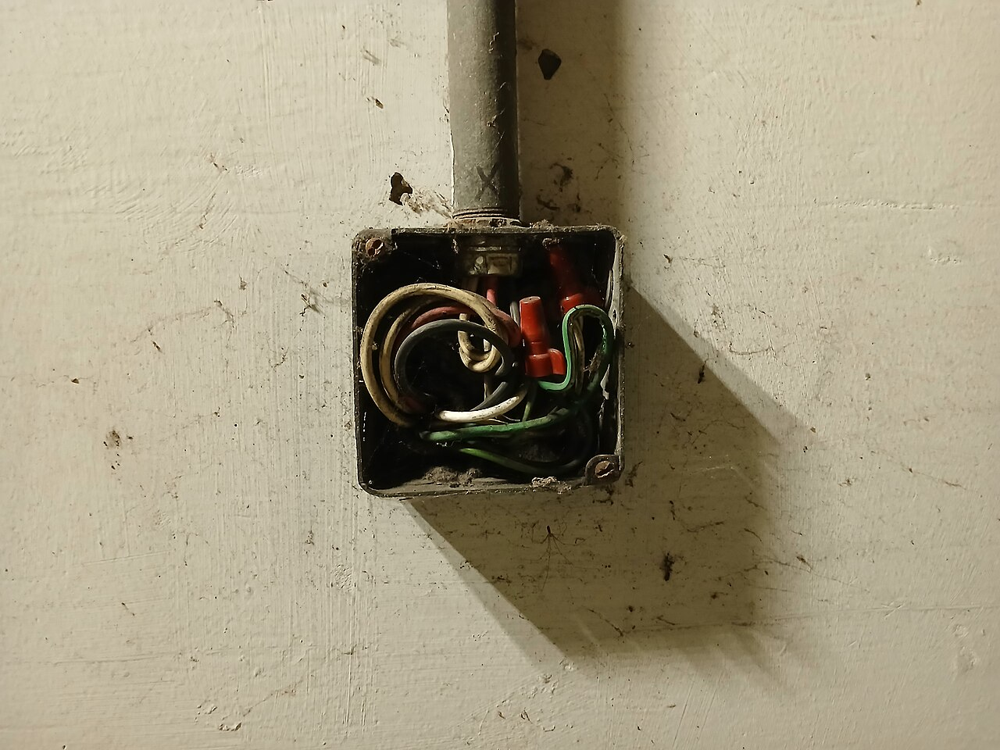
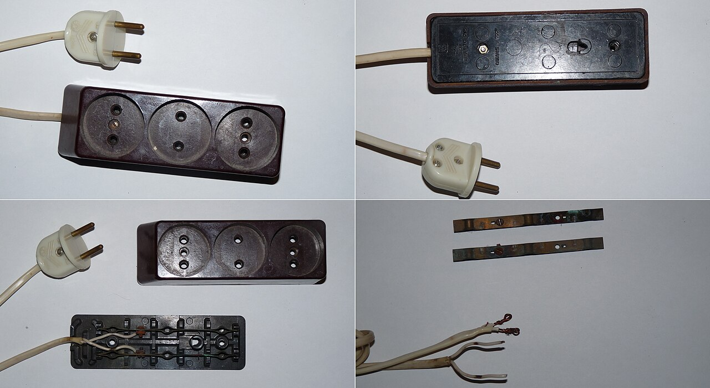
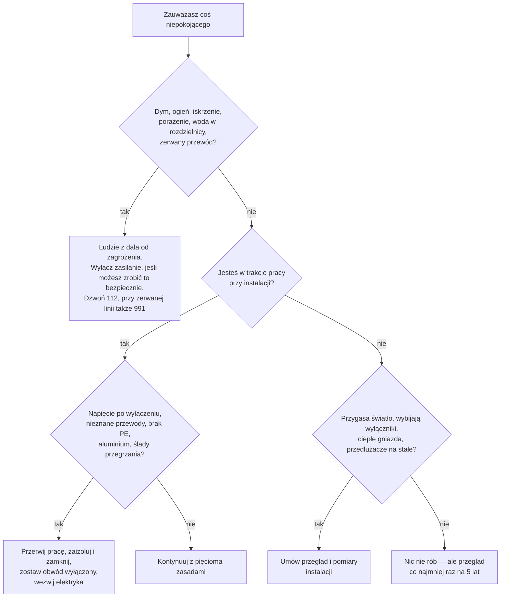

# 00.04 — Czerwone flagi — kiedy przerwać pracę i wezwać elektryka

> **Moduł:** [00 — Zanim dotkniesz czegokolwiek](README.md) · **Oznaczenia:** 🟢🏠📋 · **Zakres SEP:** (c) (d) · **Status:** ✅ pełny
>
> **Czytaj:**
>
> - Postępowanie przy pożarze i awarii: [moduł 30](../30-pozar-i-awaria/README.md)
> - Pierwsza pomoc przy porażeniu: [moduł 31](../31-pierwsza-pomoc/README.md)
> - Diagnostyka usterek krok po kroku: [moduł 20](../20-diagnostyka-usterek/README.md)

[← poprzedni temat](00.03-co-wolno-zrobic-samemu-a-co-wymaga-uprawnien-i.md) · [spis modułu](README.md) · (koniec modułu) →

## Po co to jest

Instalacja zwykle ostrzega, zanim dojdzie do pożaru albo porażenia: ciepłe gniazdo, zapach, przygasające światło, mrowienie przy dotyku pralki. Ten temat zbiera sygnały, po których trzeba **natychmiast przerwać** to, co robisz, oraz sytuacje, w których dalsza samodzielna praca jest zbyt ryzykowna. Na egzaminie odpowiada to obszarowi (e): postępowanie w razie awarii, pożaru lub zagrożenia życia.

## Po ludzku

Czerwone flagi dzielą się na trzy grupy.

1. **Zagrożenie teraz.** Dym, iskrzenie, porażenie, woda w rozdzielnicy. Nie myślisz o naprawie, tylko o bezpieczeństwie ludzi: wyłączasz zasilanie, jeśli możesz to zrobić bezpiecznie, i wzywasz pomoc.
2. **Coś jest nie tak w trakcie pracy.** Napięcie tam, gdzie go nie powinno być, przewody, których nie rozumiesz, stan instalacji gorszy, niż zakładałeś. Przerywasz, zabezpieczasz i wzywasz kogoś, kto się na tym zna. Nie kończysz pracy na siłę.
3. **Ostrzeżenia w codziennym życiu.** Rzeczy, które nie płoną dzisiaj, ale świadczą o problemie: przygasające światło, wybijające wyłączniki, przedłużacze na stałe. Umawiasz przegląd.

Najważniejsza zasada brzmi: **jeśli nie wiesz, dlaczego coś się dzieje, nie zakładaj, że to nic groźnego.** Wyłącznik, który zadziałał, zrobił to z jakiegoś powodu.

## Jak to wygląda

*Na co patrzeć: puszka bez pokrywy, przewody w kilku kolorach, kilka połączeń na złączkach. Nie wiadomo, które przewody są pod napięciem, z jakiego obwodu pochodzą ani czy jest tu przewód ochronny. Odsłonięte połączenia można dotknąć ręką albo zalać. To czerwona flaga z grupy 2: najpierw ustalenie, co to jest, i zabezpieczenie, a nie „dokręcę i zamknę”.*

*Na co patrzeć: gniazda bez bolca ochronnego, ciemne naloty na blaszkach stykowych i popękana izolacja przewodu. Skorodowany styk ma większą rezystancję i grzeje się pod obciążeniem (dlaczego — [01.06](../01-prad-napiecie-opor/01.06-grzanie-przewodow-i-spadek-napiecia.md)). Taka listwa nadaje się tylko do wyrzucenia.*

## Schemat

## Pojęcia

| Pojęcie | Po ludzku | Termin normowy / symbol |
|---------|-----------|-------------------------|
| Przegrzanie styku | Słabe połączenie grzeje się, bo prąd przechodzi przez mały, utleniony punkt | wzrost rezystancji przejścia |
| Przerwa w przewodzie neutralnym | „Zgubione N” — w instalacji trójfazowej napięcia w mieszkaniu przestają być równe | przerwa przewodu neutralnego, asymetria napięć |
| Napięcie na obudowie | Obudowa pralki, kran albo wanna „kopią” przy dotyku | napięcie dotykowe ([moduł 04](../04-prad-a-czlowiek/README.md)) |
| Pogotowie energetyczne | Służba operatora sieci od awarii zasilania i zagrożeń sieciowych | numer alarmowy 991 |

## Liczby do zapamiętania

| Co | Wartość | Kiedy | Uwagi |
|----|---------|-------|-------|
| Numer alarmowy | **112** | pożar, porażenie, zagrożenie życia | ratownictwo, straż pożarna |
| Pogotowie energetyczne | **991** | brak zasilania w okolicy, zerwany przewód, uszkodzone złącze, problem przed licznikiem | operator sieci |
| Napięcie w mieszkaniu przy przerwie N w instalacji trójfazowej | od kilkudziesięciu do **prawie 400 V** w zależności od obciążenia faz | przerwa przewodu neutralnego przed rozdzielnicą | niszczy sprzęt, grozi pożarem — wyłącz wyłącznik główny |
| Przegląd instalacji | co najmniej **raz na 5 lat** | każdy budynek | Prawo budowlane, art. 62 ([00.03](00.03-co-wolno-zrobic-samemu-a-co-wymaga-uprawnien-i.md)) |

## W praktyce

### Grupa 1 — zagrożenie teraz: wyłącz, odsuń ludzi, wezwij pomoc

| Co widzisz | Co robisz |
|------------|-----------|
| Dym, zapach spalenizny lub topiącego się plastiku z gniazda, puszki, rozdzielnicy | Wyłącz wyłącznik główny, jeśli możesz bezpiecznie do niego podejść. Jeśli się pali — 112, ludzie na zewnątrz. Urządzeń pod napięciem nie gaś wodą ([moduł 30](../30-pozar-i-awaria/README.md)) |
| Iskrzenie, trzaski, buczenie w rozdzielnicy lub puszce | Wyłącz zasilanie, nie otwieraj „żeby zobaczyć”, wezwij elektryka |
| Ktoś został porażony | Najpierw wyłącz zasilanie, dopiero potem dotykaj poszkodowanego. Dzwoń 112, pierwsza pomoc ([moduł 31](../31-pierwsza-pomoc/README.md)) |
| Mrowienie albo „kopnięcie” przy dotyku pralki, lodówki, kranu, wanny, kaloryfera | Nikt niczego nie dotyka. Wyłącz wyłącznik główny, wezwij elektryka. To może być uszkodzona izolacja przy braku skutecznej ochrony |
| Woda w rozdzielnicy, zalane gniazda | Nie wchodź w wodę, jeśli może być w niej napięcie. Wyłącz wyłącznik główny, jeśli możesz zrobić to z suchego miejsca. W innym wypadku — 991 lub 112 |
| Zerwany przewód linii napowietrznej, iskrzący słup | Nie podchodź (napięcie krokowe — [moduł 04](../04-prad-a-czlowiek/README.md)), zatrzymaj innych, dzwoń 112 i 991 |
| W mieszkaniu z zasilaniem trójfazowym jedne lampy świecą jaśniej, inne ciemniej, sprzęt się wyłącza lub psuje | Prawdopodobna przerwa w przewodzie neutralnym. Natychmiast wyłącz wyłącznik główny i wezwij elektryka lub pogotowie energetyczne |

### Grupa 2 — w trakcie pracy: przerwij i nie kończ na siłę

- Wskaźnik pokazuje napięcie, mimo że wyłączyłeś „właściwy” wyłącznik.
- Napięcie jest na przewodzie N albo PE.
- W puszce są przewody, których pochodzenia nie znasz, albo przewody z kilku obwodów.
- Instalacja jest dwużyłowa (bez przewodu ochronnego) albo z aluminium, które kruszy się przy zginaniu.
- Izolacja jest krucha, sczerniała albo nadtopiona, a zaciski mają przebarwienia od ciepła.
- Kolory żył nie pasują do niczego (np. żółto-zielony podłączony jako faza).
- Pod jednym zaciskiem jest kilka przewodów, a połączenia są skręcone i owinięte taśmą.
- Praca wymagałaby działania pod napięciem albo w rozdzielnicy bez możliwości wyłączenia.
- Brakuje Ci wskaźnika, narzędzi, światła albo czasu. Zmęczenie i pośpiech to czerwone flagi.

**Jak przerwać bezpiecznie:** zaizoluj końcówki przewodów (złączkami, nie taśmą na skręconych żyłach), zamknij puszkę, zostaw obwód wyłączony i opisany. Zapisz albo sfotografuj, co zobaczyłeś, i wezwij elektryka.

### Grupa 3 — ostrzeżenia na co dzień: umów przegląd

- Światło przygasa, gdy włącza się czajnik, pralka albo odkurzacz.
- Wyłącznik różnicowoprądowy albo nadprądowy zadziałał więcej niż raz bez jasnej przyczyny.
- W instalacji nie ma w ogóle wyłącznika różnicowoprądowego.
- Gniazdo, wtyczka albo wyłącznik w rozdzielnicy są wyczuwalnie ciepłe.
- Ktoś „naprawił” bezpiecznik drutem albo wymienił wyłącznik na większy, bo wybijał.
- Przedłużacze i listwy leżą na stałe, a w kuchni działa kilka urządzeń grzewczych z jednej listwy.
- W kuchni lub łazience są gniazda bez bolca ochronnego.
- Instalacja ma kilkadziesiąt lat i nikt nie pamięta ostatnich pomiarów.

## Błędy i zagrożenia

- ⚠️ **Ponowne włączanie wyłącznika, który od razu wybija.** Każde załączenie na zwarcie to łuk elektryczny w miejscu uszkodzenia. Najpierw szukasz przyczyny ([moduł 20](../20-diagnostyka-usterek/README.md)).
- ⚠️ **Gaszenie wodą urządzeń pod napięciem.** Woda przewodzi, a strumień może porazić gaszącego. Najpierw wyłącz zasilanie, a jeśli się nie da, użyj gaśnicy przeznaczonej do urządzeń elektrycznych ([moduł 30](../30-pozar-i-awaria/README.md)).
- ⚠️ **Dotykanie porażonego, zanim wyłączysz zasilanie.** Wtedy porażone są dwie osoby zamiast jednej.
- **„Pachnie, ale działa”.** Zapach topiącego się plastiku albo rybi zapach przegrzanej izolacji to wczesny sygnał pożaru, a nie drobiazg.
- **Taśma izolacyjna jako naprawa.** Owinięcie nadtopionego przewodu taśmą ukrywa problem, ale nie zmniejsza rezystancji styku, który się grzeje.

## Przykład

**Sytuacja.** Wieczorem w mieszkaniu zasilanym trójfazowo żarówki w kuchni zaczynają świecić bardzo jasno, a w pokoju przygasają. Po chwili wyłącza się router, a z zasilacza telewizora czuć spaleniznę.

**Co się dzieje?** Najbardziej prawdopodobna jest przerwa w przewodzie neutralnym przed rozdzielnicą mieszkania. Bez wspólnego N odbiorniki z różnych faz łączą się szeregowo między fazami, czyli na napięciu do 400 V. Faza, na której jest mniejsze obciążenie (większa rezystancja), dostaje wyższe napięcie. Sprzęt na tej fazie przegrzewa się i psuje (podział napięcia na połączeniu szeregowym — [01.05](../01-prad-napiecie-opor/01.05-polaczenie-szeregowe-i-rownolegle.md)).

**Co robisz?** Natychmiast wyłączasz wyłącznik główny mieszkania. Nie włączasz go ponownie, żeby sprawdzić, czy przeszło. Dzwonisz do elektryka, a jeśli problem dotyczy całego budynku albo sąsiadów, także do pogotowia energetycznego (991). Uszkodzenia sprzętu dokumentujesz zdjęciami.

## Pytania SEP

1. **Jak postąpisz, gdy z rozdzielnicy wydobywa się dym?**

Odpowiedź

Najpierw bezpieczeństwo ludzi: usuwam osoby postronne z zagrożonego miejsca. Jeśli to możliwe bez narażania siebie, wyłączam zasilanie rozdzielnicy wyłącznikiem znajdującym się przed nią (np. wyłącznikiem głównym w innym miejscu albo przeciwpożarowym wyłącznikiem prądu). Jeśli jest ogień, wzywam straż pożarną (112). Urządzeń pod napięciem nie gaszę wodą ani pianą, tylko gaśnicą przeznaczoną do urządzeń elektrycznych (np. proszkową lub śniegową), z zachowaniem odległości podanej na gaśnicy. Po zdarzeniu nie załączam zasilania, dopóki rozdzielnica nie zostanie sprawdzona.

2. **Jakie objawy świadczą o przerwie w przewodzie neutralnym w instalacji trójfazowej i co należy zrobić?**

Odpowiedź

Nierówne napięcia na fazach: jedne odbiorniki świecą jaśniej, inne ciemniej, część urządzeń przestaje działać albo ulega uszkodzeniu, czuć przegrzane zasilacze. Przyczyną jest zanik wspólnego punktu neutralnego, przez co odbiorniki z różnych faz pracują szeregowo na napięciu międzyfazowym. Należy natychmiast odłączyć zasilanie (wyłącznik główny), nie załączać go ponownie i wezwać elektryka lub, jeśli problem dotyczy sieci, pogotowie energetyczne.

3. **W jakich sytuacjach przerwiesz rozpoczętą pracę przy instalacji?**

Odpowiedź

Gdy stwierdzę napięcie tam, gdzie powinien być jego brak, albo nie da się zapewnić pięciu zasad bezpieczeństwa. Także gdy instalacja jest w stanie, który grozi porażeniem lub pożarem: brak przewodu ochronnego, kruszące się przewody aluminiowe, przegrzane zaciski, nieznane przewody z innych obwodów. Przerwę też pracę przy braku sprawnych narzędzi i wskaźnika oraz w razie zagrożenia dla osób postronnych. Przerwaną pracę zostawiam w stanie bezpiecznym: przewody zaizolowane, obwód wyłączony i oznakowany.

4. **Jak postąpisz, gdy zobaczysz zerwany przewód linii napowietrznej leżący na ziemi?**

Odpowiedź

Nie zbliżam się. Wokół miejsca, gdzie przewód dotyka ziemi, występuje napięcie krokowe, groźne także dla osób, które przewodu nie dotykają. Ostrzegam i zatrzymuję innych, zawiadamiam pogotowie energetyczne (991) i numer alarmowy 112. Jeśli muszę opuścić strefę zagrożenia, robię to drobnymi krokami ze złączonymi stopami (szczegóły w module 04).

## Sprawdź się

1. Do której grupy (1 — zagrożenie teraz, 2 — przerwij pracę, 3 — umów przegląd) należy: (a) ciepła wtyczka czajnika po zagotowaniu wody, (b) mrowienie przy dotyku kranu, (c) przy wymianie łącznika znajdujesz w puszce przewód aluminiowy, który pęka przy zginaniu, (d) różnicówka zadziałała raz w czasie burzy?

Odpowiedź

(a) 3 — przyczyną może być zużyte gniazdo albo luźny styk, trzeba to sprawdzić, a gniazdo wymienić, jeśli ma przebarwienia. (b) 1 — wyłącz zasilanie, nikt niczego nie dotyka, wezwij elektryka. (c) 2 — przerwij pracę i zabezpiecz końcówki ([moduł 21](../21-stare-instalacje/README.md)). (d) Pojedyncze zadziałanie podczas burzy może wynikać z przepięcia i nie musi oznaczać usterki. Jeśli się powtarza, to grupa 3.

2. Na [zdjęciu skorodowanej listwy](../../assets/foto/00-przedluzacz-skorodowany.jpg) wskaż dwie czerwone flagi.

Odpowiedź

Brak styku ochronnego w gniazdach oraz skorodowane, zaczernione blaszki stykowe (rośnie rezystancja styku i nagrzewanie). Trzecia to kruche, popękane przewody.

## Źródła

- Postępowanie w razie pożaru i awarii: [moduł 30](../30-pozar-i-awaria/README.md); pierwsza pomoc: [moduł 31](../31-pierwsza-pomoc/README.md); napięcie krokowe: [moduł 04](../04-prad-a-czlowiek/README.md).
- Rozporządzenie z 1 lipca 2022 r., [Dz.U. 2022 poz. 1392](https://eli.gov.pl/api/acts/DU/2022/1392/text.html), § 6 ust. 1 pkt 1 lit. e — zasady postępowania w razie awarii, pożaru lub innego zagrożenia jako obszar egzaminu.
- Prawo budowlane, art. 62 ust. 1 pkt 2 — kontrola okresowa instalacji ([00.03](00.03-co-wolno-zrobic-samemu-a-co-wymaga-uprawnien-i.md)).

---

[← poprzedni temat](00.03-co-wolno-zrobic-samemu-a-co-wymaga-uprawnien-i.md) · [spis modułu](README.md) · (koniec modułu) →
