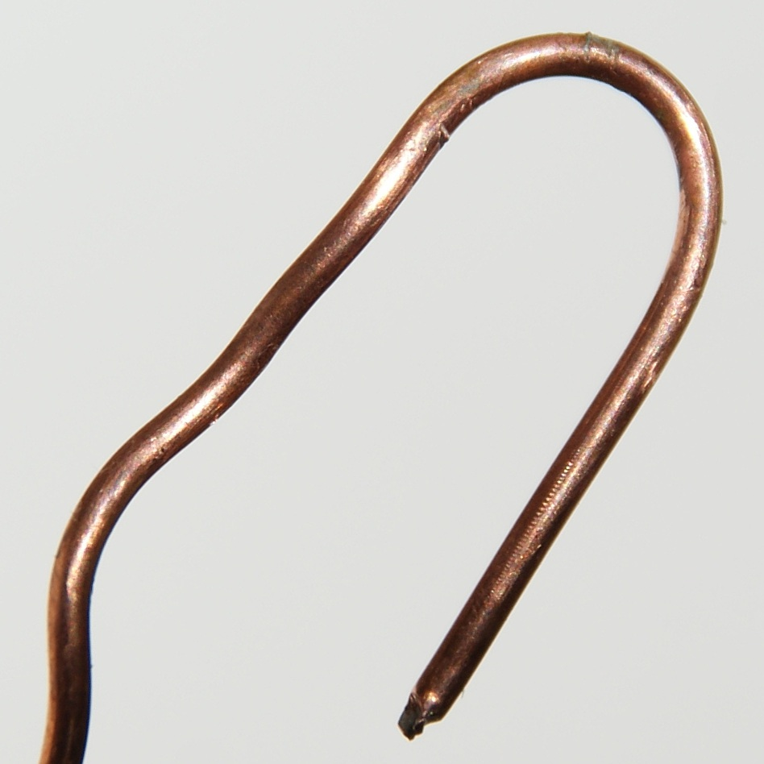
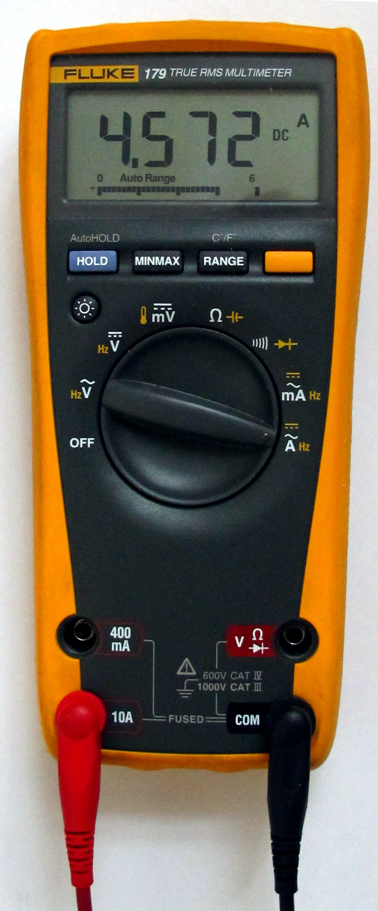
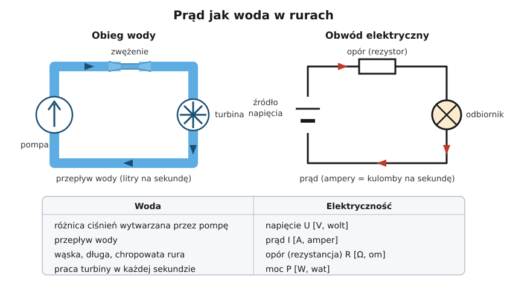
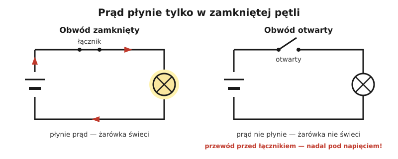

# 01.01 — Ładunek i prąd — co właściwie płynie w przewodzie

> **Moduł:** [01 — Prąd, napięcie, opór, moc i energia](README.md) · **Oznaczenia:** 🟢 · **Zakres SEP:** (a) · **Status:** ✅ pełny
>
> **Czytaj:**
>
> - OpenStax, *Fizyka dla szkół wyższych*, t. 2, rozdz. 9 „Prąd i rezystancja”: § 9.1 „Prąd elektryczny” i § 9.2 „Model przewodnictwa w metalach” · [podsumowanie rozdziału](https://openstax.org/books/fizyka-dla-szk%C3%B3%C5%82-wy%C5%BCszych-tom-2/pages/9-podsumowanie) · [najważniejsze wzory](https://openstax.org/books/fizyka-dla-szk%C3%B3%C5%82-wy%C5%BCszych-tom-2/pages/9-najwazniejsze-wzory) — darmowy podręcznik, dla chętnych na więcej fizyki
> - Pomiar prądu w praktyce: [moduł 22](../22-przyrzady-pomiarowe/README.md)

← (początek modułu) · [spis modułu](README.md) · [następny temat →](01.02-napiecie-roznica-cisnien-miedzy-dwoma-punktami.md)

## Po co to jest

Prąd to wielkość, która grzeje przewody, wyłącza wyłączniki i zabija. Każde zabezpieczenie w rozdzielnicy reaguje na prąd: nadprądowe na jego wartość, różnicowoprądowe na różnicę prądów. Bez zrozumienia, czym jest prąd i że płynie zawsze w zamkniętej pętli, trudno zrozumieć dalsze moduły. Na egzaminie to część pytań o podstawy: czym jest prąd, w czym się go mierzy i jak.

## Po ludzku

**Metal jest pełen wolnych elektronów.** W miedzi każdy atom oddaje do wspólnej „puli” jeden elektron, który może swobodnie przemieszczać się po całym przewodzie. Gdy na końcach przewodu pojawi się napięcie (o nim w [następnym temacie](01.02-napiecie-roznica-cisnien-miedzy-dwoma-punktami.md)), elektrony zaczynają dryfować w jedną stronę. **Prąd to ilość ładunku, która w każdej sekundzie przechodzi przez przekrój przewodu.**

**Analogia wodna.** Rura jest pełna wody. Pompa (źródło napięcia) wytwarza różnicę ciśnień, woda płynie, a przepływ w litrach na sekundę odpowiada prądowi w amperach. Rura musi być **zamkniętą pętlą**: woda wypływa z pompy, przepływa przez turbinę (odbiornik) i wraca do pompy. W obwodzie elektrycznym prąd wypływa ze źródła przewodem L, przechodzi przez odbiornik i wraca przewodem N. **Ile prądu wpłynie, tyle wypłynie** — odbiornik nie „zużywa” prądu, tylko energię. Na tym opiera się działanie wyłącznika różnicowoprądowego ([moduł 08](../08-wylaczniki-roznicowopradowe/README.md)).

**Elektrony jadą wolno, sygnał biegnie szybko.** W przewodzie 1,5 mm² przy 10 A elektrony przesuwają się z prędkością około pół milimetra na sekundę. Lampa zapala się jednak natychmiast po naciśnięciu łącznika. Przewód jest „pełen” elektronów jak rura pełna wody: gdy pompa naciśnie z jednej strony, woda z drugiej strony wypływa od razu, choć żadna kropla nie przeleciała całej rury.

**Przewodniki i izolatory.** Miedź i aluminium mają dużo wolnych elektronów, więc dobrze przewodzą. Tworzywa (PVC, guma, polietylen), ceramika i szkło praktycznie nie mają wolnych ładunków i są izolatorami. Woda z kranu przewodzi, bo są w niej rozpuszczone sole. Ciało człowieka też przewodzi, a skutki opisuje [moduł 04](../04-prad-a-czlowiek/README.md).

**Kierunek prądu.** Umownie przyjęto, że prąd płynie od „plusa” do „minusa”. Elektrony płyną w przeciwną stronę, ale w praktyce instalatorskiej to nie ma znaczenia. W gniazdku prąd jest przemienny: elektrony 50 razy na sekundę zmieniają kierunek i właściwie „kołyszą się” w miejscu ([moduł 02](../02-prad-przemienny-230-400/README.md)). Energia i tak płynie od źródła do odbiornika.

## Jak to wygląda

*Na co patrzeć: zwykła miedź. Każdy centymetr sześcienny tego metalu zawiera około 85 tryliardów wolnych elektronów (8,5·10²²). To one tworzą prąd, gdy na końcach drutu pojawi się napięcie.*

*Na co patrzeć: do pomiaru prądu czerwony przewód wkłada się w osobne gniazdo (oznaczone „A” lub „mA”), a amperomierz włącza się **w szereg** z obwodem, czyli prąd musi przez niego przepłynąć. Przyrząd w tym ustawieniu ma prawie zerową rezystancję. Przyłożony do gniazdka zrobi zwarcie. W instalacjach prąd mierzy się bezpieczniej: cęgami, które obejmują przewód i nie wymagają jego rozłączania.*

## Schemat

## Pojęcia

| Pojęcie | Po ludzku | Termin normowy / symbol |
|---------|-----------|-------------------------|
| Ładunek | „Ilość elektryczności” niesiona przez elektrony | ładunek elektryczny, Q, kulomb [C] |
| Prąd | Ile ładunku przepływa w każdej sekundzie | natężenie prądu elektrycznego, I, amper [A] |
| Obwód | Zamknięta pętla, w której może płynąć prąd | obwód elektryczny |
| Przewodnik | Materiał, w którym ładunki łatwo się przemieszczają | przewodnik (Cu, Al) |
| Izolator | Materiał, który praktycznie nie przewodzi | izolator, dielektryk (PVC, guma, ceramika) |
| Amperomierz | Przyrząd do pomiaru prądu, włączany w szereg | amperomierz; multimetr w funkcji A |
| Cęgi prądowe | Przyrząd, który obejmuje przewód i mierzy prąd bez rozłączania obwodu | miernik cęgowy |
| Amperogodzina | Ładunek przy prądzie 1 A płynącym przez godzinę; w niej podaje się pojemność akumulatorów | Ah (1 Ah = 3600 C) |

## Liczby do zapamiętania

| Wielkość | Wartość | Kiedy obowiązuje | Źródło |
|----------|---------|------------------|--------|
| Prąd | $I = \dfrac{Q}{t}$ | prąd stały lub wartość średnia w czasie $t$ | definicja |
| 1 amper | 1 kulomb na sekundę ≈ **6,24·10¹⁸** elektronów na sekundę | — | ładunek elektronu $e = 1{,}602 \cdot 10^{-19}\ \mathrm{C}$ |
| 1 Ah | **3600 C** | pojemność akumulatorów | $1\ \mathrm{A} \cdot 3600\ \mathrm{s}$ |
| Prędkość dryfu elektronów | ułamki **mm/s** (ok. 0,5 mm/s przy 10 A w 1,5 mm²) | przewód miedziany | $v = \dfrac{I}{n\,e\,S}$, $n_{Cu} \approx 8{,}5 \cdot 10^{28}\ \mathrm{m^{-3}}$ |
| Typowe prądy | LED ~0,03 A · laptop ~0,3 A · czajnik ~8,7 A · obwód gniazd z wyłącznikiem B16 — do 16 A | 230 V | [01.04](01.04-moc-i-energia-waty-kilowatogodziny-i-rachunek.md) |
| Prąd groźny dla człowieka | już **dziesiątki miliamperów** (stąd różnicówki 30 mA) | prąd przemienny 50 Hz | [moduł 04](../04-prad-a-czlowiek/README.md) |

## W praktyce

**Pomiar prądu cęgami w instalacji:**

1. Ustaw miernik cęgowy na pomiar prądu przemiennego (A~).
2. Obejmij cęgami **jeden** przewód: tylko L albo tylko N.
3. Odczytaj wartość. To prąd, który w tej chwili pobierają odbiorniki w tym obwodzie.

**Dlaczego jeden przewód?** W przewodzie L prąd płynie „tam”, a w N „z powrotem”. Jeśli obejmiesz cały kabel (L i N razem), pola magnetyczne obu prądów się zniosą i miernik pokaże prawie zero. Ta „wada” to dokładnie zasada działania wyłącznika różnicowoprądowego. Jeśli przy objęciu całego kabla miernik pokazuje kilka miliamperów albo więcej, część prądu ucieka inną drogą, na przykład przez przewód PE. Tak szuka się upływów ([moduł 20](../20-diagnostyka-usterek/README.md)).

**Multimetr i prąd w instalacji:** pomiar przez rozłączenie obwodu i włączenie multimetru w szereg zostaw do obwodów niskonapięciowych. W instalacji 230 V używa się cęgów.

## Błędy i zagrożenia

- ⚠️ **Multimetr z przewodem w gnieździe „A” przyłożony do gniazdka.** Przyrząd ustawiony na prąd zachowuje się jak kawałek drutu, więc robisz zwarcie przez własne ręce. Po pomiarze prądu zawsze przekładaj przewód z powrotem do gniazda „V”.
- **Cęgi na całym przewodzie wielożyłowym.** Wynik bliski zera nie oznacza, że nic nie płynie (wyjaśnienie wyżej).
- **„Odbiornik zużywa prąd”.** Nie zużywa: ile prądu wpływa przewodem L, tyle wypływa przewodem N. Odbiornik zamienia energię elektryczną na ciepło, światło albo ruch.
- **Mylenie amperów z woltami.** „W gniazdku jest 230 A” to błąd, który na egzaminie od razu zwraca uwagę. W gniazdku jest napięcie 230 V. Prąd zależy od tego, co podłączysz.

## Przykład

**Zadanie.** Czajnik pobiera 8,7 A. Ile elektronów przepływa przez jego grzałkę w ciągu sekundy? Jak szybko przesuwają się elektrony w przewodzie 1,5 mm², gdy płynie 10 A?

**Rozwiązanie.**

Liczba elektronów na sekundę:

$$N = \frac{I}{e} = \frac{8{,}7\ \mathrm{A}}{1{,}602 \cdot 10^{-19}\ \mathrm{C}} \approx 5{,}4 \cdot 10^{19}\ \text{elektronów na sekundę}$$

Prędkość dryfu:

$$v = \frac{I}{n\,e\,S} = \frac{10}{8{,}5 \cdot 10^{28} \cdot 1{,}602 \cdot 10^{-19} \cdot 1{,}5 \cdot 10^{-6}}\ \mathrm{\frac{m}{s}} \approx 4{,}9 \cdot 10^{-4}\ \mathrm{\frac{m}{s}} \approx 0{,}5\ \mathrm{\frac{mm}{s}}$$

**Sprawdzenie.** Jednostki: $\mathrm{A} / (\mathrm{m^{-3}} \cdot \mathrm{C} \cdot \mathrm{m^2}) = \mathrm{(C/s)} / (\mathrm{C/m}) = \mathrm{m/s}$ ✓. Przy prądzie stałym elektron w godzinę przesunąłby się o niecałe 2 metry, a przy przemiennym tylko drga wokół jednego miejsca.

**Wniosek.** Liczba elektronów jest ogromna, a ich ruch powolny. Energia nie „jedzie” razem z elektronami, tylko jest przekazywana przez pole elektryczne wzdłuż przewodu.

## Pytania SEP

1. **Co to jest prąd elektryczny i w jakich jednostkach się go mierzy?**

Odpowiedź

Prąd elektryczny to uporządkowany ruch ładunków elektrycznych, w metalach elektronów swobodnych, wywołany napięciem. Jego natężenie to ładunek przepływający przez przekrój przewodnika w jednostce czasu, $I = Q/t$. Jednostką jest amper [A]: 1 A to przepływ 1 kulomba na sekundę. Prąd płynie tylko w zamkniętym obwodzie.

2. **Jak mierzy się prąd w obwodzie?**

Odpowiedź

Amperomierzem włączonym szeregowo, czyli tak, żeby cały mierzony prąd przez niego przepływał; wymaga to rozłączenia obwodu. W instalacjach stosuje się mierniki cęgowe, które mierzą prąd przez pole magnetyczne wokół przewodu, bez rozłączania. Cęgami obejmuje się jeden przewód czynny. Objęcie przewodów L i N razem pokazuje różnicę prądów, czyli prąd upływu.

3. **Dlaczego miernik cęgowy założony na cały przewód jednofazowy (L i N razem) pokazuje prawie zero?**

Odpowiedź

Prąd w przewodzie L i w przewodzie N ma tę samą wartość i przeciwny kierunek, więc ich pola magnetyczne się znoszą. Miernik pokazuje tylko różnicę, czyli prąd, który wraca inną drogą niż przewodem N, na przykład przez przewód ochronny lub ziemię. Na tej samej zasadzie działa wyłącznik różnicowoprądowy.

## Sprawdź się

1. Akumulator w telefonie ma pojemność 4000 mAh. Ile to kulombów?

Odpowiedź

$4000\ \mathrm{mAh} = 4\ \mathrm{Ah} = 4 \cdot 3600\ \mathrm{C} = 14\,400\ \mathrm{C}$.

2. Zakładasz cęgi na przewód zasilający pralkę (żyły L, N i PE razem w jednej powłoce). Pralka grzeje wodę, a cęgi pokazują 6 mA. Co to oznacza?

Odpowiedź

Prądy w L i N prawie się znoszą. Różnica 6 mA to prąd, który wraca przewodem ochronnym PE zamiast przewodem N, czyli prąd upływu (z filtrów przeciwzakłóceniowych, wilgotnej grzałki albo uszkodzonej izolacji). Kilka mA to dużo jak na jedno urządzenie, bo różnicówka 30 mA może zadziałać już od połowy swojego prądu znamionowego, czyli od 15 mA. Kilka takich urządzeń na jednej różnicówce może powodować jej przypadkowe zadziałania ([moduł 08](../08-wylaczniki-roznicowopradowe/README.md)).

3. Na [zdjęciu multimetru](../../assets/foto/01-multimetr-pomiar-pradu.jpg) przewód jest w gnieździe prądowym. Co się stanie, jeśli ktoś w tym ustawieniu przyłoży sondy do gniazdka 230 V?

Odpowiedź

Zwarcie przez przyrząd. W najlepszym razie przepali się bezpiecznik w multimetrze. W gorszym — wewnątrz albo przy sondach powstanie łuk elektryczny, który może poparzyć dłonie i oczy. Dobre multimetry mają w obwodzie prądowym specjalne bezpieczniki o dużej zdolności wyłączania właśnie na taki wypadek.

## Źródła

- OpenStax, *Fizyka dla szkół wyższych*, t. 2, rozdz. 9 „Prąd i rezystancja” — definicja natężenia prądu i prędkości dryfu.
- Zasada działania wyłącznika różnicowoprądowego: [moduł 08](../08-wylaczniki-roznicowopradowe/README.md); pomiar cęgami: [moduł 22](../22-przyrzady-pomiarowe/README.md).

---

← (początek modułu) · [spis modułu](README.md) · [następny temat →](01.02-napiecie-roznica-cisnien-miedzy-dwoma-punktami.md)
