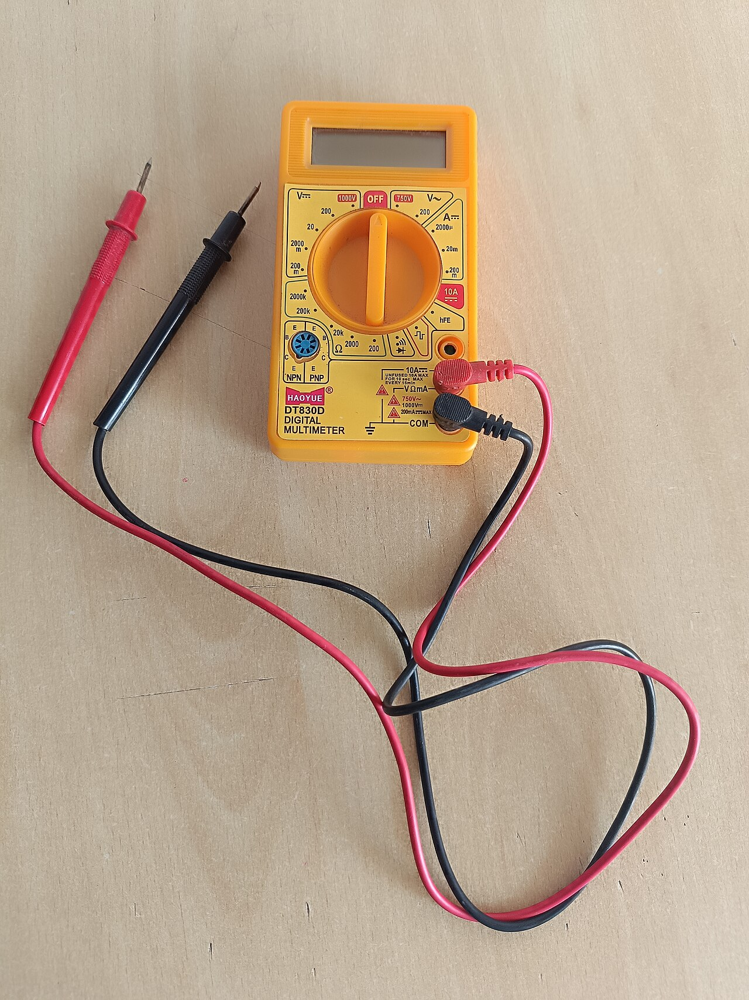
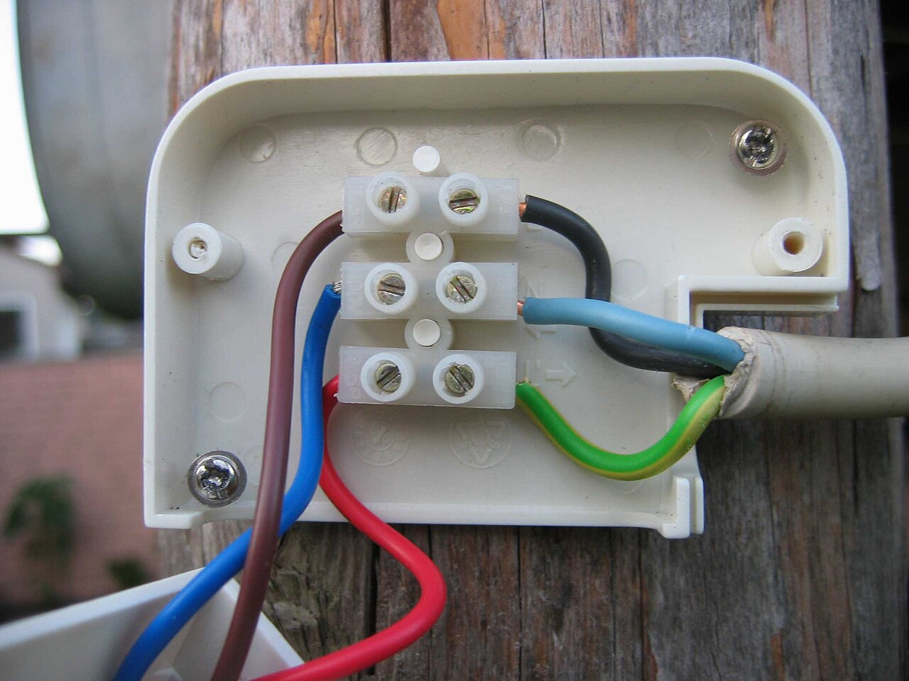
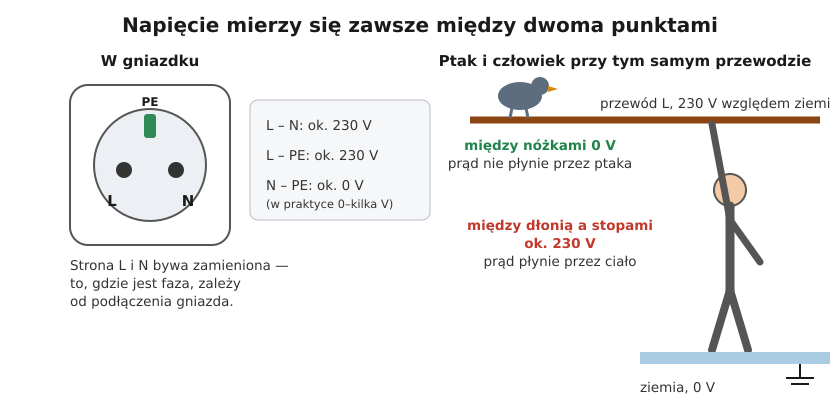

# 01.02 — Napięcie — różnica „ciśnień” między dwoma punktami

> **Moduł:** [01 — Prąd, napięcie, opór, moc i energia](README.md) · **Oznaczenia:** 🟢 · **Zakres SEP:** (a) · **Status:** ✅ pełny
>
> **Czytaj:**
>
> - Rozporządzenie Ministra Klimatu i Środowiska z 22 marca 2023 r. w sprawie szczegółowych warunków funkcjonowania systemu elektroenergetycznego (t.j. Dz.U. 2025 poz. 919), § 45 ust. 5 — dopuszczalne odchylenia napięcia i częstotliwości u odbiorców
> - PN-EN 50160 — parametry napięcia zasilającego w publicznych sieciach (omówienie)
> - Skąd 230 V i 400 V: [moduł 02](../02-prad-przemienny-230-400/README.md)

[← poprzedni temat](01.01-ladunek-i-prad-co-wlasciwie-plynie-w-przewodzie.md) · [spis modułu](README.md) · [następny temat →](01.03-opor-i-prawo-ohma.md)

## Po co to jest

Napięcie mówi, czy coś jest groźne i czy urządzenie będzie dobrze działać. Każdy pomiar w instalacji, od sprawdzania braku napięcia po szukanie usterki, to pomiar napięcia **między dwoma punktami**. Kto to zrozumie, ten wie, dlaczego ptak na przewodzie żyje, a człowiek na drabinie nie, i dlaczego sprawdza się trzy pary przewodów, a nie jedną. Na egzaminie padają pytania o napięcia w instalacji domowej i ich dopuszczalne odchylenia.

## Po ludzku

**Napięcie to różnica „ciśnień” elektrycznych między dwoma punktami.** W analogii wodnej ([schemat w 01.01](01.01-ladunek-i-prad-co-wlasciwie-plynie-w-przewodzie.md#schemat)) pompa wytwarza różnicę ciśnień, a woda płynie z miejsca o wyższym ciśnieniu do miejsca o niższym. Elektryczne „ciśnienie” w danym punkcie nazywa się **potencjałem**, a napięcie to różnica potencjałów. Jednostką jest wolt [V].

**Napięcie zawsze ma dwa końce.** Zdanie „ten przewód ma 230 V” jest skrótem i domyślnie oznacza 230 V względem ziemi. W gniazdku są trzy otwory i trzy napięcia:

- L–N: około 230 V — tym zasilane są odbiorniki,
- L–PE: około 230 V — bo PE jest połączony z ziemią,
- N–PE: prawie 0 V — bo przewód N jest uziemiony u źródła, w stacji transformatorowej ([moduł 11](../11-uklady-sieci/README.md)).

**Ptak na przewodzie** ma obie nóżki na tym samym przewodzie, więc między nimi napięcie wynosi zero i prąd przez niego nie płynie. **Człowiek na ziemi**, który dotknie tego samego przewodu, ma między dłonią a stopami pełne 230 V i prąd płynie przez jego ciało.

**Napięcie może być bez prądu.** Gdy łącznik jest otwarty, lampa nie świeci i prąd nie płynie, ale przewód od rozdzielnicy do łącznika jest nadal pod napięciem. Napięcie to „gotowość” do przepchnięcia prądu, a prąd popłynie dopiero, gdy pętla się zamknie, na przykład przez Ciebie.

**Typowe napięcia:**

| Źródło | Napięcie |
|--------|----------|
| bateria AA | 1,5 V |
| port USB | 5 V |
| akumulator samochodowy | 12 V |
| gniazdko (faza–neutralny) | 230 V |
| między dwiema fazami | 400 V |
| linia średniego napięcia na wsi | 15 kV lub 20 kV |

## Jak to wygląda

*Na co patrzeć: napięcie mierzy się, przykładając sondy do dwóch punktów, czyli równolegle. Nic nie trzeba rozłączać. Przed pomiarem w instalacji 230 V sprawdź na obudowie kategorię pomiarową (co najmniej CAT III — [moduł 22](../22-przyrzady-pomiarowe/README.md)). Tanie multimetry jej często nie mają albo mają tylko symbolicznie, a ich przewody bywają za cienkie.*

*Na co patrzeć: kolory żył podpowiadają ich funkcję: brązowy, czarny i szary to przewody fazowe (L), niebieski to neutralny (N), a żółto-zielony to ochronny (PE). Na zdjęciu widać też czerwony przewód — w starych instalacjach i urządzeniach kolory bywają inne. Kolor to tylko podpowiedź, a pewność daje pomiar.*

## Schemat

## Pojęcia

| Pojęcie | Po ludzku | Termin normowy / symbol |
|---------|-----------|-------------------------|
| Potencjał | „Ciśnienie” elektryczne w danym punkcie względem punktu odniesienia | potencjał elektryczny, φ, wolt [V] |
| Napięcie | Różnica potencjałów między dwoma punktami | napięcie elektryczne, U, wolt [V] |
| Napięcie fazowe | Napięcie między fazą a przewodem neutralnym lub ziemią | napięcie fazowe, $U_0$ = 230 V |
| Napięcie międzyfazowe | Napięcie między dwiema fazami | napięcie przewodowe, $U$ = 400 V |
| Napięcie znamionowe | Napięcie, na które zaprojektowano sieć lub urządzenie | napięcie znamionowe, $U_n$ |
| Woltomierz | Przyrząd do pomiaru napięcia, przykładany do dwóch punktów | woltomierz; multimetr w funkcji V |

## Liczby do zapamiętania

| Wielkość | Wartość | Kiedy obowiązuje | Źródło |
|----------|---------|------------------|--------|
| Napięcie fazowe (L–N, L–PE) | **230 V** | sieć nN w Polsce | PN-EN 60038 |
| Napięcie międzyfazowe (L–L) | **400 V** ≈ $230 \cdot \sqrt{3}$ | sieć trójfazowa nN | PN-EN 60038; [moduł 02](../02-prad-przemienny-230-400/README.md) |
| N–PE | **prawie 0 V** (w praktyce do kilku V) | układ TN, poprawna instalacja | [moduł 11](../11-uklady-sieci/README.md) |
| Dopuszczalne odchylenie napięcia | **±10 %**, czyli 207–253 V, dla 95 % średnich 10-minutowych w tygodniu | odbiorcy zasilani z sieci nN (grupy przyłączeniowe III–V) | rozporządzenie MKiŚ z 2023 r., § 45 ust. 5 pkt 2; PN-EN 50160 |
| Częstotliwość | **50 Hz ±1 %** przez 99,5 % tygodnia | sieć połączona z systemem | jw., § 45 ust. 5 pkt 1 |

## W praktyce

**Pomiar napięcia w gniazdku (wskaźnikiem dwubiegunowym albo multimetrem CAT III):**

1. Sprawdź przyrząd na znanym źródle, a przy multimetrze sprawdź też, czy przewody są w gniazdach „V” i „COM” i czy pokrętło jest na napięciu przemiennym (V~).
2. Zmierz kolejno L–N, L–PE i N–PE. Gniazdo nie ma oznaczeń, więc „L” to po prostu ten otwór, w którym jest faza.
3. Porównaj wynik z tabelą poniżej.

| Wynik | Co to znaczy |
|-------|--------------|
| ~230 V / ~230 V / ~0 V | gniazdo podłączone poprawnie |
| ~230 V / **~0 V** / **~0 V** | przewód PE niepodłączony albo przerwany — urządzenia klasy I nie są chronione ([moduł 12](../12-ochrona-przeciwporazeniowa/README.md)) |
| ~230 V / **0 V** / **~230 V** | przewód PE ma potencjał fazy (PE połączony z fazą, np. błąd w puszce) — ⚠️ obudowy urządzeń są pod napięciem, natychmiast wyłącz obwód |
| **0 V** / ~230 V / ~230 V | przerwa w N przed gniazdem — odbiorniki nie działają, a „N” w gniazdku ma napięcie względem ziemi |
| ~230 V / ~230 V / **kilkanaście–kilkadziesiąt V** | duży spadek napięcia na N (przeciążony lub luźny przewód N) albo błąd połączeń — do sprawdzenia |
| **~400 V** między „L” a „N” | w gnieździe są dwie fazy albo przerwa N w instalacji trójfazowej — natychmiast odłącz zasilanie ([00.04](../00-bezpieczenstwo-najpierw/00.04-czerwone-flagi-kiedy-przerwac-prace-i-wezwac.md)) |

## Błędy i zagrożenia

- ⚠️ **„N jest bezpieczny, bo ma 0 V”.** N ma prawie 0 V względem ziemi tylko wtedy, gdy instalacja jest sprawna. Przy przerwie przewodu N za przerwą pojawia się na nim napięcie fazowe, które przechodzi przez odbiorniki. Przewód N traktuj zawsze jak przewód czynny.
- ⚠️ **Pomiar tylko między dwoma punktami, które „wydają się” właściwe.** Jedna para nie mówi całej prawdy. Sprawdzaj wszystkie trzy (patrz [00.02](../00-bezpieczenstwo-najpierw/00.02-sprawdzanie-braku-napiecia-probnik-dwubiegunowy.md)).
- **Zaufanie do kolorów.** W starych instalacjach przewód ochronny bywa czerwony albo czarny, a niebieski bywa fazą. Mierz zamiast zgadywać.
- **Multimetr bez kategorii pomiarowej na instalacji 230 V.** Przepięcie w sieci może przebić tani przyrząd prosto do ręki.

## Przykład

**Sytuacja.** W domu na końcu wsi wieczorem miernik w gniazdku pokazuje 203 V, a w południe 236 V. Czy operator sieci dotrzymuje wymagań?

**Analiza.** Dopuszczalne pasmo to 230 V ±10 %:

$$230 \cdot 0{,}9 = 207\ \mathrm{V} \qquad 230 \cdot 1{,}1 = 253\ \mathrm{V}$$

Wartość 236 V mieści się w paśmie, a 203 V jest poniżej. Wymaganie dotyczy jednak 95 % średnich 10-minutowych w ciągu tygodnia. Pojedynczy odczyt nie wystarczy, żeby stwierdzić naruszenie. Trzeba rejestrować napięcie przez tydzień rejestratorem albo zgłosić problem operatorowi, który zrobi taki pomiar.

**Wniosek.** Napięcie w gniazdku nie jest stałe: spada przy dużym obciążeniu sieci (wieczór) i rośnie przy małym albo przy pracy fotowoltaiki (południe). Pasmo ±10 % to norma, a nie awaria.

## Pytania SEP

1. **Co to jest napięcie elektryczne i jak się je mierzy?**

Odpowiedź

Napięcie to różnica potencjałów elektrycznych między dwoma punktami. To ono wymusza przepływ prądu w zamkniętym obwodzie. Jednostką jest wolt [V]. Mierzy się je woltomierzem włączonym równolegle, czyli przykładając przewody pomiarowe do dwóch punktów, bez rozłączania obwodu. Do sprawdzania obecności i braku napięcia w instalacjach używa się dwubiegunowych wskaźników napięcia.

2. **Jakie napięcia występują w instalacji niskiego napięcia w budynku mieszkalnym?**

Odpowiedź

Napięcie fazowe 230 V, między przewodem fazowym a neutralnym lub ochronnym, i napięcie międzyfazowe 400 V, między dwiema fazami w instalacji trójfazowej. Napięcie między przewodem neutralnym a ochronnym w poprawnej instalacji w układzie TN jest bliskie zera. Napięcie znamionowe sieci nN to 230/400 V.

3. **Jakie są dopuszczalne odchylenia napięcia zasilającego w sieci niskiego napięcia?**

Odpowiedź

±10 % napięcia znamionowego, czyli od 207 V do 253 V dla 230 V. Wymaganie jest spełnione, jeśli w każdym tygodniu 95 % średnich 10-minutowych wartości skutecznych napięcia mieści się w tym przedziale. Określa to rozporządzenie w sprawie szczegółowych warunków funkcjonowania systemu elektroenergetycznego (§ 45) i norma PN-EN 50160. Częstotliwość ma wynosić 50 Hz ±1 % przez 99,5 % tygodnia.

## Sprawdź się

1. Pomiar wskaźnikiem dwubiegunowym w gniazdku: L–N = 231 V, L–PE = 0 V, N–PE = 231 V. Co jest nie tak i czy to groźne?

Odpowiedź

Między L i PE nie ma napięcia, a między N i PE jest pełne napięcie fazowe. To znaczy, że zacisk ochronny gniazda ma potencjał fazy: przewód PE został gdzieś połączony z fazą, na przykład w puszce żyłę żółto-zieloną podłączono do zacisku L. (Gdyby L i PE były po prostu zamienione, „faza” gniazda byłaby uziemiona i L–N pokazałoby 0 V.) To sytuacja śmiertelnie groźna, bo obudowa każdego urządzenia klasy I włączonego do tego gniazda, na przykład pralki czy czajnika, będzie pod napięciem 230 V względem ziemi. Obwód trzeba natychmiast wyłączyć i nie używać go do czasu naprawy i pomiarów. (Dla porównania: przy samym braku połączenia PE wskaźnik pokazałby około 0 V zarówno między L i PE, jak i między N i PE.)

2. Na [schemacie napięć](../../assets/schematy/01-napiecie-to-roznica.svg) ptak stoi na przewodzie L, który ma 230 V względem ziemi. Co by się stało, gdyby ptak dotknął skrzydłem sąsiedniego przewodu innej fazy?

Odpowiedź

Między przewodami dwóch faz jest 400 V. Ptak stałby się „mostkiem” między nimi i przez jego ciało popłynąłby prąd. Dlatego na liniach z gęsto rozmieszczonymi przewodami stosuje się osłony i odstraszacze dla dużych ptaków.

3. Ile wynosi najniższe i najwyższe napięcie w gniazdku, które mieści się w wymaganiach?

Odpowiedź

207 V i 253 V (230 V ±10 %), dla 95 % średnich 10-minutowych w tygodniu.

## Źródła

- Rozporządzenie Ministra Klimatu i Środowiska z 22 marca 2023 r. w sprawie szczegółowych warunków funkcjonowania systemu elektroenergetycznego (t.j. Dz.U. 2025 poz. 919), § 45 ust. 5 — parametry jakościowe energii dla grup przyłączeniowych III–V.
- PN-EN 50160 — parametry napięcia zasilającego w publicznych sieciach elektroenergetycznych.
- PN-EN 60038 — napięcia znormalizowane, w tym 230/400 V.

---

[← poprzedni temat](01.01-ladunek-i-prad-co-wlasciwie-plynie-w-przewodzie.md) · [spis modułu](README.md) · [następny temat →](01.03-opor-i-prawo-ohma.md)
