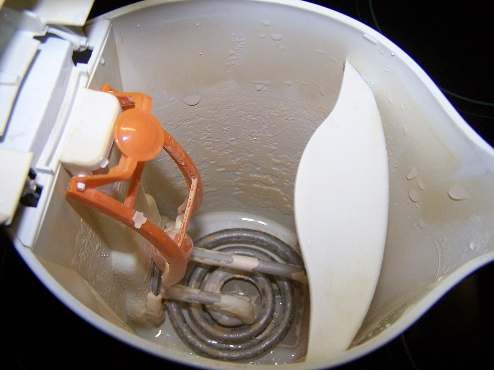
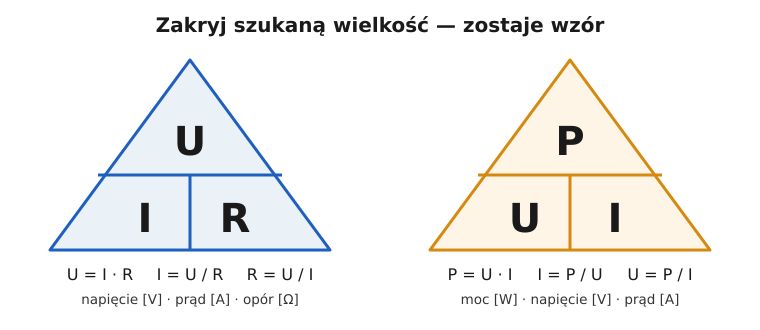

# 01.03 — Opór i prawo Ohma

> **Moduł:** [01 — Prąd, napięcie, opór, moc i energia](README.md) · **Oznaczenia:** 🟢 · **Zakres SEP:** (a) · **Status:** ✅ pełny
>
> **Czytaj:**
>
> - OpenStax, *Fizyka dla szkół wyższych*, t. 2, [§ 9.3 „Rezystywność i rezystancja”](https://openstax.org/books/fizyka-dla-szk%C3%B3%C5%82-wy%C5%BCszych-tom-2/pages/9-3-rezystywnosc-i-rezystancja) i § 9.4 „Prawo Ohma”
> - Rezystancja przewodów w doborze instalacji: [moduł 05](../05-przewody-i-kable/README.md) i [moduł 16](../16-planowanie-obwodow/README.md)

[← poprzedni temat](01.02-napiecie-roznica-cisnien-miedzy-dwoma-punktami.md) · [spis modułu](README.md) · [następny temat →](01.04-moc-i-energia-waty-kilowatogodziny-i-rachunek.md)

## Po co to jest

Opór (rezystancja) decyduje o tym, jaki prąd popłynie: przez grzałkę czajnika, przez przewód przy zwarciu i przez człowieka, który dotknął fazy. Prawo Ohma, $I = U/R$, to najczęściej używany wzór w elektryce. Za jego pomocą liczy się prąd zwarciowy, spadek napięcia i skuteczność ochrony przeciwporażeniowej. Na egzaminie: prawo Ohma, od czego zależy rezystancja przewodu i dlaczego przewody aluminiowe muszą być grubsze.

## Po ludzku

**Opór to to, co „hamuje” prąd.** W analogii wodnej to zwężenie rury albo długa, wąska rurka: przy tym samym ciśnieniu przepłynie przez nią mniej wody. W przewodniku elektrony przepychają się między drgającymi atomami i oddają im część energii, a przewodnik się nagrzewa.

**Prawo Ohma:** prąd jest tym większy, im większe napięcie, i tym mniejszy, im większy opór.

$$I = \frac{U}{R}$$

Te same 230 V dadzą:

- przez grzałkę czajnika (ok. 26 Ω) — ok. 8,7 A, czajnik grzeje,
- przez ciało człowieka (rzędu 1000 Ω, zależnie od warunków) — ok. 0,23 A, czyli 230 mA, prąd śmiertelny ([moduł 04](../04-prad-a-czlowiek/README.md)),
- przez zwarcie, gdzie jedynym oporem są przewody i sieć (ułamek oma) — setki amperów ([01.07](01.07-przeciazenie-a-zwarcie-dwie-rozne-awarie.md)),
- przez izolację przewodu (miliony omów) — mikroampery, czyli praktycznie nic (rezystancja izolacji, [moduł 23](../23-pomiary-odbiorcze-i-okresowe/README.md)).

**Od czego zależy opór przewodu:**

$$R = \rho \cdot \frac{l}{S}$$

- **materiał** ($\rho$, rezystywność): miedź przewodzi lepiej niż aluminium, a aluminium lepiej niż stal,
- **długość** $l$: dwa razy dłuższy przewód ma dwa razy większy opór,
- **przekrój** $S$: dwa razy grubszy (w mm²) przewód ma dwa razy mniejszy opór,
- **temperatura**: metal ciepły ma większy opór niż zimny. Miedź przy 70 °C ma o około 20 % większy opór niż przy 20 °C.

**Żarówka zimna i gorąca.** Włókno tradycyjnej żarówki po rozgrzaniu do ponad 2000 °C ma kilkanaście razy większy opór niż zimne. W chwili włączenia przez zimne włókno płynie więc kilkanaście razy większy prąd niż w czasie świecenia. Dlatego żarówki przepalały się najczęściej przy włączaniu. Podobne „uderzenia prądu” przy włączaniu dają zasilacze LED, silniki i transformatory ([moduł 07](../07-zabezpieczenia-nadpradowe/README.md) — dobór charakterystyki wyłącznika).

## Jak to wygląda

*Na co patrzeć: spiralna rurka na dnie to grzałka. W środku ma drut oporowy o rezystancji kilkudziesięciu omów, zaizolowany od metalowej osłonki. Opór jest dobrany tak, żeby przy 230 V popłynęło ok. 9 A i powstało ok. 2000 W ciepła. Gdyby izolacja wewnątrz grzałki pękła, metalowa osłonka i woda znalazłyby się pod napięciem. Przed tym chroni przewód PE i wyłącznik różnicowoprądowy (moduły 08 i 12).*

## Schemat

## Pojęcia

| Pojęcie | Po ludzku | Termin normowy / symbol |
|---------|-----------|-------------------------|
| Opór | Jak bardzo coś utrudnia przepływ prądu | rezystancja, R, om [Ω] |
| Rezystywność | Opór „materiału”: przewodu o długości 1 m i przekroju 1 mm² | rezystywność (oporność właściwa), ρ, Ω·mm²/m |
| Przewodność | Odwrotność rezystywności; w tabelach często dla miedzi podaje się 56–58 | konduktywność, γ = 1/ρ, m/(Ω·mm²) |
| Prawo Ohma | Prąd = napięcie / opór | $I = U/R$ |
| Rezystor | Element o określonym oporze | rezystor; w grzejnictwie — element grzejny |
| Omomierz | Przyrząd do pomiaru oporu; mierzy tylko w obwodzie **bez napięcia** | omomierz; multimetr w funkcji Ω |
| Współczynnik temperaturowy | O ile procent rośnie opór przy ogrzaniu o 1 °C | α, 1/K |

## Liczby do zapamiętania

| Wielkość | Wartość | Kiedy obowiązuje | Źródło |
|----------|---------|------------------|--------|
| Prawo Ohma | $I = \dfrac{U}{R}$, $U = I \cdot R$, $R = \dfrac{U}{I}$ | przewodniki liniowe (metale w stałej temperaturze) | definicja |
| Opór przewodu | $R = \rho \dfrac{l}{S}$ | przewód o stałym przekroju | jw. |
| Rezystywność miedzi | **0,0175 Ω·mm²/m** (≈ 1/57) | ok. 20 °C; w obliczeniach instalacyjnych | tabele producentów, PN-EN 60228 (dokładnie 0,01724 przy 20 °C) |
| Rezystywność aluminium | **0,0286 Ω·mm²/m** (≈ 1/35) — ok. **1,6 ×** więcej niż miedź | ok. 20 °C | jw. |
| Wzrost oporu miedzi z temperaturą | ok. **0,4 % na 1 °C**; przy 70 °C ok. **+20 %** względem 20 °C | metale | α ≈ 0,0039 1/K |
| Opór 1 m przewodu Cu 1,5 mm² | ok. **0,012 Ω** | ok. 20 °C | $0{,}0175 / 1{,}5$ |
| Opór 1 m przewodu Cu 2,5 mm² | ok. **0,007 Ω** | ok. 20 °C | $0{,}0175 / 2{,}5$ |
| Opór ciała człowieka | rzędu **1000 Ω** (bardzo zależny od napięcia, wilgotności i drogi prądu) | szacunek przy 230 V | [moduł 04](../04-prad-a-czlowiek/README.md) |

## W praktyce

**Pomiar oporu multimetrem (np. grzałki albo ciągłości przewodu):**

1. Odłącz urządzenie od sieci (wyjmij wtyczkę). Omomierz podaje własne, małe napięcie, więc w obwodzie pod napięciem pokaże bzdury albo się uszkodzi.
2. Ustaw pokrętło na Ω, połącz sondy ze sobą i odczytaj opór samych przewodów pomiarowych (zwykle 0,1–0,5 Ω).
3. Przyłóż sondy do końców badanego elementu i odejmij opór przewodów pomiarowych.

**Co z tego wynika w instalacji:**

- Grzałka czajnika ma kilkadziesiąt omów. Wynik „∞” oznacza przepaloną grzałkę, a wynik bliski 0 — zwarcie w środku.
- Pomiar ciągłości przewodu ochronnego i rezystancji izolacji wymaga przyrządów do badania instalacji ([moduł 23](../23-pomiary-odbiorcze-i-okresowe/README.md)). Zwykły multimetr mierzy przy zbyt małym napięciu i prądzie, żeby wykryć słabe połączenia i przebicia.

## Błędy i zagrożenia

- ⚠️ **Pomiar oporu w obwodzie pod napięciem.** Uszkodzi przyrząd i grozi łukiem. Omomierzem mierzy się tylko po odłączeniu i sprawdzeniu braku napięcia.
- **„Gruby przewód to mały opór, więc długość nie ma znaczenia”.** Ma: 50 m przewodu 2,5 mm² ma taki sam opór jak 30 m przewodu 1,5 mm². Długie obwody wymagają większych przekrojów (spadek napięcia — [01.06](01.06-grzanie-przewodow-i-spadek-napiecia.md)).
- **Aluminium „1:1” zamiast miedzi.** Przewód aluminiowy o tym samym przekroju ma o około 60 % większy opór, więc bardziej się grzeje. Na tym samym zabezpieczeniu potrzebuje większego przekroju.
- **Liczenie prądu zwarcia z oporu „na zimno”.** Rozgrzany przewód ma większy opór, więc prąd zwarcia na końcu długiego, obciążonego obwodu jest mniejszy, niż wynika z rachunku dla 20 °C ([moduł 12](../12-ochrona-przeciwporazeniowa/README.md)).

## Przykład

**Zadanie 1.** Czajnik ma moc 2000 W przy 230 V. Jaki ma opór i jaki pobiera prąd?

Z wzorów na moc ([01.04](01.04-moc-i-energia-waty-kilowatogodziny-i-rachunek.md)): $P = U^2 / R$, więc

$$R = \frac{U^2}{P} = \frac{230^2}{2000}\ \Omega = 26{,}45\ \Omega \qquad I = \frac{U}{R} = \frac{230}{26{,}45}\ \mathrm{A} \approx 8{,}7\ \mathrm{A}$$

Sprawdzenie: $P = U \cdot I = 230 \cdot 8{,}7 \approx 2000\ \mathrm{W}$ ✓.

**Zadanie 2.** Obwód gniazd w pokoju to przewód YDYp 3×1,5 mm², odległość od rozdzielnicy do gniazda 20 m. Jaki opór ma pętla L + N?

Prąd płynie do gniazda żyłą L i wraca żyłą N, więc długość drogi to $2 \cdot 20\ \mathrm{m} = 40\ \mathrm{m}$:

$$R = 0{,}0175 \cdot \frac{40}{1{,}5}\ \Omega \approx 0{,}47\ \Omega$$

Przy przewodzie 2,5 mm² byłoby to $0{,}28\ \Omega$. Ta wartość wróci w [01.06](01.06-grzanie-przewodow-i-spadek-napiecia.md) przy spadku napięcia i w [01.07](01.07-przeciazenie-a-zwarcie-dwie-rozne-awarie.md) przy prądzie zwarcia.

## Pytania SEP

1. **Podaj prawo Ohma i wyjaśnij jego znaczenie.**

Odpowiedź

Natężenie prądu płynącego przez przewodnik jest wprost proporcjonalne do przyłożonego napięcia i odwrotnie proporcjonalne do rezystancji: $I = U/R$. Wynika z tego, że przy stałym napięciu sieci prąd zależy od rezystancji obwodu. Odbiornik o małej rezystancji pobiera duży prąd, a zwarcie, czyli bardzo mała rezystancja, daje bardzo duży prąd. Z prawa Ohma liczy się m.in. prąd zwarciowy, spadek napięcia i prąd rażenia.

2. **Od czego zależy rezystancja przewodu?**

Odpowiedź

Od materiału (rezystywności), długości, przekroju i temperatury: $R = \rho\, l / S$. Rezystancja rośnie proporcjonalnie do długości i maleje proporcjonalnie do przekroju. Miedź ma mniejszą rezystywność niż aluminium (ok. 0,0175 wobec 0,0286 Ω·mm²/m). Rezystancja metali rośnie z temperaturą, dla miedzi o około 0,4 % na każdy stopień.

3. **Dlaczego przewód aluminiowy musi mieć większy przekrój niż miedziany przy tym samym obciążeniu?**

Odpowiedź

Aluminium ma około 1,6 razy większą rezystywność niż miedź. Przy tym samym przekroju i prądzie przewód aluminiowy ma większą rezystancję, więc wydziela więcej ciepła ($P = I^2 R$) i daje większy spadek napięcia. Żeby osiągnąć podobną rezystancję i obciążalność, potrzebny jest przekrój mniej więcej o jeden stopień większy. Na przykład zamiast miedzi 2,5 mm² stosuje się aluminium 4 mm², a dokładne wartości podają tabele obciążalności ([moduł 05](../05-przewody-i-kable/README.md)).

## Sprawdź się

1. Jaki prąd popłynie przez ciało człowieka o oporze 1000 Ω przy napięciu 230 V? A przez rękawicę z suchej gumy o oporze 10 MΩ?

Odpowiedź

$I = 230 / 1000 = 0{,}23\ \mathrm{A} = 230\ \mathrm{mA}$ — prąd groźny dla życia. Przez rękawicę: $I = 230 / 10\,000\,000 = 0{,}000023\ \mathrm{A} = 23\ \mathrm{\mu A}$, czyli niewyczuwalny. To pokazuje, jak ważna jest izolacja.

2. Ile wynosi opór pętli L + N obwodu z przewodu miedzianego 2,5 mm², jeśli gniazdo jest 30 m od rozdzielnicy?

Odpowiedź

$R = 0{,}0175 \cdot \dfrac{2 \cdot 30}{2{,}5} = 0{,}42\ \Omega$.

3. Grzałka zmierzona multimetrem po wyjęciu wtyczki pokazuje „OL” (przekroczenie zakresu). Co to oznacza?

Odpowiedź

Opór jest nieskończenie duży, czyli w grzałce jest przerwa, na przykład przepalony drut oporowy albo zadziałał bezpiecznik termiczny w urządzeniu. Prąd nie popłynie i urządzenie nie będzie grzać.

## Źródła

- OpenStax, *Fizyka dla szkół wyższych*, t. 2, [§ 9.3 „Rezystywność i rezystancja”](https://openstax.org/books/fizyka-dla-szk%C3%B3%C5%82-wy%C5%BCszych-tom-2/pages/9-3-rezystywnosc-i-rezystancja), § 9.4 „Prawo Ohma”.
- PN-EN 60228 — żyły przewodów i kabli: maksymalne rezystancje żył dla klas przekrojów (szczegóły w module 05).

---

[← poprzedni temat](01.02-napiecie-roznica-cisnien-miedzy-dwoma-punktami.md) · [spis modułu](README.md) · [następny temat →](01.04-moc-i-energia-waty-kilowatogodziny-i-rachunek.md)
