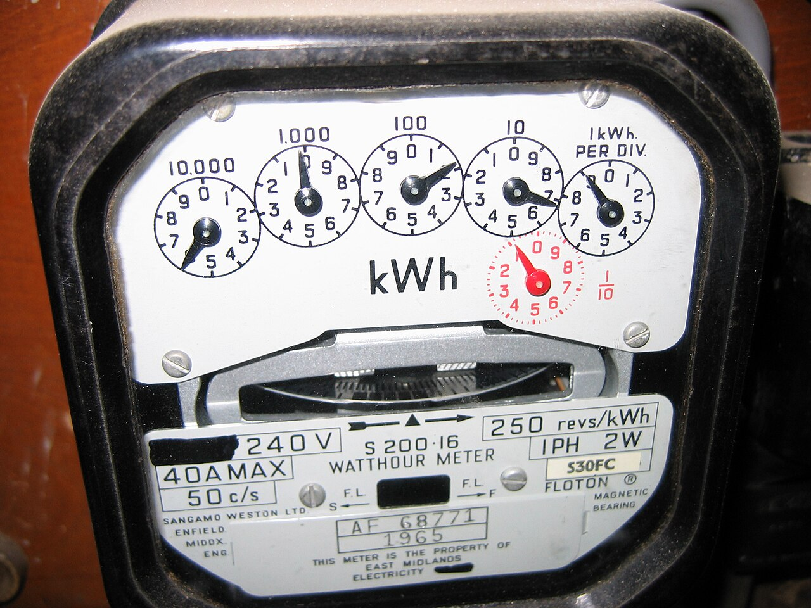
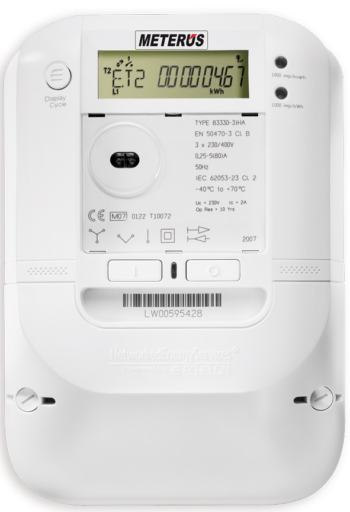
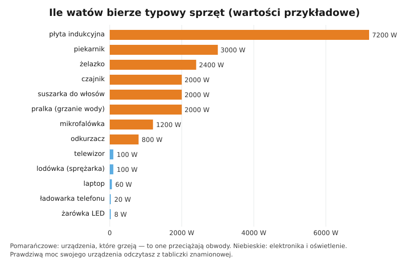

# 01.04 — Moc i energia — waty, kilowatogodziny i rachunek za prąd

> **Moduł:** [01 — Prąd, napięcie, opór, moc i energia](README.md) · **Oznaczenia:** 🟢 · **Zakres SEP:** (a) · **Status:** ✅ pełny
>
> **Czytaj:**
>
> - OpenStax, *Fizyka dla szkół wyższych*, t. 2, § 9.5 „Energia i moc elektryczna” ([podsumowanie rozdziału 9](https://openstax.org/books/fizyka-dla-szk%C3%B3%C5%82-wy%C5%BCszych-tom-2/pages/9-podsumowanie))
> - Moc czynna, bierna i pozorna przy prądzie przemiennym: [moduł 02](../02-prad-przemienny-230-400/README.md)
> - Moc przyłączeniowa i taryfy: [moduł 14](../14-od-slupa-do-gniazdka/README.md)

[← poprzedni temat](01.03-opor-i-prawo-ohma.md) · [spis modułu](README.md) · [następny temat →](01.05-polaczenie-szeregowe-i-rownolegle.md)

## Po co to jest

Moc mówi, jaki prąd pobierze urządzenie, czyli czy obwód i zabezpieczenie je „uciągną”. Energia mówi, ile zapłacisz. Te dwie wielkości ludzie mylą najczęściej: kilowat to nie kilowatogodzina. Z tabliczki znamionowej urządzenia odczytasz moc, policzysz prąd i dobierzesz obwód (moduł 16). Na egzaminie pada pytanie o jednostki mocy i energii oraz o związek mocy z napięciem i prądem.

## Po ludzku

**Moc to „tempo” zamiany energii.** W analogii wodnej moc to praca, jaką turbina wykonuje w każdej sekundzie. W elektryce:

$$P = U \cdot I$$

Czajnik przy 230 V i 8,7 A zamienia w każdej sekundzie 2000 J energii elektrycznej na ciepło, czyli ma moc 2000 W (2 kW). Im większa moc przy tym samym napięciu, tym większy prąd. Dlatego urządzenia grzejne obciążają obwody najbardziej ([schemat poniżej](#schemat)).

**Energia to moc razy czas.** Licznik w mieszkaniu nie liczy mocy, tylko energię: ile pobrano przez cały czas. Jednostką na rachunku jest **kilowatogodzina (kWh)**, czyli energia, jaką urządzenie o mocy 1 kW pobierze w ciągu godziny.

$$E = P \cdot t \qquad 1\ \mathrm{kWh} = 1000\ \mathrm{W} \cdot 3600\ \mathrm{s} = 3{,}6\ \mathrm{MJ}$$

Czajnik 2 kW przez 3 minuty pobiera $2\ \mathrm{kW} \cdot 0{,}05\ \mathrm{h} = 0{,}1\ \mathrm{kWh}$. Żarówka LED 8 W musi świecić 12,5 godziny, żeby zużyć tyle samo.

**Moc zależy od napięcia.** Dla grzałki, czyli stałego oporu, moc rośnie z kwadratem napięcia: $P = U^2 / R$. Przy napięciu 207 V (dolna granica normy) grzejnik daje $(207/230)^2 = 0{,}81$, czyli 81 % mocy znamionowej. Woda w czajniku zagotuje się wtedy wyraźnie wolniej.

**Moc znamionowa ≠ to, co płacisz.** Lodówka ma na tabliczce 100 W, ale sprężarka pracuje z przerwami, więc w ciągu doby zużywa kilkaset watogodzin, a nie 2,4 kWh. Na rachunku liczy się energia, a do doboru obwodu — moc i prąd w najgorszym momencie.

## Jak to wygląda

*Na co patrzeć: liczydło pokazuje zużytą energię w kWh. Napis „250 revs/kWh” to stała licznika: aluminiowa tarcza obraca się 250 razy na każdą kilowatogodzinę. Licząc obroty w ciągu minuty, można obliczyć chwilową moc całego mieszkania (przykład niżej). Ten egzemplarz jest brytyjski z 1965 roku, ale polskie liczniki indukcyjne działały tak samo.*

*Na co patrzeć: zamiast tarczy jest wyświetlacz i dioda, która miga określoną liczbę razy na kWh (stała podana na obudowie, np. „1000 imp/kWh”). Liczniki elektroniczne mogą rejestrować energię osobno w strefach taryfowych i przesyłać odczyty zdalnie. Liczba impulsów na minutę też pozwala policzyć chwilową moc.*

## Schemat

Wzory na moc są też na [trójkątach w 01.03](01.03-opor-i-prawo-ohma.md#schemat).

## Pojęcia

| Pojęcie | Po ludzku | Termin normowy / symbol |
|---------|-----------|-------------------------|
| Moc | Ile energii na sekundę zamienia urządzenie | moc czynna, P, wat [W]; 1 kW = 1000 W |
| Energia | Ile „pracy” wykonał prąd w danym czasie | energia elektryczna, E, dżul [J], kilowatogodzina [kWh] |
| Moc znamionowa | Moc z tabliczki — przy napięciu znamionowym | moc znamionowa, $P_n$ |
| Tabliczka znamionowa | Naklejka lub tabliczka z napięciem, mocą, prądem, klasą ochronności | tabliczka znamionowa |
| Licznik energii | Urządzenie operatora, które sumuje zużytą energię | licznik energii elektrycznej, kWh |
| Stała licznika | Ile obrotów tarczy lub impulsów diody przypada na 1 kWh | stała licznika, obr/kWh, imp/kWh |
| Czuwanie | Pobór mocy urządzenia „wyłączonego” pilotem | tryb czuwania (stand-by) |

## Liczby do zapamiętania

| Wielkość | Wartość | Kiedy obowiązuje | Źródło |
|----------|---------|------------------|--------|
| Moc | $P = U \cdot I$ | prąd stały; przy przemiennym dla odbiorników rezystancyjnych (grzałki, żarówki) | [moduł 02](../02-prad-przemienny-230-400/README.md) — współczynnik mocy |
| Moc a opór | $P = I^2 R = \dfrac{U^2}{R}$ | odbiornik o stałym oporze | z prawa Ohma |
| Energia | $E = P \cdot t$ | stała moc | definicja |
| 1 kWh | **3,6 MJ** | — | $1000\ \mathrm{W} \cdot 3600\ \mathrm{s}$ |
| Prąd przy 230 V | ok. **4,35 A na każdy 1 kW** | odbiornik jednofazowy rezystancyjny | $I = P / 230$ |
| Moc przy 16 A i 230 V | **3680 W** | granica typowego gniazda i obwodu z wyłącznikiem B16 | $230 \cdot 16$ |
| Moc grzałki przy 207 V | **81 %** mocy znamionowej | dolna granica napięcia (230 V − 10 %) | $P \sim U^2$ |
| Moc z licznika tarczowego | $P\,[\mathrm{kW}] = \dfrac{n \cdot 3600}{C \cdot t\,[\mathrm{s}]}$ | $n$ obrotów w czasie $t$, stała $C$ obr/kWh | — |

## W praktyce

**Odczyt tabliczki znamionowej i obliczenie prądu.** Na tabliczce suszarki: „230 V~ 50 Hz 2200 W”. Prąd: $I = 2200 / 230 \approx 9{,}6\ \mathrm{A}$. Suszarka i czajnik z jednego gniazda podwójnego dadzą $9{,}6 + 8{,}7 = 18{,}3\ \mathrm{A}$, czyli więcej niż 16 A ([01.05](01.05-polaczenie-szeregowe-i-rownolegle.md)).

**Pomiar mocy mieszkania licznikiem:**

1. Wyłącz wszystkie urządzenia oprócz badanego (albo zmierz całe mieszkanie).
2. Policz obroty tarczy (czerwony znak) albo mignięcia diody w ciągu 60 sekund.
3. Podziel przez stałą licznika i pomnóż przez 60: wynik to moc w kW.

**Ile kosztuje praca urządzenia:**

$$\text{koszt} = P\,[\mathrm{kW}] \cdot t\,[\mathrm{h}] \cdot \text{cena za kWh}$$

Cenę za 1 kWh odczytasz z rachunku. Oprócz ceny energii są na nim opłaty dystrybucyjne zależne od zużycia oraz opłaty stałe. Do porównywania urządzeń wystarczy łączna cena za kWh (wszystkie opłaty zmienne podzielone przez zużycie).

## Błędy i zagrożenia

- **„Kilowat na godzinę”.** Kilowat (kW) to moc, kilowatogodzina (kWh) to energia. „kW/h” to jednostka, która nic nie znaczy.
- **Moc z tabliczki a pobór w czasie.** Urządzenie 2000 W nie zawsze pobiera 2000 W (termostat, cykle pracy). Do doboru obwodu i zabezpieczenia liczy się jednak moc maksymalna.
- ⚠️ **„Wezmę mocniejszą listwę, będzie OK”.** Listwa nie zwiększa mocy, jaką obwód może bezpiecznie dostarczyć. Suma mocy wszystkiego, co działa jednocześnie, idzie jednym przewodem z rozdzielnicy.
- **Moc urządzeń z silnikiem lub zasilaczem.** Dla nich $P = U \cdot I$ nie jest dokładne (współczynnik mocy — [moduł 02](../02-prad-przemienny-230-400/README.md)). Prąd z tabliczki jest wtedy ważniejszy niż wynik dzielenia mocy przez 230 V.

## Przykład

**Zadanie 1 — rachunek.** Czajnik 2 kW pracuje średnio 3 minuty dziennie. Ile energii zużywa w roku i ile to kosztuje przy łącznej cenie 1,10 zł za kWh? (Cena jest przykładowa, swoją sprawdź na rachunku.)

$$E_{\text{dzień}} = 2\ \mathrm{kW} \cdot \tfrac{3}{60}\ \mathrm{h} = 0{,}1\ \mathrm{kWh} \qquad E_{\text{rok}} = 0{,}1 \cdot 365 = 36{,}5\ \mathrm{kWh} \qquad 36{,}5 \cdot 1{,}10 \approx 40\ \text{zł}$$

Dla porównania telewizor w czuwaniu (5 W, całą dobę) zużywa w roku $5\ \mathrm{W} \cdot 8760\ \mathrm{h} = 43{,}8\ \mathrm{kWh}$, czyli więcej niż czajnik.

**Zadanie 2 — moc z licznika.** Licznik ma stałą 250 obr/kWh. Gdy działa piekarnik, tarcza robi 8 obrotów w ciągu minuty. Jaką moc pobiera mieszkanie?

$$P = \frac{8 \cdot 3600}{250 \cdot 60}\ \mathrm{kW} = 1{,}92\ \mathrm{kW}$$

**Sprawdzenie.** 8 obrotów to $8/250 = 0{,}032\ \mathrm{kWh}$ w ciągu minuty, czyli $0{,}032 \cdot 60 = 1{,}92\ \mathrm{kWh}$ w ciągu godziny. Moc wynosi więc 1,92 kW ✓.

## Pytania SEP

1. **Jaka jest zależność między mocą, napięciem i prądem? W jakich jednostkach wyraża się moc i energię?**

Odpowiedź

Moc czynna odbiornika rezystancyjnego to iloczyn napięcia i prądu: $P = U \cdot I$. Korzystając z prawa Ohma, także $P = I^2 R = U^2 / R$. Jednostką mocy jest wat [W]. Energia to moc pomnożona przez czas, $E = P \cdot t$. Jej jednostką jest dżul [J], a w energetyce kilowatogodzina [kWh], równa 3,6 MJ. Licznik w instalacji mierzy energię w kWh. Przy prądzie przemiennym i odbiornikach indukcyjnych moc czynną liczy się z uwzględnieniem współczynnika mocy: $P = U \cdot I \cdot \cos\varphi$.

2. **Jak zmieni się moc grzejnika, gdy napięcie spadnie z 230 V do 207 V?**

Odpowiedź

Dla odbiornika o stałej rezystancji moc jest proporcjonalna do kwadratu napięcia: $P_2 / P_1 = (207/230)^2 = 0{,}81$. Moc spadnie o około 19 %, czyli do 81 % mocy znamionowej.

3. **Jaki prąd pobiera odbiornik jednofazowy o mocy 3 kW przy napięciu 230 V?**

Odpowiedź

$I = P / U = 3000 / 230 \approx 13\ \mathrm{A}$ (dla odbiornika rezystancyjnego, $\cos\varphi = 1$).

## Sprawdź się

1. Płyta indukcyjna ma moc 7,2 kW. Ile prądu pobierałaby z jednej fazy 230 V i dlaczego takie płyty podłącza się do dwóch lub trzech faz?

Odpowiedź

$7200 / 230 \approx 31\ \mathrm{A}$. To prawie dwa razy więcej, niż wytrzyma typowy obwód gniazd (16 A), i za dużo dla przewodu 2,5 mm². Rozdzielenie płyty na dwie lub trzy fazy rozkłada prąd na kilka przewodów i zabezpieczeń (moduł 16).

2. Odkurzacz 800 W pracuje 30 minut dziennie przez cały rok. Ile kWh zużyje?

Odpowiedź

$0{,}8\ \mathrm{kW} \cdot 0{,}5\ \mathrm{h} \cdot 365 = 146\ \mathrm{kWh}$.

3. Sąsiad twierdzi, że ma „przyłącze 14 kWh”. Co jest nie tak w tym zdaniu?

Odpowiedź

Moc przyłączeniowa to moc, a nie energia, więc jednostką jest kW, a nie kWh. Poprawnie: „moc przyłączeniowa 14 kW”.

## Źródła

- OpenStax, *Fizyka dla szkół wyższych*, t. 2, § 9.5 „Energia i moc elektryczna”.
- Moc przy prądzie przemiennym i współczynnik mocy: [moduł 02](../02-prad-przemienny-230-400/README.md); moc przyłączeniowa: [moduł 14](../14-od-slupa-do-gniazdka/README.md).

---

[← poprzedni temat](01.03-opor-i-prawo-ohma.md) · [spis modułu](README.md) · [następny temat →](01.05-polaczenie-szeregowe-i-rownolegle.md)
