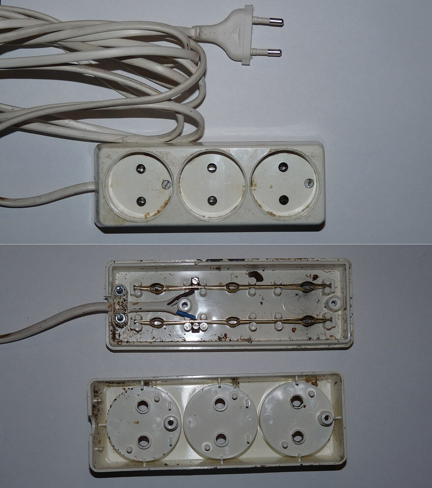
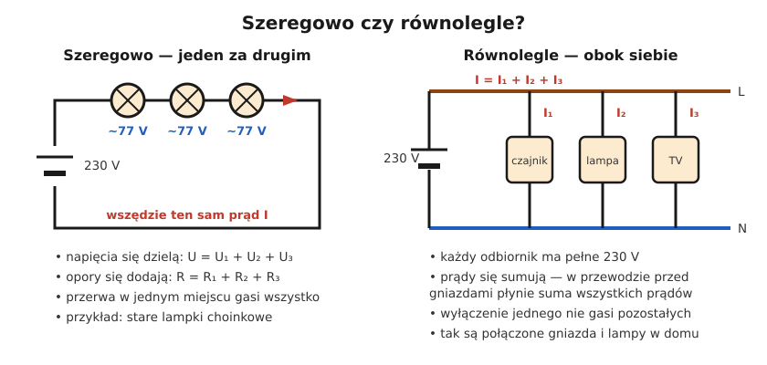

# 01.05 — Połączenie szeregowe i równoległe

> **Moduł:** [01 — Prąd, napięcie, opór, moc i energia](README.md) · **Oznaczenia:** 🟢 · **Zakres SEP:** (a) · **Status:** ✅ pełny
>
> **Czytaj:**
>
> - OpenStax, *Fizyka dla szkół wyższych*, t. 2, rozdz. 10 „Obwody prądu stałego”: § 10.2 „Rezystory połączone szeregowo i równolegle”, § 10.3 „Prawa Kirchhoffa”
> - Układy łączników (szeregowe połączenie łącznika z lampą): [moduł 18](../18-oswietlenie/README.md)

[← poprzedni temat](01.04-moc-i-energia-waty-kilowatogodziny-i-rachunek.md) · [spis modułu](README.md) · [następny temat →](01.06-grzanie-przewodow-i-spadek-napiecia.md)

## Po co to jest

W domu wszystkie gniazda i lampy jednego obwodu są połączone **równolegle**. Każde urządzenie ma pełne 230 V, ale ich prądy dodają się w przewodzie, który idzie z rozdzielnicy. To jest powód, dla którego czajnik, grzejnik i mikrofalówka z jednej listwy wyłączają „esa”. Szeregowo łączy się łącznik z lampą, zabezpieczenie z obwodem i elementy dawnych lampek choinkowych. Te dwa sposoby łączenia rządzą się przeciwnymi zasadami i trzeba je odróżniać.

## Po ludzku

**Szeregowo — jeden za drugim**, jak wagony pociągu. Prąd ma tylko jedną drogę, więc:

- przez wszystkie elementy płynie **ten sam prąd**,
- napięcie źródła **dzieli się** między elementy (20 żaróweczek na 230 V dostaje po 11,5 V),
- opory się **dodają**,
- przerwa w jednym miejscu gasi wszystko, tak jak przepalona żaróweczka w starym łańcuchu choinkowym.

**Równolegle — obok siebie**, jak pasy na autostradzie. Każdy element jest podłączony bezpośrednio między L i N, więc:

- każdy ma **pełne napięcie** 230 V,
- prądy się **sumują** w przewodzie przed rozgałęzieniem,
- opór zastępczy jest **mniejszy** niż najmniejszy z oporów (więcej „pasów” to łatwiejszy przepływ),
- wyłączenie jednego odbiornika nie wpływa na pozostałe.

**Dlaczego instalacja jest równoległa?** Bo każde urządzenie potrzebuje 230 V niezależnie od tego, co jeszcze jest włączone. Cena za to jest taka, że przewód od rozdzielnicy do pierwszego gniazda niesie sumę prądów wszystkich urządzeń w obwodzie. Zabezpieczenie w rozdzielnicy chroni właśnie ten przewód.

**Gdzie jest szeregowo?** Łącznik jest w szeregu z lampą: jego otwarcie przerywa jedyną drogę prądu. Wyłącznik nadprądowy jest w szeregu z całym obwodem. Uszkodzenie też bywa szeregowe: luźny zacisk to dodatkowy mały opór w szeregu z odbiornikiem ([01.06](01.06-grzanie-przewodow-i-spadek-napiecia.md)).

## Jak to wygląda

*Na co patrzeć: w środku listwy biegną dwie mosiężne szyny, a każde gniazdo „siedzi” na obu. To połączenie równoległe: każde gniazdo ma te same 230 V, a przez przewód zasilający płynie suma prądów wszystkich podłączonych urządzeń. Ta listwa ma płaską wtyczkę typu „euro”, przeznaczoną do prądu najwyżej 2,5 A (ok. 575 W), i nie ma styku ochronnego. Podłączenie do niej czajnika to proszenie się o przegrzanie wtyczki.*

## Schemat

## Pojęcia

| Pojęcie | Po ludzku | Termin normowy / symbol |
|---------|-----------|-------------------------|
| Połączenie szeregowe | Jeden za drugim, jedna droga dla prądu | połączenie szeregowe |
| Połączenie równoległe | Obok siebie, każdy między tymi samymi dwoma punktami | połączenie równoległe |
| Opór zastępczy | Jeden opór, który „udaje” całą grupę | rezystancja zastępcza, $R_z$ |
| Węzeł | Punkt, w którym rozgałęzia się prąd (zacisk, złączka, listwa) | węzeł obwodu |
| I prawo Kirchhoffa | Suma prądów wpływających do węzła = suma wypływających | prawo prądowe Kirchhoffa |
| II prawo Kirchhoffa | Suma napięć w zamkniętej pętli = 0 (napięcie źródła rozkłada się na elementy) | prawo napięciowe Kirchhoffa |

## Liczby do zapamiętania

| Wielkość | Szeregowo | Równolegle | Źródło |
|----------|-----------|------------|--------|
| Prąd | ten sam: $I = I_1 = I_2 = \ldots$ | suma: $I = I_1 + I_2 + \ldots$ | prawa Kirchhoffa |
| Napięcie | suma: $U = U_1 + U_2 + \ldots$ | to samo: $U = U_1 = U_2 = \ldots$ | jw. |
| Opór zastępczy | $R = R_1 + R_2 + \ldots$ | $\dfrac{1}{R} = \dfrac{1}{R_1} + \dfrac{1}{R_2} + \ldots$ | jw. |
| Dwa jednakowe opory | $2R$ | $R/2$ | jw. |
| Moc całkowita | suma mocy (zawsze) | suma mocy (zawsze) | zasada zachowania energii |

| Granica | Wartość | Uwagi |
|---------|---------|-------|
| Gniazdo i wtyczka z bolcem (typ E/F) | **16 A / 3680 W** | maksymalnie dla gniazda i całej listwy z takim gniazdem |
| Płaska wtyczka „euro” (bez styku ochronnego) | **2,5 A / ok. 575 W** | lampki, ładowarki, małe RTV |
| Obwód gniazd z wyłącznikiem B16 | **16 A łącznie** dla wszystkich gniazd obwodu | suma prądów, nie na każde gniazdo |

## W praktyce

**Ile można podłączyć do jednego obwodu gniazd?**

1. Sprawdź w rozdzielnicy, jakim wyłącznikiem chroniony jest obwód (np. B16 — 16 A).
2. Zsumuj moce urządzeń, które **mogą działać jednocześnie** w gniazdach tego obwodu. Pamiętaj, że jeden obwód często obejmuje kilka pomieszczeń.
3. Podziel sumę przez 230 V. Wynik powinien być wyraźnie poniżej prądu wyłącznika.

**Listwy i przedłużacze:**

- Nie łącz listw łańcuchem (listwa do listwy). Prąd wszystkich urządzeń płynie przez pierwszą wtyczkę i pierwszy przewód.
- Urządzeń grzejnych (czajnik, grzejnik, żelazko) nie zasilaj przez listwę z cienkim przewodem ani przez wtyczkę „euro”.
- Stałe zasilanie przez przedłużacz jest sygnałem, że brakuje gniazd albo obwodów ([00.04](../00-bezpieczenstwo-najpierw/00.04-czerwone-flagi-kiedy-przerwac-prace-i-wezwac.md)).

## Błędy i zagrożenia

- ⚠️ **„Każde gniazdo ma swoje 16 A”.** Nie ma: 16 A ma cały obwód, a wszystkie jego gniazda dzielą ten sam przewód i to samo zabezpieczenie.
- ⚠️ **Łańcuch listew i przedłużaczy.** Suma prądów przechodzi przez najsłabsze ogniwo, zwykle wtyczkę albo cienki przewód pierwszej listwy.
- **Łącznik w przewodzie N zamiast L.** Lampa gaśnie, bo łącznik przerywa obwód szeregowy, ale oprawa po wyłączeniu nadal jest pod napięciem fazy. Groźne przy wymianie żarówki (moduł 18).
- **Mylenie spadku napięcia z „podziałem” w równoległym.** W połączeniu równoległym każdy odbiornik ma to samo napięcie, ale tylko „na papierze”. W prawdziwym obwodzie część napięcia zostaje na przewodzie, który jest w szeregu z całą grupą ([01.06](01.06-grzanie-przewodow-i-spadek-napiecia.md)).

## Przykład

**Sytuacja.** W kuchni z jednego obwodu (wyłącznik B16) jednocześnie pracują czajnik 2000 W, grzejnik olejowy 2000 W i mikrofalówka 1200 W. Jaki prąd płynie przewodem z rozdzielnicy i jaki jest opór zastępczy?

**Rozwiązanie.** Każde urządzenie jest podłączone równolegle i ma 230 V. Prądy:

$$I_{cz} = \frac{2000}{230} \approx 8{,}7\ \mathrm{A} \qquad I_{gr} \approx 8{,}7\ \mathrm{A} \qquad I_{mf} = \frac{1200}{230} \approx 5{,}2\ \mathrm{A}$$

$$I = 8{,}7 + 8{,}7 + 5{,}2 = 22{,}6\ \mathrm{A}$$

Opory: czajnik i grzejnik po 26,45 Ω, mikrofalówka (traktowana jak opór) $230^2 / 1200 \approx 44{,}1\ \Omega$:

$$\frac{1}{R_z} = \frac{1}{26{,}45} + \frac{1}{26{,}45} + \frac{1}{44{,}1} \approx 0{,}0983\ \frac{1}{\Omega} \qquad R_z \approx 10{,}2\ \Omega$$

**Sprawdzenie.** $230 / 10{,}2 \approx 22{,}6\ \mathrm{A}$ ✓, a $5200\ \mathrm{W} / 230\ \mathrm{V} \approx 22{,}6\ \mathrm{A}$ ✓. Opór zastępczy (10,2 Ω) jest mniejszy niż najmniejszy z oporów (26,45 Ω), tak jak powinien.

**Wniosek.** 22,6 A to 1,41 raza więcej niż 16 A, czyli przeciążenie. Wyłącznik zadziała członem termicznym, ale nie od razu, a nawet po kilkudziesięciu minutach ([01.07](01.07-przeciazenie-a-zwarcie-dwie-rozne-awarie.md)). Przez ten czas przewód pracuje w podwyższonej temperaturze.

## Pytania SEP

1. **Czym różni się połączenie szeregowe od równoległego?**

Odpowiedź

W połączeniu szeregowym przez wszystkie elementy płynie ten sam prąd, napięcie źródła dzieli się między elementy, a rezystancje się sumują. Przerwa w jednym elemencie przerywa cały obwód. W połączeniu równoległym na wszystkich elementach jest to samo napięcie, prądy się sumują, a odwrotność rezystancji zastępczej jest sumą odwrotności rezystancji. Elementy działają niezależnie od siebie.

2. **Jak są połączone odbiorniki w instalacji domowej i co z tego wynika dla przewodów i zabezpieczeń?**

Odpowiedź

Równolegle, między przewodem fazowym i neutralnym, dzięki czemu każdy odbiornik ma napięcie 230 V i działa niezależnie. Przez przewód zasilający obwód płynie suma prądów wszystkich pracujących odbiorników. Przekrój tego przewodu i prąd zabezpieczenia muszą być dobrane do tej sumy. Przy zbyt wielu odbiornikach dochodzi do przeciążenia.

3. **Dlaczego łącznik oświetlenia włącza się w przewód fazowy?**

Odpowiedź

Łącznik jest połączony szeregowo z lampą, więc jego otwarcie przerywa przepływ prądu niezależnie od tego, w który przewód go włączono. Tylko przerwanie przewodu fazowego sprawia jednak, że po wyłączeniu oprawa i oprawka nie mają napięcia względem ziemi. Łącznik w przewodzie N zostawia na oprawie fazę, co grozi porażeniem przy wymianie źródła światła.

## Sprawdź się

1. Do listwy na 16 A podłączono komputer (300 W), monitor (50 W), drukarkę laserową (w czasie drukowania 900 W) i czajnik (2000 W). Czy listwa jest przeciążona?

Odpowiedź

Suma: $300 + 50 + 900 + 2000 = 3250\ \mathrm{W}$, czyli $3250/230 \approx 14{,}1\ \mathrm{A}$. To mniej niż 16 A, ale blisko granicy. W tym samym obwodzie mogą jednak działać jeszcze inne gniazda. Czajnik lepiej podłączyć do gniazda w kuchni.

2. Dwie jednakowe grzałki po 1000 W (230 V) połączono szeregowo i podłączono do 230 V. Jaką moc będzie miał zestaw?

Odpowiedź

Każda grzałka ma $R = 230^2/1000 = 52{,}9\ \Omega$. Szeregowo: $R = 105{,}8\ \Omega$, więc $P = 230^2 / 105{,}8 = 500\ \mathrm{W}$. Dwie grzałki szeregowo dają łącznie połowę mocy jednej grzałki, bo każda dostaje tylko 115 V, a moc zależy od kwadratu napięcia. Tak działają niektóre przełączniki mocy w grzejnikach.

3. Na [zdjęciu listwy](../../assets/foto/01-przedluzacz-z-listwa.jpg) wskaż, co świadczy o połączeniu równoległym gniazd, i podaj dwie wady tej listwy.

Odpowiedź

Dwie szyny biegną wzdłuż wszystkich gniazd i każde gniazdo jest dołączone do obu, więc wszystkie gniazda są między tymi samymi dwoma przewodami, czyli równolegle. Wady: brak styku i przewodu ochronnego oraz płaska wtyczka „euro” dopuszczona tylko do 2,5 A, przy gniazdach, do których można włożyć urządzenia większej mocy.

## Źródła

- OpenStax, *Fizyka dla szkół wyższych*, t. 2, rozdz. 10 „Obwody prądu stałego”, § 10.2 i § 10.3.
- Wtyczki i gniazda: PN-IEC 60884-1 (gniazda wtyczkowe do 16 A); wtyczka płaska CEE 7/16 — 2,5 A (szczegóły w [module 06](../06-osprzet-instalacyjny/README.md)).

---

[← poprzedni temat](01.04-moc-i-energia-waty-kilowatogodziny-i-rachunek.md) · [spis modułu](README.md) · [następny temat →](01.06-grzanie-przewodow-i-spadek-napiecia.md)
