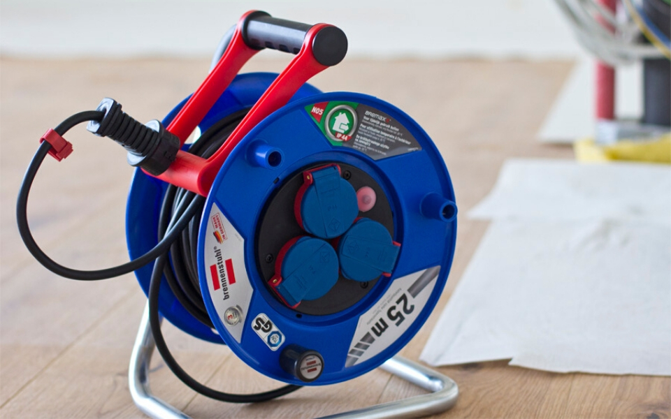
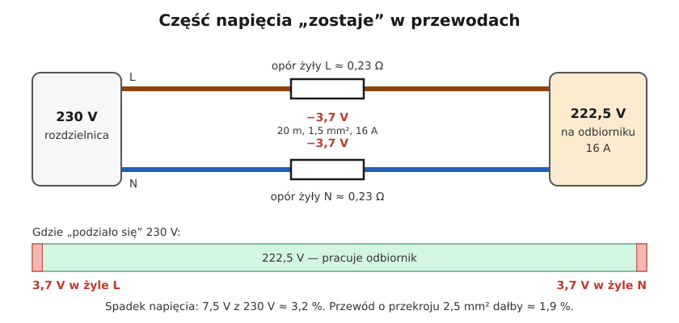
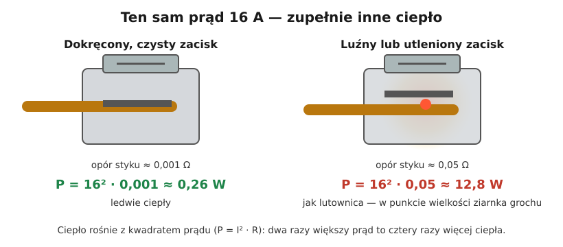

# 01.06 — Grzanie przewodów i spadek napięcia

> **Moduł:** [01 — Prąd, napięcie, opór, moc i energia](README.md) · **Oznaczenia:** 🟢 · **Zakres SEP:** (a) · **Status:** ✅ pełny
>
> **Czytaj:**
>
> - PN-HD 60364-5-52 — dobór i montaż oprzewodowania: obciążalność prądowa i spadek napięcia (załącznik informacyjny G)
> - N SEP-E-002 *Instalacje elektryczne w obiektach budowlanych. Instalacje elektryczne w obiektach mieszkalnych. Podstawy planowania* — dopuszczalny spadek napięcia
> - Dobór przekroju w praktyce: [moduł 05](../05-przewody-i-kable/README.md) i [moduł 16](../16-planowanie-obwodow/README.md)

[← poprzedni temat](01.05-polaczenie-szeregowe-i-rownolegle.md) · [spis modułu](README.md) · [następny temat →](01.07-przeciazenie-a-zwarcie-dwie-rozne-awarie.md)

## Po co to jest

Każdy przewód ma opór, więc przy przepływie prądu robią się dwie rzeczy. **Przewód się grzeje**, a za ciepło odpowiada izolacja, która przy za wysokiej temperaturze starzeje się, mięknie i w końcu się topi. **Część napięcia „zostaje” w przewodzie**, więc odbiornik na końcu dostaje mniej niż 230 V. Z tych dwóch zjawisk wynika dobór przekroju przewodu ([moduł 16](../16-planowanie-obwodow/README.md)), zakaz używania zwiniętego przedłużacza i to, że luźny zacisk potrafi spalić puszkę. Na egzaminie: czym jest spadek napięcia, od czego zależy, jakie są dopuszczalne wartości i dlaczego słabe połączenia są groźne.

## Po ludzku

**Ciepło w przewodzie.** Prąd płynący przez opór wydziela ciepło:

$$P = I^2 \cdot R$$

Ważny jest kwadrat: dwa razy większy prąd to **cztery razy** więcej ciepła. Przewód oddaje ciepło do otoczenia, a ustala się temperatura, przy której ciepło wydzielane i oddawane są równe. Na tym polega obciążalność: przewód w ścianie albo w wiązce chłodzi się gorzej niż na powietrzu, więc może przenieść mniejszy prąd ([moduł 05](../05-przewody-i-kable/README.md)). Izolacja PVC jest projektowana na długotrwałą pracę w **70 °C**.

**Zwinięty przedłużacz to grzałka.** Na bębnie zwoje przewodu leżą jeden na drugim i nie mają jak oddawać ciepła. Producenci podają dwie moce: dla przewodu zwiniętego (zwykle około 1000 W) i rozwiniętego (zwykle 3000–3500 W). Kosiarka 2000 W na zwiniętym bębnie może stopić izolację w środku zwoju.

**Spadek napięcia.** Przewód L i przewód N to opory połączone **szeregowo** z odbiornikiem ([01.05](01.05-polaczenie-szeregowe-i-rownolegle.md)). Napięcie 230 V dzieli się więc między przewody i odbiornik. Na przewodach traci się kilka woltów, a odbiornik dostaje resztę. Im dłuższy i cieńszy przewód oraz im większy prąd, tym większy spadek:

$$\Delta U = I \cdot R_{L+N} = I \cdot \frac{2 \cdot l \cdot \rho}{S}$$

(dla obwodu jednofazowego i odbiornika rezystancyjnego; $l$ — odległość od rozdzielnicy do odbiornika).

**Luźny zacisk.** Styk dwóch metali nigdy nie jest idealny. Dokręcony, czysty zacisk ma opór rzędu tysięcznej części oma. Luźny albo utleniony może mieć opór kilkadziesiąt razy większy. Cały ten opór jest skupiony w punkcie wielkości ziarnka grochu, więc nawet kilkanaście watów ciepła rozgrzewa go do temperatury, w której topi się plastik. **Wyłącznik nadprądowy tego nie zauważy**, bo prąd w obwodzie wcale nie rośnie ([01.07](01.07-przeciazenie-a-zwarcie-dwie-rozne-awarie.md)).

## Jak to wygląda

*Na co patrzeć: przewód jest nawinięty ciasno, warstwa na warstwę. Na obudowie takich bębnów jest naklejka z dwiema mocami: dla zwiniętego i rozwiniętego przewodu. Przy urządzeniach dużej mocy (kosiarka, nagrzewnica, myjka ciśnieniowa) bęben trzeba rozwinąć do końca. Wiele bębnów ma też wyłącznik termiczny, który odłącza zasilanie przy przegrzaniu, ale nie należy na nim polegać.*

## Schemat

## Pojęcia

| Pojęcie | Po ludzku | Termin normowy / symbol |
|---------|-----------|-------------------------|
| Ciepło Joule'a | Ciepło wydzielane przez prąd w oporze | straty mocy, $P = I^2 R$ |
| Obciążalność prądowa | Największy prąd, jaki przewód może przewodzić długo bez przegrzania | obciążalność prądowa długotrwała, $I_z$ |
| Temperatura dopuszczalna izolacji | Temperatura, w której izolacja może pracować latami | 70 °C (PVC), 90 °C (XLPE, guma silikonowa — zależnie od typu) |
| Spadek napięcia | Napięcie „zgubione” na przewodach między źródłem a odbiornikiem | spadek napięcia, ΔU, w V lub w % napięcia znamionowego |
| Rezystancja przejścia | Opór w miejscu połączenia dwóch elementów | rezystancja styku |

## Liczby do zapamiętania

| Wielkość | Wartość | Kiedy obowiązuje | Źródło |
|----------|---------|------------------|--------|
| Ciepło w przewodzie | $P = I^2 R$ — **2 × prąd = 4 × ciepło** | zawsze | prawo Joule'a |
| Spadek napięcia (1 faza) | $\Delta U = \dfrac{2\, l\, I\, \rho}{S}$; $\Delta U\% = \dfrac{\Delta U}{230} \cdot 100\%$ | obwód jednofazowy, odbiornik rezystancyjny | dokładniejsze wzory — [moduł 16](../16-planowanie-obwodow/README.md) |
| Dopuszczalny spadek od licznika do odbiornika | **3 %** | instalacje w budynkach mieszkalnych | N SEP-E-002 |
| Zalecany maksymalny spadek (od złącza) | **3 %** oświetlenie, **5 %** inne odbiorniki | instalacje zasilane z publicznej sieci nN | PN-HD 60364-5-52, zał. G (informacyjny) |
| Temperatura pracy izolacji PVC | **70 °C** | praca długotrwała | normy przewodów, [moduł 05](../05-przewody-i-kable/README.md) |
| Przedłużacz na bębnie | moc dla **zwiniętego** przewodu kilka razy mniejsza niż dla rozwiniętego | wartości z etykiety bębna | instrukcja producenta |
| Ciepło w luźnym zacisku przy 16 A | **12,8 W** przy 0,05 Ω (vs 0,26 W przy 0,001 Ω) | ilustracja | $P = I^2 R$ |

## W praktyce

**Szybka ocena spadku napięcia w obwodzie:**

1. Odczytaj długość trasy przewodu od rozdzielnicy do najdalszego odbiornika (nie w linii prostej — po ścianach).
2. Policz opór pętli: $R = 0{,}0175 \cdot 2l / S$.
3. Pomnóż przez prąd odbiornika (albo prąd zabezpieczenia, jeśli liczysz najgorszy przypadek).
4. Podziel przez 230 V i porównaj z 3 %.

**Zasady dla przedłużaczy:**

- Rozwijaj bęben do końca przy każdym urządzeniu powyżej kilkuset watów.
- Na długie dystanse (ogród, budowa) wybieraj przewód 2,5 mm², a nie 1,5 mm².
- Ciepła wtyczka albo przewód po kilkunastu minutach pracy to sygnał, że przedłużacz jest za słaby albo ma uszkodzony styk.

**Zaciski:**

- Dokręcaj zaciski śrubowe momentem podanym przez producenta osprzętu, najlepiej wkrętakiem dynamometrycznym ([moduł 19](../19-prace-krok-po-kroku/README.md)).
- Linki (przewody wielodrutowe) zakańczaj tulejkami, bo pojedyncze druciki pod śrubą rozchodzą się i styk słabnie.
- W rozdzielnicy po kilku tygodniach od montażu warto sprawdzić, czy zaciski się nie poluzowały (miedź się „układa”).

## Błędy i zagrożenia

- ⚠️ **Praca na zwiniętym bębnie.** Najczęstsza przyczyna stopionych przedłużaczy w ogrodach i na budowach.
- ⚠️ **Luźne połączenia.** Nie wyzwalają żadnego zabezpieczenia nadprądowego i potrafią grzać się latami, zanim dojdzie do pożaru. Objawy: przebarwienia, zapach, migotanie światła, ciepła obudowa gniazda.
- **Skręcane połączenia owinięte taśmą.** Z czasem opór styku rośnie (utlenianie, rozluźnianie się przy nagrzewaniu i stygnięciu). Połączenia wykonuje się złączkami lub zaciskami ([moduł 06](../06-osprzet-instalacyjny/README.md)).
- **Za cienki przewód na długim odcinku.** Odbiornik dostaje za mało napięcia: silnik ma problem z rozruchem, grzejnik grzeje słabiej, LED migają, a przewód się grzeje. Do tego przy zwarciu prąd jest mniejszy, więc wyłącznik może nie zadziałać szybko ([01.07](01.07-przeciazenie-a-zwarcie-dwie-rozne-awarie.md)).

## Przykład

**Zadanie.** Kosiarka elektryczna 2000 W na końcu przedłużacza o długości 50 m z przewodem 3×1,5 mm². Jaki jest spadek napięcia i ile ciepła wydziela się w przedłużaczu?

**Dane.** $P = 2000\ \mathrm{W}$, $U = 230\ \mathrm{V}$, $l = 50\ \mathrm{m}$, $S = 1{,}5\ \mathrm{mm^2}$, $\rho = 0{,}0175\ \Omega \cdot \mathrm{mm^2/m}$.

**Prąd:** $I = 2000 / 230 \approx 8{,}7\ \mathrm{A}$.

**Opór pętli L + N:**

$$R = 0{,}0175 \cdot \frac{2 \cdot 50}{1{,}5}\ \Omega \approx 1{,}17\ \Omega$$

**Spadek napięcia:**

$$\Delta U = I \cdot R = 8{,}7 \cdot 1{,}17 \approx 10{,}1\ \mathrm{V} \qquad \Delta U\% = \frac{10{,}1}{230} \cdot 100\% \approx 4{,}4\ \%$$

**Ciepło w przedłużaczu:**

$$P_{\text{straty}} = I^2 R = 8{,}7^2 \cdot 1{,}17 \approx 88\ \mathrm{W}$$

**Sprawdzenie.** $\Delta U \cdot I = 10{,}1 \cdot 8{,}7 \approx 88\ \mathrm{W}$ ✓. Te same 88 W liczone na dwa sposoby.

**Wniosek.** Rozłożone na 50 m rozwiniętego przewodu 88 W to niecałe 2 W na metr i nie stanowi problemu. Te same 88 W w ciasno zwiniętym bębnie podgrzeje środek zwoju do niebezpiecznej temperatury. Przy przewodzie 2,5 mm² spadek wyniósłby około 2,6 %, a straty około 53 W.

## Pytania SEP

1. **Co to jest spadek napięcia i od czego zależy?**

Odpowiedź

To różnica między napięciem na początku linii (np. w rozdzielnicy) a napięciem na jej końcu, przy odbiorniku. Powstaje, bo przewody mają rezystancję, a płynący prąd wywołuje na niej napięcie $\Delta U = I \cdot R$. Spadek rośnie z prądem i długością przewodu, maleje ze wzrostem przekroju i zależy od materiału żyły (aluminium daje większy spadek niż miedź). Przy prądzie przemiennym znaczenie ma też reaktancja przewodów i współczynnik mocy odbiornika.

2. **Jakie są dopuszczalne spadki napięcia w instalacji mieszkaniowej?**

Odpowiedź

Według normy SEP N SEP-E-002 spadek napięcia od licznika do dowolnego odbiornika nie powinien przekraczać 3 %. Załącznik G do PN-HD 60364-5-52, który ma charakter informacyjny, zaleca dla instalacji zasilanych z publicznej sieci nN nie więcej niż 3 % dla oświetlenia i 5 % dla innych odbiorników. Zbyt duży spadek napięcia pogarsza pracę odbiorników i świadczy o za małym przekroju lub zbyt długim obwodzie.

3. **Dlaczego luźne połączenia w instalacji są niebezpieczne?**

Odpowiedź

Luźne lub utlenione połączenie ma dużą rezystancję przejścia. Przy przepływie prądu wydziela się na niej ciepło ($P = I^2 R$) skupione w bardzo małej objętości, co prowadzi do przegrzania, zwęglenia izolacji, iskrzenia i pożaru. Prąd w obwodzie nie rośnie, więc wyłącznik nadprądowy nie reaguje. Zapobiega się temu przez poprawny montaż, właściwy moment dokręcania, tulejki na linkach i okresowe przeglądy, a w niektórych miejscach stosuje się też wyłączniki AFDD ([moduł 10](../10-aparatura-modulowa/README.md)).

4. **Dlaczego bęben przedłużacza należy rozwinąć przy zasilaniu odbiorników dużej mocy?**

Odpowiedź

Zwinięty przewód gorzej oddaje ciepło, bo zwoje nagrzewają się nawzajem. Przy dużym prądzie temperatura wewnątrz zwoju może przekroczyć dopuszczalną temperaturę izolacji i spowodować jej stopienie oraz zwarcie. Producenci podają na bębnie moc dopuszczalną dla przewodu zwiniętego i rozwiniętego.

## Sprawdź się

1. Obwód gniazd w garażu: 35 m przewodu 2,5 mm² od rozdzielnicy, odbiornik pobiera 16 A. Czy spadek napięcia mieści się w 3 %?

Odpowiedź

$R = 0{,}0175 \cdot 70 / 2{,}5 = 0{,}49\ \Omega$; $\Delta U = 16 \cdot 0{,}49 \approx 7{,}8\ \mathrm{V}$; $7{,}8 / 230 \approx 3{,}4\ \%$. Nie mieści się. Do tego dochodzi spadek od licznika do rozdzielnicy. Trzeba dać przewód 4 mm² albo ograniczyć obciążenie obwodu.

2. Prąd w obwodzie wzrósł z 8 A do 12 A. Ile razy wzrosło ciepło wydzielane w przewodzie?

Odpowiedź

$(12/8)^2 = 1{,}5^2 = 2{,}25$ raza.

3. Na [schemacie spadku napięcia](../../assets/schematy/01-spadek-napiecia.svg) zamień przewód na 2,5 mm². Ile woltów zostanie na odbiorniku?

Odpowiedź

Opór każdej żyły: $0{,}0175 \cdot 20 / 2{,}5 = 0{,}14\ \Omega$; spadek na żyle: $16 \cdot 0{,}14 = 2{,}24\ \mathrm{V}$; razem 4,48 V. Na odbiorniku zostanie około 225,5 V, czyli spadek około 1,9 %.

## Źródła

- PN-HD 60364-5-52 — dobór i montaż wyposażenia elektrycznego, oprzewodowanie; obciążalność prądowa przewodów, załącznik G (informacyjny) — spadek napięcia.
- N SEP-E-002 — instalacje elektryczne w obiektach mieszkalnych, podstawy planowania: dopuszczalny spadek napięcia 3 % od licznika do odbiornika.
- [Poradnik Moeller „Instalacje elektryczne”](https://zsznr1.edupage.org/files/poradnik_MOELLER_instalacke_elektryczne%281%29.pdf), rozdz. 2.1.2 — dopuszczalne spadki napięcia według N SEP-E-002.

---

[← poprzedni temat](01.05-polaczenie-szeregowe-i-rownolegle.md) · [spis modułu](README.md) · [następny temat →](01.07-przeciazenie-a-zwarcie-dwie-rozne-awarie.md)
