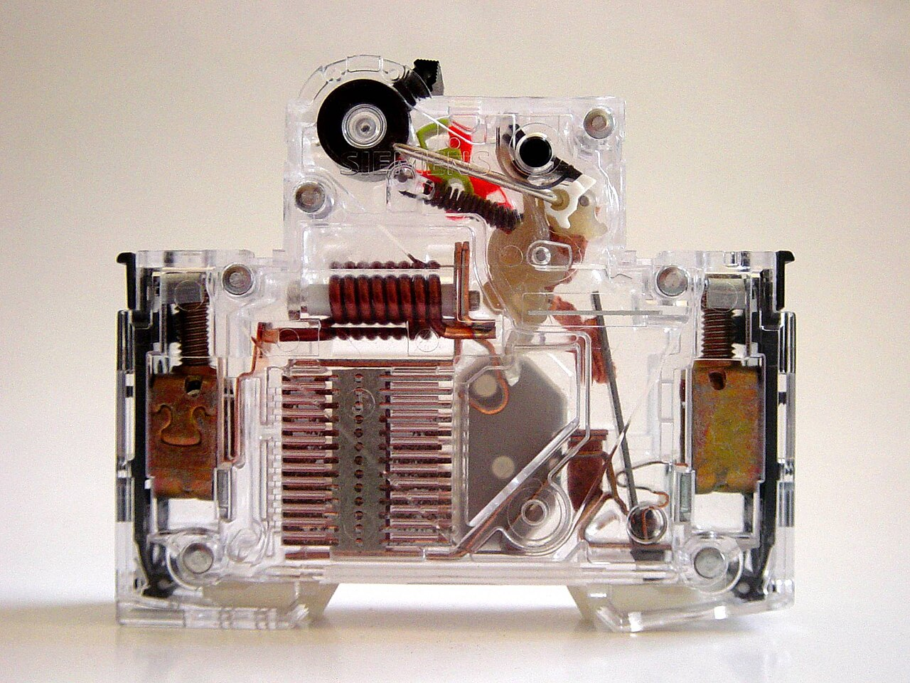
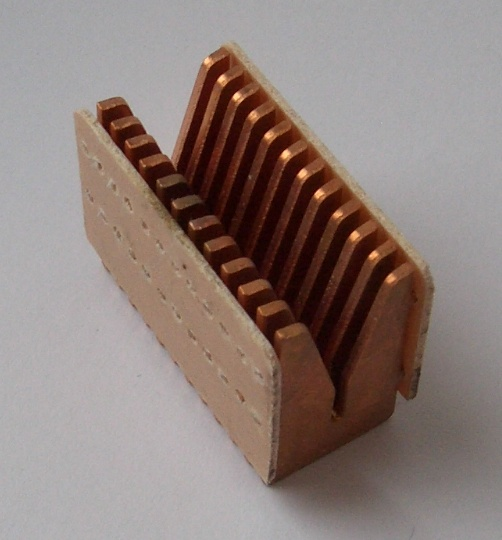
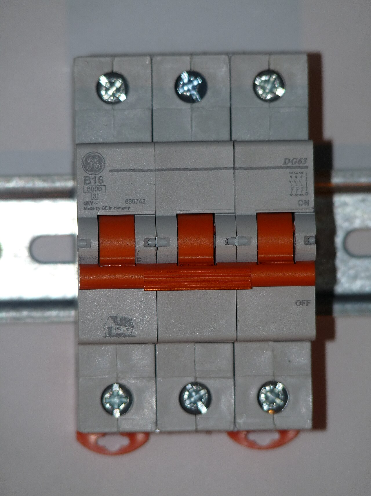
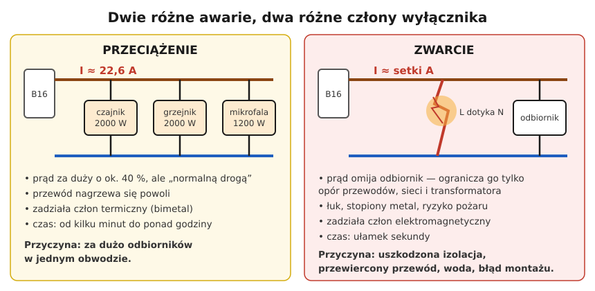

# 01.07 — Przeciążenie a zwarcie — dwie różne awarie

> **Moduł:** [01 — Prąd, napięcie, opór, moc i energia](README.md) · **Oznaczenia:** 🟢 · **Zakres SEP:** (a) · **Status:** ✅ pełny
>
> **Czytaj:**
>
> - PN-EN 60898-1 — wyłączniki nadprądowe do instalacji domowych: prądy umowne i charakterystyki B, C, D (omówienie)
> - PN-HD 60364-4-43 — ochrona przed prądem przetężeniowym (omówienie)
> - Szczegółowo o zabezpieczeniach: [moduł 07](../07-zabezpieczenia-nadpradowe/README.md); o zwarciu do obudowy: [moduł 12](../12-ochrona-przeciwporazeniowa/README.md)

[← poprzedni temat](01.06-grzanie-przewodow-i-spadek-napiecia.md) · [spis modułu](README.md) · (koniec modułu) →

## Po co to jest

„Wybiło esa” może oznaczać dwie zupełnie różne rzeczy: za dużo urządzeń w obwodzie albo uszkodzenie, w którym faza połączyła się z czymś, z czym nie powinna. Od tego, która to awaria, zależy, czy wolno po prostu wyłączyć czajnik i załączyć wyłącznik, czy trzeba szukać uszkodzenia. Wyłącznik nadprądowy ma na każdą z tych awarii osobny człon. Na egzaminie to jedno z podstawowych pytań: czym różni się przeciążenie od zwarcia i co na nie reaguje.

## Po ludzku

**Przeciążenie** to prąd płynący „normalną drogą”, przez odbiorniki, ale większy niż ten, na który zaprojektowano obwód. Przyczyna: za dużo urządzeń naraz ([01.05](01.05-polaczenie-szeregowe-i-rownolegle.md)) albo urządzenie, które pobiera za dużo (zablokowany silnik). Prąd jest za duży o kilkadziesiąt procent, czasem dwa–trzy razy. Przewód nagrzewa się **powoli**, więc nie trzeba go odłączać natychmiast, wystarczy w ciągu minut. Reaguje na to **człon termiczny** wyłącznika: pasek bimetaliczny, który wygina się pod wpływem ciepła.

**Zwarcie** to prąd płynący **„na skróty”**, z pominięciem odbiornika: przewód fazowy styka się z neutralnym, z ochronnym albo z drugą fazą. Przyczyna: uszkodzona izolacja, przewiercony przewód, woda, błąd przy podłączaniu. Opór pętli to tylko przewody, sieć i transformator, czyli ułamki oma. Prąd jest więc ogromny (setki, tysiące amperów) i trzeba go przerwać **w ułamku sekundy**, zanim przewody się stopią i powstanie pożar. Reaguje na to **człon elektromagnetyczny**: cewka, której pole przy dużym prądzie natychmiast wyrywa zamek wyłącznika.

$$I_{zw} = \frac{U_0}{Z_s}$$

gdzie $U_0$ = 230 V, a $Z_s$ to impedancja całej pętli zwarcia, od transformatora do miejsca zwarcia i z powrotem ([moduł 12](../12-ochrona-przeciwporazeniowa/README.md)).

**Łuk elektryczny.** W chwili zwarcia i przy otwieraniu styków powstaje łuk, czyli świecąca plazma o temperaturze kilku tysięcy stopni. Wyłącznik ma **komorę gaszeniową**: zestaw stalowych płytek, które dzielą łuk na krótkie odcinki i go chłodzą. Wyłącznik musi mieć **zdolność zwarciową** większą niż największy prąd zwarcia, jaki może popłynąć w miejscu jego zainstalowania (np. 6 kA albo 10 kA — [moduł 07](../07-zabezpieczenia-nadpradowe/README.md)).

**Trzecia awaria, której wyłącznik nadprądowy nie widzi.** Luźny zacisk albo iskrzące połączenie to ani przeciążenie, ani zwarcie: prąd w obwodzie jest normalny, a ciepło wydziela się w jednym punkcie ([01.06](01.06-grzanie-przewodow-i-spadek-napiecia.md)). Wyłącznik nadprądowy nie zareaguje. Tę lukę zamykają detektory iskrzenia AFDD ([moduł 10](../10-aparatura-modulowa/README.md)).

## Jak to wygląda

*Na co patrzeć: miedziana cewka nawinięta w górnej części to wyzwalacz elektromagnetyczny, który reaguje na zwarcie. Rząd równoległych płytek w lewej dolnej części to komora gaszeniowa, w której gaśnie łuk. U góry jest mechanizm zamka z dźwignią, a po bokach zaciski przyłączeniowe. Wyzwalacz termiczny (bimetal) to cienki pasek w torze prądowym. W tak małym aparacie są dwa niezależne zabezpieczenia.*

*Na co patrzeć: płytki ustawione w szeregu z małymi odstępami. Łuk wciągany między nie dzieli się na kilka krótszych łuków, które szybko się chłodzą i gasną. Każdy z nich potrzebuje kilkunastu–kilkudziesięciu woltów, żeby się utrzymać, a łącznie potrzebowałyby więcej, niż daje sieć.*

*Na co patrzeć: na froncie oznaczenie charakterystyki i prądu znamionowego, np. „B16”. Litera mówi, przy jakiej krotności prądu zadziała człon elektromagnetyczny, a liczba to prąd, który wyłącznik przewodzi bez końca ([moduł 07](../07-zabezpieczenia-nadpradowe/README.md)). Trzy bieguny połączone wspólną dźwignią wyłączają razem wszystkie trzy fazy.*

## Schemat

## Pojęcia

| Pojęcie | Po ludzku | Termin normowy / symbol |
|---------|-----------|-------------------------|
| Przetężenie | Każdy prąd większy niż znamionowy — wspólna nazwa | prąd przetężeniowy |
| Przeciążenie | Za duży prąd w nieuszkodzonym obwodzie | prąd przeciążeniowy |
| Zwarcie | Połączenie przewodów o różnych potencjałach z pominięciem odbiornika | zwarcie; prąd zwarciowy $I_k$ |
| Zwarcie doziemne | Faza dotyka przewodu ochronnego, obudowy, ziemi | zwarcie L–PE ([moduł 12](../12-ochrona-przeciwporazeniowa/README.md)) |
| Wyzwalacz termiczny | Bimetal: wygina się pod wpływem ciepła i otwiera zamek | wyzwalacz przeciążeniowy |
| Wyzwalacz elektromagnetyczny | Cewka, która przy dużym prądzie natychmiast otwiera zamek | wyzwalacz zwarciowy |
| Prąd znamionowy | Prąd, który wyłącznik przewodzi bez ograniczenia czasu | $I_n$ |
| Impedancja pętli zwarcia | Łączny „opór” drogi prądu zwarcia | $Z_s$ |
| Zdolność zwarciowa | Największy prąd zwarcia, który wyłącznik bezpiecznie przerwie | $I_{cn}$, np. 6 kA, 10 kA |

## Liczby do zapamiętania

| Wielkość | Wartość | Kiedy obowiązuje | Źródło |
|----------|---------|------------------|--------|
| Prąd zwarcia | $I_{zw} = \dfrac{U_0}{Z_s}$ | $U_0$ = 230 V, $Z_s$ — impedancja pętli | prawo Ohma; [moduł 12](../12-ochrona-przeciwporazeniowa/README.md) |
| Umowny prąd niezadziałania | **1,13 $I_n$** — nie zadziała przez 1 h | wyłączniki do 63 A, stan zimny | PN-EN 60898-1 |
| Umowny prąd zadziałania | **1,45 $I_n$** — zadziała w czasie krótszym niż 1 h | wyłączniki do 63 A, po próbie 1,13 $I_n$ | jw. |
| Strefa między 1,13 a 1,45 $I_n$ | czas zadziałania **nieokreślony** — od minut do ponad godziny | przeciążenie | jw. |
| Zadziałanie natychmiastowe (człon elektromagnetyczny) | **B: 3–5 $I_n$** · **C: 5–10 $I_n$** · **D: 10–20 $I_n$** | prąd przemienny | jw.; [moduł 07](../07-zabezpieczenia-nadpradowe/README.md) |
| B16 — prąd pewnego zadziałania natychmiastowego | **80 A** (5 × 16 A) | charakterystyka B | jw. |

## W praktyce

**Wyłącznik zadziałał — przeciążenie czy zwarcie?**

| Objaw | Raczej przeciążenie | Raczej zwarcie |
|-------|---------------------|----------------|
| Kiedy zadziałał | po kilku–kilkudziesięciu minutach pracy dużych odbiorników | natychmiast po włączeniu urządzenia, wkręceniu żarówki, wierceniu |
| Co słychać i widać | nic | trzask, błysk, czasem zapach albo ślad nadpalenia |
| Ponowne załączenie | da się załączyć od razu albo po chwili (bimetal stygnie) | wyłącza natychmiast po załączeniu |
| Co zrobić | wyłączyć część odbiorników, rozłożyć je na inne obwody | odłączyć wszystkie urządzenia i szukać uszkodzenia ([moduł 20](../20-diagnostyka-usterek/README.md)) |

**Nie „wzmacniaj” zabezpieczenia.** Wyłącznik dobiera się do przewodu, a nie do urządzeń. Wymiana B16 na B20 albo C25 „bo wybija” sprawia, że przewód 2,5 mm² może być przeciążany bez reakcji wyłącznika. To prosta droga do pożaru ([moduł 07](../07-zabezpieczenia-nadpradowe/README.md)).

## Błędy i zagrożenia

- ⚠️ **Wielokrotne załączanie na zwarcie.** Każde załączenie to łuk w miejscu uszkodzenia i obciążenie wyłącznika. Po drugim zadziałaniu natychmiastowym szukaj przyczyny, nie próbuj dalej.
- ⚠️ **Większy wyłącznik zamiast naprawy przyczyny.** Wyłącznik chroni przewód. Za duży prąd znamionowy oznacza, że przewód się przegrzeje, zanim wyłącznik zadziała.
- ⚠️ **„Drutowanie” bezpieczników topikowych.** Wkładka zastąpiona drutem nie chroni przed niczym. Przy zwarciu przewody stopią się w ścianie.
- **Założenie, że wyłącznik chroni przed porażeniem.** Wyłącznik nadprądowy reaguje na setki amperów, a człowieka zabijają dziesiątki miliamperów. Przed porażeniem chronią: izolacja, PE, samoczynne wyłączenie przy zwarciu do obudowy i wyłącznik różnicowoprądowy (moduły 08 i 12).
- **Za długi i za cienki obwód.** Duża impedancja pętli to mały prąd zwarcia, który może nie wywołać natychmiastowego zadziałania (przykład niżej).

## Przykład

**Zadanie.** Gniazdo zabezpieczone wyłącznikiem B16. W gnieździe nastąpiło zwarcie L–N. Ile wyniesie prąd zwarcia i czy wyłącznik zadziała natychmiast, jeśli impedancja pętli wynosi (a) 0,8 Ω, (b) 3 Ω? A gdyby zamiast B16 był C16?

**Rozwiązanie.**

(a) $I_{zw} = 230 / 0{,}8 \approx 288\ \mathrm{A}$, czyli $288 / 16 \approx 18$ razy więcej niż $I_n$. B16 zadziała natychmiast, bo próg pewnego zadziałania to 5 × 16 = 80 A. C16 też, bo jego próg to 10 × 16 = 160 A.

(b) $I_{zw} = 230 / 3 \approx 77\ \mathrm{A}$, czyli $77/16 \approx 4{,}8\ I_n$. B16: wartość leży między 3 a 5 $I_n$, więc wyłącznik **może, ale nie musi** zadziałać natychmiast. Pewnego zadziałania norma gwarantuje dopiero od 80 A. C16 (próg 160 A) **nie zadziała** natychmiast i wyłączy dopiero członem termicznym, po sekundach. Przez ten czas przewody się grzeją, a przy zwarciu do obudowy na obudowie byłoby niebezpieczne napięcie.

**Sprawdzenie.** Jednostki: V / Ω = A ✓. Wynik (b) jest mniejszy, bo impedancja większa ✓.

**Wniosek.** O skuteczności wyłącznika decyduje nie tylko jego prąd znamionowy, ale też impedancja pętli zwarcia, czyli długość i przekrój przewodów oraz parametry sieci. Dlatego mierzy się ją przy pomiarach odbiorczych i okresowych ([moduł 23](../23-pomiary-odbiorcze-i-okresowe/README.md)), a w module 12 poznasz warunek skuteczności samoczynnego wyłączenia.

## Pytania SEP

1. **Czym różni się przeciążenie od zwarcia?**

Odpowiedź

Przeciążenie to przepływ prądu większego od dopuszczalnego w nieuszkodzonym obwodzie, przez odbiorniki, np. przy zbyt wielu włączonych urządzeniach. Prąd jest większy o kilkadziesiąt procent lub kilka razy, a przewody nagrzewają się stopniowo. Zwarcie to połączenie, przez uszkodzenie lub błąd, punktów o różnych potencjałach z pominięciem odbiornika. Prąd ogranicza wtedy tylko impedancja pętli zwarcia, więc osiąga setki lub tysiące amperów. Grozi to natychmiastowym przegrzaniem, łukiem i pożarem, dlatego zwarcie musi być wyłączone w bardzo krótkim czasie.

2. **Jakie człony ma wyłącznik nadprądowy i na co reaguje każdy z nich?**

Odpowiedź

Człon termiczny (bimetaliczny) reaguje na przeciążenia: im większy prąd, tym szybciej bimetal się nagrzewa i wygina, zwalniając zamek. Wyłącza z opóźnieniem zależnym od prądu, od sekund do ponad godziny. Człon elektromagnetyczny (cewka z kotwiczką) reaguje na zwarcia: po przekroczeniu określonej krotności prądu znamionowego (B: 3–5, C: 5–10, D: 10–20 $I_n$) wyłącza bez celowego opóźnienia, w czasie poniżej 0,1 s. Łuk powstający przy wyłączaniu gaśnie w komorze gaszeniowej.

3. **Od czego zależy wartość prądu zwarciowego?**

Odpowiedź

Od napięcia i impedancji pętli zwarcia: $I_k = U_0 / Z_s$. Na impedancję pętli składają się impedancja transformatora zasilającego, linii zasilającej, przyłącza, WLZ i przewodów obwodu aż do miejsca zwarcia i z powrotem. Im dalej od transformatora, im dłuższe i cieńsze przewody, tym mniejszy prąd zwarcia. Mały prąd zwarcia może nie wywołać natychmiastowego zadziałania wyłącznika.

4. **Co oznacza oznaczenie B16 na wyłączniku nadprądowym?**

Odpowiedź

B to charakterystyka czasowo-prądowa: człon elektromagnetyczny zadziała przy prądzie od 3 do 5 razy większym od znamionowego. 16 to prąd znamionowy w amperach, który wyłącznik może przewodzić w sposób ciągły. Dla B16 natychmiastowe zadziałanie jest pewne przy prądzie co najmniej 80 A.

## Sprawdź się

1. Wyłącznik B10 w obwodzie oświetlenia zadziałał natychmiast, gdy wkręcano żarówkę do lampy, której łącznik był załączony. Po ponownym załączeniu wyłącznika wszystko działa. Przeciążenie czy zwarcie i jaka mogła być przyczyna?

Odpowiedź

Zwarcie, chwilowe. Przy wkręcaniu gwint żarówki mógł zetknąć się jednocześnie z kontaktem środkowym i gwintem oprawki albo żarnik przepalił się z łukiem (to typowe przy tradycyjnych żarówkach). Uszkodzenie zniknęło, więc wyłącznik daje się załączyć. Wniosek: żarówkę wymienia się przy wyłączonym obwodzie.

2. Obwód B16 w kuchni wyłącza się po około 40 minutach, gdy pracują jednocześnie piekarnik 3000 W i czajnik 2000 W. Policz prąd i wyjaśnij, dlaczego nie od razu.

Odpowiedź

$I = 5000 / 230 \approx 21{,}7\ \mathrm{A} \approx 1{,}36\ I_n$. To przeciążenie w strefie między 1,13 a 1,45 $I_n$, w której czas zadziałania członu termicznego jest nieokreślony i może sięgać godziny. Rozwiązanie: osobny obwód dla piekarnika ([moduł 16](../16-planowanie-obwodow/README.md)), a nie większy wyłącznik.

3. Na [zdjęciu wnętrza wyłącznika](../../assets/foto/01-wylacznik-nadpradowy-wnetrze.jpg) wskaż element, który zadziała przy zwarciu, i element, który zgasi łuk.

Odpowiedź

Przy zwarciu zadziała miedziana cewka w górnej części, czyli wyzwalacz elektromagnetyczny. Łuk zgasi komora gaszeniowa z rzędem płytek w lewej dolnej części.

## Źródła

- PN-EN 60898-1 — wyłączniki nadprądowe do instalacji domowych i podobnych: prądy umowne 1,13 $I_n$ i 1,45 $I_n$, zakresy zadziałania natychmiastowego B, C, D.
- PN-HD 60364-4-43 — ochrona przed prądem przetężeniowym: koordynacja przewodu i zabezpieczenia ([moduł 07](../07-zabezpieczenia-nadpradowe/README.md)).
- Impedancja pętli zwarcia i samoczynne wyłączenie zasilania: [moduł 12](../12-ochrona-przeciwporazeniowa/README.md); pomiar: [moduł 23](../23-pomiary-odbiorcze-i-okresowe/README.md).

---

[← poprzedni temat](01.06-grzanie-przewodow-i-spadek-napiecia.md) · [spis modułu](README.md) · (koniec modułu) →
