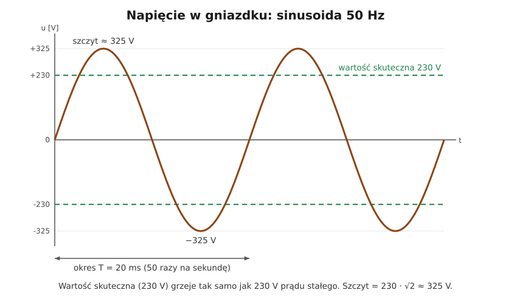

# 02.01 — Sinusoida, 50 Hz i wartość skuteczna

> **Moduł:** [02 — Prąd przemienny i sieć 230/400 V](README.md) · **Oznaczenia:** 🟢📋 · **Zakres SEP:** (a) · **Status:** ✅ pełny
>
> **Czytaj:**
>
> - OpenStax, *Fizyka dla szkół wyższych*, t. 2, rozdz. 15 „Obwody prądu przemiennego”, § 15.1 „Źródła prądu przemiennego” i § 15.4 „Moc w obwodach prądu przemiennego” (wartość skuteczna)
> - Rozporządzenie MKiŚ z 22 marca 2023 r. w sprawie szczegółowych warunków funkcjonowania systemu elektroenergetycznego (t.j. Dz.U. 2025 poz. 919), § 45 ust. 5 — częstotliwość i napięcie u odbiorców

← (początek modułu) · [spis modułu](README.md) · [następny temat →](02.02-faza-przewod-neutralny-i-przewod-ochronny-l-n-pe.md)

## Po co to jest

W gniazdku nie ma stałego napięcia 230 V, tylko napięcie, które 50 razy na sekundę zmienia kierunek. Z tego wynika kilka praktycznych rzeczy. Izolacja musi wytrzymać 325 V, a nie 230 V. Multimetr musi być ustawiony na „V~”. Prąd przemienny 50 Hz jest dla serca groźniejszy niż stały (moduł 04). Działają transformatory (moduł 03). Na egzaminie: co to jest wartość skuteczna, ile wynosi częstotliwość sieci i jaka jest wartość szczytowa napięcia 230 V.

## Po ludzku

**Prąd stały** płynie cały czas w jedną stronę: bateria, akumulator, zasilacz USB. **Prąd przemienny** zmienia kierunek: przez 10 ms „pcha” w jedną stronę, przez kolejne 10 ms w drugą. Napięcie rośnie od zera do szczytu, spada do zera, rośnie do szczytu w przeciwnym kierunku i znów wraca do zera. Ten kształt to **sinusoida**, a jeden pełny cykl to **okres**. W Polsce i całej Europie trwa on 20 ms, czyli w ciągu sekundy jest **50 okresów — 50 Hz** (herców). W USA jest 60 Hz.

**Dlaczego przemienny?** Bo napięcie przemienne łatwo zmienić transformatorem ([03.02](../03-elektromagnetyzm-w-praktyce/03.02-indukcja-elektromagnetyczna-i-transformator.md)). Elektrownia produkuje kilkanaście tysięcy woltów, linie przesyłowe pracują na setkach tysięcy, a do domu dociera 230 V. Przy wysokim napięciu ten sam przesył mocy wymaga mniejszego prądu, a mniejszy prąd to mniejsze straty w przewodach ([01.06](../01-prad-napiecie-opor/01.06-grzanie-przewodow-i-spadek-napiecia.md)).

**Co znaczy „230 V”, skoro napięcie cały czas się zmienia?** To **wartość skuteczna**. Grzałka podłączona do napięcia przemiennego 230 V grzeje dokładnie tak samo, jak gdyby była podłączona do stałego 230 V. Wartość chwilowa w szczycie jest jednak większa:

$$U_{max} = U \cdot \sqrt{2} = 230 \cdot 1{,}414 \approx 325\ \mathrm{V}$$

Między dwoma szczytami (dodatnim i ujemnym) jest więc ok. 650 V. Izolacja przewodów, kondensatory w zasilaczach i przyrządy pomiarowe muszą to wytrzymać.

**Wszystkie liczby w elektryce domowej to wartości skuteczne**, chyba że ktoś wyraźnie napisze inaczej: 230 V, 400 V, 16 A, 30 mA różnicówki.

## Schemat

## Pojęcia

| Pojęcie | Po ludzku | Termin normowy / symbol |
|---------|-----------|-------------------------|
| Prąd stały | Płynie zawsze w jedną stronę | DC, „=”, „⎓” |
| Prąd przemienny | Zmienia kierunek okresowo | AC, „~” |
| Okres | Czas jednego pełnego cyklu | $T$ [s]; w sieci 20 ms |
| Częstotliwość | Liczba cykli na sekundę | $f = 1/T$ [Hz]; w sieci 50 Hz |
| Wartość chwilowa | Napięcie w danej chwili | $u(t)$ |
| Wartość szczytowa | Największa wartość chwilowa | amplituda, $U_{max}$ |
| Wartość skuteczna | Wartość „grzejąca” jak prąd stały | RMS, $U$, $I$ |
| True RMS | Miernik, który poprawnie mierzy wartość skuteczną także przy przebiegach niesinusoidalnych | pomiar wartości skutecznej prawdziwej |

## Liczby do zapamiętania

| Wielkość | Wartość | Kiedy obowiązuje | Źródło |
|----------|---------|------------------|--------|
| Częstotliwość sieci | **50 Hz** (±1 % przez 99,5 % tygodnia) | sieć połączona z systemem | rozporządzenie MKiŚ z 2023 r., § 45 ust. 5 pkt 1 |
| Okres | **20 ms** | 50 Hz | $T = 1/f$ |
| Przejścia przez zero | **100 na sekundę** | 50 Hz | dwa na okres |
| Wartość szczytowa 230 V | **≈ 325 V** | przebieg sinusoidalny | $U_{max} = \sqrt{2} \cdot U$ |
| Międzyszczytowa 230 V | **≈ 650 V** | jw. | $2 \sqrt{2} \cdot U$ |
| Wartość szczytowa 400 V | **≈ 566 V** | jw. | jw. |
| Wartość skuteczna z szczytowej | $U = U_{max} / \sqrt{2} \approx 0{,}707\, U_{max}$ | tylko sinusoida | — |

## W praktyce

- **Multimetr:** napięcie w gniazdku mierzysz na zakresie „V~” (albo „ACV”). Na zakresie „V=” zwykły miernik pokaże zero albo bzdury.
- **Oznaczenia na urządzeniach:** „230 V~ 50 Hz” na tabliczce znaczy: zasilanie przemienne 230 V. Zasilacz laptopa ma na wejściu „100–240 V~ 50/60 Hz”, a na wyjściu np. „19 V ⎓ 3,4 A” (stałe).
- **Pomiar przebiegów odkształconych** (zasilacze, falowniki, ściemniacze) wymaga miernika „True RMS”. Tańsze przyrządy liczą wartość skuteczną przy założeniu, że przebieg jest sinusoidą, i przy innym kształcie mogą się mylić o kilkadziesiąt procent ([02.05](02.05-odbiorniki-nieliniowe-i-wyzsze-harmoniczne.md)).
- **Migotanie światła:** niektóre źródła światła (stare świetlówki, tanie LED) przygasają przy każdym przejściu napięcia przez zero, czyli 100 razy na sekundę. Wzrok tego zwykle nie widzi, ale aparat w telefonie może pokazać pasy.

## Błędy i zagrożenia

- ⚠️ **„W gniazdku jest tylko 230 V”.** W szczycie jest 325 V, a dla izolacji i przyrządów liczy się właśnie szczyt i przepięcia. Przyrząd lub przewód „na 250 V” nie ma zapasu.
- **Mylenie V~ i V=.** Pomiar na złym zakresie daje fałszywy wynik „0 V” albo przypadkowe wartości. Przy sprawdzaniu braku napięcia to groźne, dlatego do tego służy wskaźnik dwubiegunowy ([00.02](../00-bezpieczenstwo-najpierw/00.02-sprawdzanie-braku-napiecia-probnik-dwubiegunowy.md)), który rozpoznaje oba rodzaje napięcia sam.
- **Przekonanie, że prąd stały jest „bezpieczny”.** Akumulatory fotowoltaiki, magazyny energii i ładowarki samochodów mają setki woltów prądu stałego, a łuk przy prądzie stałym gaśnie trudniej niż przy przemiennym (moduł 26).

## Przykład

**Zadanie.** Kondensator w zasilaczu ładuje się do szczytowej wartości napięcia sieci. Do jakiego napięcia naładuje się przy 230 V i przy górnej granicy normy (253 V)? Czy kondensator na 350 V wystarczy?

$$U_{max} = 230 \cdot \sqrt{2} \approx 325\ \mathrm{V} \qquad U_{max,253} = 253 \cdot \sqrt{2} \approx 358\ \mathrm{V}$$

**Wniosek.** Przy górnej dopuszczalnej wartości napięcia (230 V + 10 %) szczyt przekracza 350 V. Dlatego kondensatory wejściowe zasilaczy sieciowych mają napięcie znamionowe co najmniej 400 V. To samo dotyczy izolacji: przewody instalacyjne mają napięcie znamionowe 450/750 V lub wyższe.

## Pytania SEP

1. **Co to jest wartość skuteczna prądu przemiennego?**

Odpowiedź

To taka wartość prądu stałego, który przepływając przez ten sam rezystor w tym samym czasie, wydzieliłby tę samą ilość ciepła co dany prąd przemienny. Dla przebiegu sinusoidalnego wartość skuteczna jest $\sqrt{2}$ razy mniejsza od szczytowej: $U = U_{max}/\sqrt{2}$. Napięcie sieci 230 V to wartość skuteczna, a wartość szczytowa wynosi około 325 V. Mierniki i tabliczki znamionowe podają wartości skuteczne.

2. **Jaka jest częstotliwość napięcia w sieci i jakie są dopuszczalne odchylenia?**

Odpowiedź

Częstotliwość znamionowa wynosi 50 Hz, czyli okres trwa 20 ms. Dla odbiorców zasilanych z sieci niskiego napięcia częstotliwość ma się mieścić w przedziale 50 Hz ±1 % (49,5–50,5 Hz) przez 99,5 % tygodnia (rozporządzenie w sprawie szczegółowych warunków funkcjonowania systemu elektroenergetycznego, § 45).

3. **Dlaczego energię elektryczną przesyła się prądem przemiennym?**

Odpowiedź

Napięcie przemienne można łatwo i sprawnie zmieniać transformatorami. Przesył odbywa się na wysokim napięciu, przy którym prąd i straty w liniach są małe. U odbiorcy napięcie obniża się do 230/400 V. Prąd przemienny trójfazowy pozwala też w prosty sposób wytworzyć pole wirujące w silnikach indukcyjnych.

## Sprawdź się

1. Ile okresów napięcia sieci mieści się w 0,4 s, czyli w czasie, w którym musi zadziałać zabezpieczenie w obwodzie gniazd ([04.04](../04-prad-a-czlowiek/04.04-maksymalne-czasy-samoczynnego-wylaczenia.md))?

Odpowiedź

$0{,}4\ \mathrm{s} / 0{,}02\ \mathrm{s} = 20$ okresów.

2. Oscyloskop pokazuje sinusoidę o wartości szczytowej 340 V. Jaka jest wartość skuteczna i czy mieści się w normie?

Odpowiedź

$340 / \sqrt{2} \approx 240\ \mathrm{V}$. Mieści się w przedziale 207–253 V.

3. Na zasilaczu napisano „Input: 100–240 V~ 50/60 Hz, Output: 12 V ⎓ 2 A”. Co oznaczają symbole?

Odpowiedź

„~” to prąd przemienny: zasilacz działa z sieci o napięciu 100–240 V i częstotliwości 50 lub 60 Hz, więc także w USA. „⎓” to prąd stały: na wyjściu daje 12 V stałego napięcia i do 2 A.

## Źródła

- OpenStax, *Fizyka dla szkół wyższych*, t. 2, rozdz. 15 — źródła prądu przemiennego, wartość skuteczna, moc.
- Rozporządzenie MKiŚ z 22 marca 2023 r. (t.j. Dz.U. 2025 poz. 919), § 45 ust. 5 — częstotliwość 50 Hz ±1 %, napięcie ±10 %.
- PN-EN 60038 — napięcia znormalizowane 230/400 V.

---

← (początek modułu) · [spis modułu](README.md) · [następny temat →](02.02-faza-przewod-neutralny-i-przewod-ochronny-l-n-pe.md)
