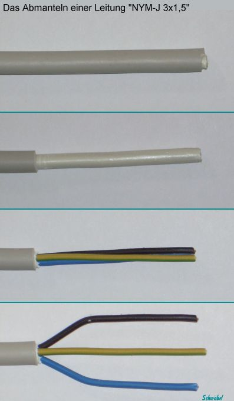
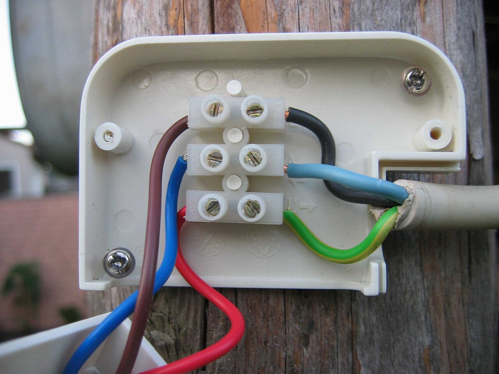
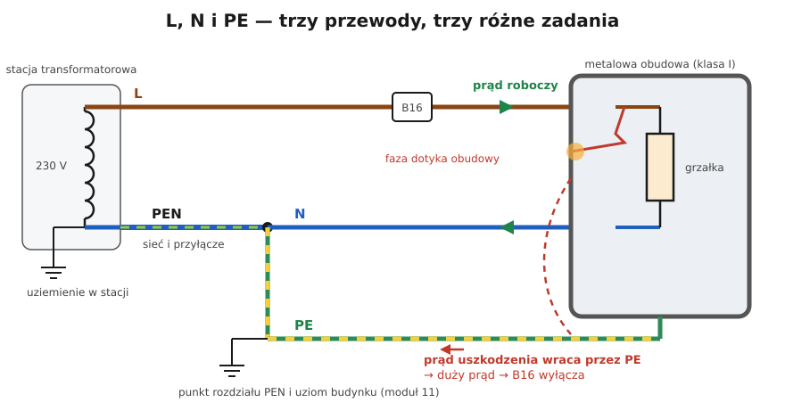

# 02.02 — Faza, przewód neutralny i przewód ochronny — L, N, PE

> **Moduł:** [02 — Prąd przemienny i sieć 230/400 V](README.md) · **Oznaczenia:** 🟢📋 · **Zakres SEP:** (a) · **Status:** ✅ pełny
>
> **Czytaj:**
>
> - PN-EN 60445 — oznaczanie zacisków i przewodów, w tym barwy żył (omówienie)
> - PN-HD 60364-5-54 — przewody ochronne (omówienie)
> - Układy sieci i rozdział PEN: [moduł 11](../11-uklady-sieci/README.md)

[← poprzedni temat](02.01-sinusoida-50-hz-i-wartosc-skuteczna.md) · [spis modułu](README.md) · [następny temat →](02.03-uklad-trojfazowy-230-v-i-400-v-kolejnosc-faz.md)

## Po co to jest

Każdy obwód jednofazowy w domu ma trzy przewody i każdy ma inne zadanie. Pomylenie ich to najczęstszy groźny błąd montażowy: faza na obudowie, łącznik w przewodzie N, przewód ochronny użyty jako neutralny. Kto rozumie, po co jest każdy przewód, ten wie, czego nie wolno robić, nawet jeśli „działa”. Na egzaminie: rola L, N i PE, barwy przewodów i zakaz przerywania przewodu ochronnego.

## Po ludzku

**L — przewód fazowy („faza”).** Tędy prąd płynie do odbiornika. Względem ziemi ma 230 V, więc dotknięcie go grozi porażeniem. Barwy: brązowy, czarny albo szary.

**N — przewód neutralny („zero”).** Tędy prąd wraca do źródła, czyli do transformatora w stacji. Jest połączony z ziemią w stacji, więc w normalnych warunkach ma względem ziemi prawie 0 V. To jednak przewód **czynny**: w czasie pracy płynie przez niego taki sam prąd jak przez L. Przy przerwie przed odbiornikiem pojawia się na nim napięcie fazowe ([00.04](../00-bezpieczenstwo-najpierw/00.04-czerwone-flagi-kiedy-przerwac-prace-i-wezwac.md#przykład)). Barwa: niebieska.

**PE — przewód ochronny.** Łączy metalowe obudowy urządzeń (pralka, czajnik, piekarnik) i bolce gniazd z ziemią i z punktem neutralnym sieci. **W normalnej pracy prąd przez niego nie płynie.** Pracuje dopiero przy uszkodzeniu: gdy faza dotknie obudowy, prąd popłynie przez PE z powrotem do źródła. Będzie on tak duży, że wyłącznik natychmiast odłączy obwód ([moduł 12](../12-ochrona-przeciwporazeniowa/README.md)). Bez PE obudowa zostałaby pod napięciem i czekała na kogoś, kto jej dotknie. Barwa: **żółto-zielona — i tylko PE**.

**PEN — przewód ochronno-neutralny.** W sieci operatora i w starych instalacjach jeden przewód pełni obie funkcje. W budynku rozdziela się go na N i PE, a od miejsca rozdziału nie wolno ich już łączyć ([moduł 11](../11-uklady-sieci/README.md)). Barwa: żółto-zielona z niebieskim oznaczeniem na końcach (albo niebieska z żółto-zielonym).

**Złota zasada:** prąd roboczy płynie tylko przewodami L i N. Przewodem PE prąd płynie tylko przy uszkodzeniu, a wtedy ma zadziałać zabezpieczenie.

## Jak to wygląda

*Na co patrzeć: pod szarą powłoką są trzy żyły. Ciemna (brązowa lub czarna) to fazowa L, niebieska to neutralna N, a żółto-zielona to ochronna PE. W przewodach wielożyłowych układ barw jest określony normą, ale w starszych instalacjach bywa inny — zawsze sprawdzaj pomiarem.*

*Na co patrzeć: w jednej puszce spotykają się przewody o różnych barwach. Żółto-zielony nigdy nie może być podłączony do zacisku fazy ani neutralnego.*

## Schemat

## Pojęcia

| Pojęcie | Po ludzku | Termin normowy / symbol |
|---------|-----------|-------------------------|
| Faza | Przewód „pod napięciem” względem ziemi | przewód liniowy, L (L1, L2, L3) |
| Zero, neutralny | Przewód powrotny, uziemiony w stacji | przewód neutralny, N |
| Ochronny, „uziemienie” | Przewód łączący obudowy z ziemią | przewód ochronny, PE |
| PEN | Jeden przewód zamiast N i PE | przewód ochronno-neutralny, PEN |
| Przewód czynny | Przewód, który w normalnej pracy jest pod napięciem lub przewodzi prąd roboczy | część czynna — L i N (nie PE) |
| Część przewodząca dostępna | Metalowa obudowa, której można dotknąć | część przewodząca dostępna |

## Liczby do zapamiętania

| Przewód | Barwa | Napięcie względem ziemi (sprawna instalacja) | Prąd w normalnej pracy | Źródło |
|---------|-------|----------------------------------------------|------------------------|--------|
| L (L1, L2, L3) | brązowy, czarny, szary | 230 V | prąd roboczy | PN-EN 60445 |
| N | niebieski | ≈ 0 V | prąd roboczy (taki jak w L) | jw. |
| PE | żółto-zielony | 0 V | **brak** (tylko prąd upływu, mA) | jw. |
| PEN | żółto-zielony + niebieskie oznaczenie końców (lub odwrotnie) | ≈ 0 V | prąd roboczy | jw. |

## W praktyce

- **Identyfikacja przewodów w puszce:** barwy dają wskazówkę, a pewność daje pomiar wskaźnikiem dwubiegunowym między przewodami i względem PE ([01.02](../01-prad-napiecie-opor/01.02-napiecie-roznica-cisnien-miedzy-dwoma-punktami.md#w-praktyce)).
- **Łącznik światła** przerywa przewód L, nigdy N ([01.05](../01-prad-napiecie-opor/01.05-polaczenie-szeregowe-i-rownolegle.md)).
- **Przewodu PE nie wolno przerywać** żadnym łącznikiem ani zabezpieczeniem. Wtyczki i gniazda są tak zbudowane, że styk ochronny łączy się pierwszy i rozłącza ostatni.
- **Żółto-zielonej żyły nie wolno użyć jako fazy ani neutralnego**, nawet gdy brakuje żyły, a „ochronny i tak nie jest potrzebny”. Ktoś po latach uzna ją za PE.
- **W gnieździe ze stykiem ochronnym** (bolec w gnieździe albo styki boczne) PE podłącza się do zacisku oznaczonego symbolem ⏚ albo „PE”.

## Błędy i zagrożenia

- ⚠️ **Mostkowanie PE z N w gnieździe** („zerowanie” w instalacji dwużyłowej). Przy przerwie przewodu N obudowy wszystkich urządzeń dostają pełne napięcie fazowe. To jedna z najczęstszych przyczyn śmiertelnych porażeń w starych mieszkaniach ([moduł 21](../21-stare-instalacje/README.md)).
- ⚠️ **Przewód PE połączony z fazą** (albo zamieniony z L). Obudowy urządzeń są pod napięciem 230 V. Wyłącznik nadprądowy tego nie wykryje, bo nie płynie żaden duży prąd. Wykryje to różnicówka, kiedy ktoś dotknie obudowy, albo pomiar ([01.02](../01-prad-napiecie-opor/01.02-napiecie-roznica-cisnien-miedzy-dwoma-punktami.md#sprawdź-się)).
- **N „bo jest bezpieczny”.** Praca przy przewodzie N pod napięciem grozi porażeniem przy przerwie albo błędnym podłączeniu. Traktuj go jak fazę.
- **Łączenie N z PE za punktem rozdziału**, np. w puszce albo w gnieździe, psuje działanie wyłącznika różnicowoprądowego i rozprowadza prąd roboczy po przewodach ochronnych.

## Przykład

**Sytuacja.** W łazience pralka „kopie” przy dotknięciu obudowy. Pomiar wskaźnikiem w gnieździe: L–N 230 V, L–PE 0 V, N–PE 230 V. W rozdzielnicy nie ma wyłącznika różnicowoprądowego.

**Analiza.** Zacisk PE w gnieździe ma potencjał fazy (L–PE = 0 V, N–PE = 230 V). Przewód ochronny tego obwodu został gdzieś połączony z fazą, na przykład w puszce żyłę żółto-zieloną podłączono do zacisku L. Przez przewód PE napięcie fazy trafia prosto na obudowę pralki. Pralka działa normalnie, bo między L a N jest 230 V. Wyłącznik nadprądowy nic nie widzi, bo nie płynie żaden nadmierny prąd.

**Wniosek.** Natychmiast wyłączyć obwód i nie używać pralki do czasu poprawienia połączeń i pomiarów. W łazience obowiązkowa jest też ochrona różnicowoprądowa 30 mA ([moduł 17](../17-pomieszczenia-szczegolne/README.md)). Gdyby była zainstalowana, prawdopodobnie zadziałałaby przy pierwszym dotknięciu, zanim prąd stałby się groźny.

## Pytania SEP

1. **Jakie zadania pełnią przewody L, N i PE?**

Odpowiedź

Przewód fazowy L doprowadza prąd do odbiornika i ma względem ziemi napięcie fazowe 230 V. Przewód neutralny N odprowadza prąd z powrotem do źródła; jest połączony z uziemionym punktem neutralnym transformatora, ale w czasie pracy przewodzi prąd roboczy i jest przewodem czynnym. Przewód ochronny PE łączy części przewodzące dostępne (obudowy) z uziemieniem. W normalnej pracy nie przewodzi prądu roboczego, a przy uszkodzeniu izolacji umożliwia przepływ prądu zwarciowego i samoczynne wyłączenie zasilania.

2. **Jakie są barwy przewodów L, N, PE i PEN?**

Odpowiedź

Przewody fazowe: brązowy, czarny i szary (najczęściej L1 brązowy, L2 czarny, L3 szary). Neutralny: niebieski. Ochronny PE: żółto-zielony, zarezerwowany wyłącznie dla przewodu ochronnego. PEN: żółto-zielony z niebieskim oznaczeniem na końcach albo niebieski z żółto-zielonym oznaczeniem na końcach (PN-EN 60445).

3. **Dlaczego w przewodzie ochronnym nie wolno instalować łączników ani zabezpieczeń?**

Odpowiedź

Przerwanie przewodu ochronnego pozbawia obudowy połączenia z uziemieniem. Przy uszkodzeniu izolacji obudowa znalazłaby się pod napięciem, a prąd zwarciowy nie mógłby popłynąć i wywołać wyłączenia. Ciągłość przewodu ochronnego musi być zapewniona zawsze, dlatego PE nie może być przerywany, a styki ochronne we wtyczkach łączą się pierwsze i rozłączają ostatnie.

## Sprawdź się

1. Dlaczego przez przewód N płynie taki sam prąd jak przez L, a przez PE (w sprawnym urządzeniu) praktycznie żaden?

Odpowiedź

Prąd roboczy płynie w zamkniętej pętli: przewodem L do odbiornika i przewodem N z powrotem ([01.01](../01-prad-napiecie-opor/01.01-ladunek-i-prad-co-wlasciwie-plynie-w-przewodzie.md)). PE jest połączony tylko z obudową, która w sprawnym urządzeniu jest odizolowana od części pod napięciem, więc nie ma drogi, którą prąd mógłby do niego wpłynąć. Płyną nim tylko bardzo małe prądy upływu, rzędu miliamperów.

2. W starej instalacji jest przewód dwużyłowy: czarny i niebieski. Ktoś chce zamontować gniazdo z bolcem i połączyć bolec z niebieskim przewodem, „żeby było uziemienie”. Co odpowiesz?

Odpowiedź

Nie wolno. To mostkowanie PE z N: przy przerwie przewodu N obudowy urządzeń dostaną napięcie fazowe, a przy zamianie przewodów w puszce — od razu. Rozwiązaniem jest doprowadzenie przewodu ochronnego (wymiana przewodu) albo zastosowanie środków z modułu 21, wykonane przez elektryka.

## Źródła

- PN-EN 60445 — barwy i oznaczenia przewodów: L brązowy/czarny/szary, N niebieski, PE żółto-zielony, PEN.
- PN-HD 60364-5-54 — przewody ochronne: zakaz łączników w przewodzie PE, ciągłość.
- Samoczynne wyłączenie zasilania: [moduł 12](../12-ochrona-przeciwporazeniowa/README.md); rozdział PEN: [moduł 11](../11-uklady-sieci/README.md).

---

[← poprzedni temat](02.01-sinusoida-50-hz-i-wartosc-skuteczna.md) · [spis modułu](README.md) · [następny temat →](02.03-uklad-trojfazowy-230-v-i-400-v-kolejnosc-faz.md)
