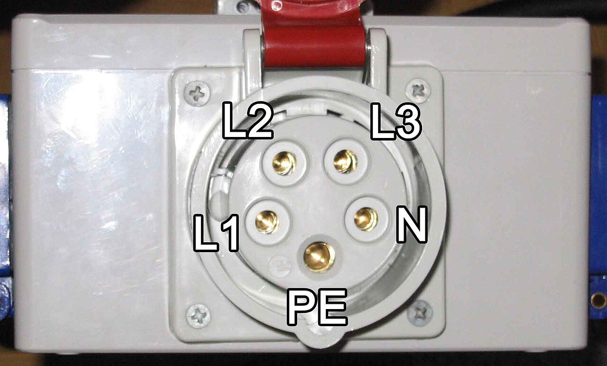
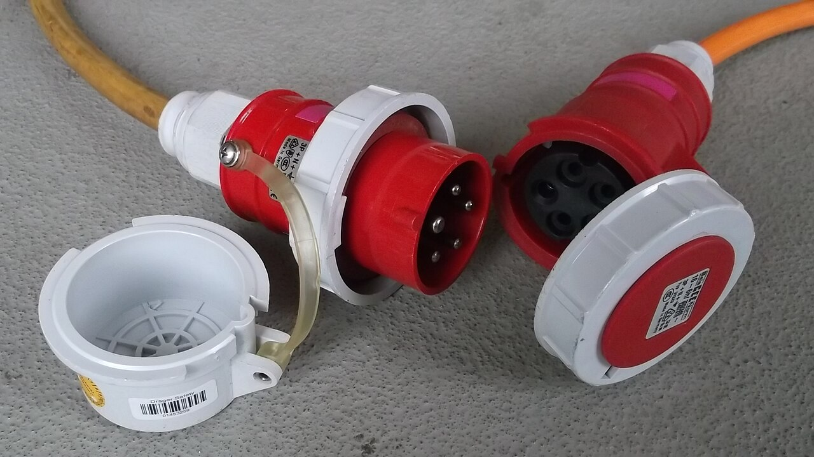
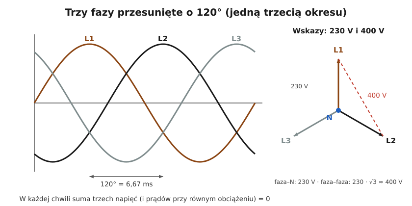

# 02.03 — Układ trójfazowy: 230 V i 400 V, kolejność faz

> **Moduł:** [02 — Prąd przemienny i sieć 230/400 V](README.md) · **Oznaczenia:** 🟢📋 · **Zakres SEP:** (a) · **Status:** ✅ pełny
>
> **Czytaj:**
>
> - PN-EN 60445 — oznaczenia L1, L2, L3, N, PE i barwy żył (omówienie)
> - PN-EN 60309-1 i -2 — wtyczki i gniazda przemysłowe CEE (omówienie)
> - Silniki trójfazowe i kierunek obrotów: [moduł 24](../24-silniki-i-napedy/README.md)

[← poprzedni temat](02.02-faza-przewod-neutralny-i-przewod-ochronny-l-n-pe.md) · [spis modułu](README.md) · [następny temat →](02.04-moc-czynna-bierna-i-pozorna-wspolczynnik-mocy.md)

## Po co to jest

Większość nowych domów i wiele mieszkań w Polsce ma przyłącze trójfazowe. Z jednej strony daje to 230 V w zwykłych gniazdach, z drugiej 400 V dla płyty indukcyjnej, pompy ciepła, ładowarki samochodu i silników. Trzeba wiedzieć, skąd się bierze 400 V, dlaczego obciążenie rozkłada się na fazy, co się dzieje przy zaniku jednej fazy i dlaczego przy silnikach liczy się kolejność faz. Na egzaminie: napięcia fazowe i międzyfazowe, zależność $\sqrt{3}$, kolejność faz i jej sprawdzanie.

## Po ludzku

**Trzy fazy to trzy napięcia 230 V przesunięte w czasie o jedną trzecią okresu** (120°, czyli 6,67 ms). Gdy napięcie L1 jest w szczycie, L2 i L3 są w innych miejscach sinusoidy. Wszystkie trzy mają wspólny przewód neutralny N.

**Skąd 400 V?** Między fazą a N jest 230 V. Między dwiema fazami napięcie jest większe, bo ich szczyty nie wypadają w tym samym momencie. Gdy jedna jest blisko „plusa”, druga jest już „na minusie”. Z geometrii (wykres wskazowy poniżej) wychodzi $230 \cdot \sqrt{3} \approx 400\ \mathrm{V}$. Sieć niskiego napięcia oznacza się więc jako **230/400 V**.

**Dlaczego trzy fazy?**

- **Przesył:** trzy fazy przenoszą trzy razy więcej mocy niż jedna, a przewód N przy równym obciążeniu nie niesie prawie żadnego prądu. Przy idealnie równym obciążeniu suma prądów trzech faz w każdej chwili wynosi zero.
- **Duże odbiorniki:** płyta indukcyjna 7 kW na jednej fazie pobierałaby ok. 31 A. Rozłożona na dwie fazy pobiera po ok. 16 A z każdej.
- **Silniki:** trzy przesunięte prądy w uzwojeniach tworzą pole, które samo się obraca. Silnik trójfazowy nie potrzebuje kondensatora ani rozrusznika ([03.04](../03-elektromagnetyzm-w-praktyce/03.04-jak-dziala-silnik-elektryczny-intuicja.md)).

**Rozkład obciążenia.** W domu z trzema fazami obwody gniazd i oświetlenia rozdziela się między L1, L2 i L3 tak, żeby fazy były obciążone mniej więcej równo. Przy zaniku jednej fazy (np. przepalona wkładka przedlicznikowa) gaśnie tylko część mieszkania, a urządzenia trójfazowe przestają działać albo pracują nieprawidłowo.

**Kolejność faz** (L1 → L2 → L3) decyduje o kierunku wirowania pola. Zamiana dowolnych dwóch faz odwraca kierunek obrotów silnika: pompa pompuje „do tyłu”, piła tnie w złą stronę. Kolejność sprawdza się wskaźnikiem kolejności faz.

## Jak to wygląda

*Na co patrzeć: pięć styków. Trzy fazy L1, L2, L3, neutralny N i najgrubszy, wysunięty styk ochronny PE, który łączy się pierwszy. Czerwony kolor obudowy oznacza 400 V, a niebieski 230 V. Gniazda CEE spotkasz w garażu, warsztacie, na budowie i przy ładowarkach samochodów.*

*Na co patrzeć: wtyczka ma bolce w określonym położeniu względem wypustu (oznaczenie „6 h” — pozycja jak na tarczy zegara). Dzięki temu nie da się włożyć wtyczki 400 V do gniazda o innym napięciu. Na obudowie są też prąd znamionowy (16 A lub 32 A) i stopień ochrony IP.*

## Schemat

## Pojęcia

| Pojęcie | Po ludzku | Termin normowy / symbol |
|---------|-----------|-------------------------|
| Napięcie fazowe | Faza — N (lub ziemia) | $U_0$ (w instalacjach) = 230 V |
| Napięcie międzyfazowe | Faza — faza | $U$ (przewodowe) = 400 V |
| Kolejność faz | W jakiej kolejności fazy osiągają szczyt | kolejność faz, kierunek wirowania pola |
| Obciążenie symetryczne | Wszystkie fazy obciążone jednakowo | — |
| Asymetria | Fazy obciążone nierówno; płynie prąd w N | asymetria obciążenia/napięcia |
| Gniazdo CEE | Przemysłowe gniazdo 3- lub 5-stykowe | gniazdo wg PN-EN 60309 |
| Zanik fazy | Brak napięcia na jednej z faz | zanik fazy, praca niepełnofazowa |

## Liczby do zapamiętania

| Wielkość | Wartość | Kiedy obowiązuje | Źródło |
|----------|---------|------------------|--------|
| Napięcie fazowe | **230 V** | sieć nN | PN-EN 60038 |
| Napięcie międzyfazowe | **400 V** = $\sqrt{3} \cdot 230$ | jw. | jw. |
| Przesunięcie faz | **120°** = 6,67 ms | 50 Hz | — |
| Moc trójfazowa | $P = \sqrt{3} \cdot U \cdot I \cdot \cos\varphi$ | $U$ = 400 V, $I$ — prąd fazowy | [02.04](02.04-moc-czynna-bierna-i-pozorna-wspolczynnik-mocy.md) |
| Prąd na 1 kW (trójfazowo, cos φ = 1) | ok. **1,44 A** na fazę | odbiornik symetryczny | $1000 / (\sqrt{3} \cdot 400)$ |
| Barwy faz | L1 **brązowy**, L2 **czarny**, L3 **szary** | nowe instalacje | PN-EN 60445 |
| Gniazdo CEE | czerwone **400 V**, niebieskie **230 V**; 16 A, 32 A, 63 A… | gniazda przemysłowe | PN-EN 60309 |

## W praktyce

- **Sprawdzenie obecności faz:** wskaźnikiem dwubiegunowym między każdą fazą a N (230 V) i między fazami (400 V). Brak 400 V między dwoma „fazami” oznacza, że to ta sama faza.
- **Kolejność faz** sprawdza się wskaźnikiem kolejności faz (osobny przyrząd lub funkcja miernika instalacji) przed podłączeniem silnika i po zmianach w zasilaniu. Kolejność w gniazdach CEE w jednym budynku powinna być jednakowa.
- **Rozdział obwodów na fazy:** obwody o podobnym obciążeniu rozdziela się równomiernie. Kuchnia, łazienka i garaż nie powinny wisieć na jednej fazie ([moduł 16](../16-planowanie-obwodow/README.md)).
- **Kontrolki faz** w rozdzielnicy (trzy lampki) od razu pokazują zanik fazy ([moduł 10](../10-aparatura-modulowa/README.md)).

## Błędy i zagrożenia

- ⚠️ **400 V w jednej puszce.** Gdy przez puszkę przechodzą obwody z różnych faz, między ich przewodami jest 400 V. Wyłączenie jednego obwodu nie gasi drugiego ([00.01](../00-bezpieczenstwo-najpierw/00.01-piec-zasad-bezpiecznej-pracy-przy-urzadzeniach.md)).
- ⚠️ **Przerwa w przewodzie N w instalacji trójfazowej.** Odbiorniki z różnych faz łączą się szeregowo na 400 V i napięcia „pływają” ([00.04](../00-bezpieczenstwo-najpierw/00.04-czerwone-flagi-kiedy-przerwac-prace-i-wezwac.md#przykład)).
- **Silnik trójfazowy po zaniku jednej fazy** (praca dwufazowa) grzeje się i może się spalić, jeśli nie ma zabezpieczenia od zaniku fazy ([moduł 24](../24-silniki-i-napedy/README.md)).
- **Przekładanie faz „na oko” po remoncie.** Zmiana kolejności faz odwraca kierunek obrotów pomp, wentylatorów i maszyn.

## Przykład

**Zadanie.** Grzejnik elektryczny trójfazowy 9 kW (rezystancyjny, cos φ = 1). Jaki prąd pobiera z każdej fazy? Jaki pobierałby jednofazowy grzejnik 9 kW?

$$I_{3f} = \frac{P}{\sqrt{3} \cdot U} = \frac{9000}{1{,}732 \cdot 400}\ \mathrm{A} \approx 13\ \mathrm{A} \qquad I_{1f} = \frac{9000}{230}\ \mathrm{A} \approx 39\ \mathrm{A}$$

**Sprawdzenie.** Każda faza dostarcza jedną trzecią mocy: $3000\ \mathrm{W} / 230\ \mathrm{V} \approx 13\ \mathrm{A}$ ✓.

**Wniosek.** Trójfazowo grzejnik pracuje na zwykłym przewodzie 2,5 mm² z zabezpieczeniem 16 A. Jednofazowo potrzebowałby zabezpieczenia 40 A i przewodu 6–10 mm², zależnie od sposobu ułożenia ([moduł 16](../16-planowanie-obwodow/README.md)).

## Pytania SEP

1. **Jaka jest zależność między napięciem fazowym a międzyfazowym w sieci trójfazowej?**

Odpowiedź

Napięcie międzyfazowe jest $\sqrt{3}$ razy większe od fazowego: $U = \sqrt{3} \cdot U_0$. W sieci nN napięcie fazowe (faza–N) wynosi 230 V, a międzyfazowe (faza–faza) 400 V. Wynika to z przesunięcia napięć poszczególnych faz o 120°.

2. **Co to jest kolejność faz i jak się ją sprawdza?**

Odpowiedź

To kolejność, w jakiej napięcia faz osiągają wartości szczytowe (L1, L2, L3). Wyznacza kierunek wirowania pola magnetycznego, a więc kierunek obrotów silników trójfazowych. Zamiana dwóch dowolnych faz odwraca kierunek. Sprawdza się ją wskaźnikiem kolejności faz albo miernikiem instalacji z taką funkcją, przy podłączaniu silników i gniazd trójfazowych.

3. **Jak oblicza się moc odbiornika trójfazowego?**

Odpowiedź

Moc czynna: $P = \sqrt{3} \cdot U \cdot I \cdot \cos\varphi$, gdzie $U$ to napięcie międzyfazowe (400 V), $I$ — prąd w przewodzie fazowym, $\cos\varphi$ — współczynnik mocy. Moc pozorna: $S = \sqrt{3} \cdot U \cdot I$. Dla odbiornika symetrycznego można też liczyć moc jednej fazy ($U_0 \cdot I \cdot \cos\varphi$) i pomnożyć przez trzy.

## Sprawdź się

1. Płyta indukcyjna 7,2 kW jest podłączona do dwóch faz, a jej moc rozkłada się po równo. Ile prądu płynie każdą fazą?

Odpowiedź

Na każdą fazę przypada 3,6 kW: $3600/230 \approx 15{,}7\ \mathrm{A}$. Mieści się w zabezpieczeniu 16 A na fazę (przy pełnej mocy wszystkich pól jednocześnie, co zdarza się rzadko).

2. Wskaźnik pokazuje między przewodami brązowym i czarnym w puszce 0 V, a każdy z nich względem N ma 230 V. Co to znaczy?

Odpowiedź

Oba przewody są na tej samej fazie (np. dwa obwody z L1 albo przewód fazowy i przewód łącznikowy przy załączonym łączniku). Gdyby były na różnych fazach, wskaźnik pokazałby 400 V.

3. Na [zdjęciu gniazda CEE](../../assets/foto/02-cee-oznaczenie-stykow.jpg) wskaż styki, między którymi będzie 400 V, i te, między którymi będzie 230 V.

Odpowiedź

400 V: między dowolnymi dwiema fazami — L1–L2, L2–L3, L1–L3. 230 V: między każdą fazą a N oraz między każdą fazą a PE. Między N a PE — prawie 0 V.

## Źródła

- PN-EN 60038 — napięcia 230/400 V; PN-EN 60445 — oznaczenia i barwy L1, L2, L3, N, PE.
- PN-EN 60309-1, -2 — wtyczki i gniazda przemysłowe (CEE): barwy obudów, pozycje styku ochronnego.
- OpenStax, *Fizyka dla szkół wyższych*, t. 2, rozdz. 15 — wskazy i przesunięcie fazowe.

---

[← poprzedni temat](02.02-faza-przewod-neutralny-i-przewod-ochronny-l-n-pe.md) · [spis modułu](README.md) · [następny temat →](02.04-moc-czynna-bierna-i-pozorna-wspolczynnik-mocy.md)
