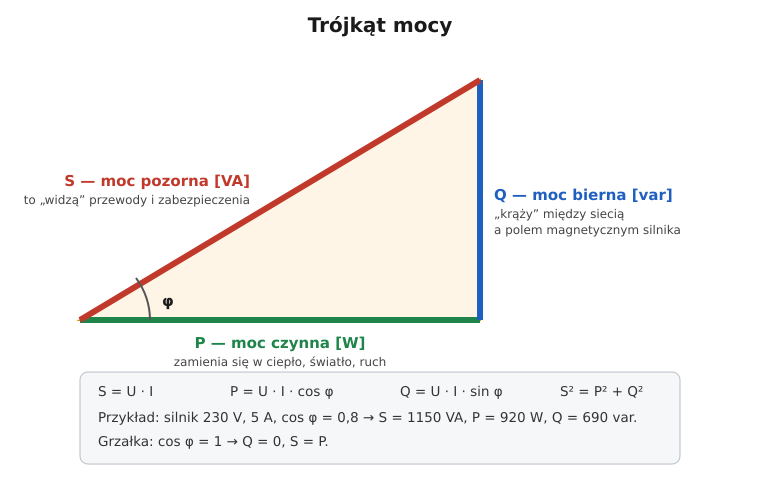

# 02.04 — Moc czynna, bierna i pozorna, współczynnik mocy

> **Moduł:** [02 — Prąd przemienny i sieć 230/400 V](README.md) · **Oznaczenia:** 🟢📋 · **Zakres SEP:** (a) · **Status:** ✅ pełny
>
> **Czytaj:**
>
> - OpenStax, *Fizyka dla szkół wyższych*, t. 2, rozdz. 15, § 15.4 „Moc w obwodach prądu przemiennego”
> - Cewka i indukcyjność: [03.01](../03-elektromagnetyzm-w-praktyce/03.01-pole-magnetyczne-pradu-i-cewka.md)

[← poprzedni temat](02.03-uklad-trojfazowy-230-v-i-400-v-kolejnosc-faz.md) · [spis modułu](README.md) · [następny temat →](02.05-odbiorniki-nieliniowe-i-wyzsze-harmoniczne.md)

## Po co to jest

Przy grzałce $P = U \cdot I$ i sprawa jest prosta. Przy silniku, transformatorze czy świetlówce prąd jest większy, niż wynikałoby z mocy w watach. Przewody i wyłączniki muszą przenieść cały ten prąd, a nie tylko „użyteczną” część. Dlatego UPS-y mają moc w VA i w W, silniki mają na tabliczce cos φ, a firmy płacą czasem za „energię bierną”. Na egzaminie: rodzaje mocy, jednostki, współczynnik mocy i jego wpływ na prąd.

## Po ludzku

**Analogia z kuflem piwa.** Kufel to moc pozorna S — tyle „miejsca” zajmuje przepływ w przewodach. Piwo to moc czynna P — to, co naprawdę się pije, czyli zamienia na ciepło, światło i pracę mechaniczną. Piana to moc bierna Q — zajmuje miejsce w kuflu, ale nic z niej nie ma.

**Skąd się bierze moc bierna?** Cewka (uzwojenie silnika, transformatora, dławik świetlówki) przy prądzie przemiennym co pół okresu buduje pole magnetyczne, a potem je rozbudowuje i oddaje energię z powrotem do sieci ([03.01](../03-elektromagnetyzm-w-praktyce/03.01-pole-magnetyczne-pradu-i-cewka.md)). Energia „krąży” tam i z powrotem, nie wykonując pracy, ale prąd z nią związany płynie przewodami i je grzeje. W efekcie prąd jest przesunięty w czasie względem napięcia o kąt φ: w odbiorniku indukcyjnym prąd spóźnia się za napięciem. Kondensator działa odwrotnie i prąd wyprzedza napięcie.

**Współczynnik mocy** cos φ mówi, jaka część mocy pozornej to moc czynna:

$$P = S \cdot \cos\varphi = U \cdot I \cdot \cos\varphi$$

Grzałka i żarówka mają cos φ = 1, czyli prąd idzie razem z napięciem. Silnik ma zwykle 0,7–0,9, nieobciążony nawet mniej. Stara świetlówka bez kompensacji miała ok. 0,5, czyli pobierała dwa razy więcej prądu, niż wynikałoby z jej mocy.

**Kto płaci za moc bierną?** Gospodarstwa domowe (taryfy grupy G) nie płacą. Firmy w niektórych grupach taryfowych (B, C) płacą za pobór energii biernej ponad wartość określoną w umowie. Zwykle jest to tg φ = 0,4, czyli cos φ ≈ 0,93. Poprawia się to **kompensacją**: kondensatorami, które „produkują” moc bierną na miejscu, tak że nie płynie ona przez sieć.

## Schemat

## Pojęcia

| Pojęcie | Po ludzku | Termin normowy / symbol |
|---------|-----------|-------------------------|
| Moc czynna | Moc zamieniana na ciepło, światło, pracę | P, wat [W] |
| Moc bierna | Moc „krążąca” między siecią a polem cewek i kondensatorów | Q, war [var] |
| Moc pozorna | Iloczyn napięcia i prądu — to, co obciąża przewody | S, woltoamper [VA] |
| Współczynnik mocy | Jaka część S to P | cos φ (przy przebiegach sinusoidalnych) |
| Odbiornik indukcyjny | Silnik, transformator, dławik — prąd opóźniony | Q > 0 |
| Odbiornik pojemnościowy | Kondensator, długie kable, niektóre zasilacze — prąd wyprzedza | Q < 0 |
| Kompensacja | Kondensatory przy odbiornikach indukcyjnych zmniejszają Q pobierane z sieci | kompensacja mocy biernej |

## Liczby do zapamiętania

| Wielkość | Wartość | Kiedy obowiązuje | Źródło |
|----------|---------|------------------|--------|
| Moc pozorna | $S = U \cdot I$ (1f), $S = \sqrt{3}\, U I$ (3f) | zawsze | definicja |
| Moc czynna | $P = S \cos\varphi$ | przebiegi sinusoidalne | jw. |
| Moc bierna | $Q = S \sin\varphi$ | jw. | jw. |
| Trójkąt mocy | $S^2 = P^2 + Q^2$ | jw. | jw. |
| Typowe cos φ | grzałka, żarówka **1** · silnik **0,7–0,9** · świetlówka bez kompensacji **≈ 0,5** | wartości orientacyjne | tabliczki znamionowe |
| Próg opłat za energię bierną | zwykle **tg φ = 0,4** (cos φ ≈ 0,93) | odbiorcy biznesowi w niektórych grupach taryfowych; **nie dotyczy** gospodarstw domowych (grupa G) | taryfy operatorów |

## W praktyce

- **Dobór przewodu i zabezpieczenia** opiera się na prądzie, czyli na mocy pozornej. Silnik 920 W o cos φ = 0,8 pobiera prąd jak odbiornik 1150 VA.
- **Tabliczka silnika** podaje moc **na wale** (mechaniczną), prąd i cos φ. Prąd odczytuj z tabliczki, nie licz go z mocy ([moduł 24](../24-silniki-i-napedy/README.md)).
- **UPS i agregat** mają podaną moc w VA (pozorną) i w W (czynną). Obie muszą wystarczyć dla zasilanych urządzeń ([moduł 25](../25-transformatory-ups-agregaty/README.md)).
- **Licznik w domu** liczy energię czynną (kWh) i to ona jest na rachunku.

## Błędy i zagrożenia

- **Liczenie prądu silnika jako $P/230$.** Wynik jest zaniżony: nie uwzględnia cos φ ani sprawności. Przewód i zabezpieczenie mogą być za małe.
- **„VA to to samo co W”.** Tylko przy cos φ = 1. UPS 1000 VA ma często tylko 600–700 W mocy czynnej.
- **Kondensatory kompensacyjne bez rozładowania.** Po wyłączeniu mogą długo trzymać napięcie. Przed pracą przy baterii kompensacyjnej trzeba sprawdzić, czy kondensatory są rozładowane ([00.01](../00-bezpieczenstwo-najpierw/00.01-piec-zasad-bezpiecznej-pracy-przy-urzadzeniach.md)).

## Przykład

**Zadanie.** Silnik jednofazowy: tabliczka 230 V, 5 A, cos φ = 0,8. Oblicz S, P i Q. Ile prądu pobierałby, gdyby cos φ podnieść do 1 przy tej samej mocy czynnej?

$$S = 230 \cdot 5 = 1150\ \mathrm{VA} \qquad P = 1150 \cdot 0{,}8 = 920\ \mathrm{W} \qquad Q = 1150 \cdot \sin\varphi = 1150 \cdot 0{,}6 = 690\ \mathrm{var}$$

($\sin\varphi = \sqrt{1 - 0{,}8^2} = 0{,}6$.)

**Sprawdzenie:** $\sqrt{920^2 + 690^2} = 1150$ ✓.

Przy cos φ = 1: $I = 920 / 230 = 4\ \mathrm{A}$ zamiast 5 A.

**Wniosek.** Moc bierna zwiększa prąd o 25 %, choć silnik nie wykonuje przez to więcej pracy. Ten „nadmiarowy” prąd grzeje przewody, transformatory i obciąża sieć. Dlatego duże zakłady kompensują moc bierną.

## Pytania SEP

1. **Co to jest moc czynna, bierna i pozorna? Podaj jednostki.**

Odpowiedź

Moc czynna P [W] to moc zamieniana w odbiorniku na pracę użyteczną i ciepło: $P = U I \cos\varphi$. Moc bierna Q [var] to moc związana z okresowym gromadzeniem i oddawaniem energii w polu magnetycznym cewek i elektrycznym kondensatorów: $Q = U I \sin\varphi$; nie wykonuje pracy, ale powoduje przepływ prądu. Moc pozorna S [VA] to iloczyn napięcia i prądu, $S = UI$, określa obciążenie przewodów i urządzeń. Związek: $S^2 = P^2 + Q^2$.

2. **Co to jest współczynnik mocy i dlaczego jego niska wartość jest niekorzystna?**

Odpowiedź

Współczynnik mocy to stosunek mocy czynnej do pozornej, przy przebiegach sinusoidalnych równy cos φ, gdzie φ to kąt przesunięcia między napięciem a prądem. Niski współczynnik mocy oznacza, że do przesłania tej samej mocy czynnej potrzebny jest większy prąd. To większe straty i spadki napięcia w przewodach, większe obciążenie transformatorów i dodatkowe opłaty za energię bierną dla niektórych odbiorców. Poprawia się go przez kompensację, najczęściej baterią kondensatorów.

3. **Jakie odbiorniki pobierają moc bierną indukcyjną?**

Odpowiedź

Odbiorniki z uzwojeniami: silniki indukcyjne (zwłaszcza słabo obciążone), transformatory, dławiki (np. w oprawach świetlówkowych ze statecznikiem magnetycznym), spawarki transformatorowe, elektromagnesy. Prąd takich odbiorników jest opóźniony względem napięcia.

## Sprawdź się

1. UPS ma na tabliczce „1500 VA / 900 W”. Ile wynosi jego współczynnik mocy i czy zasili grzejnik 1200 W?

Odpowiedź

$900 / 1500 = 0{,}6$. Grzejnik 1200 W przekracza moc czynną UPS-a (900 W), więc UPS go nie zasili, chociaż 1200 < 1500.

2. Odbiornik pobiera 10 A przy 230 V, a watomierz pokazuje 1840 W. Ile wynosi cos φ i moc bierna?

Odpowiedź

$S = 2300\ \mathrm{VA}$, $\cos\varphi = 1840/2300 = 0{,}8$, $Q = \sqrt{2300^2 - 1840^2} = 1380\ \mathrm{var}$.

## Źródła

- OpenStax, *Fizyka dla szkół wyższych*, t. 2, § 15.4 — moc w obwodach prądu przemiennego, współczynnik mocy.
- Taryfy operatorów systemów dystrybucyjnych — zasady rozliczania energii biernej (wartość tg φ określona w umowie, zwykle 0,4; nie dotyczy grupy G).

---

[← poprzedni temat](02.03-uklad-trojfazowy-230-v-i-400-v-kolejnosc-faz.md) · [spis modułu](README.md) · [następny temat →](02.05-odbiorniki-nieliniowe-i-wyzsze-harmoniczne.md)
