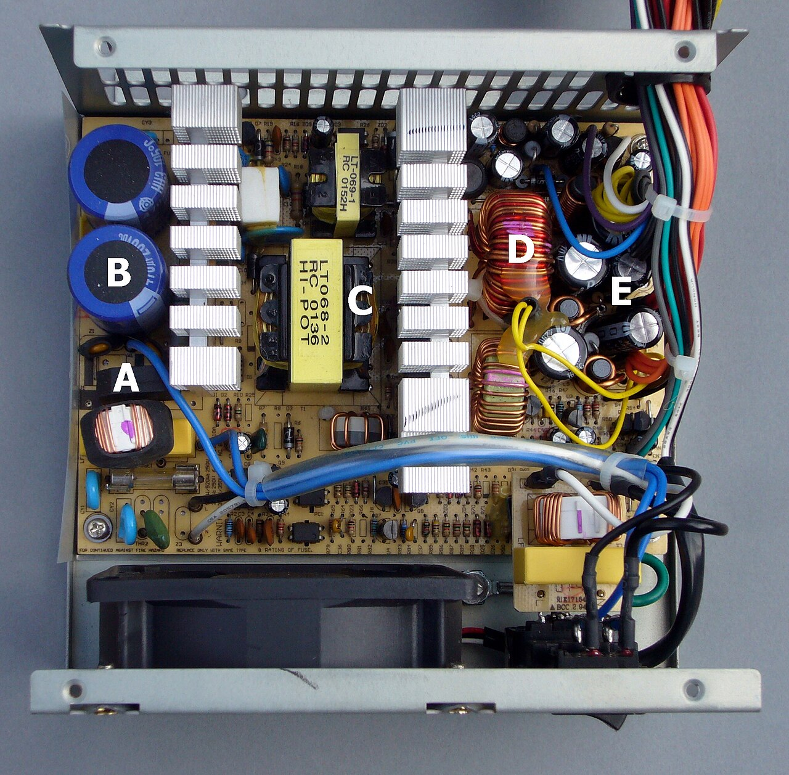
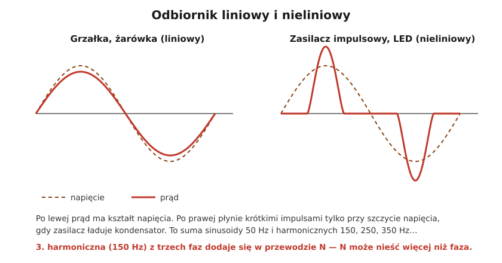

# 02.05 — Odbiorniki nieliniowe i wyższe harmoniczne — podstawy

> **Moduł:** [02 — Prąd przemienny i sieć 230/400 V](README.md) · **Oznaczenia:** 🟢📋 · **Zakres SEP:** (a) · **Status:** ✅ pełny
>
> **Czytaj:**
>
> - Rozporządzenie MKiŚ z 22 marca 2023 r. (t.j. Dz.U. 2025 poz. 919), § 45 ust. 5 — współczynnik odkształcenia napięcia THD
> - PN-EN 50160 — parametry napięcia zasilającego (omówienie)
> - Typy wyłączników różnicowoprądowych przy prądach odkształconych: [moduł 08](../08-wylaczniki-roznicowopradowe/README.md)

[← poprzedni temat](02.04-moc-czynna-bierna-i-pozorna-wspolczynnik-mocy.md) · [spis modułu](README.md) · (koniec modułu) →

## Po co to jest

Dziś większość urządzeń w domu ma w środku zasilacz elektroniczny: komputer, telewizor, ładowarka, oświetlenie LED, płyta indukcyjna, pompa ciepła, falownik fotowoltaiki. Pobierają one prąd, który nie ma kształtu sinusoidy. Ma to praktyczne skutki. Przewód neutralny w instalacji trójfazowej może być przeciążony, choć fazy nie są. Zwykły multimetr pokazuje błędny prąd. Różnicówki typu AC mogą nie zadziałać. To temat na poziomie podstaw, ale tłumaczy kilka „zagadkowych” usterek. Na egzaminie bywa pytanie o przyczyny i skutki odkształceń.

## Po ludzku

**Odbiornik liniowy** (grzałka, żarówka, w przybliżeniu silnik) pobiera prąd tego samego kształtu co napięcie: sinusoidę.

**Odbiornik nieliniowy** pobiera prąd innego kształtu. Typowy zasilacz impulsowy ma na wejściu prostownik i kondensator. Kondensator ładuje się tylko wtedy, gdy napięcie sieci jest bliskie szczytu, więc prąd płynie krótkimi, wysokimi „szpilkami” dwa razy na okres, a przez resztę czasu prawie wcale.

**Harmoniczne.** Każdy powtarzający się przebieg da się rozłożyć na sumę sinusoid: podstawowej 50 Hz i **wyższych harmonicznych** o częstotliwościach będących jej wielokrotnościami — 150 Hz (3.), 250 Hz (5.), 350 Hz (7.) i tak dalej. Im bardziej „szpiczasty” prąd, tym więcej w nim harmonicznych.

**Dlaczego to ważne:**

- **Przewód N w instalacji trójfazowej.** Przy równym obciążeniu prądy 50 Hz z trzech faz znoszą się w N ([02.03](02.03-uklad-trojfazowy-230-v-i-400-v-kolejnosc-faz.md)). Trzecie harmoniczne z trzech faz są jednak ze sobą w fazie, więc w N **dodają się**. W budynku pełnym komputerów i LED prąd w N może przekroczyć prąd fazowy, w skrajnych przypadkach sięgając ok. 1,7 raza. Dlatego przy takich odbiornikach nie zmniejsza się przekroju przewodu N.
- **Pomiar.** Multimetr bez „True RMS” zakłada sinusoidę i przy szpiczastym prądzie potrafi pomylić się o kilkadziesiąt procent.
- **Nagrzewanie.** Harmoniczne dodatkowo grzeją transformatory i silniki.
- **Zakłócenia.** Odkształcony prąd na impedancji sieci odkształca też napięcie, co może zakłócać inne urządzenia.
- **Prądy upływu.** Zasilacze mają filtry przeciwzakłóceniowe, przez które do PE płynie mały prąd. Kilkanaście urządzeń na jednej różnicówce potrafi ją wyzwalać ([moduł 08](../08-wylaczniki-roznicowopradowe/README.md)).

## Jak to wygląda

*Na co patrzeć: duże cylindry (oznaczone m.in. literą B) to kondensatory wejściowe, które ładują się przy szczytach napięcia. To one powodują impulsowy pobór prądu. Aluminiowe żebra to radiatory tranzystorów, a żółte elementy z uzwojeniami to transformator i dławiki pracujące z częstotliwością dziesiątek kiloherców. Ten mały transformator zastępuje ciężki transformator 50 Hz ([03.02](../03-elektromagnetyzm-w-praktyce/03.02-indukcja-elektromagnetyczna-i-transformator.md)). Lepsze zasilacze mają układ PFC, który wyrównuje kształt prądu.*

## Schemat

## Pojęcia

| Pojęcie | Po ludzku | Termin normowy / symbol |
|---------|-----------|-------------------------|
| Odbiornik liniowy | Prąd ma kształt napięcia | odbiornik liniowy |
| Odbiornik nieliniowy | Prąd ma inny kształt niż napięcie | odbiornik nieliniowy |
| Harmoniczna | Składowa sinusoidalna o częstotliwości będącej wielokrotnością 50 Hz | n-ta harmoniczna (150 Hz — 3., 250 Hz — 5.) |
| THD | Jak bardzo przebieg różni się od sinusoidy, w % | współczynnik odkształcenia harmonicznymi, THD |
| PFC | Układ w zasilaczu wyrównujący kształt prądu | korekcja współczynnika mocy |
| True RMS | Miernik liczący prawdziwą wartość skuteczną | — |

## Liczby do zapamiętania

| Wielkość | Wartość | Kiedy obowiązuje | Źródło |
|----------|---------|------------------|--------|
| Częstotliwości harmonicznych | 3. — **150 Hz**, 5. — **250 Hz**, 7. — **350 Hz** | sieć 50 Hz | $f_n = n \cdot 50\ \mathrm{Hz}$ |
| Dopuszczalny THD napięcia | **≤ 8 %** (maks. ze średnich 10-min w tygodniu) | odbiorcy w grupach przyłączeniowych III–V | rozporządzenie MKiŚ z 2023 r., § 45 ust. 5 |
| Prąd w N przy odbiornikach nieliniowych | może **przekroczyć prąd fazowy** (do ok. 1,7 ×) | sieć trójfazowa, dużo zasilaczy impulsowych | — |
| Harmoniczne sumujące się w N | **3., 9., 15.** (wielokrotności 3) | układ trójfazowy | — |

## W praktyce

- **Pomiar prądu** urządzeń elektronicznych rób miernikiem „True RMS” (cęgi, multimetr).
- **Przekrój przewodu N** w instalacjach trójfazowych z dużą liczbą odbiorników elektronicznych nie może być mniejszy niż przekrój faz ([moduł 16](../16-planowanie-obwodow/README.md)).
- **Różnicówki:** w obwodach z zasilaczami impulsowymi, falownikami i płytami indukcyjnymi stosuje się wyłączniki typu A albo F, a nie AC; przy falownikach i ładowarkach samochodów czasem typu B ([moduł 08](../08-wylaczniki-roznicowopradowe/README.md)).
- **Rozkładanie obciążeń:** wiele zasilaczy (np. serwerownia, biuro) lepiej rozdzielić na kilka obwodów i różnicówek.

## Błędy i zagrożenia

- **Zmniejszony przekrój N** w obwodach trójfazowych zasilających elektronikę. Przewód N może się przegrzewać, choć wszystkie wyłączniki faz „trzymają”, bo w przewodzie N nie ma zabezpieczenia.
- **Wyłącznik różnicowoprądowy typu AC** w obwodzie z falownikiem lub zasilaczem może nie wykryć prądu upływu o odkształconym kształcie ([moduł 08](../08-wylaczniki-roznicowopradowe/README.md)).
- **Zaufanie do taniego multimetru** przy pomiarze prądu LED-ów i zasilaczy — wynik może być zaniżony.

## Przykład

**Sytuacja.** W biurze zasilanym trójfazowo każda faza obciążona jest równo prądem 20 A, pobieranym głównie przez komputery i oświetlenie LED. W każdej fazie trzecia harmoniczna stanowi ok. 12 A. Jaki prąd płynie w przewodzie N?

**Analiza.** Składowe 50 Hz trzech faz przy równym obciążeniu znoszą się w N. Trzecie harmoniczne z trzech faz są ze sobą w fazie, więc się dodają:

$$I_N \approx 3 \cdot I_3 = 3 \cdot 12\ \mathrm{A} = 36\ \mathrm{A}$$

**Wniosek.** W przewodzie N płynie ok. 36 A, czyli więcej niż w którejkolwiek fazie (20 A). Przewód N dobrany „tak jak fazy, a nawet cieńszy, bo przy równym obciążeniu nic nie płynie” będzie się przegrzewał. Taki problem wykrywa pomiar cęgami True RMS na przewodzie N.

## Pytania SEP

1. **Co to są odbiorniki nieliniowe i jakie powodują problemy w instalacji?**

Odpowiedź

To odbiorniki, których prąd nie jest proporcjonalny do napięcia, więc ma kształt niesinusoidalny: zasilacze impulsowe, oświetlenie LED i świetlówki elektroniczne, przemienniki częstotliwości, prostowniki, UPS-y. Prąd odkształcony zawiera wyższe harmoniczne. Skutki: przeciążenie przewodu neutralnego w sieciach trójfazowych (sumowanie trzecich harmonicznych), dodatkowe nagrzewanie transformatorów i przewodów, odkształcenie napięcia, błędy pomiarów zwykłymi miernikami, zakłócenia i niepożądane zadziałania zabezpieczeń.

2. **Dlaczego w instalacji trójfazowej z dużą liczbą zasilaczy impulsowych przewód neutralny może być obciążony bardziej niż przewody fazowe?**

Odpowiedź

Składowe podstawowe prądów (50 Hz) trzech faz są przesunięte o 120° i przy symetrycznym obciążeniu znoszą się w przewodzie N. Trzecia harmoniczna (150 Hz) i jej wielokrotności są we wszystkich trzech fazach zgodne w fazie, więc w przewodzie N się sumują. Przy dużym udziale trzeciej harmonicznej prąd w N może przekroczyć prąd fazowy.

## Sprawdź się

1. Jaką częstotliwość ma 5. harmoniczna w sieci 50 Hz?

Odpowiedź

$5 \cdot 50 = 250\ \mathrm{Hz}$.

2. Tani multimetr pokazuje, że listwa z komputerem i monitorem pobiera 1,1 A, a cęgi True RMS — 1,6 A. Który pomiar jest bliższy prawdy i dlaczego?

Odpowiedź

Cęgi True RMS. Prąd zasilaczy jest impulsowy, a zwykły miernik zakłada sinusoidę i zaniża wynik przy takim przebiegu.

## Źródła

- Rozporządzenie MKiŚ z 22 marca 2023 r. (t.j. Dz.U. 2025 poz. 919), § 45 ust. 5 — THD napięcia ≤ 8 %, poziomy poszczególnych harmonicznych.
- PN-EN 50160 — parametry napięcia zasilającego w publicznych sieciach.
- PN-HD 60364-5-52 — przekrój przewodu neutralnego przy obecności harmonicznych (omówienie w module 16).

---

[← poprzedni temat](02.04-moc-czynna-bierna-i-pozorna-wspolczynnik-mocy.md) · [spis modułu](README.md) · (koniec modułu) →
