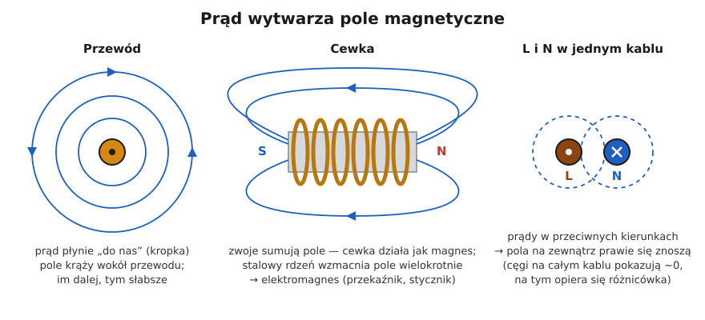

# 03.01 — Pole magnetyczne prądu i cewka

> **Moduł:** [03 — Elektromagnetyzm w praktyce](README.md) · **Oznaczenia:** 🟢 · **Zakres SEP:** (a) · **Status:** ✅ pełny
>
> **Czytaj:**
>
> - OpenStax, *Fizyka dla szkół wyższych*, t. 2, rozdz. 12 „Źródła pola magnetycznego” (pole przewodu prostoliniowego, solenoid) i rozdz. 14 „Indukcyjność”

← (początek modułu) · [spis modułu](README.md) · [następny temat →](03.02-indukcja-elektromagnetyczna-i-transformator.md)

## Po co to jest

Połowa aparatów w rozdzielnicy działa dzięki temu, że prąd wytwarza pole magnetyczne. Cewka w wyłączniku nadprądowym reaguje na zwarcie ([01.07](../01-prad-napiecie-opor/01.07-przeciazenie-a-zwarcie-dwie-rozne-awarie.md)). Przekładnik w różnicówce „liczy” różnicę prądów. Elektromagnes w styczniku przestawia styki, a uzwojenia silnika i transformatora też są cewkami. Z tego samego zjawiska wynika też moc bierna ([02.04](../02-prad-przemienny-230-400/02.04-moc-czynna-bierna-i-pozorna-wspolczynnik-mocy.md)) i to, że przewody L i N prowadzi się razem.

## Po ludzku

**Każdy przewód z prądem jest otoczony polem magnetycznym.** Linie pola to okręgi wokół przewodu. Kierunek wskazuje **reguła prawej dłoni**: kciuk wzdłuż prądu, a zgięte palce pokazują, w którą stronę „kręci się” pole. Im większy prąd, tym silniejsze pole, a im dalej od przewodu, tym słabsze.

**Cewka skupia pole.** Przewód nawinięty w zwoje sumuje pole wszystkich zwojów wewnątrz cewki. Cewka zachowuje się jak magnes sztabkowy, z biegunem N i S. Jeśli w środku jest **rdzeń ze stali** (żelaza), pole rośnie setki, a nawet tysiące razy, bo stal sama się magnesuje. Tak powstaje **elektromagnes**: magnes, który włącza się prądem i wyłącza razem z nim.

**Cewka „nie lubi zmian prądu”.** Przy każdej zmianie prądu zmienia się pole, a zmieniające się pole indukuje w cewce napięcie, które przeciwdziała tej zmianie ([03.02](03.02-indukcja-elektromagnetyczna-i-transformator.md)). Dlatego:

- przy prądzie przemiennym cewka stawia opór większy niż sama rezystancja drutu, nazywany **reaktancją**: $X_L = 2\pi f L$,
- prąd w cewce spóźnia się za napięciem, stąd moc bierna indukcyjna ([02.04](../02-prad-przemienny-230-400/02.04-moc-czynna-bierna-i-pozorna-wspolczynnik-mocy.md)),
- przy **wyłączaniu** prądu w cewce powstaje skok napięcia (przepięcie łączeniowe), który daje iskrę na stykach. Stąd warystory i układy RC przy cewkach styczników.

**Dwa przewody z przeciwnymi prądami.** Gdy L i N biegną obok siebie, ich pola wokół kabla prawie się znoszą. Dlatego przewody jednego obwodu prowadzi się razem, w jednym kablu lub jednej rurce, a w kablach jedno- i trójfazowych pole na zewnątrz jest bardzo małe. Na tym samym zjawisku opiera się działanie wyłącznika różnicowoprądowego ([moduł 08](../08-wylaczniki-roznicowopradowe/README.md)).

## Schemat

## Pojęcia

| Pojęcie | Po ludzku | Termin normowy / symbol |
|---------|-----------|-------------------------|
| Pole magnetyczne | „Strefa wpływu” wokół magnesu lub przewodu z prądem | indukcja magnetyczna B, tesla [T] |
| Cewka | Przewód nawinięty w zwoje | cewka, uzwojenie, solenoid |
| Rdzeń | Stalowy element w cewce, który wzmacnia pole | rdzeń ferromagnetyczny, obwód magnetyczny |
| Elektromagnes | Cewka z rdzeniem — magnes włączany prądem | elektromagnes |
| Indukcyjność | „Bezwładność” cewki wobec zmian prądu | L, henr [H] |
| Reaktancja indukcyjna | Opór cewki dla prądu przemiennego | $X_L = 2\pi f L$ [Ω] |
| Przepięcie łączeniowe | Skok napięcia przy przerwaniu prądu w cewce | przepięcie łączeniowe ([moduł 09](../09-ochrona-przeciwprzepieciowa/README.md)) |

## Liczby do zapamiętania

| Wielkość | Wartość | Kiedy obowiązuje | Źródło |
|----------|---------|------------------|--------|
| Kierunek pola | reguła prawej dłoni: kciuk — prąd, palce — pole | przewód prostoliniowy | — |
| Reaktancja cewki | $X_L = 2\pi f L$ — rośnie z częstotliwością | prąd przemienny | definicja |
| Przy 50 Hz | $X_L \approx 314 \cdot L$ | sieć 50 Hz | $2\pi \cdot 50 \approx 314$ |
| Cewka przy prądzie stałym | tylko rezystancja drutu (po ustaleniu prądu) | DC | — |
| Wpływ rdzenia stalowego | pole wielokrotnie silniejsze (setki–tysiące razy) | rdzeń nienasycony | — |

## W praktyce

- **Przewody jednego obwodu prowadź razem.** L i N w jednym kablu lub rurce; przy kablach jednożyłowych w obwodach prądu przemiennego układa się je blisko siebie. Rozdzielenie L i N tworzy pętlę, która wytwarza pole i grzeje metalowe elementy w pobliżu.
- **Cewki styczników i przekaźników** przy wyłączaniu dają przepięcia. Producenci oferują nakładki tłumiące (warystor, RC), które chronią styki sterujące i elektronikę ([03.03](03.03-elektromagnes-w-pracy-przekaznik-i-stycznik.md)).
- **Cęgi prądowe** mierzą pole wokół przewodu, dlatego obejmują jeden przewód, a nie cały kabel ([01.01](../01-prad-napiecie-opor/01.01-ladunek-i-prad-co-wlasciwie-plynie-w-przewodzie.md#w-praktyce)).

## Błędy i zagrożenia

- **Pojedynczy przewód fazowy przeprowadzony przez metalową dławnicę lub otwór w stalowej płycie**, gdy N idzie inną drogą. Pole wokół przewodu indukuje prądy wirowe w stali i ją nagrzewa.
- **Przewody L i N jednego obwodu w różnych rurkach.** Duże pole, zakłócenia i błędne działanie różnicówki, jeśli przewody przechodzą przez nią osobno.
- **Lekceważenie przepięć łączeniowych.** Bez tłumienia cewki stycznika iskrzą styki łączników sterujących, a elektronika obok może się uszkadzać.

## Przykład

**Zadanie.** Cewka stycznika ma indukcyjność 1 H i rezystancję drutu 100 Ω. Jaki prąd popłynie przy 230 V prądu przemiennego 50 Hz, a jaki płynąłby przy 230 V prądu stałego?

Reaktancja: $X_L = 2\pi \cdot 50 \cdot 1 \approx 314\ \Omega$. Impedancja: $Z = \sqrt{R^2 + X_L^2} = \sqrt{100^2 + 314^2} \approx 330\ \Omega$.

$$I_{AC} = \frac{230}{330} \approx 0{,}7\ \mathrm{A} \qquad I_{DC} = \frac{230}{100} = 2{,}3\ \mathrm{A}$$

**Wniosek.** Przy prądzie stałym ta sama cewka pobiera ponad trzy razy większy prąd i się przegrzewa. Dlatego cewek na napięcie przemienne nie podłącza się do napięcia stałego tej samej wartości, a na tabliczce cewki zawsze jest rodzaj napięcia (np. „230 V AC” albo „24 V DC”). W rzeczywistych stycznikach indukcyjność zmienia się jeszcze po przyciągnięciu zwory, ale wniosek jest ten sam.

## Pytania SEP

1. **Na czym polega działanie elektromagnesu i gdzie wykorzystuje się go w instalacjach?**

Odpowiedź

Prąd płynący przez cewkę wytwarza pole magnetyczne, które rdzeń ze stali ferromagnetycznej wielokrotnie wzmacnia. Elektromagnes przyciąga ruchomą zworę, dopóki płynie prąd. W instalacjach wykorzystują go styczniki i przekaźniki (przestawianie styków), wyzwalacze elektromagnetyczne wyłączników nadprądowych (reakcja na zwarcie), wyzwalacze wyłączników różnicowoprądowych, dzwonki, zamki elektromagnetyczne i elektrozawory.

2. **Dlaczego przewody L i N jednego obwodu prowadzi się razem?**

Odpowiedź

Prądy w L i N mają tę samą wartość i przeciwny kierunek, więc ich pola magnetyczne wzajemnie się znoszą. Prowadzenie ich razem minimalizuje pole wokół obwodu, zakłócenia, indukowanie prądów wirowych w metalowych elementach i spadek napięcia indukcyjnego. Jest to też warunek poprawnej pracy wyłącznika różnicowoprądowego: przez jego przekładnik muszą przechodzić wszystkie przewody czynne obwodu.

## Sprawdź się

1. Ile wynosi reaktancja cewki o indukcyjności 0,5 H przy 50 Hz?

Odpowiedź

$X_L = 2\pi \cdot 50 \cdot 0{,}5 \approx 157\ \Omega$.

2. Dlaczego przy wyłączaniu dużego silnika lub stycznika na stykach łącznika widać iskrę, a przy wyłączaniu grzałki o tej samej mocy — mniejszą?

Odpowiedź

Uzwojenia silnika i cewka stycznika magazynują energię w polu magnetycznym. Przy przerwaniu prądu indukuje się w nich napięcie, które próbuje podtrzymać prąd, więc na rozchodzących się stykach powstaje łuk. Grzałka ma znikomą indukcyjność, więc tego zjawiska prawie nie ma.

## Źródła

- OpenStax, *Fizyka dla szkół wyższych*, t. 2, rozdz. 12 i 14 — pole magnetyczne przewodu i solenoidu, indukcyjność.
- Przepięcia łączeniowe: [moduł 09](../09-ochrona-przeciwprzepieciowa/README.md); różnicówka: [moduł 08](../08-wylaczniki-roznicowopradowe/README.md).

---

← (początek modułu) · [spis modułu](README.md) · [następny temat →](03.02-indukcja-elektromagnetyczna-i-transformator.md)
