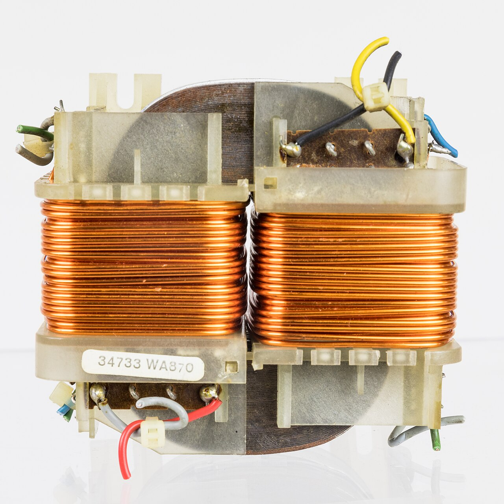
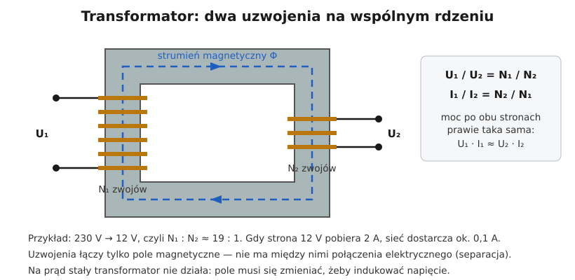

# 03.02 — Indukcja elektromagnetyczna i transformator

> **Moduł:** [03 — Elektromagnetyzm w praktyce](README.md) · **Oznaczenia:** 🟢 · **Zakres SEP:** (a) · **Status:** ✅ pełny
>
> **Czytaj:**
>
> - OpenStax, *Fizyka dla szkół wyższych*, t. 2, rozdz. 13 „Indukcja elektromagnetyczna” i § 15.6 „Transformatory”
> - Transformatory bezpieczeństwa i separacyjne: [moduł 25](../25-transformatory-ups-agregaty/README.md)

[← poprzedni temat](03.01-pole-magnetyczne-pradu-i-cewka.md) · [spis modułu](README.md) · [następny temat →](03.03-elektromagnes-w-pracy-przekaznik-i-stycznik.md)

## Po co to jest

Indukcja to druga strona elektromagnetyzmu: zmieniające się pole magnetyczne wytwarza napięcie. Na tym działają generatory w elektrowniach, transformatory, które przenoszą energię z 15 kV na 400 V, i przekładniki w różnicówkach. Dzięki niej działają też ładowarki indukcyjne i płyty indukcyjne. Elektrykowi transformator jest potrzebny w zasilaczach dzwonków i oświetlenia, w transformatorach bezpieczeństwa (SELV) i separacyjnych. Na egzaminie: zasada działania transformatora, przekładnia i dlaczego nie działa na prąd stały.

## Po ludzku

**Zmiana pola = napięcie.** Jeśli pole magnetyczne przechodzące przez zwój przewodu się zmienia, w zwoju pojawia się napięcie. Jest tym większe, im szybciej zmienia się pole i im więcej zwojów. To **prawo Faradaya**. Nieruchomy magnes w nieruchomej cewce nie daje nic. Magnes poruszający się w cewce (generator) albo cewka z prądem przemiennym obok drugiej cewki (transformator) daje napięcie.

**Transformator** to dwie cewki nawinięte na wspólnym stalowym rdzeniu:

1. Prąd przemienny w **uzwojeniu pierwotnym** wytwarza w rdzeniu zmieniające się pole (strumień magnetyczny).
2. Ten sam strumień przechodzi przez **uzwojenie wtórne** i indukuje w nim napięcie.
3. Każdy zwój „dostaje” takie samo napięcie, więc napięcia mają się do siebie jak liczby zwojów:

$$\frac{U_1}{U_2} = \frac{N_1}{N_2}$$

Transformator nie wytwarza energii: moc po obu stronach jest prawie taka sama. Gdy napięcie spada, prąd rośnie w tej samej proporcji.

**Separacja.** Uzwojenia łączy tylko pole magnetyczne, a nie przewód. Obwód wtórny nie ma galwanicznego połączenia z siecią ani z ziemią. Na tym opiera się ochrona przez separację elektryczną i obwody SELV z transformatorem bezpieczeństwa ([moduł 12](../12-ochrona-przeciwporazeniowa/README.md)).

**Dlaczego nie na prąd stały?** Prąd stały daje stałe pole, a stałe pole nic nie indukuje. Transformator podłączony do napięcia stałego zachowuje się jak kawałek drutu o małej rezystancji: płynie ogromny prąd i uzwojenie się przepala.

**Straty.** Transformator grzeje się od rezystancji uzwojeń i od przemagnesowywania rdzenia. Rdzeń składa się z cienkich izolowanych blach, żeby ograniczyć prądy wirowe. Na tej samej zasadzie działa płyta indukcyjna, tylko celowo: prądy wirowe grzeją dno garnka.

## Jak to wygląda

*Na co patrzeć: dwie cewki z miedzianego drutu na wspólnym rdzeniu z pakietu blach. Uzwojenie o większej liczbie cienkich zwojów to strona wyższego napięcia, a o mniejszej liczbie grubszych zwojów — strona niższego napięcia i większego prądu. Między uzwojeniami nie ma żadnego połączenia elektrycznego.*

## Schemat

## Pojęcia

| Pojęcie | Po ludzku | Termin normowy / symbol |
|---------|-----------|-------------------------|
| Indukcja elektromagnetyczna | Zmieniające się pole wytwarza napięcie | prawo Faradaya |
| Strumień magnetyczny | „Ilość” pola przechodząca przez zwój lub rdzeń | Φ, weber [Wb] |
| Uzwojenie pierwotne | Strona zasilana | $N_1$, $U_1$ |
| Uzwojenie wtórne | Strona, z której odbieramy energię | $N_2$, $U_2$ |
| Przekładnia | Stosunek napięć (zwojów) | $\vartheta = U_1/U_2 = N_1/N_2$ |
| Separacja galwaniczna | Brak połączenia przewodem między obwodami | separacja elektryczna |
| Prądy wirowe | Prądy indukowane w masie metalu, grzeją go | prądy wirowe |
| Transformator bezpieczeństwa | Transformator z izolacją wzmocnioną między uzwojeniami, do obwodów SELV | PN-EN 61558-2-6 ([moduł 25](../25-transformatory-ups-agregaty/README.md)) |

## Liczby do zapamiętania

| Wielkość | Wartość | Kiedy obowiązuje | Źródło |
|----------|---------|------------------|--------|
| Przekładnia napięciowa | $U_1 / U_2 = N_1 / N_2$ | transformator idealny, prąd przemienny | prawo Faradaya |
| Przekładnia prądowa | $I_1 / I_2 = N_2 / N_1$ | jw., pod obciążeniem | bilans mocy |
| Moc | $U_1 I_1 \approx U_2 I_2$ (sprawność dużych transformatorów > 95 %) | — | — |
| Prąd stały | transformator **nie działa** (zwarcie dla źródła) | DC | — |
| Typowe przekładnie | stacja 15 kV / 0,4 kV; zasilacz dzwonka 230 / 8–12 V; transformator bezpieczeństwa 230 / 12–24 V | — | — |

## W praktyce

- **Zasilacze oświetlenia 12 V** (halogenowego, starszego LED) to transformatory (dawniej żelazne, dziś elektroniczne). Moc transformatora dobiera się z zapasem do sumy mocy źródeł.
- **Transformator w rozdzielnicy** (dzwonek, sterowanie 24 V) ma na obudowie napięcia obu stron i moc w VA. Strona niskonapięciowa też wymaga zabezpieczenia.
- **Transformator separacyjny** (np. do zasilania jednego urządzenia w warsztacie) zasila zawsze **jeden** odbiornik, a obwodu wtórnego się nie uziemia ([moduł 12](../12-ochrona-przeciwporazeniowa/README.md)).
- **Przy pomiarach** pamiętaj, że po stronie wtórnej transformatora bez obciążenia napięcie bywa wyższe od znamionowego o kilka–kilkanaście procent.

## Błędy i zagrożenia

- ⚠️ **„Po stronie 12 V nic mi nie grozi, więc mogę pracować po stronie 230 V bez wyłączania”.** Strona pierwotna jest pod napięciem sieci. Pięć zasad dotyczy całego urządzenia.
- **Podłączenie transformatora do napięcia stałego** (np. akumulatora) — spalenie uzwojenia.
- **Odwrotne podłączenie** — podanie 230 V na uzwojenie 12 V. Rdzeń się przesyca, płynie ogromny prąd i uzwojenie się przepala, a po drugiej stronie mogą się na chwilę pojawić bardzo wysokie napięcia.
- **Zwykły zasilacz uznany za „bezpieczny”.** Nie każdy zasilacz ma separację na poziomie transformatora bezpieczeństwa. O SELV decyduje oznaczenie i konstrukcja, a nie samo niskie napięcie.

## Przykład

**Zadanie.** Transformator bezpieczeństwa 230/12 V zasila oświetlenie o mocy 60 W. Ile wynosi przekładnia, prąd po stronie 12 V i prąd pobierany z sieci (pomijając straty)?

$$\vartheta = \frac{230}{12} \approx 19{,}2 \qquad I_2 = \frac{60}{12} = 5\ \mathrm{A} \qquad I_1 = \frac{I_2}{\vartheta} = \frac{5}{19{,}2} \approx 0{,}26\ \mathrm{A}$$

**Sprawdzenie:** $230 \cdot 0{,}26 \approx 60\ \mathrm{W}$ ✓.

**Wniosek.** Po stronie 12 V płynie prąd 19 razy większy niż po stronie 230 V. Dlatego przewody niskonapięciowe muszą mieć **większy** przekrój niż przewód zasilający transformator, a spadek napięcia na nich jest procentowo dużo groźniejszy: 1 V to ponad 8 % z 12 V.

## Pytania SEP

1. **Wyjaśnij zasadę działania transformatora.**

Odpowiedź

Transformator składa się z dwóch (lub więcej) uzwojeń nawiniętych na wspólnym rdzeniu z blach stalowych. Prąd przemienny w uzwojeniu pierwotnym wytwarza w rdzeniu zmienny strumień magnetyczny, który przenika uzwojenie wtórne i indukuje w nim napięcie (zjawisko indukcji elektromagnetycznej). Stosunek napięć jest równy stosunkowi liczb zwojów: $U_1/U_2 = N_1/N_2$, a prądy zmieniają się odwrotnie. Uzwojenia nie są połączone elektrycznie, co pozwala na separację obwodów. Transformator działa tylko przy prądzie przemiennym.

2. **Dlaczego transformatora nie można zasilać napięciem stałym?**

Odpowiedź

Napięcie stałe wywołuje w rdzeniu stały strumień magnetyczny, który nie indukuje napięcia ani w uzwojeniu wtórnym, ani w pierwotnym. Prąd w uzwojeniu pierwotnym ogranicza wtedy tylko jego niewielka rezystancja, więc jest bardzo duży i uzwojenie ulega przegrzaniu i spaleniu.

3. **Do czego służy transformator separacyjny i transformator bezpieczeństwa?**

Odpowiedź

Transformator separacyjny oddziela galwanicznie obwód odbiornika od sieci. Przy pojedynczym uszkodzeniu izolacji odbiornika nie płynie prąd przez człowieka do ziemi, bo obwód wtórny nie jest uziemiony. Transformator bezpieczeństwa zasila obwody bardzo niskiego napięcia SELV/PELV (do 50 V AC). Ma izolację wzmocnioną lub podwójną między uzwojeniami, dzięki czemu napięcie sieci nie może przedostać się na stronę niskonapięciową. Szczegóły w modułach 12 i 25.

## Sprawdź się

1. Stacja transformatorowa obniża 15 kV do 400 V (międzyfazowo). Ile wynosi przekładnia? Ile razy prąd po stronie 400 V jest większy niż po stronie 15 kV?

Odpowiedź

$15\,000 / 400 = 37{,}5$. Prąd po stronie niskiego napięcia jest ok. 37,5 raza większy.

2. Dlaczego rdzeń transformatora składa się z cienkich blach, a nie z jednego kawałka stali?

Odpowiedź

Zmienne pole indukuje prądy także w samym rdzeniu (prądy wirowe), które go grzeją. Cienkie, izolowane od siebie blachy przerywają drogę tym prądom i zmniejszają straty.

## Źródła

- OpenStax, *Fizyka dla szkół wyższych*, t. 2, rozdz. 13 — prawo Faradaya; § 15.6 — transformatory.
- PN-EN 61558 — transformatory bezpieczeństwa i separacyjne (omówienie w module 25).

---

[← poprzedni temat](03.01-pole-magnetyczne-pradu-i-cewka.md) · [spis modułu](README.md) · [następny temat →](03.03-elektromagnes-w-pracy-przekaznik-i-stycznik.md)
