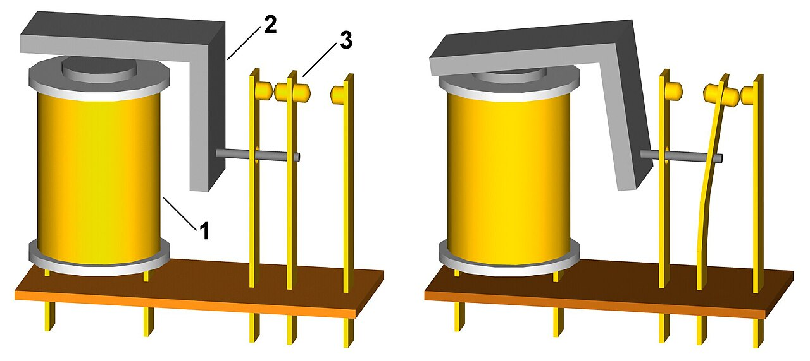
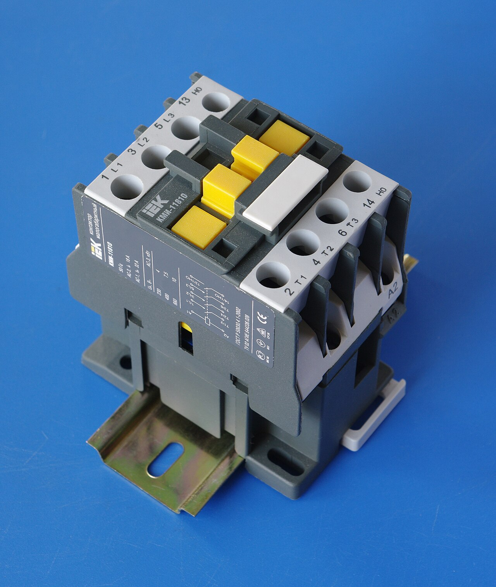
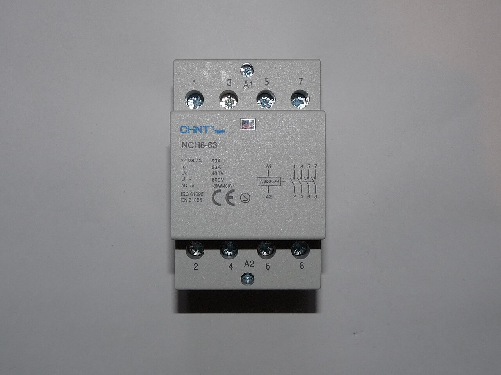
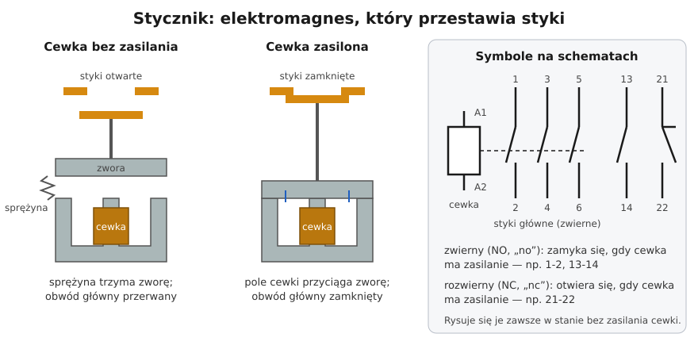

# 03.03 — Elektromagnes w pracy: przekaźnik i stycznik

> **Moduł:** [03 — Elektromagnetyzm w praktyce](README.md) · **Oznaczenia:** 🟢 · **Zakres SEP:** (a) · **Status:** ✅ pełny
>
> **Czytaj:**
>
> - PN-EN 60947-4-1 — styczniki i rozruszniki silnikowe (omówienie)
> - PN-EN 60445 i PN-EN 81346 — oznaczanie zacisków (A1/A2, 13-14, 21-22) i aparatów (oznaczenie K dla styczników i przekaźników) — omówienie
> - Stycznik w układzie silnika: [moduł 24](../24-silniki-i-napedy/README.md); stycznik i przekaźnik w rozdzielnicy domowej: [moduł 10](../10-aparatura-modulowa/README.md)

[← poprzedni temat](03.02-indukcja-elektromagnetyczna-i-transformator.md) · [spis modułu](README.md) · [następny temat →](03.04-jak-dziala-silnik-elektryczny-intuicja.md)

## Po co to jest

Stycznik i przekaźnik pozwalają małym prądem sterować dużym. Słaby łącznik, czujnik zmierzchu, programator czasowy czy sterownik „inteligentnego domu” wysterowuje cewkę, a ta przestawia styki, które zasilają podgrzewacz wody, pompę albo całe oświetlenie. Na egzaminie stycznik pojawia się przy układach silnikowych (moduł 24): trzeba umieć przeczytać jego oznaczenia i wiedzieć, co to styk zwierny i rozwierny.

## Po ludzku

**Przekaźnik** to elektromagnes ([03.01](03.01-pole-magnetyczne-pradu-i-cewka.md)) i zestaw styków. Gdy przez cewkę płynie prąd, rdzeń przyciąga ruchomą **zworę**, a zwora przestawia styki. Gdy prąd zniknie, **sprężyna** wraca zworę i styki do pozycji spoczynkowej.

**Stycznik** to „duży przekaźnik” do łączenia obwodów mocy, zwykle trójfazowych. Ma mocniejsze styki główne, komory gaszenia łuku i często dodatkowe styki pomocnicze. Jest przeznaczony do bardzo wielu łączeń, nawet milionów.

**Dwa rodzaje styków:**

- **zwierny (NO, normally open)** — w spoczynku otwarty, zamyka się, gdy cewka ma zasilanie,
- **rozwierny (NC, normally closed)** — w spoczynku zamknięty, otwiera się, gdy cewka ma zasilanie.

Na schematach styki rysuje się **zawsze w stanie spoczynku**, czyli bez zasilania cewki.

**Oznaczenia zacisków:**

- cewka: **A1** i **A2**,
- styki główne: **1-2, 3-4, 5-6** (w stycznikach modułowych bywa też 7-8),
- styki pomocnicze: dwie cyfry. Pierwsza to numer styku, druga określa rodzaj: **3-4 to zwierny** (np. 13-14), **1-2 to rozwierny** (np. 21-22).

**Napięcie cewki** jest niezależne od napięcia obwodu głównego. Stycznik może łączyć 400 V, a mieć cewkę 24 V DC sterowaną ze sterownika. Napięcie i rodzaj prądu cewki są nadrukowane na aparacie i muszą się zgadzać z obwodem sterowania ([03.01 — przykład](03.01-pole-magnetyczne-pradu-i-cewka.md#przykład)).

**Przekaźnik bistabilny** (impulsowy) przestawia się i zostaje w nowej pozycji bez zasilania cewki. Każdy krótki impuls z przycisku zmienia stan. Służy do sterowania oświetleniem z wielu miejsc ([moduł 18](../18-oswietlenie/README.md)).

## Jak to wygląda

*Na co patrzeć: (1) cewka z rdzeniem, (2) zwora w kształcie kątownika, (3) zestaw styków. Na prawym rysunku cewka jest zasilona, zwora została przyciągnięta i przestawiła styki: jeden obwód się zamknął, drugi otworzył.*

*Na co patrzeć: u góry i u dołu po trzy zaciski toru głównego, które łączą trzy fazy. Na froncie widać schemat styków i oznaczenia zacisków. Tego typu styczniki spotkasz w szafach sterowniczych, przy pompach i silnikach.*

*Na co patrzeć: stycznik modułowy wygląda jak wyłącznik i pasuje do rozdzielnicy mieszkaniowej. Na froncie są zaciski cewki A1/A2 i schemat czterech styków głównych. Styczniki modułowe w domu przełączają np. bojler w taryfie nocnej, ogrzewanie podłogowe czy grupę oświetlenia. Pracują cicho, a przeznaczone są do częstego łączenia.*

## Schemat

## Pojęcia

| Pojęcie | Po ludzku | Termin normowy / symbol |
|---------|-----------|-------------------------|
| Przekaźnik | Elektromagnes przestawiający styki — małe prądy | przekaźnik elektromagnetyczny, K |
| Stycznik | Przekaźnik do obwodów mocy, z gaszeniem łuku | stycznik, K (dawniej Q/S) |
| Cewka | Uzwojenie elektromagnesu | zaciski A1, A2 |
| Styk zwierny | Zamyka się po zasileniu cewki | NO; pomocnicze x3-x4 |
| Styk rozwierny | Otwiera się po zasileniu cewki | NC; pomocnicze x1-x2 |
| Styki główne | Łączą obwód mocy (odbiornik) | 1-2, 3-4, 5-6 |
| Styki pomocnicze | Do obwodów sterowania i sygnalizacji | 13-14, 21-22… |
| Przekaźnik bistabilny | Zmienia stan impulsem, pamięta go bez zasilania | przekaźnik impulsowy |

## Liczby do zapamiętania

| Wielkość | Wartość | Kiedy obowiązuje | Źródło |
|----------|---------|------------------|--------|
| Zaciski cewki | **A1, A2** | styczniki, przekaźniki | PN-EN 60947, PN-EN 60445 |
| Styki główne | **1-2, 3-4, 5-6** | styczniki | jw. |
| Druga cyfra styku pomocniczego | **3-4 zwierny**, **1-2 rozwierny** | 13-14 NO, 21-22 NC, 31-32 NC, 43-44 NO | jw. |
| Typowe napięcia cewek | **230 V AC**, 24 V AC/DC, 12 V DC | — | tabliczka aparatu |
| Stan rysowany na schemacie | **bez zasilania cewki** | schematy | zasada rysunku |

## W praktyce

- **Sprawdź napięcie cewki** przed podłączeniem: nadruk np. „Us = 230 V AC” albo „24 V DC”. Cewka 24 V podłączona do 230 V spłonie od razu, a cewka 230 V przy 24 V nie przyciągnie zwory.
- **Obwód sterowania** cewki ma własne zabezpieczenie (np. wyłącznik 2–6 A), niezależne od obwodu głównego.
- **Przed pracą przy styczniku** odłącz zarówno obwód główny, jak i sterowania. Wyłączenie samej cewki nie odłącza zacisków górnych toru głównego od zasilania ([00.01](../00-bezpieczenstwo-najpierw/00.01-piec-zasad-bezpiecznej-pracy-przy-urzadzeniach.md)).
- **Buczenie stycznika** to często zabrudzona powierzchnia rdzenia, zbyt niskie napięcie cewki albo uszkodzony zwój zwarty (pierścień w rdzeniu cewek AC).

## Błędy i zagrożenia

- ⚠️ **Wyłączony stycznik ≠ odłączony obwód.** Styki stycznika nie są przerwą izolacyjną w rozumieniu bezpiecznej pracy. Do pracy przy odbiorniku odłącza się zasilanie rozłącznikiem lub wyłącznikiem i sprawdza brak napięcia.
- **Mylenie styków NO i NC** w obwodach sterowania: urządzenie działa odwrotnie, niż powinno, np. pompa pracuje, kiedy ma stać.
- **Za słaby przekaźnik do obciążenia.** Prąd znamionowy styków podaje się dla konkretnej kategorii użytkowania (AC-1 — grzałki, AC-3 — silniki). Ten sam stycznik przy silniku przeniesie mniej niż przy grzałce.
- **Przekaźnik bistabilny po zaniku napięcia** zostaje w ostatniej pozycji. Światło, które było włączone, zaświeci się samo po powrocie zasilania.

## Przykład

**Zadanie.** Bojler elektryczny 3 kW ma grzać tylko w nocy (tańsza taryfa). Programator czasowy w rozdzielnicy ma styk 16 A. Czy można zasilić bojler bezpośrednio przez styk programatora, czy lepiej przez stycznik?

**Analiza.** Prąd bojlera: $3000/230 \approx 13\ \mathrm{A}$. Mieści się w 16 A, ale styk programatora pracuje wtedy blisko granicy, codziennie, przy dużym prądzie. Typowe rozwiązanie: programator steruje tylko cewką stycznika modułowego (prąd cewki to ułamek ampera), a stycznik z kategorią AC-1 20 A lub 25 A łączy bojler.

**Wniosek.** Stycznik oddziela „rozum” (programator) od „mięśni” (styki mocy). Programator i jego styk żyją dłużej, a przy awarii wymienia się tani stycznik. Szczegóły doboru w [module 10](../10-aparatura-modulowa/README.md).

## Pytania SEP

1. **Jak zbudowany jest stycznik i jak działa?**

Odpowiedź

Stycznik składa się z elektromagnesu (cewka na rdzeniu), ruchomej zwory połączonej ze stykami, sprężyny powrotnej, styków głównych z komorami gaszeniowymi oraz styków pomocniczych. Po podaniu napięcia na cewkę (zaciski A1-A2) rdzeń przyciąga zworę i styki główne zwierne się zamykają, a styki pomocnicze zmieniają stan. Po zaniku napięcia sprężyna przywraca stan spoczynkowy. Stycznik pozwala zdalnie i wielokrotnie łączyć obwody dużej mocy sygnałem z obwodu sterowania o małej mocy.

2. **Czym różni się styk zwierny od rozwiernego i jak się je oznacza?**

Odpowiedź

Styk zwierny (NO) w stanie spoczynku jest otwarty i zamyka się po zadziałaniu aparatu. Styk rozwierny (NC) w spoczynku jest zamknięty i otwiera się po zadziałaniu. W stykach pomocniczych druga cyfra oznaczenia 3-4 wskazuje styk zwierny (np. 13-14), a 1-2 rozwierny (np. 21-22). Na schematach styki rysuje się w stanie, gdy cewka nie jest zasilona.

3. **Czy wyłączenie stycznika wystarcza do bezpiecznej pracy przy zasilanym przez niego silniku?**

Odpowiedź

Nie. Stycznik jest aparatem łączeniowym do sterowania, a nie odłącznikiem. Jego styki mogą się zespawać, obwód sterowania może zostać przypadkowo załączony, a zaciski zasilające stycznika pozostają pod napięciem. Do pracy przy silniku trzeba odłączyć zasilanie aparatem o właściwościach izolacyjnych (rozłącznik, wyłącznik), zabezpieczyć przed załączeniem i sprawdzić brak napięcia, zgodnie z pięcioma zasadami.

## Sprawdź się

1. Na [schemacie stycznika](../../assets/schematy/03-stycznik.svg) styk 21-22 jest narysowany jako zamknięty. Jaki będzie jego stan, gdy na A1-A2 pojawi się napięcie?

Odpowiedź

Otwarty — to styk rozwierny (NC).

2. Na stycznik naklejono „Us 24 V DC”. Czy można go sterować bezpośrednio z łącznika na 230 V?

Odpowiedź

Nie. Cewka jest przeznaczona na 24 V prądu stałego. Po podaniu 230 V spłonie. Potrzebny jest zasilacz 24 V DC w obwodzie sterowania albo stycznik z cewką 230 V AC.

## Źródła

- PN-EN 60947-4-1 — styczniki i rozruszniki silnikowe: kategorie użytkowania AC-1, AC-3.
- PN-EN 60445, PN-EN 81346 — oznaczenia zacisków i aparatów.
- Układy z wykorzystaniem stycznika: [moduł 24](../24-silniki-i-napedy/README.md); stycznik modułowy i przekaźniki w domu: [moduł 10](../10-aparatura-modulowa/README.md).

---

[← poprzedni temat](03.02-indukcja-elektromagnetyczna-i-transformator.md) · [spis modułu](README.md) · [następny temat →](03.04-jak-dziala-silnik-elektryczny-intuicja.md)
