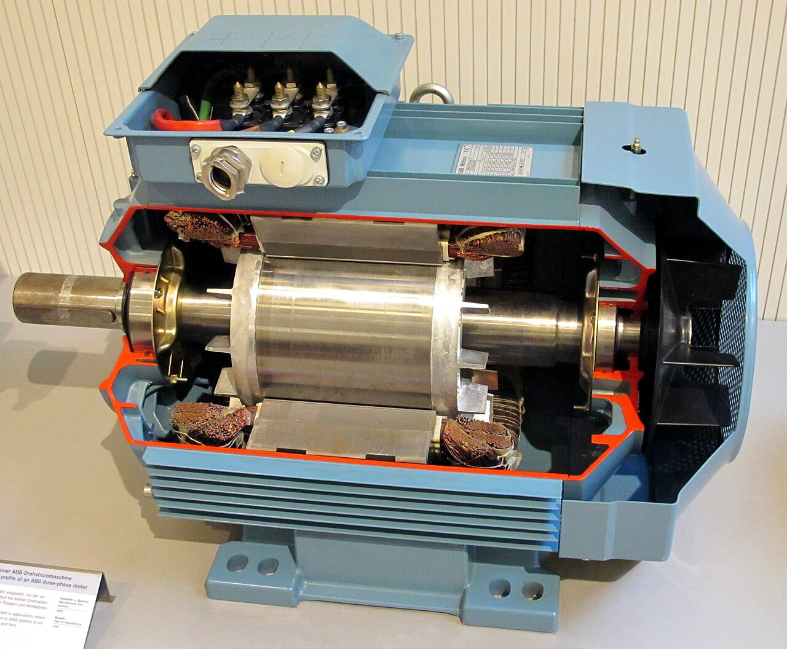
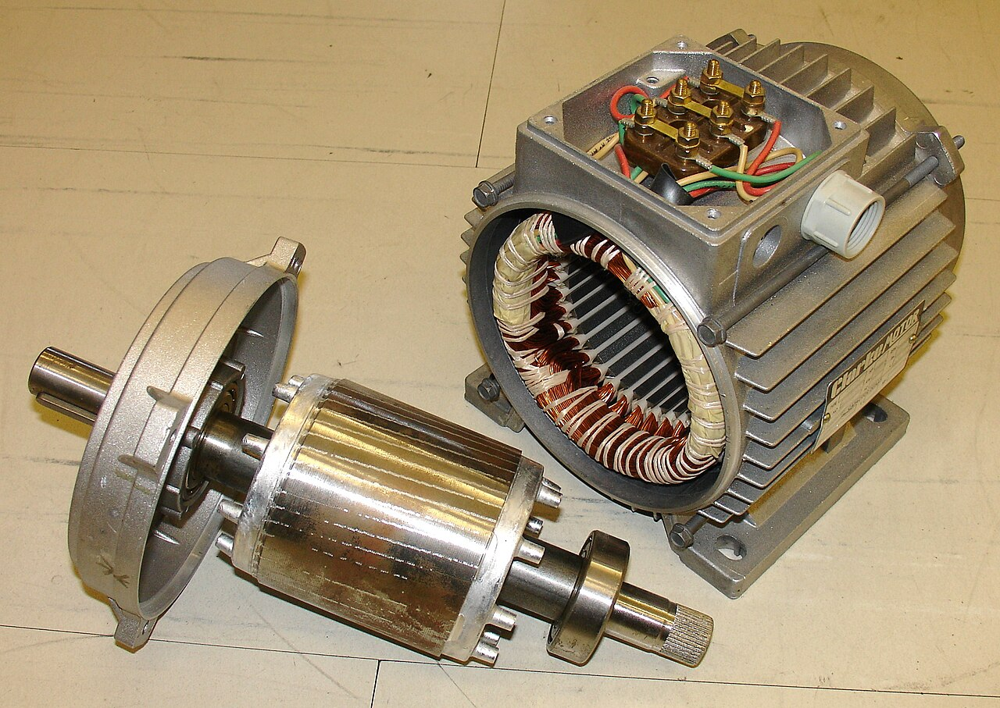
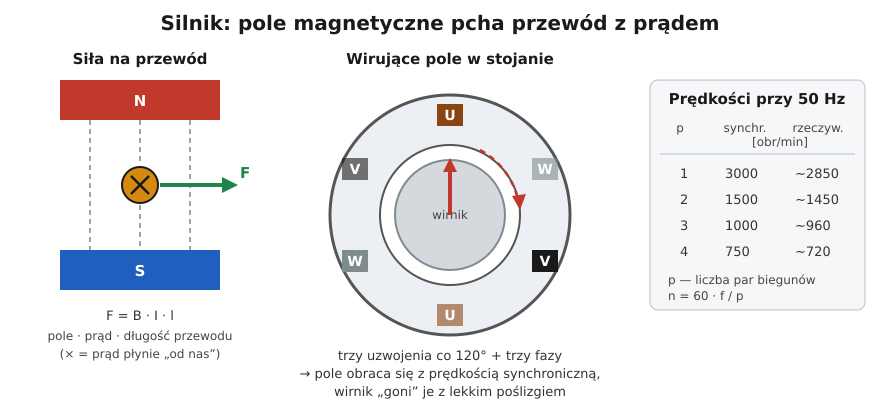

# 03.04 — Jak działa silnik elektryczny — intuicja

> **Moduł:** [03 — Elektromagnetyzm w praktyce](README.md) · **Oznaczenia:** 🟢 · **Zakres SEP:** (a) · **Status:** ✅ pełny
>
> **Czytaj:**
>
> - OpenStax, *Fizyka dla szkół wyższych*, t. 2, rozdz. 11 „Siły i pola magnetyczne” (siła działająca na przewodnik z prądem, silnik elektryczny)
> - Silniki w praktyce instalatora: [moduł 24](../24-silniki-i-napedy/README.md)

[← poprzedni temat](03.03-elektromagnes-w-pracy-przekaznik-i-stycznik.md) · [spis modułu](README.md) · (koniec modułu) →

## Po co to jest

Silniki są w pralce, lodówce, pompie, wentylatorze, bramie garażowej i w każdym warsztacie. Elektryk musi rozumieć, dlaczego silnik przy rozruchu pobiera kilka razy więcej prądu, dlaczego zamiana faz odwraca kierunek obrotów i dlaczego silnik jednofazowy potrzebuje kondensatora. To intuicja przed modułem 24, gdzie są tabliczki, gwiazda-trójkąt i układy sterowania. Na egzaminie silnik indukcyjny trójfazowy to jedno z pewnych pytań.

## Po ludzku

**Siła na przewód.** Przewód z prądem w polu magnetycznym jest wypychany w bok. Siła jest tym większa, im silniejsze pole, większy prąd i dłuższy przewód w polu: $F = B \cdot I \cdot l$. To odwrotność indukcji: tam ruch dawał napięcie, tu prąd daje ruch.

**Silnik indukcyjny trójfazowy** (najpopularniejszy w przemyśle i w pompach ciepła) ma dwie części:

- **stojan** — nieruchomy pierścień z blach z trzema uzwojeniami przesuniętymi o 120°,
- **wirnik** — walec z blach z wtopionymi prętami aluminiowymi połączonymi na końcach pierścieniami (tzw. „klatka”). Do wirnika nie dochodzi żaden przewód.

Trzy prądy fazowe przesunięte w czasie o 120° ([02.03](../02-prad-przemienny-230-400/02.03-uklad-trojfazowy-230-v-i-400-v-kolejnosc-faz.md)) płyną w trzech uzwojeniach przesuniętych w przestrzeni o 120°. Razem tworzą **pole wirujące**: „magnes”, który obraca się wewnątrz stojana 50 razy na sekundę (przy jednej parze biegunów). Wirujące pole przecina pręty wirnika i indukuje w nich prądy ([03.02](03.02-indukcja-elektromagnetyczna-i-transformator.md)). Te prądy w polu dają siłę, a wirnik zaczyna „gonić” pole.

**Poślizg.** Wirnik nigdy nie dogoni pola. Gdyby obracał się dokładnie z prędkością pola, pole przestałoby przecinać pręty, prądy by zanikły i zniknęłaby siła. Dlatego silnik o prędkości synchronicznej 1500 obr/min kręci się np. z 1450 obr/min. Różnica, kilka procent, to poślizg.

**Prąd rozruchowy.** W chwili startu wirnik stoi, a pole przecina pręty z pełną prędkością. Prądy w wirniku są ogromne, więc z sieci płynie prąd **5–8 razy większy** niż znamionowy. Trwa to ułamki sekundy do kilku sekund. Stąd charakterystyki C i D wyłączników ([moduł 07](../07-zabezpieczenia-nadpradowe/README.md)) i rozruch gwiazda-trójkąt albo łagodny ([moduł 24](../24-silniki-i-napedy/README.md)).

**Kierunek obrotów** zależy od kolejności faz. Zamiana dwóch dowolnych faz odwraca kierunek wirowania pola, a więc i silnika.

**Silnik jednofazowy** z jednego uzwojenia dostaje tylko pole „pulsujące”, a nie wirujące, więc sam nie ruszy. Dodaje się drugie uzwojenie zasilane przez **kondensator**, który przesuwa prąd w czasie i daje namiastkę pola wirującego. Uszkodzony kondensator to silnik, który buczy i nie rusza.

**Silnik komutatorowy (uniwersalny)** w wiertarce, odkurzaczu i mikserze ma szczotki i komutator, działa na prąd przemienny i stały i łatwo zmienia prędkość. Iskrzenie szczotek to jego normalna cecha.

## Jak to wygląda

*Na co patrzeć: w środku stalowy wirnik na wale, wokół stojan z miedzianymi uzwojeniami (brązowe wiązki na końcach). U góry skrzynka zaciskowa, do której podłącza się trzy fazy i PE. Żebra na obudowie i wentylator z tyłu odprowadzają ciepło.*

*Na co patrzeć: wirnik nie ma żadnych przewodów ani szczotek. Jego pręty są zalane w blachach i widać tylko skośne rowki na powierzchni. Uzwojenia są wyłącznie w stojanie. Dlatego silnik indukcyjny jest prosty i niezawodny: zużywają się w nim głównie łożyska.*

## Schemat

## Pojęcia

| Pojęcie | Po ludzku | Termin normowy / symbol |
|---------|-----------|-------------------------|
| Stojan | Nieruchoma część z uzwojeniami | stojan (stator) |
| Wirnik | Część obracająca się | wirnik (rotor), klatkowy |
| Pole wirujące | Pole, które obraca się samo dzięki trzem fazom | pole wirujące |
| Prędkość synchroniczna | Prędkość obrotu pola | $n_s = 60 f / p$ [obr/min] |
| Poślizg | O ile wirnik „spóźnia się” za polem | $s = (n_s - n)/n_s$, zwykle 2–6 % |
| Prąd rozruchowy | Prąd w chwili startu | $I_r \approx (5\text{–}8) \cdot I_n$ |
| Silnik kondensatorowy | Jednofazowy z kondensatorem do rozruchu/pracy | silnik jednofazowy kondensatorowy |
| Silnik komutatorowy | Ze szczotkami, w elektronarzędziach | silnik uniwersalny |

## Liczby do zapamiętania

| Wielkość | Wartość | Kiedy obowiązuje | Źródło |
|----------|---------|------------------|--------|
| Prędkość synchroniczna | $n_s = 60 \cdot f / p$ | $p$ — liczba par biegunów | — |
| Przy 50 Hz | **3000 / 1500 / 1000 / 750** obr/min dla $p$ = 1 / 2 / 3 / 4 | — | — |
| Poślizg znamionowy | ok. **2–6 %** | silniki małej i średniej mocy | typowe wartości |
| Prąd rozruchowy | ok. **5–8 ×** prąd znamionowy | rozruch bezpośredni | katalogi producentów |
| Zmiana kierunku obrotów | zamiana **dwóch** faz | silnik trójfazowy | — |
| Siła na przewód | $F = B I l$ | przewód prostopadły do pola | — |

## W praktyce

- **Prędkość z tabliczki** (np. 1420 obr/min) od razu mówi o liczbie biegunów: najbliższa wyższa prędkość synchroniczna to 1500, więc $p = 2$ (silnik czterobiegunowy).
- **Silnik buczy i nie rusza:** w jednofazowym najczęściej kondensator, w trójfazowym brak jednej fazy. Natychmiast wyłączyć, bo zablokowany silnik pobiera prąd rozruchowy i się przegrzewa.
- **Kierunek obrotów** sprawdza się krótkim załączeniem przed sprzęgnięciem z maszyną. Kolejność faz w gnieździe CEE sprawdza się wskaźnikiem ([02.03](../02-prad-przemienny-230-400/02.03-uklad-trojfazowy-230-v-i-400-v-kolejnosc-faz.md)).
- **Zabezpieczenie silnika** to nie tylko wyłącznik nadprądowy. Potrzebne jest też zabezpieczenie przed przeciążeniem dobrane do prądu silnika (przekaźnik termiczny lub wyłącznik silnikowy) — [moduł 24](../24-silniki-i-napedy/README.md).

## Błędy i zagrożenia

- ⚠️ **Silnik zatrzymany ≠ silnik odłączony.** Sterownik, termostat albo automatyka mogą go w każdej chwili uruchomić. Przed pracą przy maszynie odłącz zasilanie i zablokuj je (pięć zasad).
- ⚠️ **Kondensator silnika jednofazowego** może po wyłączeniu trzymać napięcie. Rozładuj go przed dotknięciem zacisków.
- **Praca na dwóch fazach** po przepaleniu bezpiecznika: silnik się grzeje, a bez zabezpieczenia od zaniku fazy się spali.
- **Wyłącznik B przy dużym silniku** wybija przy każdym rozruchu z powodu prądu rozruchowego. Rozwiązaniem jest właściwa charakterystyka i aparat silnikowy, a nie większy prąd wyłącznika.

## Przykład

**Zadanie.** Na tabliczce silnika trójfazowego: 400 V, 50 Hz, 2,2 kW, 4,8 A, 1430 obr/min. Ile ma par biegunów, jaki jest poślizg i jakiego prądu rozruchowego można się spodziewać?

**Rozwiązanie.** Najbliższa wyższa prędkość synchroniczna to 1500 obr/min, więc $p = 2$.

$$s = \frac{1500 - 1430}{1500} \approx 0{,}047 = 4{,}7\ \%$$

Prąd rozruchowy (przyjmując 6–7 × $I_n$): $6 \cdot 4{,}8 \approx 29\ \mathrm{A}$ do $7 \cdot 4{,}8 \approx 34\ \mathrm{A}$.

**Wniosek.** Wyłącznik B10 (próg natychmiastowego zadziałania 30–50 A) może zadziałać przy rozruchu. Do takiego silnika stosuje się wyłącznik silnikowy albo charakterystykę C lub D, dobraną w module 24.

## Pytania SEP

1. **Wyjaśnij zasadę działania silnika indukcyjnego trójfazowego.**

Odpowiedź

Trzy uzwojenia stojana przesunięte w przestrzeni o 120° i zasilane prądami trójfazowymi przesuniętymi w czasie o 120° wytwarzają wirujące pole magnetyczne. Pole przecina pręty wirnika klatkowego i indukuje w nich prądy. Oddziaływanie tych prądów z polem wytwarza moment obrotowy, a wirnik obraca się w kierunku wirowania pola z prędkością nieco mniejszą od synchronicznej (poślizg). Prędkość synchroniczna wynosi $n_s = 60f/p$, np. 1500 obr/min dla silnika czterobiegunowego przy 50 Hz.

2. **Jak zmienić kierunek obrotów silnika trójfazowego?**

Odpowiedź

Zamieniając miejscami dwa dowolne przewody fazowe zasilające silnik. Zmienia to kolejność faz i kierunek wirowania pola magnetycznego. W układach nawrotnych robi się to dwoma stycznikami z blokadą wzajemną ([moduł 24](../24-silniki-i-napedy/README.md)).

3. **Dlaczego prąd rozruchowy silnika indukcyjnego jest kilka razy większy od znamionowego?**

Odpowiedź

W chwili rozruchu wirnik stoi, więc wirujące pole przecina jego pręty z pełną prędkością i indukuje w nich bardzo duże prądy. W uzwojeniach stojana płynie wtedy prąd 5–8 razy większy od znamionowego. W miarę rozpędzania się wirnika różnica prędkości maleje i prąd spada do wartości wynikającej z obciążenia.

## Sprawdź się

1. Silnik ma na tabliczce 2880 obr/min. Ile ma par biegunów?

Odpowiedź

Najbliższa wyższa prędkość synchroniczna to 3000 obr/min, więc $p = 1$ (silnik dwubiegunowy).

2. Pompa w studni po wymianie przewodu zasilającego pompuje słabo i głośno pracuje. Co sprawdzisz najpierw?

Odpowiedź

Kierunek obrotów, czyli kolejność faz. Prawdopodobnie przy podłączaniu zamieniono dwie fazy i pompa kręci się w przeciwną stronę. Trzeba zamienić dwie fazy na zaciskach.

## Źródła

- OpenStax, *Fizyka dla szkół wyższych*, t. 2, rozdz. 11 — siła na przewodnik z prądem, silnik prądu stałego.
- Tabliczki i układy połączeń silników: [moduł 24](../24-silniki-i-napedy/README.md).

---

[← poprzedni temat](03.03-elektromagnes-w-pracy-przekaznik-i-stycznik.md) · [spis modułu](README.md) · (koniec modułu) →
