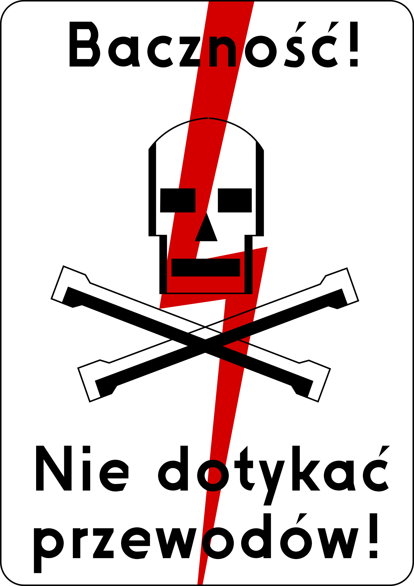
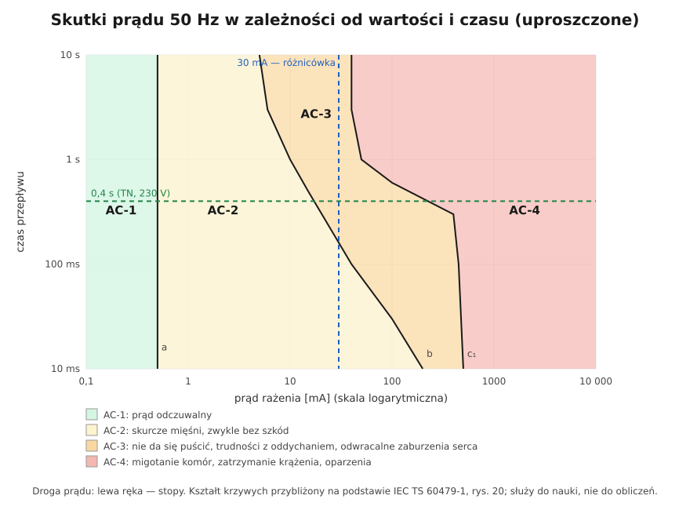

# 04.01 — Jak prąd działa na organizm — progi odczuwania, samouwolnienia i migotania komór

> **Moduł:** [04 — Prąd a człowiek](README.md) · **Oznaczenia:** 🟢📋 · **Zakres SEP:** (a) (d) · **Status:** ✅ pełny
>
> **Czytaj:**
>
> - IEC TS 60479-1 *Effects of current on human beings and livestock — Part 1: General aspects* (dostępna w PKN) — omówienie, rys. 20 i 22
> - [Materiały szkoleniowe CIOP-PIB / IEN o skutkach rażenia](https://ien.com.pl/images/projekty/Prezentacja-CIOP---szkolenia.pdf) — strefy AC i DC po polsku
> - Pierwsza pomoc: [moduł 31](../31-pierwsza-pomoc/README.md)

← (początek modułu) · [spis modułu](README.md) · [następny temat →](04.02-droga-przeplywu-czas-i-czestotliwosc.md)

## Po co to jest

Wszystkie środki ochrony w instalacji — izolacja, przewód PE, wyłączniki różnicowoprądowe 30 mA, czasy wyłączenia 0,4 s — wynikają z tego, jak prąd działa na człowieka. Kto zna progi i ich zależność od czasu, ten rozumie, dlaczego różnicówka ma 30 mA, a nie 300 mA, i dlaczego „przecież tylko mnie kopnęło” to nie powód do spokoju. Na egzaminie pada pytanie o skutki przepływu prądu przez organizm i od czego zależą.

## Po ludzku

**Zabija prąd, ale prąd bierze się z napięcia.** Szkodę robi prąd płynący przez ciało. Jego wartość wynika z napięcia dotyku i impedancji ciała, rzędu 1000 Ω przy 230 V ([01.03](../01-prad-napiecie-opor/01.03-opor-i-prawo-ohma.md)). Przy 230 V to setki miliamperów — dużo więcej, niż potrzeba do zatrzymania serca.

**Co robi prąd w ciele:**

- **Działanie na mięśnie i nerwy.** Prąd przemienny 50 Hz pobudza mięśnie 100 razy na sekundę. Powyżej pewnego progu mięśnie dłoni zaciskają się na przewodzie i **nie da się go puścić**. Przepływ trwa wtedy dłużej i jest coraz groźniejszy.
- **Działanie na serce.** Serce ma własny „rozrusznik” elektryczny. Prąd z zewnątrz może go rozregulować i wywołać **migotanie komór**: mięsień drga chaotycznie, nie pompuje krwi i po kilku minutach następuje śmierć. To główna przyczyna śmierci przy porażeniu niskim napięciem. Pomaga tylko defibrylator (AED) i resuscytacja ([moduł 31](../31-pierwsza-pomoc/README.md)).
- **Zatrzymanie oddechu** — skurcz mięśni oddechowych przy przepływie przez klatkę piersiową.
- **Działanie cieplne.** Duże prądy palą tkanki na drodze przepływu, także głęboko pod skórą ([04.05](04.05-luk-elektryczny-i-oparzenia.md)).
- **Skutki pośrednie.** Odruchowe szarpnięcie i upadek z drabiny, oparzenia łukiem, uraz oczu.

**Progi dla prądu przemiennego 50 Hz** (dorosły, droga lewa ręka → stopy, IEC TS 60479-1):

| Prąd | Co się dzieje |
|------|---------------|
| do ok. **0,5 mA** | zwykle nieodczuwalny (próg odczuwania) |
| **0,5–10 mA** | mrowienie, skurcze; da się puścić przewód |
| ok. **10 mA** | **próg samouwolnienia** — powyżej wiele osób nie puści przewodu (u części osób już od ok. 5 mA) |
| od ok. **40–50 mA** przy czasie ponad 1 s | możliwe **migotanie komór** |
| ok. **500 mA** przy 10 ms | możliwe migotanie komór nawet przy bardzo krótkim przepływie |
| ampery | oparzenia wewnętrzne, zwęglenia |

**Czas jest kluczowy.** Ten sam prąd jest dużo groźniejszy, gdy płynie dłużej. Dlatego zabezpieczenia muszą wyłączać szybko ([04.04](04.04-maksymalne-czasy-samoczynnego-wylaczenia.md)), a wyłącznik różnicowoprądowy 30 mA wyłącza w ułamku sekundy. Jego próg leży poniżej wartości, przy których przy takim czasie przepływu groziłoby migotanie komór.

**Prąd stały** przy tej samej wartości jest mniej groźny dla serca, a progi odczuwania (ok. 2 mA) i migotania są wyższe. „Mniej groźny” nie znaczy jednak „bezpieczny” ([02.01](../02-prad-przemienny-230-400/02.01-sinusoida-50-hz-i-wartosc-skuteczna.md)).

## Jak to wygląda

*Na co patrzeć: dawny wzór tablicy, wciąż spotykany na słupach i stacjach. Dzisiejsze znaki mają żółty trójkąt z błyskawicą, ale przekaz jest ten sam: prąd z sieci zabija, a przepływ przez serce nie musi być długi.*

## Schemat

## Pojęcia

| Pojęcie | Po ludzku | Termin normowy / symbol |
|---------|-----------|-------------------------|
| Porażenie | Przepływ prądu przez ciało z groźnymi skutkami | porażenie prądem elektrycznym |
| Rażenie | Każdy przepływ prądu przez ciało | rażenie prądem |
| Próg odczuwania | Najmniejszy prąd, który się czuje | ok. 0,5 mA (AC), ok. 2 mA (DC) |
| Próg samouwolnienia | Największy prąd, przy którym da się jeszcze puścić przewód | ok. 10 mA (AC) |
| Migotanie komór | Chaotyczne drgania serca, brak krążenia | fibrylacja komór |
| Strefy AC-1…AC-4 | Obszary skutków na wykresie prąd–czas | IEC TS 60479-1, rys. 20 |
| AED | Automatyczny defibrylator, który przywraca rytm serca | automatyczny defibrylator zewnętrzny |

## Liczby do zapamiętania

| Wielkość | Wartość | Kiedy obowiązuje | Źródło |
|----------|---------|------------------|--------|
| Próg odczuwania AC | **0,5 mA** | 50 Hz, niezależnie od czasu | IEC TS 60479-1 |
| Próg odczuwania DC | ok. **2 mA** | prąd stały | jw. |
| Próg samouwolnienia AC | ok. **10 mA** (u części osób ok. 5 mA) | 50 Hz, dorośli | jw. |
| Migotanie komór — długi przepływ | od ok. **40–50 mA** | czas powyżej ok. 1–3 s | jw., krzywa c₁ |
| Migotanie komór — krótki przepływ | ok. **400–500 mA** | 10–100 ms | jw. |
| Różnicówka ochrony uzupełniającej | **30 mA** | obwody gniazd, łazienki itd. | PN-HD 60364-4-41 ([moduł 08](../08-wylaczniki-roznicowopradowe/README.md)) |
| Czas zadziałania RCD 30 mA | ≤ **300 ms** przy 30 mA, ≤ **40 ms** przy 150 mA | wyłączniki ogólnego typu | PN-EN 61008-1 ([moduł 08](../08-wylaczniki-roznicowopradowe/README.md)) |

## W praktyce

- **Nie testuj „czy jest prąd” palcem.** Nawet krótkie „kopnięcie” może wywołać szarpnięcie i upadek, a przy złym zbiegu okoliczności zaburzenia rytmu serca.
- **Różnicówka 30 mA** nie zapobiega odczuciu porażenia. Prąd zdąży popłynąć przez kilkadziesiąt milisekund. Zapobiega jednak, z dużym prawdopodobieństwem, skutkom śmiertelnym. Przycisk TEST naciskaj regularnie ([moduł 08](../08-wylaczniki-roznicowopradowe/README.md)).
- **Po każdym porażeniu** prądem sieciowym poszkodowany powinien skontaktować się z lekarzem. Natychmiast wezwij pomoc (112), jeśli stracił przytomność, ma oparzenia, duszność, ból w klatce piersiowej albo zaburzenia rytmu serca, albo prąd płynął przez klatkę piersiową ([moduł 31](../31-pierwsza-pomoc/README.md)).

## Błędy i zagrożenia

- ⚠️ **„230 V mnie już kopało i nic się nie stało”.** Skutek zależy od drogi prądu, czasu, wilgotności skóry, obuwia i od tego, w której fazie pracy serca nastąpiło rażenie. Kolejne zdarzenie może skończyć się inaczej.
- ⚠️ **Dotykanie porażonego, zanim odłączysz zasilanie.** Ratownik staje się drugą ofiarą ([moduł 31](../31-pierwsza-pomoc/README.md)).
- **„Prąd stały jest bezpieczny”.** Akumulatory i instalacje PV mają setki woltów DC, a łuk prądu stałego trudniej zgasić.
- **Lekceważenie skutków odroczonych.** Zaburzenia rytmu serca i uszkodzenia wewnętrzne mogą ujawnić się po czasie.

## Przykład

**Zadanie.** Człowiek stojący na wilgotnej posadzce dotyka obudowy pralki, na którą przez uszkodzenie dostało się napięcie fazowe. Impedancja drogi ręka–stopy przy tych warunkach wynosi ok. 1000 Ω. Jaki prąd popłynie i do której strefy należy, jeśli (a) zadziała różnicówka 30 mA w 40 ms, (b) nie ma różnicówki, a wyłącznik nadprądowy nie zadziała?

$$I = \frac{230\ \mathrm{V}}{1000\ \Omega} = 0{,}23\ \mathrm{A} = 230\ \mathrm{mA}$$

(a) 230 mA przez 40 ms: na [wykresie stref](../../assets/schematy/04-strefy-skutkow-pradu.svg) to strefa AC-3, wyraźnie poniżej krzywej c₁. Silny, bolesny skurcz, ale bez migotania komór.

(b) 230 mA bez ograniczenia czasu: po kilkuset milisekundach głęboko w strefie AC-4 — duże ryzyko migotania komór i śmierci.

**Wniosek.** Te same 230 mA mogą zakończyć się nieprzyjemnym szarpnięciem albo śmiercią. Różnicę robi **czas przepływu**, który skraca ochrona przeciwporażeniowa ([moduł 12](../12-ochrona-przeciwporazeniowa/README.md)).

## Pytania SEP

1. **Jakie są skutki przepływu prądu elektrycznego przez organizm człowieka?**

Odpowiedź

Skutki biologiczne: pobudzenie nerwów i mięśni, skurcze, niemożność oderwania się od przewodu, zatrzymanie oddechu, zaburzenia pracy serca, najgroźniejsze z nich to migotanie komór prowadzące do zatrzymania krążenia. Skutki cieplne: oparzenia skóry i tkanek wewnętrznych na drodze przepływu. Skutki elektrolityczne: rozkład płynów ustrojowych. Do tego skutki pośrednie: upadki, urazy mechaniczne i oparzenia łukiem elektrycznym. Przy niskim napięciu najczęstszą przyczyną śmierci jest migotanie komór.

2. **Jakie wartości prądu przemiennego 50 Hz są niebezpieczne dla człowieka?**

Odpowiedź

Próg odczuwania to ok. 0,5 mA. Próg samouwolnienia, powyżej którego człowiek może nie oderwać się od przewodu, to ok. 10 mA. Migotanie komór może wystąpić od ok. 40–50 mA przy czasie przepływu dłuższym niż ok. 1 s, a przy bardzo krótkim przepływie (10 ms) od kilkuset miliamperów. Skutki zależą od wartości prądu, czasu przepływu i drogi przez ciało, dlatego istotne jest szybkie wyłączenie zasilania.

3. **Dlaczego wyłączniki różnicowoprądowe ochrony uzupełniającej mają prąd 30 mA?**

Odpowiedź

Prąd 30 mA wyłączany w czasie kilkudziesięciu do kilkuset milisekund leży poniżej progu wywołania migotania komór dla takiego czasu przepływu. Różnicówka 30 mA nie zapobiega odczuciu porażenia, ale chroni przed jego skutkami śmiertelnymi, także przy dotyku bezpośrednim części czynnej, gdy zawiodą inne środki ochrony.

## Sprawdź się

1. Uporządkuj od najmniejszego: próg samouwolnienia, próg odczuwania, prąd zadziałania różnicówki ochrony uzupełniającej, próg migotania przy długim przepływie.

Odpowiedź

Próg odczuwania (0,5 mA) < próg samouwolnienia (ok. 10 mA) < prąd różnicówki (30 mA) < próg migotania przy długim przepływie (ok. 40–50 mA).

2. Na [wykresie stref](../../assets/schematy/04-strefy-skutkow-pradu.svg) znajdź prąd 30 mA płynący przez 3 sekundy. W jakiej to strefie i co oznacza?

Odpowiedź

W strefie AC-3: silne skurcze, niemożność puszczenia przewodu, trudności z oddychaniem, zwykle bez trwałych uszkodzeń, ale już blisko granicy AC-4. To ilustruje, dlaczego różnicówka musi wyłączać szybko, a nie „kiedyś”.

## Źródła

- IEC TS 60479-1 — progi odczuwania, samouwolnienia i migotania komór, strefy AC-1…AC-4 i DC-1…DC-4.
- [CIOP-PIB / IEN — prezentacja szkoleniowa o skutkach rażenia](https://ien.com.pl/images/projekty/Prezentacja-CIOP---szkolenia.pdf) — opis stref po polsku, próg samouwolnienia 10 mA.
- [EMF-Portal (RWTH Aachen) — tło wartości granicznych](https://emf-portal.org/en/cms/page/home/more/electrical-injuries/background-information-for-limit-values) 🇬🇧 — próg samouwolnienia ok. 5 mA przy długim przepływie, migotanie od ok. 40 mA powyżej 2 s.
- PN-EN 61008-1 — czasy zadziałania wyłączników różnicowoprądowych ([moduł 08](../08-wylaczniki-roznicowopradowe/README.md)).

---

← (początek modułu) · [spis modułu](README.md) · [następny temat →](04.02-droga-przeplywu-czas-i-czestotliwosc.md)
