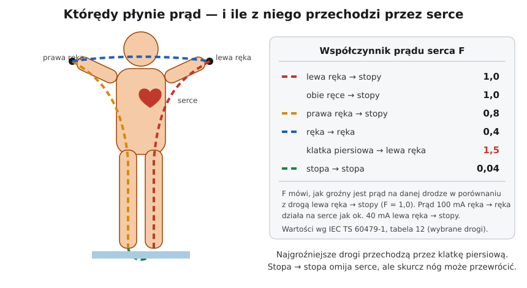

# 04.02 — Droga przepływu, czas i częstotliwość

> **Moduł:** [04 — Prąd a człowiek](README.md) · **Oznaczenia:** 🟢📋 · **Zakres SEP:** (a) (d) · **Status:** ✅ pełny
>
> **Czytaj:**
>
> - IEC TS 60479-1 — impedancja ciała, współczynnik prądu serca (tabela 12), wpływ czasu — omówienie
> - [Materiały „Metody ochrony” — VŠB, rozdz. o impedancji ciała](https://preshranice22.vsb.cz/W7_Metody_ochrony.pdf) — udział impedancji poszczególnych dróg

[← poprzedni temat](04.01-jak-prad-dziala-na-organizm-progi-odczuwania.md) · [spis modułu](README.md) · [następny temat →](04.03-napiecie-dotykowe-i-krokowe-napiecia.md)

## Po co to jest

Ten sam prąd może być prawie niegroźny albo śmiertelny, zależnie od tego, którędy płynie, jak długo i z jaką częstotliwością. Wynika z tego kilka zasad pracy: jedna ręka przy pracy w rozdzielnicy, suche ręce i obuwie, przewodzące podłoże jako czynnik ryzyka. Do tego wymaganie, żeby zabezpieczenia wyłączały w ułamku sekundy. Na egzaminie: od czego zależą skutki porażenia.

## Po ludzku

**Od czego zależy, czy porażenie będzie groźne:**

1. **Wartość prądu**, która wynika z napięcia i impedancji ciała ([04.01](04.01-jak-prad-dziala-na-organizm-progi-odczuwania.md)).
2. **Czas przepływu** — im dłużej, tym niższy próg migotania komór.
3. **Droga przez ciało** — ile prądu przechodzi przez serce.
4. **Rodzaj i częstotliwość prądu** — najgroźniejszy jest przemienny o częstotliwości sieciowej.
5. **Stan człowieka i otoczenia** — wilgotna skóra, mokre podłoże, metalowe otoczenie, choroby serca.

**Droga.** Serce leży w klatce piersiowej, lekko po lewej. Najgroźniejsze są drogi, które je przecinają: lewa ręka → stopy, obie ręce → stopy, klatka piersiowa → ręka. Norma opisuje to **współczynnikiem prądu serca F**. Prąd płynący drogą o współczynniku F działa na serce jak prąd F razy większy (lub mniejszy) na drodze lewa ręka → stopy. Ręka → ręka ma F = 0,4, a stopa → stopa tylko 0,04. Dlatego napięcie krokowe rzadko zatrzymuje serce, ale przewraca człowieka, a wtedy prąd może popłynąć przez tułów.

**Czas.** Serce w każdym cyklu ma krótki „okres podatny”, w którym impuls z zewnątrz najłatwiej wywołuje migotanie. Przepływ krótszy niż jeden cykl serca może w ten okres nie trafić. Przepływ dłuższy niż ok. 1 s trafi w niego na pewno. Dlatego dopuszczalny prąd dla czasu 10 ms jest ok. 10 razy większy niż dla czasu ponad 1 s, a ochrona przeciwporażeniowa opiera się na szybkim wyłączeniu ([04.04](04.04-maksymalne-czasy-samoczynnego-wylaczenia.md)).

**Impedancja ciała** nie jest stała:

- maleje ze wzrostem napięcia, bo powyżej kilkudziesięciu woltów naskórek przestaje izolować,
- maleje przy wilgotnej i spoconej skórze i przy dużej powierzchni styku (cała dłoń zaciśnięta na rurze),
- zależy od drogi: ręka → stopy to ok. 70–90 % impedancji ręka → ręka, a obie ręce → obie stopy mniej więcej połowa.

Przy 230 V i dużej powierzchni styku impedancja ciała to rząd 1000–2000 Ω. Do tego dochodzi opór obuwia i podłoża. Suche gumowe buty na suchym parkiecie mogą ograniczyć prąd do wartości odczuwalnych. Bose stopy na mokrej posadzce łazienki nie ograniczają go wcale.

**Częstotliwość.** Najgroźniejsze są częstotliwości 15–100 Hz, w tym sieciowe 50 Hz. Prąd stały przy tej samej wartości jest mniej groźny dla serca (ale wciąż groźny i parzy). Prądy o częstotliwościach kiloherców słabiej działają na serce, ale silnie grzeją tkanki.

## Schemat

## Pojęcia

| Pojęcie | Po ludzku | Termin normowy / symbol |
|---------|-----------|-------------------------|
| Droga przepływu | Którędy prąd przechodzi przez ciało | droga prądu |
| Współczynnik prądu serca | Jak groźna jest dana droga dla serca w porównaniu z lewą ręką → stopy | F (IEC TS 60479-1, tab. 12) |
| Impedancja ciała | „Opór” ciała dla prądu | $Z_T$ — całkowita impedancja ciała |
| Okres podatny serca | Moment cyklu serca najbardziej wrażliwy na impuls | faza podatna (załamek T w EKG) |
| Warunki zwiększonego zagrożenia | Wilgoć, przewodzące otoczenie, ograniczona przestrzeń | ([moduł 17](../17-pomieszczenia-szczegolne/README.md)) |

## Liczby do zapamiętania

| Wielkość | Wartość | Kiedy obowiązuje | Źródło |
|----------|---------|------------------|--------|
| F: lewa ręka → stopy | **1,0** (droga odniesienia) | — | IEC TS 60479-1, tab. 12 |
| F: obie ręce → stopy | **1,0** | — | jw. |
| F: prawa ręka → stopy | **0,8** | — | jw. |
| F: ręka → ręka | **0,4** | — | jw. |
| F: klatka piersiowa → lewa ręka | **1,5** | — | jw. |
| F: stopa → stopa | **0,04** | — | jw. |
| Prąd równoważny | $I_{ref} = F \cdot I_h$ | porównanie z drogą lewa ręka → stopy | jw. |
| Impedancja ciała przy 230 V | rząd **1000–2000 Ω** (sucha skóra, duży styk); mniej przy wilgoci | ręka → ręka | jw. |
| Impedancja ręka → stopy | ok. **70–90 %** wartości ręka → ręka | — | jw. |
| Najgroźniejsze częstotliwości | **15–100 Hz** | — | jw. |

## W praktyce

- **Pracuj jedną ręką**, jeśli musisz coś zrobić w pobliżu części pod napięciem (np. pomiar w rozdzielnicy). Druga ręka nie powinna się opierać o obudowę ani rurę, bo wtedy droga ręka → ręka przechodzi przez klatkę piersiową.
- **Suche ręce i podłoże, obuwie z izolującą podeszwą.** To nie jest ochrona podstawowa, ale ogranicza prąd, gdy coś pójdzie źle.
- **Nie opieraj się o kaloryfery, rury i metalowe konstrukcje** w czasie pracy przy instalacji — to dobre połączenia z ziemią.
- **Przy pracach w miejscach mokrych lub ciasnych** (łazienka, kocioł, zbiornik) obowiązują zaostrzone wymagania: niższe napięcia, separacja, różnicówki ([moduł 17](../17-pomieszczenia-szczegolne/README.md)).

## Błędy i zagrożenia

- ⚠️ **Praca „dwiema rękami” w rozdzielnicy pod napięciem** — droga przez klatkę piersiową.
- ⚠️ **Mokre ręce, bose stopy, posadzka w łazience** — impedancja i opór podłoża maleją kilkukrotnie, a prąd rośnie tak samo.
- **„Napięcie krokowe jest niegroźne, bo omija serce”.** Skurcz nóg przewraca człowieka, a leżący ma między głową a stopami dużo większe napięcie i drogę przez tułów.
- **Lekceważenie czasu.** „Tylko na chwilę” to dokładnie ten parametr, który decyduje o przeżyciu.

## Przykład

**Zadanie.** Elektryk dotyka jedną ręką fazy, a drugą metalowej obudowy połączonej z PE. Płynie prąd 100 mA. Jak groźne jest to w porównaniu z prądem płynącym drogą lewa ręka → stopy?

$$I_{ref} = F \cdot I_h = 0{,}4 \cdot 100\ \mathrm{mA} = 40\ \mathrm{mA}$$

**Wniosek.** Dla serca to tak, jakby drogą lewa ręka → stopy płynęło 40 mA. Przy przepływie dłuższym niż ok. 1 s to już okolice progu migotania komór. Droga ręka → ręka jest „łagodniejsza”, ale przy 100 mA wcale nie bezpieczna.

## Pytania SEP

1. **Od jakich czynników zależą skutki porażenia prądem elektrycznym?**

Odpowiedź

Od wartości prądu rażeniowego, który zależy od napięcia dotyku i impedancji ciała. Od czasu przepływu: im dłuższy, tym niższy próg migotania komór. Od drogi przepływu przez ciało: najgroźniejsze są drogi przez klatkę piersiową, np. lewa ręka–stopy. Od rodzaju i częstotliwości prądu: najgroźniejszy jest przemienny 15–100 Hz. Od warunków środowiskowych (wilgotność, przewodzące podłoże, powierzchnia styku) oraz od stanu zdrowia porażonego.

2. **Która droga przepływu prądu jest najbardziej niebezpieczna i dlaczego?**

Odpowiedź

Drogi przechodzące przez serce: klatka piersiowa–lewa ręka (współczynnik prądu serca 1,5), lewa ręka–stopy i obie ręce–stopy (1,0). Duża część prądu przepływa wtedy przez mięsień sercowy, co sprzyja migotaniu komór. Droga ręka–ręka (0,4) jest mniej groźna, a stopa–stopa (0,04) praktycznie omija serce.

3. **Jak zmienia się impedancja ciała człowieka?**

Odpowiedź

Maleje ze wzrostem napięcia dotyku, bo naskórek ulega przebiciu. Maleje przy wilgotnej skórze i dużej powierzchni styku. Zależy od drogi przepływu: ręka–stopy ma mniejszą impedancję niż ręka–ręka, a obie ręce–obie stopy jeszcze mniejszą. Przy 230 V i dużej powierzchni styku wynosi rzędu 1000–2000 Ω.

## Sprawdź się

1. Prąd 60 mA płynie drogą prawa ręka → stopy (F = 0,8). Jaki prąd na drodze odniesienia ma takie same skutki dla serca?

Odpowiedź

$0{,}8 \cdot 60 = 48\ \mathrm{mA}$.

2. Dlaczego przy pomiarze w rozdzielnicy pod napięciem zaleca się trzymać drugą rękę z dala od obudowy?

Odpowiedź

Żeby przy przypadkowym dotknięciu części czynnej prąd nie popłynął drogą ręka → ręka przez klatkę piersiową, z obudową połączoną z PE jako drugim biegunem.

## Źródła

- IEC TS 60479-1 — impedancja ciała w zależności od napięcia i drogi, współczynniki prądu serca (tab. 12), wpływ czasu przepływu.
- [VŠB — „Metody ochrony”, rozdz. o impedancji ciała](https://preshranice22.vsb.cz/W7_Metody_ochrony.pdf) — udział impedancji dróg ręka–stopy, ręce–stopy; przykłady prądów przy 230 V.
- [Elek — IEC 60479-1: hand-to-foot vs hand-to-hand](https://elek.com/articles/iec-60479-1-conversion-factor/) 🇬🇧 — impedancja ręka–stopy ok. 70–90 % wartości ręka–ręka.

---

[← poprzedni temat](04.01-jak-prad-dziala-na-organizm-progi-odczuwania.md) · [spis modułu](README.md) · [następny temat →](04.03-napiecie-dotykowe-i-krokowe-napiecia.md)
