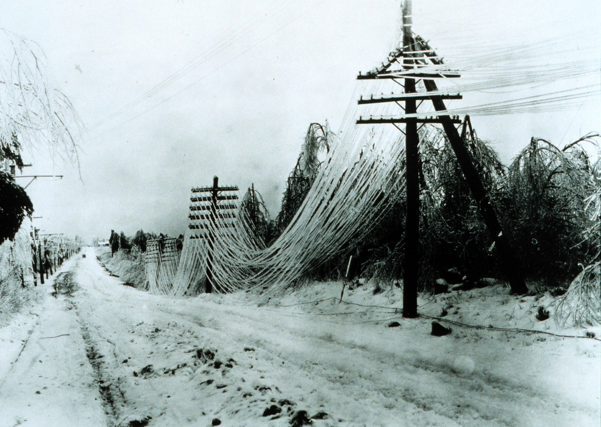

# 04.03 — Napięcie dotykowe i krokowe, napięcia dopuszczalne długotrwale

> **Moduł:** [04 — Prąd a człowiek](README.md) · **Oznaczenia:** 🟢📋 · **Zakres SEP:** (a) (d) · **Status:** ✅ pełny
>
> **Czytaj:**
>
> - PN-HD 60364-4-41 — ochrona przed porażeniem: napięcie dotykowe dopuszczalne, SELV/PELV (omówienie)
> - Uziemienia i rozpływ prądu w gruncie: [moduł 13](../13-uziemienia-i-wyrownanie/README.md)

[← poprzedni temat](04.02-droga-przeplywu-czas-i-czestotliwosc.md) · [spis modułu](README.md) · [następny temat →](04.04-maksymalne-czasy-samoczynnego-wylaczenia.md)

## Po co to jest

Człowiek rzadko dotyka gołego przewodu fazowego. Częściej dotyka obudowy, która przez uszkodzenie znalazła się pod napięciem, albo stoi w pobliżu miejsca, gdzie prąd uszkodzenia wpływa do ziemi. Napięcie dotykowe i krokowe opisują właśnie te sytuacje. Z nich wynika wartość 50 V, która wraca w module 12, i zasady ucieczki od zerwanego przewodu. Na egzaminie: definicje napięcia dotykowego i krokowego oraz napięcia dopuszczalne długotrwale.

## Po ludzku

**Napięcie dotykowe** to napięcie między dwoma miejscami, których można dotknąć jednocześnie: zwykle między obudową urządzenia (ręka) a podłożem (stopy). W sprawnej instalacji wynosi zero. Gdy faza dotknie obudowy, prąd uszkodzenia płynie przez przewód PE i na jego oporze powstaje napięcie. Obudowa ma wtedy względem ziemi kilkadziesiąt albo kilkaset woltów, dopóki zabezpieczenie nie wyłączy obwodu ([moduł 12](../12-ochrona-przeciwporazeniowa/README.md)).

**Napięcie krokowe** to napięcie między stopami. Gdy prąd wpływa do ziemi (uziom, zerwany przewód leżący na trawie, piorun), rozpływa się we wszystkich kierunkach. Potencjał gruntu jest najwyższy w miejscu wpływu i maleje z odległością, jak lejek. Kto stoi w tym lejku z rozstawionymi nogami, ma między stopami napięcie i prąd płynie przez nogi.

**Napięcie dopuszczalne długotrwale** ($U_L$) to umowna granica, poniżej której napięcie dotykowe może się utrzymywać bez wyłączania i nie grozi porażeniem w danych warunkach:

- **50 V** prądu przemiennego (**120 V** stałego) — warunki normalne,
- **25 V** AC (**60 V** DC) — warunki zwiększonego zagrożenia: wilgoć, przewodzące otoczenie, kontakt dużej powierzchni ciała. Przykładowo w obiektach rolniczych wymagania liczy się dla 25 V.

Dlatego obwody bardzo niskiego napięcia SELV i PELV mają najwyżej 50 V AC / 120 V DC, a w miejscach szczególnych jeszcze mniej ([moduł 17](../17-pomieszczenia-szczegolne/README.md)).

**Jak opuścić strefę napięcia krokowego** (zerwany przewód, iskrzący słup):

1. Nie podchodź. Zatrzymaj innych.
2. Jeśli jesteś w strefie, nie biegnij i nie stawiaj szerokich kroków.
3. Odchodź **drobnymi krokami ze złączonymi stopami** (stopa przy stopie, bez odrywania) albo **skokami obunóż**, tak żeby obie stopy zawsze miały prawie ten sam potencjał.
4. Nie dotykaj niczego, co może mieć kontakt z przewodem: ogrodzenia, pojazdu, gałęzi.
5. Dzwoń 112 i 991 ([00.04](../00-bezpieczenstwo-najpierw/00.04-czerwone-flagi-kiedy-przerwac-prace-i-wezwac.md)).

**Jeśli przewód spadł na samochód**, w którym jesteś: zostań w środku i poczekaj na pogotowie energetyczne. Wysiadaj tylko w razie pożaru: wyskocz obunóż, nie dotykając jednocześnie auta i ziemi, i odchodź drobnymi krokami.

## Jak to wygląda

*Na co patrzeć: przewody zerwane i ciągnące się po ziemi. Nawet jeśli wyglądają na martwe, mogą być pod napięciem: niektóre zabezpieczenia linii próbują ją automatycznie ponownie załączyć. Wokół miejsca, gdzie przewód dotyka ziemi, powstaje lejek potencjału o zasięgu od kilku do kilkudziesięciu metrów, zależnie od napięcia linii i gruntu.*

## Schemat

## Pojęcia

| Pojęcie | Po ludzku | Termin normowy / symbol |
|---------|-----------|-------------------------|
| Napięcie dotykowe | Między tym, czego dotykasz, a tym, na czym stoisz | napięcie dotykowe (rażeniowe), $U_T$ |
| Napięcie dotykowe spodziewane | Napięcie, które pojawi się, zanim ktoś dotknie (bez uwzględnienia ciała) | napięcie dotykowe spodziewane |
| Napięcie krokowe | Między stopami w odległości kroku (ok. 1 m) | napięcie krokowe, $U_S$ |
| Lejek potencjału | Spadek potencjału gruntu wokół miejsca wpływu prądu | rozkład potencjału na powierzchni gruntu |
| Napięcie dopuszczalne długotrwale | Granica napięcia dotykowego, które może trwać dowolnie długo | $U_L$ = 50 V AC / 120 V DC |
| Część przewodząca dostępna | Obudowa, która może znaleźć się pod napięciem przy uszkodzeniu | część przewodząca dostępna |
| Część przewodząca obca | Metal niebędący częścią instalacji: rura, kaloryfer, wanna | część przewodząca obca (moduł 13) |

## Liczby do zapamiętania

| Wielkość | Wartość | Kiedy obowiązuje | Źródło |
|----------|---------|------------------|--------|
| $U_L$ — warunki normalne | **50 V AC**, **120 V DC** | instalacje w budynkach | PN-HD 60364-4-41; dawne przepisy ochrony przeciwporażeniowej |
| $U_L$ — warunki zwiększonego zagrożenia | **25 V AC**, **60 V DC** | wilgoć, przewodzące otoczenie, np. obiekty rolnicze | PN-HD 60364-7-705 i in. |
| Granica SELV/PELV | **50 V AC**, **120 V DC** (bez tętnień) | obwody bardzo niskiego napięcia | PN-HD 60364-4-41 (moduł 12) |
| Krok (do obliczeń napięcia krokowego) | **1 m** | — | konwencja |
| Ucieczka ze strefy | drobne kroki, stopy złączone, lub skoki obunóż | zerwany przewód, uziom w czasie zwarcia | dobra praktyka |

## W praktyce

- **Ochrona przy uszkodzeniu** ma zapewnić, że napięcie dotykowe powyżej $U_L$ nie utrzyma się dłużej niż wymagany czas wyłączenia ([04.04](04.04-maksymalne-czasy-samoczynnego-wylaczenia.md), [moduł 12](../12-ochrona-przeciwporazeniowa/README.md)).
- **Połączenia wyrównawcze** (rury, kaloryfery, wanna połączone z PE) sprawiają, że wszystkie metalowe części, których można dotknąć jednocześnie, mają ten sam potencjał. Napięcie dotykowe między nimi spada wtedy prawie do zera ([moduł 13](../13-uziemienia-i-wyrownanie/README.md)).
- **W czasie burzy** unikaj stania pod drzewami i przy słupach. Prąd pioruna rozpływa się w gruncie i daje duże napięcia krokowe.

## Błędy i zagrożenia

- ⚠️ **Podchodzenie do zerwanego przewodu**, żeby go „odsunąć kijem”. Nie wiesz, czy jest pod napięciem i jak duży jest lejek potencjału.
- ⚠️ **Bieg ze strefy napięcia krokowego** — każdy długi krok to większe napięcie między stopami, a upadek kładzie ciało w poprzek lejka.
- **Przekonanie, że 50 V to granica „bezpieczne / niebezpieczne” wszędzie.** W wilgoci, w wannie, w zbiorniku i przy dużej powierzchni styku granice są niższe.
- **Brak połączeń wyrównawczych** — między kranem a uszkodzoną pralką może pojawić się pełne napięcie dotykowe.

## Przykład

**Sytuacja.** W piwnicy przez uszkodzenie izolacji faza dotknęła obudowy pompy. Prąd uszkodzenia 200 A płynie przewodem PE o rezystancji 0,25 Ω (od pompy do szyny wyrównawczej). Jakie napięcie dotykowe pojawi się między obudową pompy a metalową rurą wodną połączoną z szyną wyrównawczą?

$$U_T = I \cdot R_{PE} = 200\ \mathrm{A} \cdot 0{,}25\ \Omega = 50\ \mathrm{V}$$

**Analiza.** Obudowa ma względem rury 50 V, czyli dokładnie granicę $U_L$ dla warunków normalnych. W wilgotnej piwnicy to już powyżej 25 V. Dlatego obwód musi zostać wyłączony szybko: przy 200 A wyłącznik B16 zadziała natychmiast ([01.07](../01-prad-napiecie-opor/01.07-przeciazenie-a-zwarcie-dwie-rozne-awarie.md)). Gdyby przewód PE był dłuższy lub cieńszy, napięcie dotykowe byłoby wyższe.

**Wniosek.** Napięcie dotykowe zależy od prądu uszkodzenia i rezystancji przewodu ochronnego. Pomaga je ograniczyć dodatkowe połączenie wyrównawcze miejscowe, czyli pompa i rura połączone krótkim przewodem bezpośrednio ([moduł 13](../13-uziemienia-i-wyrownanie/README.md)).

## Pytania SEP

1. **Co to jest napięcie dotykowe i napięcie krokowe?**

Odpowiedź

Napięcie dotykowe to napięcie między dwiema częściami przewodzącymi, których człowiek może jednocześnie dotknąć, najczęściej między obudową urządzenia, która przy uszkodzeniu znalazła się pod napięciem, a podłożem lub inną częścią uziemioną (droga ręka–stopy lub ręka–ręka). Napięcie krokowe to napięcie między dwoma punktami powierzchni gruntu odległymi o długość kroku (ok. 1 m), występujące w pobliżu miejsca wpływu prądu do ziemi, np. uziomu w czasie zwarcia albo zerwanego przewodu.

2. **Jakie są wartości napięć dotykowych dopuszczalnych długotrwale?**

Odpowiedź

W warunkach normalnych 50 V prądu przemiennego i 120 V prądu stałego. W warunkach zwiększonego zagrożenia porażeniem (wilgoć, przewodzące otoczenie, np. obiekty rolnicze i niektóre pomieszczenia szczególne) 25 V AC i 60 V DC. Napięcia dotykowe wyższe od dopuszczalnych muszą być wyłączane w czasie określonym w normie.

3. **Jak należy opuścić strefę, w której leży zerwany przewód linii napowietrznej?**

Odpowiedź

Nie zbliżać się do przewodu. Jeśli znajduję się w strefie zagrożenia, odchodzę bardzo małymi krokami, ze złączonymi stopami, nie odrywając ich od siebie, albo skokami obunóż. Nie biegnę i nie robię szerokich kroków, żeby nie znaleźć się pod dużym napięciem krokowym. Nie dotykam przedmiotów, które mogą mieć kontakt z przewodem. Zawiadamiam pogotowie energetyczne (991) i 112.

## Sprawdź się

1. Dlaczego na [schemacie](../../assets/schematy/04-napiecie-dotykowe-krokowe.svg) osoba stojąca ze złączonymi stopami daleko od uziomu jest bezpieczna, choć stoi na „naelektryzowanym” gruncie?

Odpowiedź

Bo między jej stopami nie ma różnicy potencjałów: obie stopy są w tym samym miejscu lejka, a daleko od uziomu lejek jest prawie płaski. Prąd płynie tylko wtedy, gdy między dwoma punktami ciała jest napięcie.

2. Prąd uszkodzenia 120 A płynie przez przewód PE o rezystancji 0,6 Ω. Jakie napięcie dotykowe pojawi się na obudowie względem szyny wyrównawczej? Czy jest dopuszczalne długotrwale?

Odpowiedź

$120 \cdot 0{,}6 = 72\ \mathrm{V}$. To więcej niż 50 V, więc obwód musi zostać wyłączony w czasie wymaganym przez normę ([04.04](04.04-maksymalne-czasy-samoczynnego-wylaczenia.md)).

## Źródła

- PN-HD 60364-4-41 — napięcie dotykowe, warunek skuteczności ochrony, granice SELV/PELV.
- PN-HD 60364-7-705 — obiekty rolnicze i ogrodnicze (obniżone napięcie dotykowe).
- Rozporządzenie Ministra Przemysłu z 1990 r. w sprawie warunków technicznych, jakim powinna odpowiadać ochrona przeciwporażeniowa w urządzeniach elektroenergetycznych (Dz.U. 1990 nr 81 poz. 473) — historyczne źródło tabeli napięć bezpiecznych $U_L$ 50/25 V, wciąż często przywoływanej na egzaminach.

---

[← poprzedni temat](04.02-droga-przeplywu-czas-i-czestotliwosc.md) · [spis modułu](README.md) · [następny temat →](04.04-maksymalne-czasy-samoczynnego-wylaczenia.md)
