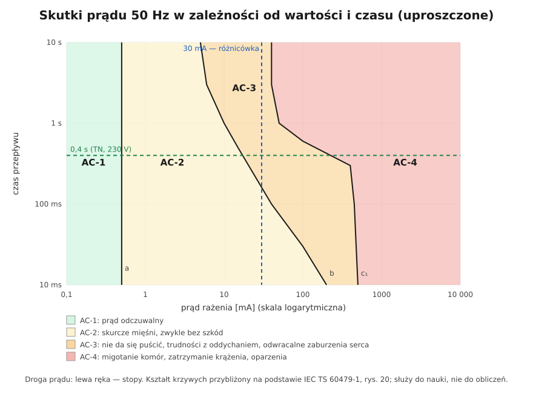

# 04.04 — Maksymalne czasy samoczynnego wyłączenia

> **Moduł:** [04 — Prąd a człowiek](README.md) · **Oznaczenia:** 🟢📋 · **Zakres SEP:** (a) (d) · **Status:** ✅ pełny
>
> **Czytaj:**
>
> - PN-HD 60364-4-41:2017 — tablica 41.1 (maksymalne czasy wyłączenia) i pkt 411.3.2 (omówienie)
> - [Zestawienie tablicy 41.1 (NEN 1010 / IEC 60364-4-41)](https://nen.sulerr.com/en/guides/nen-1010/413-disconnection) 🇬🇧
> - Warunek skuteczności samoczynnego wyłączenia: [moduł 12](../12-ochrona-przeciwporazeniowa/README.md); pomiar impedancji pętli: [moduł 23](../23-pomiary-odbiorcze-i-okresowe/README.md)

[← poprzedni temat](04.03-napiecie-dotykowe-i-krokowe-napiecia.md) · [spis modułu](README.md) · [następny temat →](04.05-luk-elektryczny-i-oparzenia.md)

## Po co to jest

Skoro czas przepływu decyduje o życiu ([04.02](04.02-droga-przeplywu-czas-i-czestotliwosc.md)), norma mówi wprost, w jakim czasie zasilanie musi zostać wyłączone, gdy faza dotknie obudowy. Te liczby — 0,4 s, 0,2 s, 5 s, 1 s — trzeba znać na pamięć. Na nich opiera się sprawdzanie skuteczności ochrony przy pomiarach. Na egzaminie to jedno z najczęstszych pytań liczbowych.

## Po ludzku

**Samoczynne wyłączenie zasilania** to podstawowy sposób ochrony przy uszkodzeniu. Gdy izolacja zawiedzie i faza dotknie metalowej obudowy, prąd uszkodzenia płynie przez przewód PE. Zabezpieczenie (wyłącznik nadprądowy, bezpiecznik albo różnicówka) ma wyłączyć obwód **szybciej, niż napięcie dotykowe zdąży zrobić krzywdę**.

**Ile to „szybciej”?** Zależy od napięcia i układu sieci:

- **Obwody odbiorcze** (gniazda, oświetlenie, odbiorniki) w układzie TN przy 230 V: **0,4 s**. To najczęstszy przypadek w Polsce.
- W układzie **TT** prąd uszkodzenia wraca przez ziemię, jest mniejszy, a napięcia dotykowe większe, więc czas jest krótszy: **0,2 s**.
- **Obwody rozdzielcze** (WLZ, zasilanie podrozdzielnic) i obwody odbiorcze większe niż w punkcie pierwszym: w TN **5 s**, w TT **1 s**. Do takich obwodów nie podłącza się bezpośrednio sprzętu, którego człowiek dotyka ręką.

**Które obwody są „odbiorcze”** w rozumieniu tablicy 41.1? Według PN-HD 60364-4-41:2017 obwody do **63 A z gniazdami** i do **32 A zasilające wyłącznie odbiorniki przyłączone na stałe**. Starsze wydanie normy mówiło o obwodach do 32 A.

**Jak to osiągnąć?** Prąd uszkodzenia musi być wystarczająco duży, żeby zabezpieczenie zadziałało w wymaganym czasie. Dla wyłącznika nadprądowego oznacza to prąd zadziałania natychmiastowego, np. dla B16 co najmniej 80 A ([01.07](../01-prad-napiecie-opor/01.07-przeciazenie-a-zwarcie-dwie-rozne-awarie.md)). Wartość prądu wynika z impedancji pętli zwarcia, więc pętla musi być wystarczająco mała. W skrócie: $Z_s \cdot I_a \le U_0$ ([moduł 12](../12-ochrona-przeciwporazeniowa/README.md)). Gdy impedancja pętli jest za duża (długi, cienki obwód), pomaga wyłącznik różnicowoprądowy, który zadziała już przy kilkudziesięciu miliamperach.

**Ochrona uzupełniająca.** Niezależnie od czasów wyłączenia gniazda do 32 A dla zwykłych użytkowników (laików) muszą mieć wyłącznik różnicowoprądowy **30 mA** ([moduł 08](../08-wylaczniki-roznicowopradowe/README.md)).

## Schemat

| Układ sieci | $U_0$ = 230 V, obwody odbiorcze (gniazda ≤ 63 A, odbiorniki stałe ≤ 32 A) | Obwody rozdzielcze i pozostałe |
|-------------|------------------------------------------------------------------------|--------------------------------|
| **TN** | **0,4 s** | **5 s** |
| **TT** | **0,2 s** | **1 s** |

Pełna tablica 41.1 (inne napięcia):

| Układ | $U_0$ ≤ 120 V | 120 < $U_0$ ≤ 230 V | 230 < $U_0$ ≤ 400 V | $U_0$ > 400 V |
|-------|---------------|----------------------|----------------------|----------------|
| TN | 0,8 s | **0,4 s** | 0,2 s | 0,1 s |
| TT | 0,3 s | **0,2 s** | 0,07 s | 0,04 s |

*Wartości dla prądu przemiennego wg tablicy 41.1 PN-HD 60364-4-41. Dla prądu stałego norma podaje osobne wartości.*

*Linia 0,4 s na wykresie stref: przy takim czasie przepływu migotanie komór wymaga prądu rzędu setek miliamperów, a przy 230 V i niskiej impedancji ciała taki prąd jest realny. Dlatego 0,4 s to górna granica, a nie „dużo czasu”.*

## Pojęcia

| Pojęcie | Po ludzku | Termin normowy / symbol |
|---------|-----------|-------------------------|
| Samoczynne wyłączenie zasilania | Zabezpieczenie samo wyłącza obwód przy zwarciu do obudowy | SWZ, ochrona przy uszkodzeniu ([moduł 12](../12-ochrona-przeciwporazeniowa/README.md)) |
| Obwód odbiorczy | Obwód zasilający gniazda i odbiorniki | obwód odbiorczy (końcowy) |
| Obwód rozdzielczy | Obwód zasilający rozdzielnicę | obwód rozdzielczy |
| Prąd zapewniający zadziałanie | Prąd, przy którym zabezpieczenie zadziała w wymaganym czasie | $I_a$ |
| Impedancja pętli zwarcia | „Opór” drogi prądu uszkodzenia | $Z_s$ |
| Ochrona uzupełniająca | Różnicówka 30 mA jako dodatkowa warstwa | ochrona uzupełniająca ([moduł 08](../08-wylaczniki-roznicowopradowe/README.md)) |

## Liczby do zapamiętania

| Wielkość | Wartość | Kiedy obowiązuje | Źródło |
|----------|---------|------------------|--------|
| TN, 230 V, obwody odbiorcze | **0,4 s** | gniazda ≤ 63 A, odbiorniki stałe ≤ 32 A | PN-HD 60364-4-41, tabl. 41.1 |
| TT, 230 V, obwody odbiorcze | **0,2 s** | jw. | jw. |
| TN, obwody rozdzielcze i pozostałe | **5 s** | — | PN-HD 60364-4-41, 411.3.2.3 |
| TT, obwody rozdzielcze i pozostałe | **1 s** | — | PN-HD 60364-4-41, 411.3.2.4 |
| Warunek skuteczności (TN) | $Z_s \cdot I_a \le U_0$ | — | PN-HD 60364-4-41, 411.4.4 ([moduł 12](../12-ochrona-przeciwporazeniowa/README.md)) |
| $I_a$ dla wyłączników B / C / D | **5 / 10 / 20 × $I_n$** (zadziałanie < 0,1 s) | wyłączniki wg PN-EN 60898-1 | [moduł 07](../07-zabezpieczenia-nadpradowe/README.md) |
| RCD 30 mA w obwodach gniazd | wymagany dla gniazd ≤ 32 A dla laików | ochrona uzupełniająca | PN-HD 60364-4-41, 411.3.3 |

## W praktyce

- **Sprawdzanie skuteczności** przy pomiarach: mierzy się impedancję pętli zwarcia $Z_s$ w każdym gnieździe i na końcu każdego obwodu, a potem porównuje $Z_s$ z wartością dopuszczalną $U_0 / I_a$ ([moduł 23](../23-pomiary-odbiorcze-i-okresowe/README.md)).
- **Dopuszczalna impedancja dla popularnych wyłączników** (TN, 230 V, $I_a = 5 I_n$ dla B, $10 I_n$ dla C):

| Wyłącznik | $I_a$ | $Z_s$ max = 230 / $I_a$ |
|-----------|-------|--------------------------|
| B10 | 50 A | 4,6 Ω |
| B16 | 80 A | 2,88 Ω |
| B20 | 100 A | 2,3 Ω |
| C16 | 160 A | 1,44 Ω |
| C20 | 200 A | 1,15 Ω |

- **W praktyce pomiarowej** uwzględnia się dodatkowo wzrost rezystancji przewodów po nagrzaniu i niepewność pomiaru, więc zmierzona wartość powinna być wyraźnie mniejsza od granicznej ([moduł 23](../23-pomiary-odbiorcze-i-okresowe/README.md)).

## Błędy i zagrożenia

- ⚠️ **Zamiana B16 na C16 „bo wybija przy rozruchu”** bez sprawdzenia pętli. Dopuszczalna impedancja spada o połowę (z 2,88 Ω do 1,44 Ω) i na końcu długiego obwodu ochrona może przestać być skuteczna.
- ⚠️ **„Mam różnicówkę, więc pętla nieważna”.** Różnicówka chroni przed porażeniem, ale nie zastąpi wyłączenia zwarcia L–N, a pętla decyduje też o wyłączeniu zwarć. Obie ochrony muszą działać.
- **Mylenie 0,4 s i 5 s.** 5 s dotyczy obwodów rozdzielczych, nie gniazd.
- **Brak pomiarów po zmianach** — wydłużenie obwodu o kilkanaście metrów może przekroczyć dopuszczalną impedancję.

## Przykład

**Zadanie.** Obwód gniazd w garażu chroniony wyłącznikiem B16, układ TN, 230 V. Zmierzona impedancja pętli zwarcia w najdalszym gnieździe: 2,1 Ω. Czy samoczynne wyłączenie jest skuteczne? A gdyby zamontowano C16?

**B16:** $I_a = 5 \cdot 16 = 80\ \mathrm{A}$, więc $Z_{s,max} = 230/80 = 2{,}88\ \Omega$. Zmierzone 2,1 Ω < 2,88 Ω, więc ochrona jest skuteczna. Prąd zwarcia $230/2{,}1 \approx 110\ \mathrm{A}$ wyłączy B16 w czasie poniżej 0,1 s.

**C16:** $I_a = 10 \cdot 16 = 160\ \mathrm{A}$, więc $Z_{s,max} = 1{,}44\ \Omega$. Zmierzone 2,1 Ω > 1,44 Ω, więc ochrona **nie jest** skuteczna. Prąd 110 A nie wywoła natychmiastowego zadziałania C16, a człon termiczny wyłączy obwód dopiero po kilku sekundach, więc 0,4 s nie zostanie dotrzymane.

**Wniosek.** Ten sam obwód jest bezpieczny z B16 i niebezpieczny z C16. Ratunkiem byłby wyłącznik różnicowoprądowy, który zadziała przy prądzie uszkodzenia do PE niezależnie od impedancji pętli ([moduł 08](../08-wylaczniki-roznicowopradowe/README.md)).

## Pytania SEP

1. **Jakie są maksymalne czasy samoczynnego wyłączenia zasilania w układzie TN przy napięciu 230 V?**

Odpowiedź

Dla obwodów odbiorczych z gniazdami do 63 A i obwodów do 32 A zasilających wyłącznie odbiorniki stałe: 0,4 s. Dla obwodów rozdzielczych i pozostałych obwodów: 5 s. W układzie TT odpowiednio 0,2 s i 1 s. Wartości podaje PN-HD 60364-4-41 (tablica 41.1 i pkt 411.3.2).

2. **Jaki warunek musi spełniać obwód w układzie TN, żeby samoczynne wyłączenie zasilania było skuteczne?**

Odpowiedź

$Z_s \cdot I_a \le U_0$, gdzie $Z_s$ to impedancja pętli zwarcia, $I_a$ — prąd zapewniający zadziałanie zabezpieczenia w wymaganym czasie, a $U_0$ — napięcie fazowe względem ziemi (230 V). Dla wyłącznika nadprądowego $I_a$ to prąd zadziałania natychmiastowego (np. $5 I_n$ dla charakterystyki B), a dla wyłącznika różnicowoprądowego jego znamionowy prąd różnicowy. Spełnienie warunku sprawdza się pomiarem impedancji pętli zwarcia.

3. **Jaka jest największa dopuszczalna impedancja pętli zwarcia dla obwodu z wyłącznikiem B16 w układzie TN 230 V?**

Odpowiedź

$Z_s \le U_0 / I_a = 230 / (5 \cdot 16) = 230 / 80 \approx 2{,}88\ \Omega$.

## Sprawdź się

1. Oblicz dopuszczalną impedancję pętli dla wyłącznika C10 i B25 (TN, 230 V).

Odpowiedź

C10: $I_a = 100\ \mathrm{A}$, $Z_s \le 2{,}3\ \Omega$. B25: $I_a = 125\ \mathrm{A}$, $Z_s \le 1{,}84\ \Omega$.

2. Ile okresów napięcia sieci mieści się w czasie 0,4 s i 0,2 s?

Odpowiedź

20 i 10 okresów (okres 20 ms).

## Źródła

- PN-HD 60364-4-41:2017 — tablica 41.1, pkt 411.3.2 (czasy wyłączenia), 411.3.3 (ochrona uzupełniająca RCD 30 mA), 411.4.4 (warunek w układzie TN).
- [Opracowanie tablicy 41.1 — NEN 1010 / IEC 60364-4-41](https://nen.sulerr.com/en/guides/nen-1010/413-disconnection) 🇬🇧 — wartości 0,8/0,4/0,2/0,1 s (TN) i 0,3/0,2/0,07/0,04 s (TT), 5 s i 1 s dla obwodów rozdzielczych.
- PN-EN 60898-1 — prądy zadziałania natychmiastowego B, C, D ([moduł 07](../07-zabezpieczenia-nadpradowe/README.md)).

---

[← poprzedni temat](04.03-napiecie-dotykowe-i-krokowe-napiecia.md) · [spis modułu](README.md) · [następny temat →](04.05-luk-elektryczny-i-oparzenia.md)
