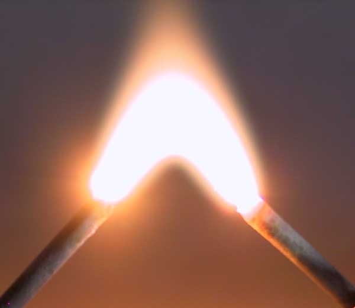
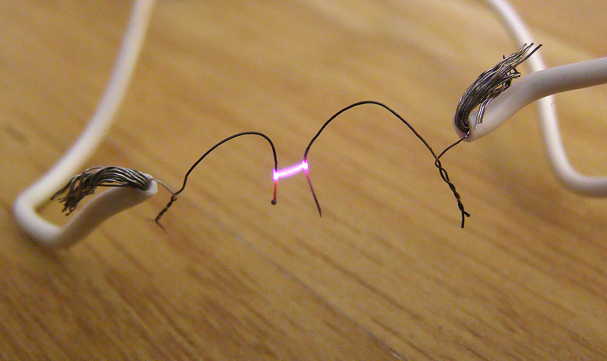
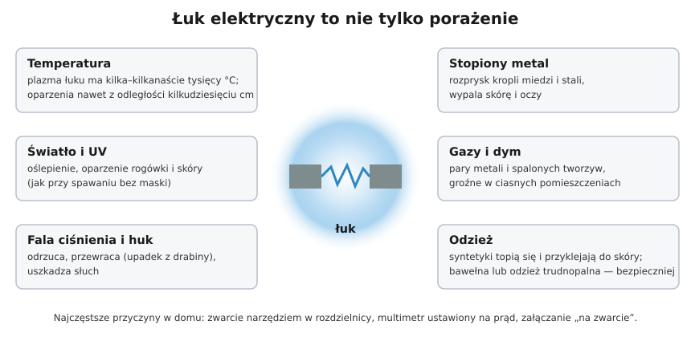

# 04.05 — Łuk elektryczny i oparzenia

> **Moduł:** [04 — Prąd a człowiek](README.md) · **Oznaczenia:** 🟢📋 · **Zakres SEP:** (a) (d) · **Status:** ✅ pełny
>
> **Czytaj:**
>
> - Sprzęt ochronny i odzież przy pracach elektrycznych: [moduł 28](../28-bhp-przy-urzadzeniach/README.md)
> - Pierwsza pomoc przy oparzeniach elektrycznych: [moduł 31](../31-pierwsza-pomoc/README.md)
> - Gaszenie łuku w wyłącznikach: [01.07](../01-prad-napiecie-opor/01.07-przeciazenie-a-zwarcie-dwie-rozne-awarie.md)

[← poprzedni temat](04.04-maksymalne-czasy-samoczynnego-wylaczenia.md) · [spis modułu](README.md) · (koniec modułu) →

## Po co to jest

Wielu ciężkich wypadków przy instalacjach niskiego napięcia nie powoduje prąd płynący przez ciało, tylko **łuk elektryczny**. Wystarczy wkrętak, który zsunął się w rozdzielnicy i zwarł dwie szyny, multimetr ustawiony na prąd albo załączenie wyłącznika na zwarcie. Łuk w ułamku sekundy parzy twarz i ręce, oślepia i rozpryskuje stopiony metal. Przy porażeniu prądem z kolei najgroźniejsze uszkodzenia są często niewidoczne. Na egzaminie: oparzenia elektryczne i zagrożenia łukiem w ramach BHP.

## Po ludzku

**Łuk elektryczny** to prąd płynący przez zjonizowane powietrze, czyli plazmę. Powstaje przy zwarciu i przy rozłączaniu obwodu pod obciążeniem. Plazma łuku ma temperaturę **kilku do kilkunastu tysięcy stopni**. Zwykle to kwestia milisekund, ale przy dużym prądzie zwarciowym (blisko transformatora, w złączu, w rozdzielnicy głównej) energia wystarczy, żeby:

- poparzyć skórę i oczy z odległości kilkudziesięciu centymetrów,
- rozprysnąć stopioną miedź,
- wytworzyć falę ciśnienia, która odrzuca człowieka (upadek z drabiny) i uszkadza słuch,
- oślepić i poparzyć rogówkę światłem i promieniowaniem UV, jak przy spawaniu bez maski,
- zapalić odzież; syntetyki topią się i wtapiają w skórę.

**Im bliżej źródła, tym groźniej.** W gnieździe na końcu długiego obwodu prąd zwarcia to setki amperów i wyłącznik przerwie go w kilka milisekund. W złączu albo przy zabezpieczeniu przedlicznikowym prąd zwarcia to tysiące amperów, a zabezpieczenia operatora reagują wolniej. Dlatego prace przed licznikiem są dla operatora ([00.03](../00-bezpieczenstwo-najpierw/00.03-co-wolno-zrobic-samemu-a-co-wymaga-uprawnien-i.md)).

**Oparzenia prądem** różnią się od zwykłych. Na skórze widać często tylko małe **znamiona prądowe**: miejsce wejścia i wyjścia prądu. Prąd płynie jednak przez całe ciało, a tkanki o dużej rezystancji (kości) nagrzewają się i uszkadzają głęboko mięśnie, naczynia i nerwy. Rozpad mięśni może po godzinach uszkodzić nerki, a zaburzenia rytmu serca mogą pojawić się po czasie. Dlatego **każde porażenie prądem sieciowym wymaga konsultacji lekarskiej**, nawet jeśli „nic nie widać”.

**Łuk szeregowy** to coś innego niż łuk zwarciowy: małe iskrzenie na luźnym zacisku albo przełamanym przewodzie. Nie wyzwala wyłącznika ([01.07](../01-prad-napiecie-opor/01.07-przeciazenie-a-zwarcie-dwie-rozne-awarie.md)), ale latami grzeje i może wywołać pożar. Wykrywają go detektory AFDD ([moduł 10](../10-aparatura-modulowa/README.md)).

## Jak to wygląda

*Na co patrzeć: łuk świeci jaśniej niż cokolwiek wokół, a jego środek jest biały, co oznacza temperaturę kilku tysięcy stopni. Pokazowy łuk przy wysokim napięciu i małym prądzie wygląda spokojnie. Łuk przy zwarciu w rozdzielnicy niskiego napięcia trwa ułamek sekundy, ale ma setki razy większą energię i wygląda jak wybuch.*

*Na co patrzeć: drobny łuk między dwoma drucikami o słabym styku. Tak wygląda iskrzenie na luźnym połączeniu albo przetartym przewodzie. Przy normalnym prądzie odbiornika wyłącznik nadprądowy tego nie widzi, a w puszce pod tynkiem nikt tego nie zobaczy.*

## Schemat

## Pojęcia

| Pojęcie | Po ludzku | Termin normowy / symbol |
|---------|-----------|-------------------------|
| Łuk elektryczny | Prąd płynący przez zjonizowane powietrze | wyładowanie łukowe |
| Łuk zwarciowy | Gwałtowny łuk przy zwarciu, duża energia | zwarcie łukowe |
| Łuk szeregowy | Iskrzenie na luźnym połączeniu, mały prąd | iskrzenie, zwarcie łukowe szeregowe |
| Znamię prądowe | Ślad wejścia lub wyjścia prądu na skórze | znamię prądowe |
| Oparzenie łukowe | Oparzenie ciepłem i promieniowaniem łuku, bez przepływu prądu przez ciało | oparzenie termiczne |
| AFDD | Aparat wykrywający iskrzenie | urządzenie do detekcji zwarć łukowych (moduł 10) |

## Liczby do zapamiętania

| Wielkość | Wartość | Kiedy obowiązuje | Źródło |
|----------|---------|------------------|--------|
| Temperatura plazmy łuku | **kilka–kilkanaście tysięcy °C** | łuk w powietrzu | fizyka łuku |
| Prąd zwarcia w gnieździe | **setki A** | koniec obwodu odbiorczego | [01.07](../01-prad-napiecie-opor/01.07-przeciazenie-a-zwarcie-dwie-rozne-awarie.md) |
| Prąd zwarcia przy złączu / rozdzielnicy głównej | **kilka–kilkanaście kA** | blisko transformatora | zdolność zwarciowa aparatów 6–10 kA (moduł 07) |
| Konsultacja lekarska | **po każdym porażeniu** napięciem sieciowym | — | moduł 31 |

## W praktyce

- **Przed pracą w rozdzielnicy** zastosuj pięć zasad, a części, które pozostają pod napięciem (zaciski zasilające wyłącznika głównego), osłoń ([00.01](../00-bezpieczenstwo-najpierw/00.01-piec-zasad-bezpiecznej-pracy-przy-urzadzeniach.md)).
- **Narzędzia izolowane 1000 V** ograniczają skutki zsunięcia się narzędzia na sąsiedni zacisk.
- **Okulary ochronne** przy każdej pracy w rozdzielnicy i przy pomiarach. Przy pomiarach blisko złącza — osłona twarzy (moduł 28).
- **Odzież:** bawełniana lub trudnopalna, z długim rękawem. Bez polaru i syntetyków.
- **Multimetr:** przed pomiarem napięcia sprawdź pokrętło i gniazda przewodów ([00.02](../00-bezpieczenstwo-najpierw/00.02-sprawdzanie-braku-napiecia-probnik-dwubiegunowy.md)).
- **Nie załączaj ponownie** wyłącznika, który zadziałał natychmiast, dopóki nie znajdziesz przyczyny — każde załączenie na zwarcie to nowy łuk.
- **Stój z boku** przy załączaniu dużych wyłączników i rozłączników, a nie na wprost.

## Błędy i zagrożenia

- ⚠️ **Praca w rozdzielnicy „pod napięciem, bo to tylko chwila”.** Najczęstszy scenariusz ciężkich oparzeń łukowych.
- ⚠️ **„Nic nie widać, więc nic się nie stało”** po porażeniu. Uszkodzenia wewnętrzne i zaburzenia rytmu serca mogą ujawnić się po godzinach.
- **Pierścionki, zegarki i bransoletki** przy pracy elektrycznej — metal na ręce może zewrzeć zaciski i nagrzać się do czerwoności.
- **Gaszenie płonącej odzieży syntetycznej przez zrywanie** — wtopiony materiał zrywa się ze skórą. Pierwsza pomoc w module 31.

## Przykład

**Sytuacja.** Przy wymianie wyłącznika w rozdzielnicy mieszkaniowej elektryk wyłączył wyłącznik główny, ale nie osłonił jego zacisków górnych. Wkrętak ześlizgnął się z zacisku wyłącznika obwodu i dotknął jednocześnie zacisku górnego wyłącznika głównego (faza) i szyny PE.

**Co się stało?** Zacisk górny wyłącznika głównego był pod napięciem (przed wyłącznikiem). Powstało zwarcie faza–PE przez wkrętak. Prąd zwarcia ograniczała tylko impedancja WLZ, przyłącza i sieci, czyli setki amperów albo kilka kiloamperów. Zadziałało zabezpieczenie przedlicznikowe, ale przez kilka–kilkadziesiąt milisekund trwał łuk. Końcówka wkrętaka się stopiła, a rozprysk metalu i błysk poparzyły dłoń i twarz.

**Czego zabrakło:** osłony części pozostających pod napięciem (zasada 5), okularów lub osłony twarzy i narzędzia izolowanego z izolacją prawie do samego grotu.

## Pytania SEP

1. **Jakie zagrożenia stwarza łuk elektryczny?**

Odpowiedź

Oparzenia termiczne skóry i oczu od plazmy o temperaturze kilku–kilkunastu tysięcy stopni. Uszkodzenie wzroku przez intensywne światło i promieniowanie UV. Rozprysk stopionego metalu. Fala ciśnienia i hałas, które mogą przewrócić człowieka i uszkodzić słuch. Toksyczne gazy i dym. Zapalenie odzieży, zwłaszcza syntetycznej. Ochrona: praca w stanie beznapięciowym, osłony części czynnych, narzędzia izolowane, okulary lub osłona twarzy, odzież trudnopalna lub bawełniana.

2. **Czym różnią się oparzenia elektryczne od zwykłych oparzeń termicznych?**

Odpowiedź

Przy oparzeniu prądem na skórze widać często tylko niewielkie znamiona prądowe w miejscu wejścia i wyjścia prądu. Prąd płynący przez ciało uszkadza jednak tkanki głęboko na całej drodze przepływu: mięśnie, naczynia, nerwy. Rozpad mięśni może prowadzić do uszkodzenia nerek, a zaburzenia rytmu serca mogą wystąpić z opóźnieniem. Dlatego każdy porażony prądem powinien zostać zbadany przez lekarza, nawet przy braku widocznych obrażeń.

## Sprawdź się

1. Dlaczego zwarcie w złączu kablowym przy budynku jest groźniejsze dla wykonującego pracę niż zwarcie w gnieździe w sypialni?

Odpowiedź

Przy złączu impedancja pętli jest mała, więc prąd zwarcia to kiloampery, a nie setki amperów. Zabezpieczenia operatora (bezpieczniki o dużym prądzie znamionowym) mogą działać wolniej niż wyłącznik B16 w mieszkaniu. Energia łuku zależy od prądu i czasu, więc jest wielokrotnie większa.

2. Wymień trzy środki z tego tematu i z modułu 00, które zapobiegłyby wypadkowi z przykładu.

Odpowiedź

Osłonięcie zacisków zasilających wyłącznika głównego (zasada 5), narzędzia izolowane 1000 V z izolacją do grotu, okulary lub osłona twarzy. Dodatkowo: wyłączenie zasilania przed rozdzielnicą, jeśli to możliwe.

## Źródła

- IEC TS 60479-1 — skutki termiczne przepływu prądu (omówienie).
- Sprzęt ochronny i organizacja pracy: [moduł 28](../28-bhp-przy-urzadzeniach/README.md); pierwsza pomoc: [moduł 31](../31-pierwsza-pomoc/README.md).
- Wykrywanie iskrzenia (AFDD): PN-EN 62606 (moduł 10).

---

[← poprzedni temat](04.04-maksymalne-czasy-samoczynnego-wylaczenia.md) · [spis modułu](README.md) · (koniec modułu) →
