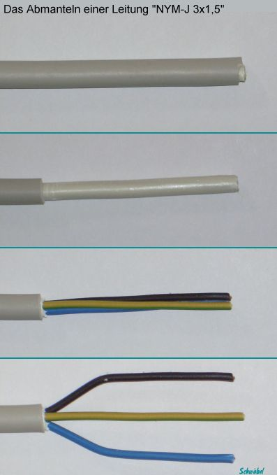
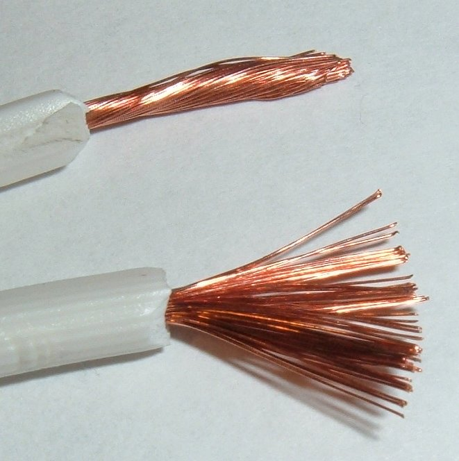
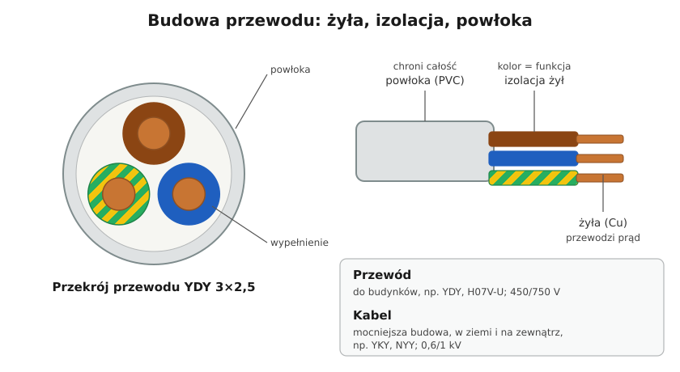

# 05.01 — Budowa przewodu i kabla: żyła, izolacja, powłoka

> **Moduł:** [05 — Przewody i kable](README.md) · **Oznaczenia:** 🏠📋 · **Zakres SEP:** (a) (c) · **Status:** ✅ pełny
>
> **Czytaj:**
>
> - [PN-HD 60364-5-52](../32-przepisy-i-normy/README.md) — dobór i montaż oprzewodowania (omówienie w module 32)
> - Klasy żył: PN-EN 60228 — drut, linka, linka giętka
> - Prąd a grzanie przewodu: [01.06](../01-prad-napiecie-opor/01.06-grzanie-przewodow-i-spadek-napiecia.md)

← (początek modułu) · [spis modułu](README.md) · [następny temat →](05.02-oznaczenia-literowe-ydy-ydyp-yly-yky-h07v-k.md)

## Po co to jest

Każda instalacja to w większości przewody. Zanim dobierzesz przekrój albo zabezpieczenie, musisz wiedzieć, co w przewodzie przewodzi, co izoluje i co chroni przed uszkodzeniem. Na egzaminie pada pytanie o różnicę między przewodem a kablem i o to, co ogranicza obciążalność przewodu.

## Po ludzku

Przewód to trzy warstwy, jak kabel od ładowarki, tylko solidniej:

1. **Żyła** — metal, którym płynie prąd. W domu prawie zawsze miedź, w starych blokach bywa aluminium ([05.07](05.07-miedz-a-aluminium.md)). Żyła może być jednym drutem albo wieloma cienkimi drucikami skręconymi razem (linka).
2. **Izolacja żyły** — plastik wokół każdej żyły z osobna. Oddziela żyły od siebie i ma kolor, który mówi, do czego żyła służy ([05.03](05.03-kolory-zyl-i-ich-znaczenie.md)).
3. **Powłoka** — wspólna „rura” na wszystkie żyły. Chroni izolację przed uszkodzeniem, wilgocią i światłem. Pod powłoką bywa wypełnienie, dzięki któremu przewód jest okrągły.

**Drut czy linka?** Drut (żyła jednodrutowa) jest sztywny, trzyma kształt i dobrze siedzi w zaciskach. Dlatego układa się go na stałe w ścianach. Linka jest giętka, więc nadaje się do rzeczy, które się ruszają (przewód od żelazka, przedłużacz) i do ciasnych rozdzielnic. Końce linki w zaciskach śrubowych zakańcza się tulejkami.

**Co ogranicza prąd w przewodzie?** Nie sam metal, tylko izolacja. Prąd grzeje żyłę ([01.06](../01-prad-napiecie-opor/01.06-grzanie-przewodow-i-spadek-napiecia.md)), a zwykły PVC wytrzymuje długotrwale tylko 70 °C. Powyżej tego izolacja się starzeje, kruszeje i w końcu przestaje izolować. Polietylen usieciowany (XLPE) wytrzymuje 90 °C, więc ten sam przekrój w izolacji XLPE może przenieść większy prąd.

**Przewód a kabel.** Granica jest umowna, ale w praktyce:

- **przewód** — do instalacji w budynkach, napięcie znamionowe zwykle 300/500 V albo 450/750 V, układany w tynku, rurkach, korytkach;
- **kabel** — mocniejsza budowa (grubsza powłoka, czasem pancerz), napięcie 0,6/1 kV i wyżej, przeznaczony także do ułożenia w ziemi i na zewnątrz.

## Jak to wygląda

*Na co patrzeć: od góry — cały przewód w szarej powłoce, potem powłoka zdjęta i widać trzy żyły w kolorowej izolacji. Między powłoką a żyłami jest miękkie wypełnienie. Powłokę nacina się wzdłuż, ostrożnie, żeby nie przeciąć izolacji żył. Nacięta izolacja żyły to przyszłe zwarcie.*

*Na co patrzeć: to linka — żyła z wielu drucików. Im cieńsze druciki, tym bardziej giętki przewód. Taki koniec włożony bez tulejki pod śrubę rozchodzi się na boki, część drucików nie jest dociśnięta, a pojedynczy wystający drucik może dotknąć sąsiedniego zacisku.*

## Schemat

## Pojęcia

| Pojęcie | Po ludzku | Termin normowy / symbol |
|---------|-----------|-------------------------|
| Żyła | Metal, którym płynie prąd | żyła przewodząca (Cu, Al) |
| Drut | Żyła z jednego drutu, sztywna | żyła klasy 1 (PN-EN 60228) |
| Linka | Żyła z wielu drucików | klasa 2 (sztywna), klasa 5 i 6 (giętka) |
| Izolacja | Plastik na każdej żyle | izolacja żyły (PVC, XLPE, guma) |
| Powłoka | Wspólna osłona wszystkich żył | powłoka |
| Napięcie znamionowe | Do jakiego napięcia przewód jest zbudowany | U₀/U, np. 450/750 V |
| Przewód / kabel | Do budynków / mocniejszy, także do ziemi | — |

## Liczby do zapamiętania

| Wielkość | Wartość | Kiedy obowiązuje | Źródło |
|----------|---------|------------------|--------|
| Dopuszczalna temperatura żyły, PVC | **70 °C** | praca ciągła | PN-HD 60364-5-52, tab. 52.1 |
| Dopuszczalna temperatura żyły, XLPE | **90 °C** | praca ciągła | jw. |
| Temperatura żyły przy zwarciu, PVC | do **160 °C** | przez czas zwarcia (≤ 5 s) | PN-HD 60364-4-43 |
| Napięcie przewodów instalacyjnych | **450/750 V** (YDY, H07V-U) | — | normy wyrobu |
| Napięcie przewodów do odbiorników | **300/500 V** (H05VV-F) | przewody giętkie | jw. |
| Napięcie kabli nn | **0,6/1 kV** (YKY) | — | jw. |

## W praktyce

- **Ściąganie powłoki.** Nacinaj powłokę wzdłuż albo ściągaczem z ogranicznikiem głębokości. Nóż prowadzony dookoła łatwo nacina izolację żył. Nacięta żyła może się złamać w zacisku albo zrobić zwarcie po latach.
- **Ściąganie izolacji z żyły.** Tyle, ile wymaga zacisk (zwykle 8–12 mm, zgodnie z oznaczeniem na osprzęcie). Za długo odsłonięta miedź wystaje z zacisku, za krótko — zacisk ściska izolację zamiast metalu.
- **Linka w zacisku śrubowym — z tulejką.** Tulejka zaciśnięta praską trzyma wszystkie druciki razem. Nie cynuj końcówek linki do zacisków śrubowych: cyna „płynie” pod naciskiem i połączenie się luzuje.
- **Promień gięcia.** Nie zaginaj przewodu na ostrym kancie. Za ciasne gięcie uszkadza izolację od środka.

## Błędy i zagrożenia

- ⚠️ **Nacięta izolacja żyły przy zdejmowaniu powłoki** — po latach zwarcie albo przebicie do obudowy.
- ⚠️ **Przewód przegrzewany ponad 70 °C** (za mały przekrój, zła końcówka, przewód zakopany w wełnie) — izolacja kruszeje i przestaje izolować.
- **Linka bez tulejki w zacisku śrubowym** — luźne połączenie, iskrzenie, grzanie.
- **Przewód do budynku zakopany w ziemi** — powłoka YDY nie jest zbudowana do pracy w gruncie ([05.06](05.06-przewody-bezhalogenowe-i-kable-ziemne.md)).

## Przykład

**Sytuacja.** W puszce znajdujesz przewód, z którego przy lekkim zgięciu odpada kawałek twardej, pękającej izolacji. Przewód zasila obwód gniazd w kuchni, w której stoi czajnik, mikrofalówka i ekspres.

**Co się stało?** Izolacja PVC przegrzewała się latami: obwód był przeciążany albo połączenie w puszce było luźne i grzało miejscowo. Gdy izolacja kruszeje, przewód traci podstawową ochronę przed porażeniem i zwarciem.

**Co zrobić?** Wyłączyć obwód, sprawdzić brak napięcia. Wymienić uszkodzony odcinek (albo cały przewód, jeśli kruszeje na długości) i poprawić połączenie. Sprawdzić, czy zabezpieczenie pasuje do przekroju ([07.06](../07-zabezpieczenia-nadpradowe/07.06-koordynacja-zabezpieczenia-z-przewodem.md)) i rozważyć podział obciążenia na dwa obwody.

## Pytania SEP

1. **Z jakich elementów składa się przewód elektroenergetyczny?**

Odpowiedź

Z żyły przewodzącej (miedzianej lub aluminiowej, jednodrutowej lub wielodrutowej), izolacji żyły (np. PVC, XLPE, guma) i — w przewodach wielożyłowych — powłoki, czyli wspólnej osłony chroniącej izolację przed uszkodzeniami mechanicznymi i wpływami otoczenia. Między żyłami a powłoką może być wypełnienie. Kable mogą mieć dodatkowo pancerz i osłonę zewnętrzną.

2. **Czym różni się przewód od kabla?**

Odpowiedź

Kabel ma mocniejszą budowę (grubsza powłoka, często pancerz lub osłona), jest przeznaczony do układania także w ziemi, w wodzie i na zewnątrz i ma wyższe napięcie znamionowe (w sieciach nn 0,6/1 kV). Przewód służy do instalacji w budynkach i do zasilania odbiorników, typowo 300/500 V lub 450/750 V.

3. **Od czego zależy dopuszczalna temperatura pracy przewodu?**

Odpowiedź

Od rodzaju izolacji. Dla PVC wynosi 70 °C przy pracy ciągłej, dla XLPE 90 °C. Przekroczenie tej temperatury przyspiesza starzenie się izolacji, która twardnieje, pęka i traci właściwości izolacyjne.

## Sprawdź się

1. Dlaczego do instalacji układanych na stałe w ścianach używa się drutu, a do przedłużaczy linki?

Odpowiedź

Drut jest sztywny, trzyma kształt i pewnie siedzi w zaciskach — przewód w ścianie się nie rusza. Linka wytrzymuje wielokrotne zginanie, a przewód przedłużacza jest ciągle przekładany. Drut zginany wiele razy pęka.

2. Na zdjęciu linki powyżej: co trzeba zrobić z jej końcem przed włożeniem pod śrubę zacisku?

Odpowiedź

Zaprasować tulejkę kablową, żeby wszystkie druciki były dociśnięte i żaden nie wystawał.

## Źródła

- PN-HD 60364-5-52 — dobór i montaż oprzewodowania, dopuszczalne temperatury izolacji (tab. 52.1).
- PN-HD 60364-4-43 — ochrona przed prądem przetężeniowym, dopuszczalne temperatury żył przy zwarciu.
- PN-EN 60228 — klasy żył przewodów i kabli.

---

← (początek modułu) · [spis modułu](README.md) · [następny temat →](05.02-oznaczenia-literowe-ydy-ydyp-yly-yky-h07v-k.md)
