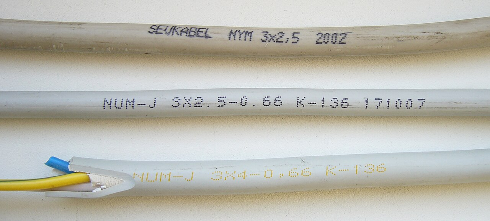
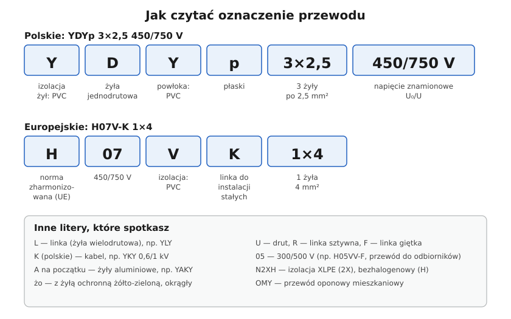

# 05.02 — Oznaczenia literowe: YDY, YDYp, YLY, YKY, H07V-K, H05VV-F, N2XH

> **Moduł:** [05 — Przewody i kable](README.md) · **Oznaczenia:** 🏠📋 · **Zakres SEP:** (a) (c) · **Status:** ✅ pełny
>
> **Czytaj:**
>
> - Nadruk na przewodzie i normy wyrobu: PN-EN 50525 (przewody zharmonizowane), normy PN-HD 603 (kable)
> - Kolory żył: [05.03](05.03-kolory-zyl-i-ich-znaczenie.md)

[← poprzedni temat](05.01-budowa-przewodu-i-kabla-zyla-izolacja-powloka.md) · [spis modułu](README.md) · [następny temat →](05.03-kolory-zyl-i-ich-znaczenie.md)

## Po co to jest

W hurtowni i w projekcie przewody są nazywane skrótami: YDYp 3×1,5, H07V-K 6, YKY 5×10. Trzeba umieć przeczytać taki skrót i od razu wiedzieć, do czego dany przewód się nadaje, a do czego nie. Na egzaminie: „co oznacza symbol YDY 3×2,5 450/750 V”.

## Po ludzku

Polskie oznaczenia czyta się **literami od lewej**. Każda litera to jedna cecha budowy:

| Litera | Znaczenie |
|--------|-----------|
| **Y** (pierwsza) | izolacja żył z PVC (polwinit) |
| **D** | żyła jednodrutowa (drut) |
| **L** | linka (żyła wielodrutowa) |
| **Y** (druga) | powłoka z PVC |
| **p** | przewód płaski |
| **żo** | z żyłą ochronną żółto-zieloną, okrągły |
| **K** | kabel |
| **A** (na początku) | żyły aluminiowe |
| **O** | przewód oponowy (gumowy) |

Za literami jest **liczba żył × przekrój**: 3×2,5 to trzy żyły po 2,5 mm². Na końcu **napięcie znamionowe U₀/U**: 450/750 V znaczy, że przewód wytrzymuje 450 V między żyłą a ziemią i 750 V między żyłami.

**Oznaczenia europejskie** (zharmonizowane, PN-EN 50525) mają stały układ:

- **H** — przewód zharmonizowany (A — krajowy odpowiednik),
- **03 / 05 / 07** — napięcie: 300/300, 300/500, 450/750 V,
- **litery materiałów**: V — PVC, R — guma, N — polichloropren (guma olejoodporna),
- **ostatnia litera po myślniku** — budowa żyły: U — drut, R — linka sztywna, K — linka do instalacji stałych, F — linka giętka.

H07V-U to więc pojedynczy drut w izolacji PVC na 450/750 V (dawne polskie DY). H07V-K to linka (dawne LgY), a H05VV-F to giętki przewód w PVC do odbiorników (dawne OWY).

**Najczęściej spotykane:**

| Oznaczenie | Co to jest | Gdzie |
|------------|------------|-------|
| YDYp 3×1,5 / 3×2,5 | płaski, drut, PVC | w tynku: oświetlenie / gniazda |
| YDY 3×2,5, 5×2,5, 5×4 | okrągły, drut, PVC | instalacje w budynkach, także trójfazowe |
| H07V-U (DY), H07V-K (LgY) | pojedyncza żyła w izolacji | w rurkach, w rozdzielnicach |
| H05VV-F (OWY) | giętki w PVC | przedłużacze, przewody odbiorników |
| H07RN-F (OnPD) | giętki gumowy | warsztat, budowa, na zewnątrz |
| YKY 0,6/1 kV | kabel miedziany w PVC | w ziemi, zasilanie budynku |
| YAKY, YAKXS | kabel aluminiowy (PVC / XLPE) | przyłącza, linie zasilające |
| N2XH | bezhalogenowy w izolacji XLPE | drogi ewakuacyjne, budynki publiczne ([05.06](05.06-przewody-bezhalogenowe-i-kable-ziemne.md)) |

## Jak to wygląda

*Na co patrzeć: nadruk na powłoce to dowód osobisty przewodu — producent, typ, liczba żył i przekrój, napięcie, rok produkcji. NYM to niemiecki odpowiednik YDY. Środkowy przewód udaje NYM, ale ma inną nazwę i napięcie 0,66 kV. Przy zakupie czytaj nadruk i sprawdzaj, czy przekrój żyły jest rzeczywiście taki, jak napisano.*

## Schemat

## Pojęcia

| Pojęcie | Po ludzku | Termin normowy / symbol |
|---------|-----------|-------------------------|
| Przewód płaski | Wszystkie żyły w jednym rzędzie, do tynku | litera „p” (YDYp) |
| Przewód oponowy | Giętki przewód w grubej gumowej lub plastikowej „oponie” | O (OMY, OWY, OnPD) |
| Przewód zharmonizowany | Ta sama budowa w całej UE | H…, PN-EN 50525 |
| Napięcie znamionowe | Napięcie, na które przewód zbudowano | U₀/U |
| Klasa reakcji na ogień | Jak przewód zachowuje się w pożarze | Eca, Dca, Cca… (CPR) |

## Liczby do zapamiętania

| Wielkość | Wartość | Kiedy obowiązuje | Źródło |
|----------|---------|------------------|--------|
| H03 / H05 / H07 | **300/300 V / 300/500 V / 450/750 V** | przewody zharmonizowane | PN-EN 50525 |
| YDY, YDYp, H07V-U | **450/750 V** | przewody instalacyjne | normy wyrobu |
| YKY, YAKY | **0,6/1 kV** | kable nn | jw. |
| Zapis „3×2,5” | **3 żyły po 2,5 mm²** | — | — |
| Zapis „5×4” | **5 żył po 4 mm²** (L1, L2, L3, N, PE) | obwód trójfazowy | — |

## W praktyce

- **Do tynku** — YDYp (płaski) albo YDY (okrągły, łatwiej uszczelnić w dławiku i w puszce). Gniazda 3×2,5, oświetlenie 3×1,5, obwody trójfazowe 5×2,5 lub więcej.
- **W rozdzielnicy** — pojedyncze żyły H07V-K (linka, z tulejkami) albo H07V-U.
- **Do ziemi** — kabel YKY albo YAKXS, nigdy YDY ([05.06](05.06-przewody-bezhalogenowe-i-kable-ziemne.md)).
- **Do odbiorników i przedłużaczy** — przewody giętkie H05VV-F (wewnątrz), H07RN-F (warsztat, na zewnątrz).
- **Przy zakupie** czytaj nadruk: przekrój, napięcie, liczba żył, klasa reakcji na ogień, producent. Przewód bez nadruku albo z podejrzanie cienką miedzią odłóż.

## Błędy i zagrożenia

- ⚠️ **Przewód giętki do odbiorników (H05VV-F) ułożony na stałe w ścianie** zamiast przewodu instalacyjnego — linka w zaciskach osprzętu bez tulejek luzuje się i grzeje.
- ⚠️ **Przewód 300/500 V tam, gdzie wymagany jest 450/750 V** albo przewód „no-name” o zaniżonym przekroju — mniejsza obciążalność i wytrzymałość izolacji, niż zakłada projekt.
- **Przewód 3-żyłowy do obwodu trójfazowego** — brak N albo PE.
- **Mylenie YDY z YKY** — YDY nie nadaje się do ziemi.

## Przykład

**Zadanie.** Rozszyfruj: **YDYżo 5×4 450/750 V**.

- Y — izolacja żył z PVC,
- D — żyły jednodrutowe,
- Y — powłoka z PVC,
- żo — z żyłą ochronną żółto-zieloną, przewód okrągły,
- 5×4 — pięć żył po 4 mm²,
- 450/750 V — napięcie znamionowe.

**Wniosek.** To przewód instalacyjny do obwodu trójfazowego (L1, L2, L3, N, PE), np. do płyty indukcyjnej z dłuższym odcinkiem albo podlicznikowej linii zasilającej rozdzielnicę w domu.

## Pytania SEP

1. **Co oznacza symbol przewodu YDY 3×2,5 450/750 V?**

Odpowiedź

Przewód o żyłach miedzianych jednodrutowych (D) w izolacji z PVC (pierwsze Y) i powłoce z PVC (drugie Y), trzy żyły o przekroju 2,5 mm² każda, napięcie znamionowe 450 V między żyłą a ziemią i 750 V między żyłami. Przewód instalacyjny do układania na stałe w budynkach.

2. **Jaka jest różnica między przewodami H07V-U, H07V-K i H05VV-F?**

Odpowiedź

H07V-U — jednożyłowy, żyła jednodrutowa w izolacji PVC, 450/750 V, do układania w rurkach i w rozdzielnicach. H07V-K — jak wyżej, ale żyła z linki (bardziej giętki). H05VV-F — wielożyłowy przewód giętki w izolacji i powłoce PVC, 300/500 V, do przyłączania odbiorników ruchomych i przedłużaczy.

3. **Jakie przewody stosuje się do zasilania odbiorników ruchomych?**

Odpowiedź

Przewody giętkie z żyłami wielodrutowymi (linkami): w pomieszczeniach H05VV-F (OWY) lub H05RR-F, w warunkach cięższych i na zewnątrz przewody oponowe gumowe H07RN-F (OnPD). Przewody muszą mieć żyłę ochronną, jeśli odbiornik jest klasy I.

## Sprawdź się

1. Co oznacza litera A w oznaczeniu YAKY?

Odpowiedź

Żyły aluminiowe. YAKY to kabel z żyłami aluminiowymi w izolacji i powłoce z PVC.

2. Kolega chce poprowadzić zasilanie do garażu stojącego 15 m od domu przewodem YDY 5×4 zakopanym w ogrodzie. Co mu powiesz?

Odpowiedź

YDY nie jest przewidziany do układania w ziemi. Trzeba użyć kabla (np. YKY 5×4 0,6/1 kV) ułożonego zgodnie z zasadami dla kabli ziemnych: na odpowiedniej głębokości, na podsypce, z folią ostrzegawczą, z rurą osłonową na przejściach ([05.06](05.06-przewody-bezhalogenowe-i-kable-ziemne.md)).

## Źródła

- PN-EN 50525 — przewody elektryczne na napięcie do 450/750 V (system oznaczeń zharmonizowanych).
- Karty katalogowe producentów przewodów (YDY, YDYp, YKY) — budowa, napięcie znamionowe, zastosowanie.
- Rozporządzenie (UE) 305/2011 (CPR) i PN-EN 50575 — klasy reakcji na ogień przewodów.

---

[← poprzedni temat](05.01-budowa-przewodu-i-kabla-zyla-izolacja-powloka.md) · [spis modułu](README.md) · [następny temat →](05.03-kolory-zyl-i-ich-znaczenie.md)
