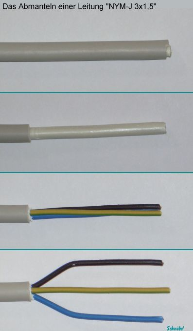
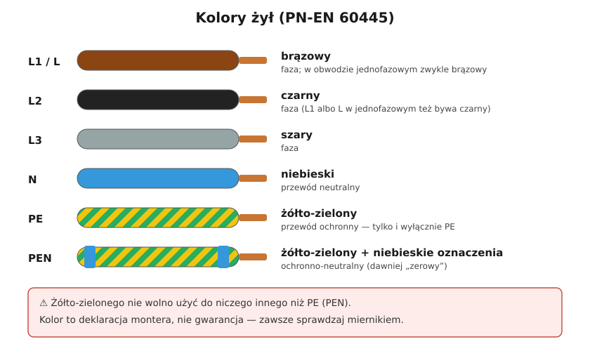

# 05.03 — Kolory żył i ich znaczenie

> **Moduł:** [05 — Przewody i kable](README.md) · **Oznaczenia:** 🏠📋 · **Zakres SEP:** (a) (c) · **Status:** ✅ pełny
>
> **Czytaj:**
>
> - PN-EN 60445 — oznaczenia zacisków i przewodów, kolory żył
> - L, N i PE — co to jest: [02.02](../02-prad-przemienny-230-400/02.02-faza-przewod-neutralny-i-przewod-ochronny-l-n-pe.md)
> - Układy sieci i przewód PEN: [moduł 11](../11-uklady-sieci/README.md)

[← poprzedni temat](05.02-oznaczenia-literowe-ydy-ydyp-yly-yky-h07v-k.md) · [spis modułu](README.md) · [następny temat →](05.04-przekroj-i-obciazalnosc-pradowa.md)

## Po co to jest

Kolory żył są umową, dzięki której monter po latach wie, co jest czym. Pomylenie N z PE potrafi wyłączać różnicówkę bez widocznej przyczyny, a podanie fazy na żyłę żółto-zieloną zamienia obudowy urządzeń w części pod napięciem. Na egzaminie: kolory przewodów N, PE i PEN.

## Po ludzku

**Trzy kolory są zarezerwowane:**

- **żółto-zielony** — wyłącznie przewód ochronny **PE** (albo PEN). Nigdy nic innego.
- **niebieski** — przewód neutralny **N**. Jeśli w obwodzie nie ma N, niebieską żyłę wolno wykorzystać do czegoś innego, ale nigdy jako PE.
- **żółto-zielony z niebieskimi oznaczeniami na końcach** (albo niebieski z żółto-zielonymi) — przewód **PEN**, czyli połączone funkcje ochronna i neutralna.

**Fazy** mają kolory brązowy, czarny i szary. W obwodzie trójfazowym kolejno L1 brązowy, L2 czarny, L3 szary. W obwodzie jednofazowym faza jest najczęściej brązowa, ale bywa czarna lub szara.

**Kolor to deklaracja, nie pomiar.** W starych instalacjach kolory bywają przypadkowe, bo monter użył tego przewodu, który miał. W nowych zdarzają się pomyłki. Zanim dotkniesz żyły, sprawdzasz brak napięcia ([00.02](../00-bezpieczenstwo-najpierw/00.02-sprawdzanie-braku-napiecia-probnik-dwubiegunowy.md)), a przed podłączeniem — miernikiem, co jest czym.

## Jak to wygląda

*Na co patrzeć: typowy przewód jednofazowy — brązowa faza L, niebieski N, żółto-zielony PE. Taki układ kolorów spotkasz w każdej nowej instalacji jednofazowej. W obwodach trójfazowych dochodzą żyły czarna i szara.*

*Na co patrzeć: pięć styków trójfazowej wtyczki to pięć funkcji — trzy fazy, N i PE. W przewodzie zasilającym takie gniazdo żyły L1, L2, L3 są brązowa, czarna i szara, N niebieska, PE żółto-zielona.*

## Schemat

## Pojęcia

| Pojęcie | Po ludzku | Termin normowy / symbol |
|---------|-----------|-------------------------|
| Faza | Żyła, na której jest napięcie względem ziemi | L, L1, L2, L3 |
| Przewód neutralny | Powrót prądu roboczego | N |
| Przewód ochronny | Łączy obudowy z uziemieniem, normalnie bez prądu | PE |
| Przewód ochronno-neutralny | Jedna żyła pełniąca obie funkcje (dawniej „zero”) | PEN |
| Oznaczenie dodatkowe | Koszulka, taśma lub znacznik na końcu żyły | PN-EN 60445 |

## Liczby do zapamiętania

| Wielkość | Wartość | Kiedy obowiązuje | Źródło |
|----------|---------|------------------|--------|
| PE | **żółto-zielony** | zawsze i wyłącznie | PN-EN 60445 |
| N | **niebieski** | — | jw. |
| PEN | **żółto-zielony + niebieskie oznaczenia** na końcach (lub odwrotnie) | układ TN-C | jw. |
| L1 / L2 / L3 | **brązowy / czarny / szary** | obwody trójfazowe | jw. |
| L w obwodzie 1-fazowym | zwykle **brązowy** | — | jw. |

## W praktyce

- **Przy podłączaniu** trzymaj się kolorów w całej instalacji. Jeśli musisz użyć żyły w innej funkcji (np. niebieskiej jako fazy w obwodzie bez N, w łączniku schodowym), oznacz ją na obu końcach brązową koszulką lub taśmą.
- **W starej instalacji** każdą żyłę identyfikuj pomiarem: napięcie względem PE, ciągłość do szyny PE lub N w rozdzielnicy ([moduł 21](../21-stare-instalacje/README.md)).
- **Żyła żółto-zielona** w przewodzie, którego nie potrzebujesz jako PE (np. przy łączniku), zostaje nieużywana i zaizolowana albo podłączona do PE. Nigdy nie służy jako faza ani N.
- **W rozdzielnicy** N i PE trafiają na osobne listwy (w układzie TN-S). Ich zamiana objawia się wybijaniem różnicówki ([08.06](../08-wylaczniki-roznicowopradowe/08.06-dlaczego-roznicowka-wybija-przyczyny-i-szukanie.md)).

## Błędy i zagrożenia

- ⚠️ **Faza na żółto-zielonej żyle** — każda obudowa połączona z PE jest pod napięciem. Śmiertelnie groźne.
- ⚠️ **Zaufanie kolorom w starej instalacji** bez pomiaru — „niebieski” może być fazą.
- **Zamiana N z PE** za różnicówką — różnicówka wybija przy włączeniu odbiornika albo w ogóle nie daje się załączyć.
- **Brak oznaczeń** przy nietypowym użyciu żyły — następny monter (albo ty za 5 lat) się pomyli.

## Przykład

**Sytuacja.** Podłączasz lampę sufitową w pokoju. Z sufitu wychodzi przewód z żyłami: czarną, brązową i żółto-zieloną. Nie ma niebieskiej.

**Co to może znaczyć?** Najczęściej to obwód z łącznikiem świecznikowym ([06.02](../06-osprzet-instalacyjny/06.02-laczniki-jednobiegunowy-dwubiegunowy.md)): brązowa i czarna to dwie łączone fazy dla dwóch grup żarówek, a N… jest gdzie indziej albo go nie ma. Albo jest to stara instalacja, w której żółto-zielona pełni funkcję N lub PEN.

**Co zrobić?** Nie zgadywać. Wyłączyć obwód, sprawdzić, które żyły dochodzą do łącznika, a które do puszki rozgałęźnej. Po załączeniu zmierzyć napięcia między żyłami przy różnych położeniach łącznika. Jeśli żółto-zielona okazuje się N, instalacja wymaga poprawienia, a nie „dopasowania” lampy.

## Pytania SEP

1. **Jakim kolorem oznacza się przewód ochronny PE, neutralny N i ochronno-neutralny PEN?**

Odpowiedź

PE — kolorem żółto-zielonym, który jest zarezerwowany wyłącznie dla przewodu ochronnego. N — niebieskim (jasnoniebieskim). PEN — żółto-zielonym z dodatkowymi niebieskimi oznaczeniami na końcach albo niebieskim z żółto-zielonymi oznaczeniami na końcach (PN-EN 60445).

2. **Czy przewód o izolacji niebieskiej może być użyty jako przewód fazowy?**

Odpowiedź

Tak, ale tylko wtedy, gdy w danym obwodzie nie ma przewodu neutralnego. Należy go wtedy oznaczyć na końcach. Niebieskiego przewodu nie wolno natomiast użyć jako przewodu ochronnego. Żółto-zielonego nie wolno użyć do żadnego innego celu niż PE lub PEN.

## Sprawdź się

1. W rozdzielnicy trójfazowej widzisz trzy żyły: brązową, czarną i szarą. Jak je oznaczysz?

Odpowiedź

L1 — brązowa, L2 — czarna, L3 — szara.

2. Co jest groźniejsze: N podłączony na zacisk PE czy faza podłączona na zacisk PE? Dlaczego?

Odpowiedź

Faza na PE — wtedy obudowy urządzeń klasy I są pod napięciem 230 V względem ziemi. N na PE jest błędem, który powoduje wybijanie różnicówki i może przenosić napięcie na obudowy przy przerwie w N, ale nie daje od razu pełnego napięcia na obudowach.

## Źródła

- PN-EN 60445 — zasady oznaczania zacisków urządzeń i zakończeń przewodów, kolory żył.
- PN-HD 60364-5-51 — dobór i montaż wyposażenia elektrycznego, identyfikacja przewodów.

---

[← poprzedni temat](05.02-oznaczenia-literowe-ydy-ydyp-yly-yky-h07v-k.md) · [spis modułu](README.md) · [następny temat →](05.04-przekroj-i-obciazalnosc-pradowa.md)
