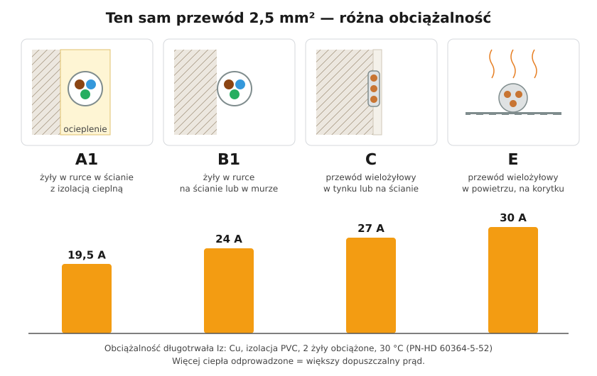

# 05.04 — Przekrój i obciążalność prądowa

> **Moduł:** [05 — Przewody i kable](README.md) · **Oznaczenia:** 🏠📋 · **Zakres SEP:** (a) (c) · **Status:** ✅ pełny
>
> **Czytaj:**
>
> - [PN-HD 60364-5-52, załącznik B](../32-przepisy-i-normy/README.md) — tablice obciążalności i współczynniki poprawkowe
> - Grzanie przewodów i spadek napięcia: [01.06](../01-prad-napiecie-opor/01.06-grzanie-przewodow-i-spadek-napiecia.md)
> - Dobór zabezpieczenia do przewodu: [07.06](../07-zabezpieczenia-nadpradowe/07.06-koordynacja-zabezpieczenia-z-przewodem.md)

[← poprzedni temat](05.03-kolory-zyl-i-ich-znaczenie.md) · [spis modułu](README.md) · [następny temat →](05.05-sposoby-ukladania-przewodow-a1-b1-c-e-i-ich.md)

## Po co to jest

Przekrój przewodu decyduje, jaki prąd może płynąć długotrwale bez przegrzania izolacji. Od niego zależy, jakie zabezpieczenie wolno dać i ile odbiorników zasilić jednym obwodem. Na egzaminie: od czego zależy obciążalność prądowa i jak dobrać przekrój.

## Po ludzku

**Przekrój** to pole powierzchni przekroju poprzecznego żyły w mm², nie średnica. Żyła 2,5 mm² ma średnicę ok. 1,8 mm, a 1,5 mm² — ok. 1,4 mm.

**Obciążalność prądowa długotrwała (Iz)** to największy prąd, który może płynąć bez końca, a żyła nie przekroczy dopuszczalnej temperatury izolacji (70 °C dla PVC). Iz nie jest cechą samego przewodu. Zależy od:

1. **przekroju i materiału żyły** — większy przekrój i miedź zamiast aluminium dają mniejszą rezystancję i mniej ciepła;
2. **rodzaju izolacji** — XLPE wytrzymuje więcej niż PVC;
3. **sposobu ułożenia** — czy ciepło ma gdzie uciec ([05.05](05.05-sposoby-ukladania-przewodow-a1-b1-c-e-i-ich.md));
4. **temperatury otoczenia** — tablice są dla 30 °C w powietrzu; gorętsze otoczenie zmniejsza Iz;
5. **liczby żył obciążonych** — w obwodzie jednofazowym grzeją się 2 żyły (L i N), w trójfazowym 3;
6. **sąsiedztwa innych obwodów** — kilka przewodów obok siebie grzeje się nawzajem.

Wartość z tablicy mnoży się przez współczynniki poprawkowe na temperaturę i na grupowanie.

**Minimalny przekrój** żył miedzianych w instalacjach stałych to 1,5 mm². W mieszkaniach przyjęło się: **oświetlenie 1,5 mm²**, **gniazda 2,5 mm²**, obwody o większej mocy (płyta indukcyjna, przepływowy podgrzewacz) — według obliczeń.

## Schemat

## Pojęcia

| Pojęcie | Po ludzku | Termin normowy / symbol |
|---------|-----------|-------------------------|
| Przekrój | Pole przekroju żyły | S [mm²] |
| Obciążalność długotrwała | Prąd, który przewód wytrzyma bez końca | Iz |
| Prąd obliczeniowy | Ile prądu naprawdę pobiorą odbiorniki | IB |
| Współczynnik temperaturowy | Poprawka na temperaturę otoczenia inną niż 30 °C | k₁ (tab. B.52.14) |
| Współczynnik grupowania | Poprawka na sąsiednie obwody | k₂ (tab. B.52.17) |

## Liczby do zapamiętania

| Wielkość | Wartość | Kiedy obowiązuje | Źródło |
|----------|---------|------------------|--------|
| Iz Cu 1,5 mm² | A1 **14,5 A** · B1 **17,5 A** · C **19,5 A** · E **22 A** | PVC, 2 żyły obciążone, 30 °C | PN-HD 60364-5-52, tab. B.52.2–B.52.10 |
| Iz Cu 2,5 mm² | A1 **19,5 A** · B1 **24 A** · C **27 A** · E **30 A** | jw. | jw. |
| Iz Cu 4 mm² | A1 **26 A** · B1 **32 A** · C **36 A** · E **40 A** | jw. | jw. |
| Iz Cu 6 mm² | A1 **34 A** · B1 **41 A** · C **46 A** · E **51 A** | jw. | jw. |
| Iz Cu 2,5 mm², 3 żyły obciążone | A1 **18 A** · B1 **21 A** · C **24 A** · E **25 A** | obwód trójfazowy | jw. |
| Poprawka na temperaturę (PVC) | 25 °C **1,06** · 35 °C **0,94** · 40 °C **0,87** | otoczenie inne niż 30 °C | tab. B.52.14 |
| Poprawka na grupowanie | 2 obwody **0,80** · 3 **0,70** · 4 **0,65** · 6 **0,57** | przewody obok siebie | tab. B.52.17 |
| Minimalny przekrój Cu | **1,5 mm²** | instalacje stałe, obwody siłowe i oświetleniowe | PN-HD 60364-5-52, tab. 52.2 |
| Typowo w mieszkaniu | oświetlenie **1,5 mm²**, gniazda **2,5 mm²** | — | praktyka, N SEP-E-002 |

## W praktyce

Dobór przekroju krok po kroku:

1. **Policz prąd obliczeniowy IB** z mocy odbiorników: jednofazowo $I_B = P / (230\ \mathrm{V} \cdot \cos\varphi)$ ([01.04](../01-prad-napiecie-opor/01.04-moc-i-energia-waty-kilowatogodziny-i-rachunek.md), [02.04](../02-prad-przemienny-230-400/02.04-moc-czynna-bierna-i-pozorna-wspolczynnik-mocy.md)).
2. **Dobierz zabezpieczenie In ≥ IB** z typoszeregu (10, 13, 16, 20, 25, 32 A).
3. **Odczytaj Iz** dla planowanego przekroju i sposobu ułożenia i pomnóż przez poprawki.
4. **Sprawdź In ≤ Iz** ([07.06](../07-zabezpieczenia-nadpradowe/07.06-koordynacja-zabezpieczenia-z-przewodem.md)). Jeśli nie wychodzi — większy przekrój albo inne ułożenie.
5. **Sprawdź spadek napięcia** ([01.06](../01-prad-napiecie-opor/01.06-grzanie-przewodow-i-spadek-napiecia.md)) i **samoczynne wyłączenie przy zwarciu** ([moduł 12](../12-ochrona-przeciwporazeniowa/README.md)). Przy długich obwodach to one, a nie Iz, wymuszają większy przekrój.

## Błędy i zagrożenia

- ⚠️ **B16 na przewodzie 1,5 mm²** — przewód może się grzać ponad 70 °C prądem, przy którym wyłącznik jeszcze długo nie zadziała.
- ⚠️ **Wymiana „wybijającego” B10 na B16** bez sprawdzenia przekroju — przeciążenie przenosi się z wyłącznika na przewód w ścianie.
- **Pominięcie grupowania** — kilka obwodów w jednej bruździe albo rurce ma realnie mniejszą obciążalność niż w tablicy.
- **Przewód w ociepleniu, w wełnie, za płytą g-k** potraktowany jak przewód w tynku.

## Przykład

**Zadanie.** Trzy obwody gniazd (YDY 3×2,5) biegną obok siebie w jednej bruździe w tynku (sposób C). Każdy ma być zabezpieczony wyłącznikiem B16. Czy to dopuszczalne? A gdyby ta sama trójka biegła w ścianie z ociepleniem (sposób A1)?

**Sposób C:**

$$I_z = 27\ \mathrm{A} \cdot 0{,}70 = 18{,}9\ \mathrm{A} \ge 16\ \mathrm{A}$$

Warunek In ≤ Iz spełniony.

**Sposób A1:**

$$I_z = 19{,}5\ \mathrm{A} \cdot 0{,}70 = 13{,}7\ \mathrm{A} < 16\ \mathrm{A}$$

Warunek niespełniony. Trzeba rozdzielić trasy, zastosować 4 mm² albo zmniejszyć zabezpieczenie (B13, o ile wystarczy dla odbiorników).

**Wniosek.** Ten sam przewód z tym samym wyłącznikiem może być poprawny albo nie — zależnie od tego, jak i z czym go ułożysz.

## Pytania SEP

1. **Od czego zależy obciążalność prądowa długotrwała przewodu?**

Odpowiedź

Od przekroju i materiału żyły (Cu, Al), rodzaju izolacji i jej dopuszczalnej temperatury (PVC 70 °C, XLPE 90 °C), sposobu ułożenia (warunki oddawania ciepła), temperatury otoczenia, liczby żył obciążonych oraz liczby obwodów ułożonych obok siebie (grupowanie). Wartość z tablic PN-HD 60364-5-52 koryguje się współczynnikami poprawkowymi.

2. **Jaki jest minimalny przekrój przewodów miedzianych w instalacjach stałych?**

Odpowiedź

1,5 mm² dla obwodów siłowych i oświetleniowych (PN-HD 60364-5-52, tab. 52.2). W praktyce w mieszkaniach obwody gniazd wykonuje się przewodem 2,5 mm², a oświetleniowe 1,5 mm².

3. **Co oznacza symbol Iz?**

Odpowiedź

Obciążalność prądową długotrwałą przewodu, czyli największy prąd, który może płynąć przez przewód w sposób ciągły w danych warunkach ułożenia, nie powodując przekroczenia dopuszczalnej temperatury izolacji.

## Sprawdź się

1. Przewód 2,5 mm² w sposobie B1 biegnie przez kotłownię, w której jest 40 °C. Ile wynosi jego obciążalność?

Odpowiedź

$24\ \mathrm{A} \cdot 0{,}87 \approx 20{,}9\ \mathrm{A}$.

2. Dlaczego obwód trójfazowy 5×2,5 ma mniejszą obciążalność na żyłę niż jednofazowy 3×2,5 w tym samym ułożeniu?

Odpowiedź

W trójfazowym grzeją się trzy żyły robocze, w jednofazowym dwie (L i N). Więcej ciepła w tej samej powłoce oznacza niższy dopuszczalny prąd każdej żyły.

## Źródła

- PN-HD 60364-5-52 — tablice obciążalności B.52.2–B.52.13, współczynniki poprawkowe B.52.14 (temperatura) i B.52.17 (grupowanie), tab. 52.2 (minimalne przekroje).
- N SEP-E-002 — instalacje elektryczne w budynkach mieszkalnych, podstawy planowania.

---

[← poprzedni temat](05.03-kolory-zyl-i-ich-znaczenie.md) · [spis modułu](README.md) · [następny temat →](05.05-sposoby-ukladania-przewodow-a1-b1-c-e-i-ich.md)
