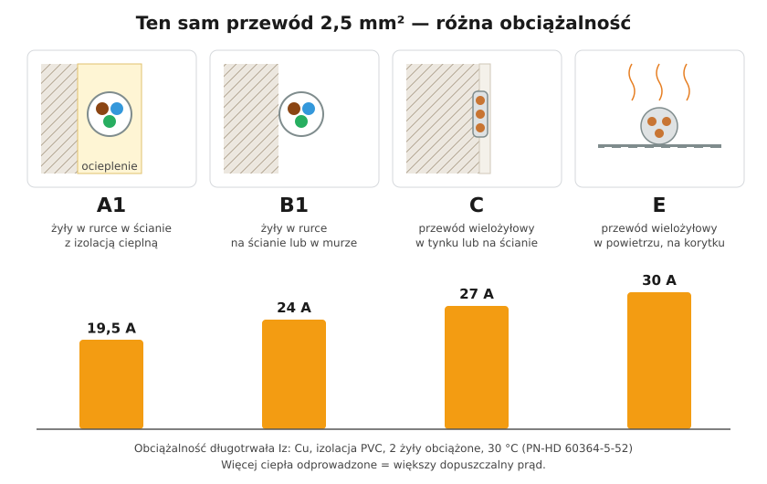

# 05.05 — Sposoby układania przewodów (A1, B1, C, E…) i ich wpływ na obciążalność

> **Moduł:** [05 — Przewody i kable](README.md) · **Oznaczenia:** 🏠📋 · **Zakres SEP:** (a) (c) · **Status:** ✅ pełny
>
> **Czytaj:**
>
> - [PN-HD 60364-5-52, tab. B.52.1 i A.52.3](../32-przepisy-i-normy/README.md) — sposoby wykonania instalacji
> - Obciążalność i poprawki: [05.04](05.04-przekroj-i-obciazalnosc-pradowa.md)

[← poprzedni temat](05.04-przekroj-i-obciazalnosc-pradowa.md) · [spis modułu](README.md) · [następny temat →](05.06-przewody-bezhalogenowe-i-kable-ziemne.md)

## Po co to jest

Przewód oddaje ciepło do otoczenia. W powietrzu chłodzi się dobrze, w ścianie z ociepleniem bardzo słabo. Dlatego norma przypisuje każdemu sposobowi ułożenia literę i osobną kolumnę w tablicy obciążalności. Bez tej litery nie dobierzesz przekroju do zabezpieczenia.

## Po ludzku

Wyobraź sobie przewód jak grzejnik o małej mocy. Ten sam przewód z tym samym prądem wytwarza tyle samo ciepła, ale jego temperatura zależy od tego, jak łatwo to ciepło odpływa. W powietrzu — łatwo. W tynku — nieźle, bo mur dobrze przewodzi ciepło. W rurce w ociepleniu — słabo, bo powietrze w rurce i styropian izolują.

Najczęstsze sposoby (litera to tzw. sposób odniesienia):

| Sposób | Co to jest | Przykład w domu |
|--------|------------|-----------------|
| **A1** | pojedyncze żyły w rurce w ścianie izolowanej cieplnie | DY w peszlu w ścianie z wełną |
| **A2** | przewód wielożyłowy w rurce w ścianie izolowanej cieplnie | YDY w peszlu za płytą g-k z wełną |
| **B1** | pojedyncze żyły w rurce na ścianie albo w murze | DY w rurce natynkowej |
| **B2** | przewód wielożyłowy w rurce na ścianie albo w murze | YDY w peszlu w bruździe |
| **C** | przewód wielożyłowy bezpośrednio na ścianie albo w tynku | YDYp pod tynkiem |
| **D1 / D2** | kabel w ziemi, w rurze / bezpośrednio | YKY do garażu |
| **E** | przewód wielożyłowy w powietrzu, na korytku perforowanym | korytko w piwnicy |

**Ocieplenie to wróg przewodu.** Przewód otoczony z każdej strony materiałem izolacyjnym na długości ponad 0,5 m może mieć obciążalność zmniejszoną nawet o połowę względem ułożenia na ścianie. To typowa pułapka w poddaszach i ścianach szkieletowych.

## Schemat

## Pojęcia

| Pojęcie | Po ludzku | Termin normowy / symbol |
|---------|-----------|-------------------------|
| Sposób odniesienia | Litera opisująca warunki chłodzenia | A1, A2, B1, B2, C, D1, D2, E, F, G |
| Rurka instalacyjna | Peszel lub rura sztywna | rura instalacyjna (PN-EN 61386) |
| Korytko perforowane | Metalowa lub plastikowa rynna z otworami | korytko kablowe |
| Ściana izolowana cieplnie | Ściana z wełną, styropianem | sposób A |

## Liczby do zapamiętania

| Wielkość | Wartość | Kiedy obowiązuje | Źródło |
|----------|---------|------------------|--------|
| Iz Cu 2,5 mm², A1 | **19,5 A** | PVC, 2 żyły obciążone, 30 °C | PN-HD 60364-5-52 |
| Iz Cu 2,5 mm², B1 | **24 A** | jw. | jw. |
| Iz Cu 2,5 mm², C | **27 A** | jw. | jw. |
| Iz Cu 2,5 mm², E | **30 A** | jw. | jw. |
| Przewód w izolacji cieplnej na długości > 0,5 m | obciążalność × **0,5** | brak dokładniejszych danych | PN-HD 60364-5-52, 523.9 |

## W praktyce

- **Planując trasę, zapisz sposób ułożenia** dla każdego obwodu. Najsłabszy odcinek trasy decyduje o obciążalności całego obwodu.
- **Unikaj prowadzenia przewodów w wełnie i styropianie.** Jeśli musisz, prowadź je po ciepłej stronie izolacji albo dobierz większy przekrój.
- **Nie układaj wielu obwodów w jednej rurce**, jeśli nie musisz. Każdy dodatkowy obwód obniża obciążalność wszystkich.
- **Trasy prowadź pionowo i poziomo**, w przewidywalnych strefach, żeby ktoś wiercący w ścianie mógł się ich domyślić ([moduł 16](../16-planowanie-obwodow/README.md)).

## Błędy i zagrożenia

- ⚠️ **Przewód gniazd kuchennych przeprowadzony przez ocieplone poddasze** i zabezpieczony jak przewód w tynku — przegrzewanie w miejscu, którego nikt nie widzi.
- **Peszel upchany przewodami** — trudna wymiana, dodatkowe grzanie.
- **Korytko pełne kabli „na dziko”** — grupowanie zmniejsza obciążalność każdego z nich.

## Przykład

**Zadanie.** Obwód gniazd w łazience na poddaszu: YDY 3×2,5, pierwsze 3 m w tynku (C), potem 4 m przez ocieploną ścianę kolankową w peszlu (A2: 18,5 A). Zabezpieczenie B16. Czy dobór jest poprawny?

**Rozwiązanie.** Liczy się najgorszy odcinek, czyli A2:

$$I_z = 18{,}5\ \mathrm{A} \ge I_n = 16\ \mathrm{A}$$

Warunek jest spełniony, ale z niewielkim zapasem. Gdyby przewód leżał bezpośrednio w wełnie bez rurki na długości ponad 0,5 m, obciążalność mogłaby spaść do ok. 13,5 A (27 A × 0,5) i B16 byłby za duży.

## Pytania SEP

1. **Jaki wpływ na obciążalność przewodu ma sposób jego ułożenia?**

Odpowiedź

Sposób ułożenia decyduje o warunkach oddawania ciepła. Przewód w powietrzu (sposób E) chłodzi się najlepiej i ma największą obciążalność, przewód w tynku (C) nieco mniejszą, w rurce (B) jeszcze mniejszą, a w ścianie izolowanej cieplnie (A) najmniejszą. Dla przewodu 2,5 mm² różnica między A1 a E to ok. 50 %.

2. **Jakie oznaczenia sposobów ułożenia przewodów stosuje norma PN-HD 60364-5-52?**

Odpowiedź

Sposoby odniesienia: A1 i A2 (w rurach w ścianie izolowanej cieplnie), B1 i B2 (w rurach na ścianie lub w murze), C (bezpośrednio na ścianie lub w tynku), D1 i D2 (w ziemi, w osłonie lub bezpośrednio), E, F i G (w powietrzu, np. na korytkach perforowanych). Każdemu odpowiada kolumna w tablicach obciążalności.

## Sprawdź się

1. Który sposób ułożenia jest bezpieczniejszy dla przewodu 2,5 mm² z wyłącznikiem B20: C czy B1?

Odpowiedź

C: Iz = 27 A ≥ 20 A — warunek spełniony. B1: Iz = 24 A ≥ 20 A — też spełniony. Oba są dopuszczalne bez grupowania, ale C ma większy zapas. Przy grupowaniu (np. 3 obwody: × 0,7) oba przestają spełniać warunek.

## Źródła

- PN-HD 60364-5-52 — tab. A.52.3 (przykłady sposobów wykonania), tab. B.52.1 (sposoby odniesienia), 523.9 (przewody w izolacji cieplnej).

---

[← poprzedni temat](05.04-przekroj-i-obciazalnosc-pradowa.md) · [spis modułu](README.md) · [następny temat →](05.06-przewody-bezhalogenowe-i-kable-ziemne.md)
