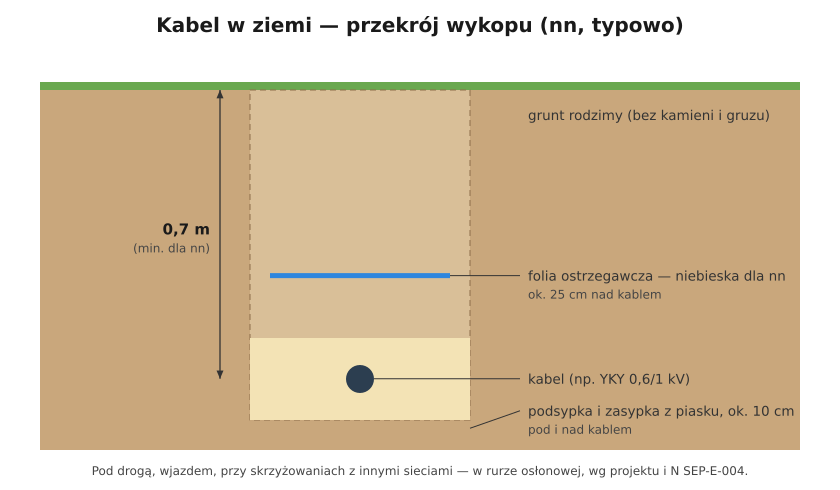

# 05.06 — Przewody bezhalogenowe i kable ziemne

> **Moduł:** [05 — Przewody i kable](README.md) · **Oznaczenia:** 🏠📋 · **Zakres SEP:** (a) (c) · **Status:** ✅ pełny
>
> **Czytaj:**
>
> - N SEP-E-004 — elektroenergetyczne i sygnalizacyjne linie kablowe, projektowanie i budowa
> - Rozporządzenie (UE) 305/2011 (CPR), PN-EN 50575 — klasy reakcji na ogień
> - [Poradnik: wykop pod kabel ziemny](https://cenauslug.pl/poradniki/jak-poprawnie-przygotowac-wykop-pod-kabel-ziemny-instrukcja-odbioru-prac)

[← poprzedni temat](05.05-sposoby-ukladania-przewodow-a1-b1-c-e-i-ich.md) · [spis modułu](README.md) · [następny temat →](05.07-miedz-a-aluminium.md)

## Po co to jest

Dwie sytuacje spoza zwykłego mieszkania. Po pierwsze budynki, w których pożar i dym są szczególnie groźne: przewody wydzielające w ogniu gęsty, żrący dym utrudniają ewakuację. Po drugie zasilanie garażu, altany czy bramy, czyli kabel w ziemi. Ma swoje zasady i trudno go poprawić, kiedy już leży pod trawnikiem.

## Po ludzku

**Przewody bezhalogenowe.** Zwykły PVC zawiera chlor. W pożarze wydziela gęsty czarny dym i chlorowodór, który z wilgocią tworzy kwas solny. Dym zasłania drogę ucieczki, kwas niszczy płuca i elektronikę. Przewody bezhalogenowe (oznaczenia HF, LSZH, LS0H, litera H w N2XH) mają izolację bez chloru i fluoru. W ogniu dymią mniej, a dym nie jest żrący.

Nie mylić z przewodami **ognioodpornymi** (np. NHXH FE180/E90). Te mają działać w czasie pożaru, np. zasilać pompy pożarowe, oświetlenie awaryjne czy oddymianie.

**Klasy reakcji na ogień (CPR).** Każdy przewód do instalacji stałych ma na nadruku klasę, np. **Eca** (zwykły YDY), **Dca**, **Cca**, **B2ca**. Im bliżej A, tym lepiej. Dopiski: **s1–s3** — ilość dymu, **d0–d2** — płonące krople, **a1–a3** — kwasowość dymu.

**Kabel w ziemi.** Do ziemi idzie **kabel**, np. YKY 0,6/1 kV, a nie przewód. Zasady (N SEP-E-004, typowo dla nn):

- głębokość ułożenia co najmniej **0,7 m**, pod drogą i wjazdem — głębiej i w rurze osłonowej;
- kabel na podsypce z piasku ok. **10 cm**, przysypany piaskiem ok. **10 cm**;
- nad kablem **folia ostrzegawcza niebieska** (dla nn), ok. **25 cm** nad kablem;
- przy wejściu do budynku, pod drogą i przy skrzyżowaniu z innymi sieciami — **rura osłonowa**;
- przebieg trasy warto zinwentaryzować: zdjęcia z miarą, szkic.

## Schemat

## Pojęcia

| Pojęcie | Po ludzku | Termin normowy / symbol |
|---------|-----------|-------------------------|
| Bezhalogenowy | Bez chloru i fluoru, mało żrącego dymu | HF, LSZH, LS0H |
| Ognioodporny | Działa w czasie pożaru przez określony czas | PH90, E90, FE180 |
| Klasa reakcji na ogień | Jak przewód pali się i dymi | Aca…Fca, s, d, a (CPR) |
| Folia ostrzegawcza | Kolorowa taśma nad kablem w ziemi | niebieska — nn |
| Rura osłonowa | Rura chroniąca kabel na przejściach | — |

## Liczby do zapamiętania

| Wielkość | Wartość | Kiedy obowiązuje | Źródło |
|----------|---------|------------------|--------|
| Głębokość ułożenia kabla nn | **0,7 m** (minimum) | teren bez ruchu kołowego | N SEP-E-004 |
| Podsypka / zasypka piaskiem | ok. **10 cm** pod i nad kablem | — | jw., praktyka wykonawcza |
| Folia ostrzegawcza nad kablem nn | **niebieska**, ok. **25 cm** nad kablem | — | jw. |
| Typowa klasa zwykłego YDY | **Eca** | — | deklaracje producentów (CPR) |
| Napięcie kabla ziemnego nn | **0,6/1 kV** | YKY, YAKXS | normy wyrobu |

## W praktyce

- **Zasilanie garażu lub altany:** kabel YKY (np. 5×4 albo 3×2,5 — wg obliczeń i spadku napięcia), w rurze na wejściu do budynku i na wyjściu z ziemi, z ochroną mechaniczną na odcinku nad terenem.
- **Przed kopaniem** sprawdź mapę uzbrojenia terenu albo zapytaj operatora sieci. Pod trawnikiem może być gaz, woda i cudzy kabel.
- **Wychodząc z ziemi** na ścianę, kabel prowadź w rurze odpornej na UV albo w osłonie stalowej do wysokości, na której nic go nie uszkodzi.
- **W budynkach z drogami ewakuacyjnymi** stosuje się przewody o klasie i właściwościach określonych w projekcie. W domu jednorodzinnym to zwykle wybór, nie obowiązek.

## Błędy i zagrożenia

- ⚠️ **YDY zakopany w ziemi** — wilgoć i nacisk gruntu niszczą powłokę, której nie zaprojektowano do tego.
- ⚠️ **Kabel płytko, bez folii i bez dokumentacji** — przetnie go ktoś z łopatą albo koparką.
- **Kabel wyprowadzony z ziemi bez osłony** — kosiarka, podkaszarka, słońce.
- **Zwykłe przewody tam, gdzie projekt wymaga bezhalogenowych lub ognioodpornych** — w razie pożaru zagrożenie dla ludzi.

## Przykład

**Sytuacja.** Kolega zakopał w ogrodzie przewód YDY 3×2,5 na głębokości 30 cm do lampy przy furtce, bez rurki i bez folii. Po roku lampa zaczęła wybijać różnicówkę po deszczu.

**Diagnoza.** Powłoka przewodu instalacyjnego nie jest przeznaczona do pracy w wilgotnym gruncie. Po roku nawilgła izolacja ma upływ, który przy deszczu przekracza próg różnicówki. Na płytko zakopanym przewodzie wystarczy też jeden ruch szpadla.

**Naprawa.** Wymiana na kabel ziemny (YKY 3×2,5 0,6/1 kV), ułożony na 0,7 m w piasku, z folią ostrzegawczą i rurą osłonową na wyjściu z ziemi.

## Pytania SEP

1. **Na jakiej głębokości układa się kable niskiego napięcia w ziemi?**

Odpowiedź

Według N SEP-E-004 kable do 1 kV układa się na głębokości co najmniej 0,7 m. Pod drogami i przy skrzyżowaniach z innymi instalacjami kabel prowadzi się w rurach osłonowych, a w terenie z ruchem pojazdów — głębiej, zgodnie z projektem. Kabel układa się na podsypce piaskowej, przysypuje piaskiem i przykrywa folią ostrzegawczą (dla nn w kolorze niebieskim).

2. **Czym różnią się przewody bezhalogenowe od ognioodpornych?**

Odpowiedź

Przewody bezhalogenowe nie zawierają chloru ani fluoru, więc w pożarze wydzielają mniej dymu i nie wydzielają żrących gazów. Przewody ognioodporne zachowują zdolność przesyłania energii przez określony czas w ogniu (np. 90 minut). Stosuje się je do zasilania urządzeń przeciwpożarowych.

## Sprawdź się

1. Co oznacza dopisek „s1 d0 a1” przy klasie przewodu?

Odpowiedź

s1 — mała ilość dymu, d0 — brak płonących kropli, a1 — mała kwasowość dymu. To najlepsze wartości tych dodatkowych kryteriów.

## Źródła

- N SEP-E-004 — elektroenergetyczne i sygnalizacyjne linie kablowe, projektowanie i budowa.
- [Cena usług — jak przygotować wykop pod kabel ziemny](https://cenauslug.pl/poradniki/jak-poprawnie-przygotowac-wykop-pod-kabel-ziemny-instrukcja-odbioru-prac) — głębokość 0,7 m, podsypka 10 cm, niebieska folia dla nn.
- Rozporządzenie (UE) 305/2011 (CPR), PN-EN 50575 i PN-EN 13501-6 — klasy reakcji na ogień przewodów.

---

[← poprzedni temat](05.05-sposoby-ukladania-przewodow-a1-b1-c-e-i-ich.md) · [spis modułu](README.md) · [następny temat →](05.07-miedz-a-aluminium.md)
