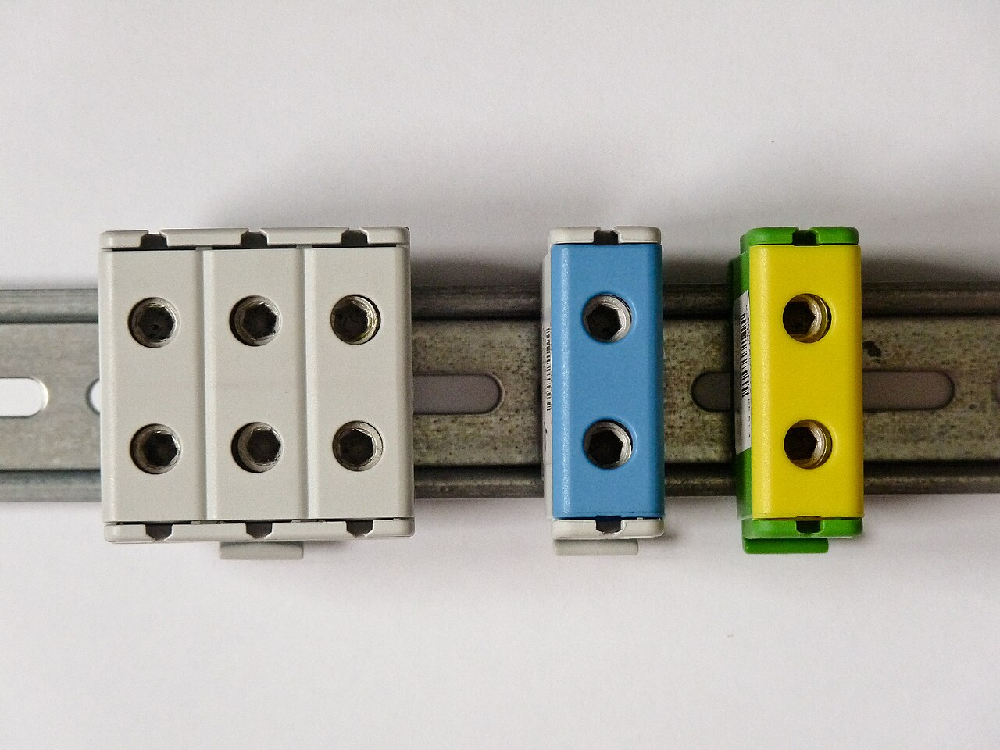

# 05.07 — Miedź a aluminium

> **Moduł:** [05 — Przewody i kable](README.md) · **Oznaczenia:** 🏠📋 · **Zakres SEP:** (a) (c) · **Status:** ✅ pełny
>
> **Czytaj:**
>
> - Opór i rezystywność: [01.03](../01-prad-napiecie-opor/01.03-opor-i-prawo-ohma.md)
> - Stare instalacje aluminiowe: [moduł 21](../21-stare-instalacje/README.md)
> - [Warunki techniczne, § 183 (wersja archiwalna)](https://arslege.pl/warunki-techniczne-dotyczace-instalacji-elektrycznych/k218/a23331/)

[← poprzedni temat](05.06-przewody-bezhalogenowe-i-kable-ziemne.md) · [spis modułu](README.md) · (koniec modułu) →

## Po co to jest

W blokach z lat 60.–80. wiele instalacji wykonano przewodami aluminiowymi. Do dziś trafiają się w mieszkaniach i są częstą przyczyną grzania się gniazd i puszek. Trzeba wiedzieć, dlaczego aluminium sprawia kłopoty, jak je bezpiecznie łączyć z miedzią i dlaczego w nowych instalacjach w budynkach stosuje się miedź.

## Po ludzku

**Aluminium przewodzi gorzej.** Ma rezystywność ok. 1,6 razy większą niż miedź. Żeby przenieść ten sam prąd, przewód aluminiowy musi mieć większy przekrój, mniej więcej o jeden stopień w typoszeregu (Al 4 mm² ≈ Cu 2,5 mm²).

**Ale gorsze przewodzenie to nie główny problem.** Kłopoty biorą się z połączeń:

1. **Tlenek.** Aluminium na powietrzu natychmiast pokrywa się twardą warstwą tlenku, który jest izolatorem. Połączenie bez jego usunięcia i bez pasty ma dużą rezystancję styku.
2. **Płynięcie.** Aluminium pod stałym naciskiem śruby powoli „ucieka” spod niej. Zacisk, który był dokręcony, po latach jest luźny.
3. **Rozszerzalność cieplna.** Aluminium przy nagrzewaniu rozszerza się bardziej niż miedź i stal. Każde nagrzanie i ostygnięcie lekko poluzowuje połączenie.
4. **Kruchość.** Drut aluminiowy kilka razy zgięty w tym samym miejscu pęka.
5. **Korozja na styku z miedzią.** Al i Cu w obecności wilgoci tworzą ogniwo galwaniczne i aluminium koroduje.

Efekt: luźne, utlenione połączenie ma rosnącą rezystancję, więc się grzeje, przez co utlenia się szybciej. Kończy się to stopioną puszką albo pożarem ([04.05](../04-prad-a-czlowiek/04.05-luk-elektryczny-i-oparzenia.md)).

**Dlatego** w budynkach od lat stosuje się w instalacjach przewody miedziane. Wcześniejsze warunki techniczne budynków (§ 183 rozporządzenia z 2002 r.) wymagały wprost żył miedzianych przy przekrojach do 10 mm². Aluminium zostało w przyłączach i liniach zasilających o dużych przekrojach (kable YAKXS), gdzie połączenia wykonuje się specjalnymi zaciskami.

## Jak to wygląda

*Na co patrzeć: złączki dopuszczone do łączenia Al z Cu mają to wyraźnie opisane przez producenta (oznaczenie Al/Cu). Zwykła złączka do miedzi nie jest do tego przeznaczona, nawet jeśli przewód aluminiowy da się do niej włożyć.*

## Pojęcia

| Pojęcie | Po ludzku | Termin normowy / symbol |
|---------|-----------|-------------------------|
| Rezystywność | Jak bardzo materiał „opiera się” prądowi | ρ [Ω·mm²/m] |
| Konduktywność | Odwrotność rezystywności | γ [m/(Ω·mm²)] |
| Płynięcie | Powolne odkształcanie metalu pod stałym naciskiem | pełzanie |
| Korozja galwaniczna | Niszczenie styku dwóch różnych metali w wilgoci | — |
| Złączka Al/Cu | Złączka dopuszczona do łączenia aluminium z miedzią | oznaczenie Al/Cu |

## Liczby do zapamiętania

| Wielkość | Wartość | Kiedy obowiązuje | Źródło |
|----------|---------|------------------|--------|
| Rezystywność Cu | **0,0175 Ω·mm²/m** (γ ≈ 56–57) | 20 °C | dane materiałowe |
| Rezystywność Al | **0,0286 Ω·mm²/m** (γ ≈ 34–35) | 20 °C | jw. |
| Al / Cu | rezystancja ok. **1,6×** większa | ten sam przekrój | — |
| Odpowiednik przekroju | Al 4 mm² ≈ Cu 2,5 mm² | obciążalność | PN-HD 60364-5-52 |
| Wymóg żył Cu (dawne WT, § 183) | do **10 mm²** | instalacje w budynkach | rozporządzenie z 2002 r. |

## W praktyce

- **Instalacja aluminiowa w mieszkaniu:** najlepiej wymienić całą. Jeśli to niemożliwe od razu — przejrzeć wszystkie połączenia, wymienić osprzęt na przystosowany do Al, dokręcić zaciski, sprawdzić stan izolacji ([moduł 21](../21-stare-instalacje/README.md)).
- **Łączenie Al z Cu** tylko złączkami dopuszczonymi do tego przez producenta (często z pastą stykową), nigdy przez skręcenie przewodów.
- **Przed podłączeniem aluminium:** oczyścić żyłę z tlenku i od razu zabezpieczyć pastą, jeśli producent złączki tego wymaga. Nie zginać wielokrotnie w tym samym miejscu.
- **Okresowo sprawdzać** dokręcenie zacisków przewodów Al (np. w rozdzielnicy) — płynięcie aluminium to proces ciągły.

## Błędy i zagrożenia

- ⚠️ **Skręcenie żyły Al z żyłą Cu** — korozja i grzanie gwarantowane po kilku latach.
- ⚠️ **Dokładanie mocnych odbiorników** (czajnik, grzejnik olejowy) do starego obwodu aluminiowego 2,5 mm² — grzanie styków w gniazdach i puszkach.
- **Wielokrotne zginanie** drutu Al przy wymianie gniazda — pęknięcie w puszce, często w ścianie.
- **Zwykła złączka do miedzi użyta do aluminium.**

## Przykład

**Zadanie.** Stara instalacja: przewód aluminiowy 2,5 mm², długość obwodu 20 m. Nowa: przewód miedziany 2,5 mm² tej samej długości. Porównaj rezystancję pętli L–N (2 × 20 m).

$$R_{Al} = \frac{0{,}0286 \cdot 40}{2{,}5} \approx 0{,}46\ \Omega \qquad R_{Cu} = \frac{0{,}0175 \cdot 40}{2{,}5} = 0{,}28\ \Omega$$

Przy prądzie 16 A moc tracona w przewodach: Al $16^2 \cdot 0{,}46 \approx 117\ \mathrm{W}$, Cu $16^2 \cdot 0{,}28 \approx 72\ \mathrm{W}$.

**Wniosek.** Aluminium grzeje się wyraźniej, a do tego dochodzą straty na każdym gorszym połączeniu. W puszce z kilkoma takimi stykami potrafi się zrobić naprawdę gorąco.

## Pytania SEP

1. **Jakie są wady przewodów aluminiowych w porównaniu z miedzianymi?**

Odpowiedź

Większa rezystywność (ok. 1,6 razy), więc potrzebny większy przekrój dla tego samego prądu. Szybkie pokrywanie się warstwą izolującego tlenku. Płynięcie pod naciskiem, przez co połączenia śrubowe się luzują. Większa rozszerzalność cieplna. Kruchość przy wielokrotnym zginaniu. Korozja galwaniczna na styku z miedzią. W efekcie połączenia aluminiowe są zawodne i mogą się grzać.

2. **Jak należy łączyć przewody aluminiowe z miedzianymi?**

Odpowiedź

Za pomocą złączek lub zacisków przeznaczonych do łączenia Al z Cu (oznaczonych przez producenta), często z pastą stykową, po oczyszczeniu żyły aluminiowej z tlenku. Nie wolno łączyć ich przez skręcanie ani w zwykłych złączkach przeznaczonych tylko dla miedzi.

## Sprawdź się

1. Dlaczego połączenie aluminiowe, które przez lata działało dobrze, nagle zaczyna się grzać?

Odpowiedź

Aluminium powoli płynie spod zacisku i rozszerza się przy każdym nagrzaniu, więc zacisk luzuje się stopniowo. Na luźnym styku narasta tlenek, rezystancja rośnie, styk grzeje się mocniej, a to przyspiesza utlenianie. Proces sam się nakręca.

## Źródła

- [Rozporządzenie w sprawie warunków technicznych budynków (2002), § 183 — wersja archiwalna](https://arslege.pl/warunki-techniczne-dotyczace-instalacji-elektrycznych/k218/a23331/) — żyły miedziane do 10 mm². Uwaga: rozporządzenie straciło moc 20.09.2026, a nowe warunki techniczne nie były jeszcze ogłoszone ([stan na październik 2026](https://coreltb.pl/baza-wiedzy/warunki-techniczne-2026/)). Art. 102a Prawa budowlanego pozwala przez 18 miesięcy projektować według dawnych przepisów.
- PN-HD 60364-5-52 — obciążalność przewodów Al i Cu, połączenia (526).

---

[← poprzedni temat](05.06-przewody-bezhalogenowe-i-kable-ziemne.md) · [spis modułu](README.md) · (koniec modułu) →
