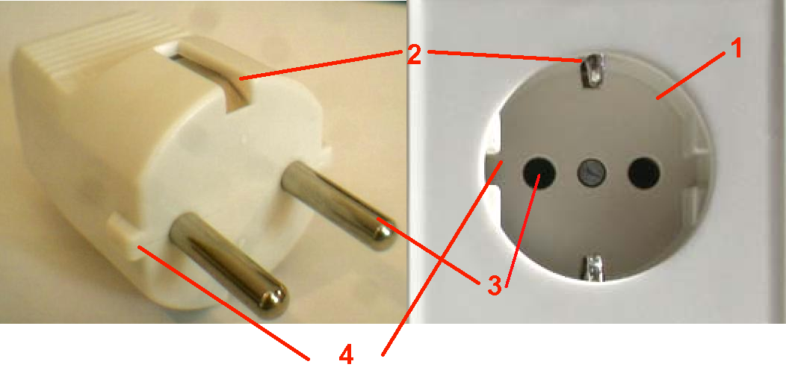
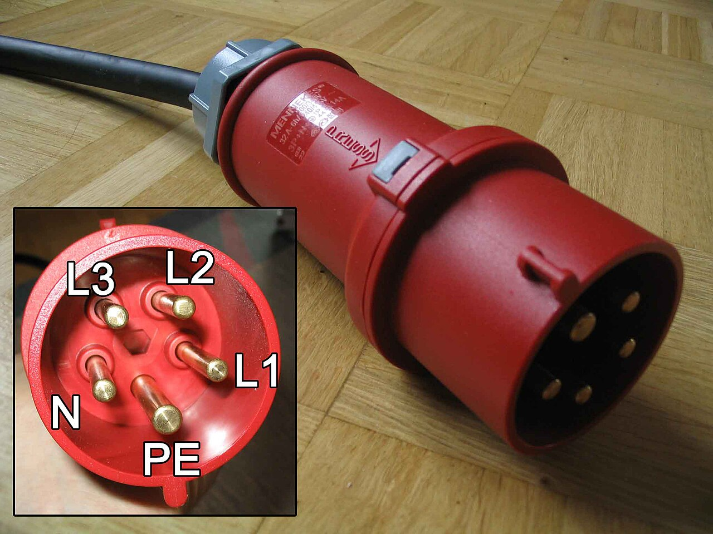
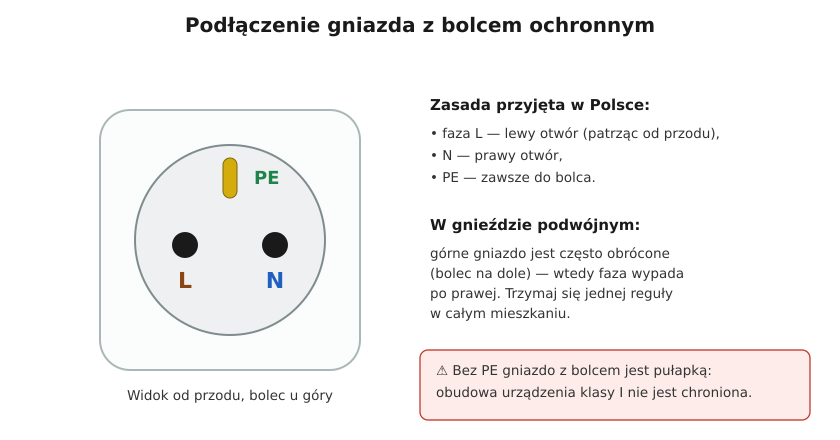

# 06.01 — Gniazda wtyczkowe: jednofazowe, z bolcem ochronnym, trójfazowe

> **Moduł:** [06 — Osprzęt instalacyjny](README.md) · **Oznaczenia:** 🏠 · **Zakres SEP:** (a) (c) · **Status:** ✅ pełny
>
> **Czytaj:**
>
> - [Gniazda elektryczne — zasady montażu (Murator)](https://muratordom.pl/galeria/gniazda-elektryczne-dobre-zasady-montazu-ktorych-trzymaja-sie-elektrycy/gg-mNro-U1xH-5ov9/gp-KQeh-v3c9-qAAM) — strona fazy w gnieździe
> - PN-IEC 60884-1 (gniazda domowe), PN-EN 60309 (gniazda przemysłowe CEE)
> - Planowanie liczby gniazd i obwodów: [moduł 16](../16-planowanie-obwodow/README.md)

← (początek modułu) · [spis modułu](README.md) · [następny temat →](06.02-laczniki-jednobiegunowy-dwubiegunowy.md)

## Po co to jest

Gniazdo to punkt, w którym instalacja spotyka się z odbiornikiem i z człowiekiem. Źle podłączone gniazdo (bez PE, z luźnym zaciskiem, z zamienionymi przewodami) jest przyczyną porażeń i pożarów. Na egzaminie: budowa gniazda ze stykiem ochronnym i jego prawidłowe podłączenie.

## Po ludzku

**Gniazdo w Polsce** to gniazdo typu E: dwa otwory na bolce wtyczki i wystający **bolec ochronny**. Bolec łączy się z PE. Wtyczka urządzenia klasy I ma w tym miejscu otwór, który przy wkładaniu nasuwa się na bolec. Dzięki temu PE łączy się wcześniej niż L i N, a rozłącza później.

W Niemczech jest gniazdo **Schuko** (typ F) — zamiast bolca ma dwa sprężynujące styki ochronne po bokach. Większość współczesnych wtyczek (CEE 7/7) pasuje do obu gniazd.

**Gniazdo jednofazowe ma 16 A i 250 V.** Wtyczka nie wie, ile może pobrać obwód, więc to zabezpieczenie obwodu (zwykle B16) chroni przewód przed przeciążeniem przez kilka odbiorników naraz.

**Jak podłączyć?** W Polsce przyjęło się, że patrząc na gniazdo od przodu, z bolcem u góry, **faza L jest po lewej**, a N po prawej. To nie wpływa na działanie odbiornika, ale ułatwia pomiary i porządek w instalacji. PE zawsze idzie na zacisk bolca.

**Gniazda siłowe (CEE, PN-EN 60309)** mają kolor zależny od napięcia: **niebieskie 230 V** (3 styki), **czerwone 400 V** (4 lub 5 styków). Styki są ułożone tak, że wtyczki innego napięcia nie da się włożyć. W gniazdach trójfazowych zachowuje się jednakową kolejność faz w całej instalacji, żeby silniki kręciły się w tę samą stronę ([02.03](../02-prad-przemienny-230-400/02.03-uklad-trojfazowy-230-v-i-400-v-kolejnosc-faz.md)).

**Przydatne odmiany:** gniazda z przesłonami torów prądowych (nie da się wsunąć gwoździa w jeden otwór), gniazda bryzgoszczelne z klapką (IP44) do łazienek i na zewnątrz, gniazda z uziemieniem do szyn w rozdzielnicach.

## Jak to wygląda

*Na co patrzeć: to gniazdo Schuko (typ F) — zamiast bolca ma boczne sprężynujące styki ochronne, a wtyczka ma po bokach metalowe blaszki. W polskim gnieździe typu E w tym miejscu jest bolec u góry wnęki. Obie wersje robią to samo: łączą obudowę urządzenia z PE, zanim bolce wtyczki dotkną L i N.*

*Na co patrzeć: styk PE jest grubszy od pozostałych, a w gnieździe jest wnęka, która ustawia wtyczkę tylko w jednej pozycji. Kolor czerwony oznacza 400 V. Gniazdo niebieskie (230 V) ma inny rozstaw i wtyczka czerwona do niego nie wejdzie.*

## Schemat

## Pojęcia

| Pojęcie | Po ludzku | Termin normowy / symbol |
|---------|-----------|-------------------------|
| Gniazdo ze stykiem ochronnym | Gniazdo z bolcem (E) lub ze stykami bocznymi (F) | typ E, typ F, CEE 7/5, CEE 7/4 |
| Przesłony torów prądowych | Klapki w otworach, „ochrona przed dziećmi” | — |
| Gniazdo siłowe | Przemysłowe gniazdo 230/400 V | PN-EN 60309, „CEE” |
| Prąd znamionowy gniazda | Ile prądu wytrzymują styki gniazda | 16 A |

## Liczby do zapamiętania

| Wielkość | Wartość | Kiedy obowiązuje | Źródło |
|----------|---------|------------------|--------|
| Gniazdo jednofazowe domowe | **16 A, 250 V** | typ E / F | PN-IEC 60884-1 |
| Typowe zabezpieczenie obwodu gniazd | **B16**, przewód **2,5 mm²** | mieszkania | praktyka, N SEP-E-002 |
| Moc „na obwód” przy B16 | ok. **3,7 kW** | 230 V × 16 A | obliczenie |
| Faza w gnieździe | **lewy otwór** (patrząc od przodu, bolec u góry) | zasada przyjęta w Polsce | praktyka montażowa |
| Gniazdo siłowe niebieskie / czerwone | **230 V / 400 V** | CEE | PN-EN 60309 |
| Ochrona różnicowoprądowa gniazd | RCD **≤ 30 mA** | gniazda do 32 A | PN-HD 60364-4-41, 411.3.3 |

## W praktyce

Wymiana gniazda krok po kroku:

1. Wyłącz obwód, zabezpiecz przed załączeniem, **sprawdź brak napięcia** na wszystkich żyłach ([00.02](../00-bezpieczenstwo-najpierw/00.02-sprawdzanie-braku-napiecia-probnik-dwubiegunowy.md)).
2. Zdejmij stare gniazdo, zanotuj (zdjęcie!), co było gdzie. Sprawdź, czy przewody nie są przegrzane i kruche.
3. Skróć i odizoluj końce, jeśli są zniszczone. Długość odizolowania zgodna z oznaczeniem na gnieździe.
4. Podłącz **najpierw PE** do zacisku bolca, potem L (lewy) i N (prawy). Jeśli z puszki biegnie przewód do kolejnego gniazda, użyj zacisków podwójnych gniazda albo złączek ([06.04](06.04-zlaczki-i-laczenie-przewodow-dlaczego-nie.md)) — nie zakładaj dwóch żył pod jeden zacisk, który nie jest do tego przeznaczony.
5. Sprawdź dokręcenie (pociągnij każdą żyłę), zamontuj gniazdo w puszce, załącz obwód.
6. Sprawdź **testerem gniazd** albo miernikiem: obecność fazy w lewym otworze, PE na bolcu, napięcie L–N i L–PE. Naciśnij TEST na różnicówce.

## Błędy i zagrożenia

- ⚠️ **Gniazdo z bolcem bez podłączonego PE** — wygląda bezpiecznie, a obudowa urządzenia klasy I nie jest chroniona.
- ⚠️ **„Mostek” N–PE w gnieździe** (tzw. zerowanie w gnieździe w układzie TN-S za różnicówką) — różnicówka wybija, a w razie przerwy N obudowy dostają napięcie.
- **Luźny zacisk** — gniazdo grzeje się przy dużym obciążeniu, plastik ciemnieje i się topi.
- **Listwy wtykane jedna w drugą** zamiast dodatkowego gniazda — przeciążony jeden punkt styku.

## Przykład

**Sytuacja.** W kuchni na jednym gnieździe podwójnym pracują czajnik 2,2 kW i mikrofalówka 1,2 kW. Gniazdo jest ciepłe w dotyku, a plastik wokół jednego otworu zmienił kolor.

**Obliczenie.**

$$I = \frac{2200 + 1200}{230} \approx 14{,}8\ \mathrm{A}$$

To mieści się w 16 A gniazda i nie wyłącza B16. Gniazdo nie powinno się grzać. Jeśli się grzeje, przyczyną jest **połączenie**: luźny zacisk, zużyte sprężyny styków albo wypalona miedź.

**Co zrobić.** Wymienić gniazdo, sprawdzić stan żył (obciąć przegrzane końce). Na przyszłość rozdzielić mocne odbiorniki kuchenne na osobne obwody ([moduł 16](../16-planowanie-obwodow/README.md)).

## Pytania SEP

1. **Jak prawidłowo podłączyć gniazdo wtyczkowe ze stykiem ochronnym?**

Odpowiedź

Przewód ochronny PE (żółto-zielony) do zacisku styku ochronnego (bolca), przewód fazowy L do lewego otworu, a neutralny N do prawego, patrząc na gniazdo od przodu z bolcem u góry (zasada przyjęta w Polsce). Połączenia muszą być pewne, a styk ochronny musi łączyć się z PE w instalacji. Obwód gniazd powinien być objęty ochroną różnicowoprądową 30 mA.

2. **Dlaczego styk ochronny w gnieździe musi łączyć się wcześniej niż styki fazowe?**

Odpowiedź

Żeby obudowa urządzenia klasy I była połączona z PE, zanim pojawi się na niej możliwe napięcie przy uszkodzeniu izolacji, i rozłączona dopiero po odłączeniu zasilania. Zapewnia to budowa gniazda i wtyczki: bolec ochronny jest dłuższy i wchodzi w otwór wtyczki wcześniej niż jej bolce w otwory gniazda.

3. **Jakie gniazda wymagają ochrony uzupełniającej wyłącznikiem różnicowoprądowym?**

Odpowiedź

Według PN-HD 60364-4-41:2017 gniazda wtyczkowe o prądzie znamionowym do 32 A przeznaczone do użytkowania przez osoby niewykwalifikowane i do ogólnego użytku — wyłącznikiem o IΔn ≤ 30 mA. Dotyczy to też urządzeń ruchomych do 32 A używanych na zewnątrz.

## Sprawdź się

1. Masz gniazdo siłowe czerwone i wtyczkę niebieską. Czy wtyczka wejdzie? Dlaczego?

Odpowiedź

Nie. Gniazda CEE mają kodowanie napięcia (położenie wnęki i liczba styków), więc wtyczki 230 V nie da się włożyć do gniazda 400 V i odwrotnie.

2. Tester gniazd pokazuje „brak PE”. Jakie mogą być przyczyny?

Odpowiedź

PE niepodłączony w gnieździe, przerwany w puszce lub na trasie, niepodłączony w rozdzielnicy albo instalacja dwuprzewodowa (bez PE), w której ktoś zamontował gniazdo z bolcem.

## Źródła

- PN-IEC 60884-1 — wtyczki i gniazda wtyczkowe do użytku domowego.
- PN-EN 60309 — wtyczki, gniazda i złącza do celów przemysłowych.
- PN-HD 60364-4-41:2017 — 411.3.3 (RCD 30 mA dla gniazd do 32 A).
- [Murator — zasady montażu gniazd](https://muratordom.pl/galeria/gniazda-elektryczne-dobre-zasady-montazu-ktorych-trzymaja-sie-elektrycy/gg-mNro-U1xH-5ov9/gp-KQeh-v3c9-qAAM) — faza po lewej przy bolcu u góry, odwrócone górne gniazdo w gniazdach podwójnych.

---

← (początek modułu) · [spis modułu](README.md) · [następny temat →](06.02-laczniki-jednobiegunowy-dwubiegunowy.md)
