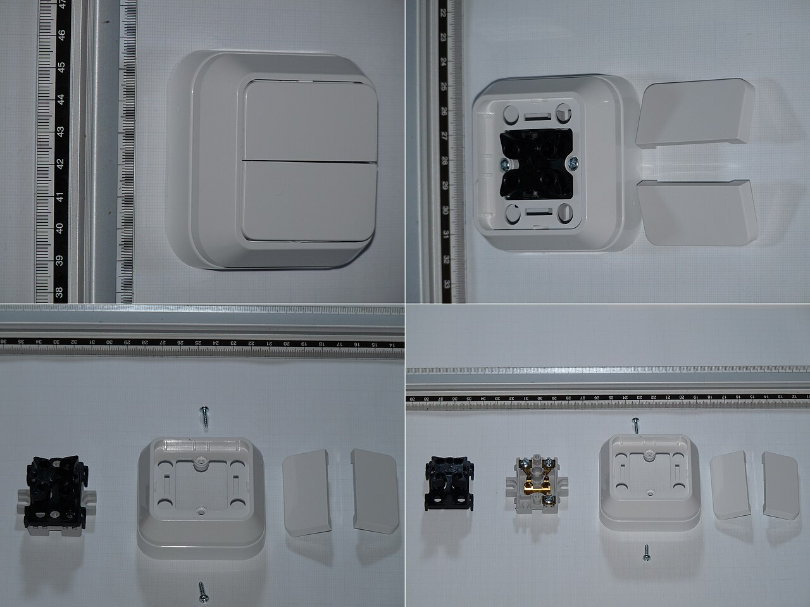
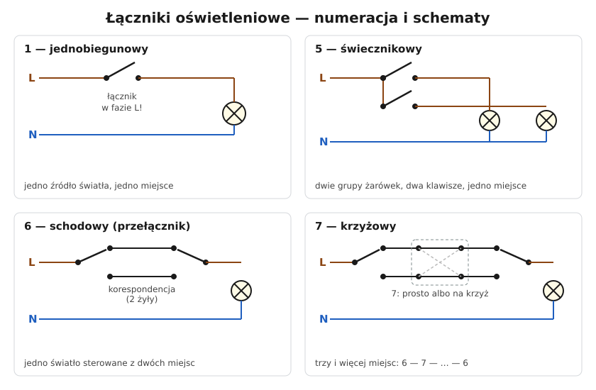

# 06.02 — Łączniki: jednobiegunowy, dwubiegunowy, świecznikowy, schodowy, krzyżowy

> **Moduł:** [06 — Osprzęt instalacyjny](README.md) · **Oznaczenia:** 🏠 · **Zakres SEP:** (a) (c) · **Status:** ✅ pełny
>
> **Czytaj:**
>
> - PN-EN 60669-1 — łączniki do instalacji domowych
> - Lampy, źródła LED i prądy rozruchowe: [moduł 18](../18-oswietlenie/README.md)
> - Przekaźniki bistabilne i sterowanie: [moduł 27](../27-inteligentny-dom/README.md)

[← poprzedni temat](06.01-gniazda-wtyczkowe-jednofazowe-z-bolcem.md) · [spis modułu](README.md) · [następny temat →](06.03-puszki-instalacyjne-i-rozgalezne.md)

## Po co to jest

Łączniki są najprostszym osprzętem, a mimo to często źle podłączane. Najczęstszy błąd: łącznik przerywa przewód N zamiast fazy, więc oprawa jest pod napięciem nawet przy zgaszonym świetle. Na egzaminie: rodzaje łączników i zasada, w którym przewodzie umieszcza się łącznik.

## Po ludzku

W Polsce łączniki oświetleniowe mają numery:

| Nr | Nazwa | Co robi |
|----|-------|---------|
| **1** | jednobiegunowy | włącza jedno źródło z jednego miejsca |
| **2** | dwubiegunowy | przerywa jednocześnie L i N (np. wentylator, podgrzewacz) |
| **5** | świecznikowy | dwa klawisze, dwie grupy żarówek, jedna faza zasilająca |
| **6** | schodowy (przełącznik) | jedno światło z dwóch miejsc |
| **7** | krzyżowy | z trzech i więcej miejsc, montowany między dwoma „szóstkami” |
| — | przyciskowy (dzwonkowy) | zwiera tylko na czas naciśnięcia; dzwonek, przekaźnik bistabilny |

**Łącznik zawsze przerywa fazę.** Gdy łącznik jest w przewodzie L, po wyłączeniu na oprawie nie ma napięcia (poza N, które ma potencjał bliski ziemi). Gdy łącznik jest w N, zgaszona lampa ma fazę na oprawce. Wymieniając żarówkę, można dostać porażenie.

**Łącznik schodowy** to przełącznik: zawsze łączy wspólny zacisk z jednym z dwóch pozostałych. Między dwoma łącznikami biegną dwie żyły **korespondencyjne**. Zmiana położenia któregokolwiek łącznika zmienia stan lampy.

**Łącznik krzyżowy** zamienia żyły korespondencyjne miejscami: raz łączy je prosto, raz na krzyż. Każdy kolejny „siódemka” w łańcuchu dodaje jedno miejsce sterowania.

**Prąd znamionowy** łączników domowych to zwykle 10 A. Oznaczenie **AX** (np. 10 AX) mówi, że łącznik wytrzymuje duże prądy załączania obciążeń pojemnościowych i indukcyjnych, typowych dla zasilaczy LED i świetlówek ([moduł 18](../18-oswietlenie/README.md)).

## Jak to wygląda

*Na co patrzeć: pod klawiszem jest wkład (mechanizm) z zaciskami i kołyską styków. W łączniku schodowym są trzy zaciski: wspólny (często oznaczony L albo innym kolorem śruby) i dwa korespondencyjne. Przy wymianie zanotuj, która żyła była na zacisku wspólnym — to najczęstsze źródło pomyłek.*

## Schemat

## Pojęcia

| Pojęcie | Po ludzku | Termin normowy / symbol |
|---------|-----------|-------------------------|
| Łącznik jednobiegunowy | Przerywa jeden przewód | „1” |
| Łącznik świecznikowy | Dwa klawisze, wspólne zasilanie | „5” |
| Łącznik schodowy | Przełącznik do sterowania z dwóch miejsc | „6” |
| Łącznik krzyżowy | Zamienia dwie żyły „prosto / na krzyż” | „7” |
| Żyły korespondencyjne | Dwie żyły między łącznikami schodowymi | — |
| Przewód łącznikowy | Żyła od łącznika do lampy (przełączana faza) | — |
| AX | Odporność na prądy załączania (LED, świetlówki) | PN-EN 60669-1 |

## Liczby do zapamiętania

| Wielkość | Wartość | Kiedy obowiązuje | Źródło |
|----------|---------|------------------|--------|
| Prąd znamionowy łącznika domowego | zwykle **10 A** (10 AX), 250 V | — | PN-EN 60669-1, dane producentów |
| Liczba żył między łącznikami schodowymi | **2** korespondencyjne | + PE, jeśli łącznik jest w obudowie metalowej / dla porządku | — |
| Łącznik krzyżowy | **4** zaciski | — | — |
| Łącznik schodowy | **3** zaciski | — | — |

## W praktyce

- **Przed wymianą łącznika** zrób zdjęcie podłączenia. W schodowym zaznacz zacisk wspólny.
- **Sprawdź, czy łącznik przerywa fazę:** przy wyłączonym łączniku na oprawce lampy nie może być napięcia względem PE (pomiar miernikiem, nie neonówką). Jeśli jest — łącznik siedzi w N i trzeba poprawić połączenia w puszce.
- **Żyły niebieskie** użyte jako korespondencyjne albo jako przewód łącznikowy oznacz na końcach brązową lub czarną koszulką.
- **Do LED** dobieraj łączniki AX i pamiętaj, że podświetlenie łącznika (lampka orientacyjna) może powodować żarzenie się LED po wyłączeniu ([moduł 18](../18-oswietlenie/README.md)).
- **Więcej niż trzy miejsca sterowania** — rozważ przyciski i przekaźnik bistabilny zamiast łańcucha łączników krzyżowych ([moduł 27](../27-inteligentny-dom/README.md)).

## Błędy i zagrożenia

- ⚠️ **Łącznik w przewodzie N** — oprawa pod napięciem przy zgaszonym świetle; porażenie przy wymianie żarówki.
- ⚠️ **„Sprawdzenie” wyłączenia światła łącznikiem zamiast wyłącznikiem w rozdzielnicy** przed pracą przy lampie — przy łączniku w N albo przy błędzie w puszce faza dalej jest na oprawie.
- **Pomylony zacisk wspólny w łączniku schodowym** — światło działa tylko w niektórych kombinacjach położeń.
- **Łącznik bez oznaczenia AX przy dużej liczbie zasilaczy LED** — sklejanie się styków.

## Przykład

**Sytuacja.** Po wymianie łączników w korytarzu światło zapala się z dolnego łącznika tylko wtedy, gdy górny jest w jednym położeniu.

**Diagnoza.** W jednym z łączników schodowych na zacisku wspólnym jest żyła korespondencyjna, a na zacisku korespondencyjnym — zasilanie (albo przewód do lampy). Taki łącznik nie przełącza między korespondencjami, tylko przerywa jedną z nich.

**Naprawa.** Wyłączyć obwód. W puszce przy łączniku znaleźć żyłę zasilającą (dolny łącznik) lub żyłę do lampy (górny łącznik) i podłączyć ją na zacisk wspólny. Dwie pozostałe żyły to korespondencja.

## Pytania SEP

1. **W którym przewodzie należy umieszczać łącznik jednobiegunowy i dlaczego?**

Odpowiedź

W przewodzie fazowym L. Wtedy po wyłączeniu łącznika oprawa i odbiornik są odłączone od fazy, więc przy wymianie żarówki lub dotknięciu oprawy nie ma niebezpieczeństwa porażenia. Łącznik w przewodzie neutralnym zostawia fazę na oprawie przy zgaszonym świetle.

2. **Do czego służą łączniki schodowe i krzyżowe?**

Odpowiedź

Łączniki schodowe (dwa) pozwalają sterować jednym obwodem oświetlenia z dwóch miejsc, np. na dole i na górze schodów. Łącznik krzyżowy, włączany między dwa łączniki schodowe, pozwala dodać kolejne miejsca sterowania — każdy kolejny krzyżowy to jedno miejsce więcej.

3. **Czym różni się łącznik świecznikowy od dwóch łączników jednobiegunowych?**

Odpowiedź

Łącznik świecznikowy ma jeden zacisk zasilający wspólny dla dwóch klawiszy i dwa zaciski wyjściowe — steruje dwiema grupami źródeł światła tej samej oprawy (np. żyrandola) przewodem 3-żyłowym od łącznika do oprawy (dwie przełączane fazy i N) oraz PE. Dwa łączniki jednobiegunowe są osobnymi aparatami, każdy z własnym zasilaniem.

## Sprawdź się

1. Ile żył (bez PE) musi mieć przewód między łącznikiem świecznikowym a żyrandolem z dwiema grupami żarówek?

Odpowiedź

Trzy: dwie przełączane fazy (po jednej na grupę) i N. Z PE — cztery.

2. Światło sterowane z czterech miejsc. Jakich łączników potrzebujesz?

Odpowiedź

Dwóch schodowych (6) na końcach i dwóch krzyżowych (7) pomiędzy nimi.

## Źródła

- PN-EN 60669-1 — łączniki do stałych instalacji elektrycznych domowych i podobnych.
- PN-HD 60364-4-46 — odłączanie izolacyjne i łączenie (łącznik nie zastępuje odłączenia przy pracach).

---

[← poprzedni temat](06.01-gniazda-wtyczkowe-jednofazowe-z-bolcem.md) · [spis modułu](README.md) · [następny temat →](06.03-puszki-instalacyjne-i-rozgalezne.md)
