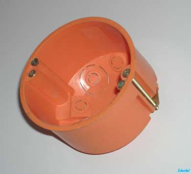
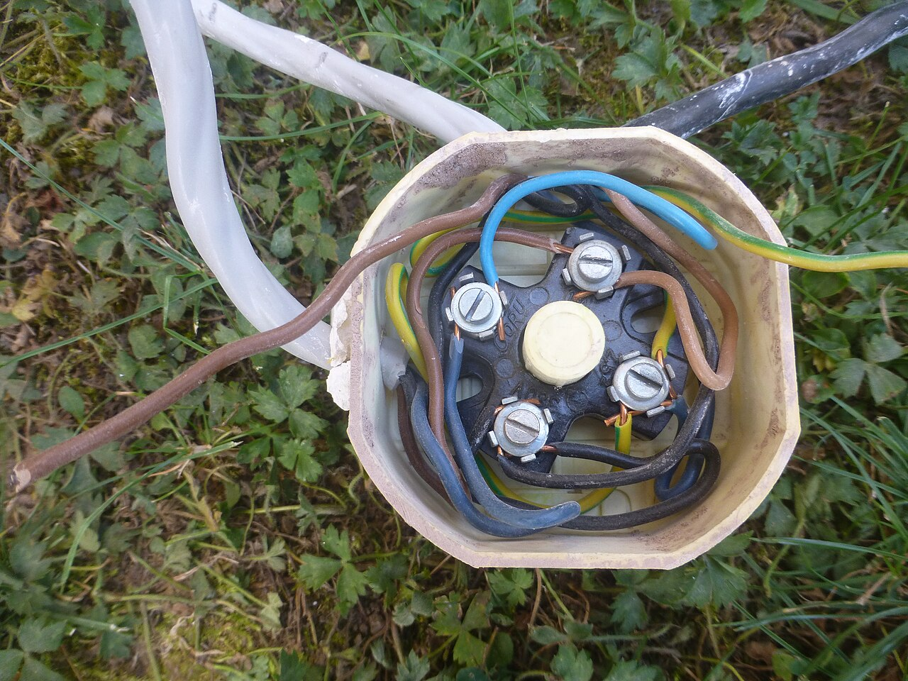
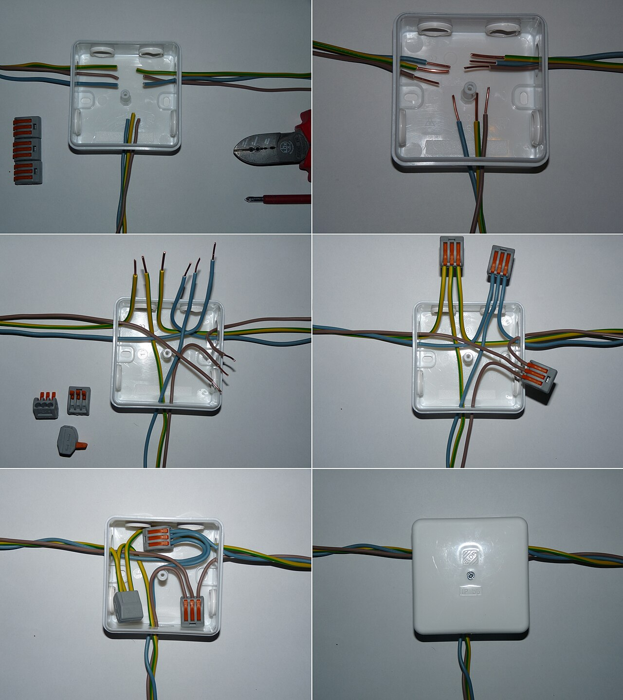

# 06.03 — Puszki instalacyjne i rozgałęźne

> **Moduł:** [06 — Osprzęt instalacyjny](README.md) · **Oznaczenia:** 🏠 · **Zakres SEP:** (a) (c) · **Status:** ✅ pełny
>
> **Czytaj:**
>
> - PN-HD 60364-5-52, 526 — połączenia i ich dostępność
> - PN-EN 60670-1 — puszki i obudowy osprzętu
> - Złączki: [06.04](06.04-zlaczki-i-laczenie-przewodow-dlaczego-nie.md)

[← poprzedni temat](06.02-laczniki-jednobiegunowy-dwubiegunowy.md) · [spis modułu](README.md) · [następny temat →](06.04-zlaczki-i-laczenie-przewodow-dlaczego-nie.md)

## Po co to jest

Puszka to miejsce, gdzie przewody się rozgałęziają albo gdzie siedzi gniazdo i łącznik. Właśnie w puszkach powstaje większość usterek: luźne połączenia, przegrzane złączki, zalane wodą zaciski. Trzeba wiedzieć, jaką puszkę dobrać i jak w niej łączyć, żeby dało się ją później otworzyć i sprawdzić.

## Po ludzku

**Rodzaje puszek:**

- **Puszka osprzętowa (podtynkowa)** — okrągła, standardowo średnica 60 mm („fi 60”). Montuje się w niej gniazdo lub łącznik na łapkach albo wkrętach. Wersje **głębokie** (ok. 60 mm) mają miejsce na złączki za osprzętem.
- **Puszka do ścian g-k** — ma łapki, które zaciskają się od tyłu płyty po dokręceniu śrub. Montuje się ją w otworze wyciętym otwornicą.
- **Puszka rozgałęźna (instalacyjna)** — z pokrywą, czasem z listwą zaciskową. Służy do łączenia przewodów bez osprzętu, np. na trasie między gniazdami albo nad drzwiami przy łączniku.
- **Puszka natynkowa hermetyczna** — w piwnicy, garażu, na zewnątrz. Ma dławiki lub przepusty i stopień ochrony np. IP55 ([06.05](06.05-stopnie-ochrony-ip.md)).

**Połączenia muszą być dostępne.** Norma wymaga, żeby połączenia przewodów dało się obejrzeć, sprawdzić i poprawić. Puszki rozgałęźnej nie wolno zatynkować na głucho ani zakryć płytką. Wyjątkiem są połączenia przeznaczone do zatopienia (np. zaprasowywane, połączenia kabli w ziemi w mufach).

**Coraz częściej wszystkie połączenia robi się w puszkach osprzętowych**: przewód idzie od gniazda do gniazda, a złączki siedzą w głębokiej puszce za gniazdem. Dostęp do połączenia jest po zdjęciu gniazda.

## Jak to wygląda

*Na co patrzeć: śruby po bokach dociągają łapki, które od tyłu zaciskają się na płycie. Puszka trzyma się samej płyty, bez kleju i zaprawy. Za płytą często jest wełna — pamiętaj o obciążalności przewodów ([05.05](../05-przewody-i-kable/05.05-sposoby-ukladania-przewodow-a1-b1-c-e-i-ich.md)).*

*Na co patrzeć: starszy typ puszki rozgałęźnej z kostką śrubową. Każda żyła siedzi pod swoją śrubą, ale śruby trzeba co jakiś czas dociągać. W nowych instalacjach zamiast kostek stosuje się złączki sprężynowe.*

*Na co patrzeć: przewody wchodzą przez elastyczne przepusty, żyły są przycięte na równą długość i połączone złączkami według kolorów. Zapas długości żył pozwala później poprawić połączenie. Pokrywa jest przykręcona, a nie zatynkowana.*

## Pojęcia

| Pojęcie | Po ludzku | Termin normowy / symbol |
|---------|-----------|-------------------------|
| Puszka osprzętowa | Puszka pod gniazdo lub łącznik | puszka podtynkowa, fi 60 |
| Puszka rozgałęźna | Puszka do łączenia przewodów | puszka odgałęźna, instalacyjna |
| Puszka głęboka | Puszka osprzętowa z miejscem na złączki | — |
| Dławik / przepust | Wejście przewodu do puszki z uszczelnieniem | — |
| Dostępność połączeń | Połączenie można obejrzeć i poprawić | PN-HD 60364-5-52, 526.3 |

## Liczby do zapamiętania

| Wielkość | Wartość | Kiedy obowiązuje | Źródło |
|----------|---------|------------------|--------|
| Średnica standardowej puszki osprzętowej | **60 mm** | osprzęt podtynkowy | normy i katalogi producentów |
| Rozstaw puszek w ramce wielokrotnej | **71 mm** | typowy system ramek | katalogi producentów |
| Głębokość puszki płytkiej / głębokiej | ok. **40 / 60 mm** | — | jw. |
| Puszka na zewnątrz, w garażu | zwykle **IP44–IP55** i więcej | wg warunków | PN-EN 60529, projekt |

## W praktyce

- **Planuj puszki** tam, gdzie będą dostępne: nie za szafą w zabudowie, nie pod płytkami.
- **Zostaw zapas przewodu** w puszce (ok. 10–15 cm), żeby po latach dało się obciąć zniszczony koniec i zrobić połączenie od nowa.
- **Nie upychaj** zbyt wielu złączek i przewodów w płytkiej puszce — połączenia się wyrywają, a gniazdo nie daje się wkręcić bez nacisku na przewody.
- **Puszki natynkowe** montuj przepustami w dół, żeby woda nie spływała po przewodzie do środka.
- **Puszki do ścian g-k** i puszki w ścianach drewnianych dobieraj z oznaczeniem do montażu w podłożu palnym, jeśli takie jest.

## Błędy i zagrożenia

- ⚠️ **Zatynkowana puszka rozgałęźna** — usterka „gdzieś w ścianie”, której nie da się znaleźć bez kucia, a przegrzewające się połączenie nikt nie zobaczy.
- ⚠️ **Puszka natynkowa bez przepustów lub z otworem od góry** na zewnątrz — woda w puszce, upływ, wybijanie różnicówki, korozja.
- **Za płytka puszka z dużą liczbą połączeń** — przewody wyrwane ze złączek przy dociskaniu gniazda.
- **Za krótkie żyły** — nie da się poprawić połączenia bez przedłużania przewodu.

## Przykład

**Sytuacja.** Po remoncie łazienki przestały działać dwa gniazda w przedpokoju. Elektryk znajduje przewód przerwany… nigdzie, bo wszystko jest pod płytkami i tynkiem.

**Prawdopodobna przyczyna.** Puszka rozgałęźna, przez którą szło zasilanie gniazd w przedpokoju, została zakryta płytkami. Przy wierceniu albo przez wilgoć połączenie w niej się rozłączyło.

**Lekcja.** Puszki rozgałęźne muszą zostać dostępne. Jeśli przeszkadzają w projekcie, połączenia przenosi się do puszek osprzętowych albo w miejsce, które zostanie dostępne. Przy remoncie dobrze jest mieć zdjęcia ścian z naniesionymi trasami.

## Pytania SEP

1. **Jakie wymagania muszą spełniać połączenia przewodów w instalacji?**

Odpowiedź

Połączenia muszą zapewniać trwałą ciągłość elektryczną i odpowiednią wytrzymałość mechaniczną, być wykonane osprzętem odpowiednim do materiału, liczby i przekroju żył, być chronione przed uszkodzeniem i wpływami otoczenia (osłona, puszka) i pozostawać dostępne do oględzin, badań i konserwacji, z wyjątkiem połączeń przeznaczonych do zatopienia, np. w ziemi lub w masie izolacyjnej (PN-HD 60364-5-52, 526).

2. **Do czego służą puszki rozgałęźne i osprzętowe?**

Odpowiedź

Puszki osprzętowe służą do montażu gniazd i łączników oraz (puszki głębokie) do wykonywania połączeń za osprzętem. Puszki rozgałęźne służą do łączenia i rozgałęziania przewodów na trasie instalacji. Obie chronią połączenia przed uszkodzeniem i oddzielają je od otoczenia.

## Sprawdź się

1. Na zdjęciu montażu puszki natynkowej: dlaczego żyły przycięto na równą długość, ale z zapasem?

Odpowiedź

Równa długość porządkuje połączenia i ułatwia zamknięcie pokrywy bez nacisku na złączki. Zapas pozwala w przyszłości odciąć uszkodzony koniec i podłączyć żyłę ponownie.

## Źródła

- PN-HD 60364-5-52 — 526 (połączenia elektryczne, dostępność połączeń).
- PN-EN 60670-1 — puszki i obudowy do sprzętu elektroinstalacyjnego.
- Katalogi producentów puszek (wymiary, montaż w ścianach g-k).

---

[← poprzedni temat](06.02-laczniki-jednobiegunowy-dwubiegunowy.md) · [spis modułu](README.md) · [następny temat →](06.04-zlaczki-i-laczenie-przewodow-dlaczego-nie.md)
