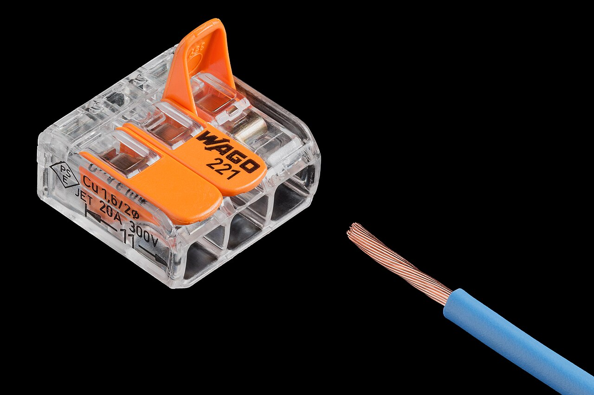
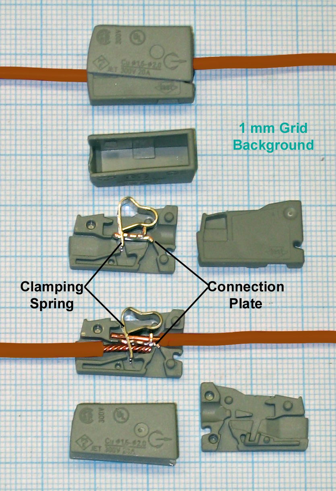
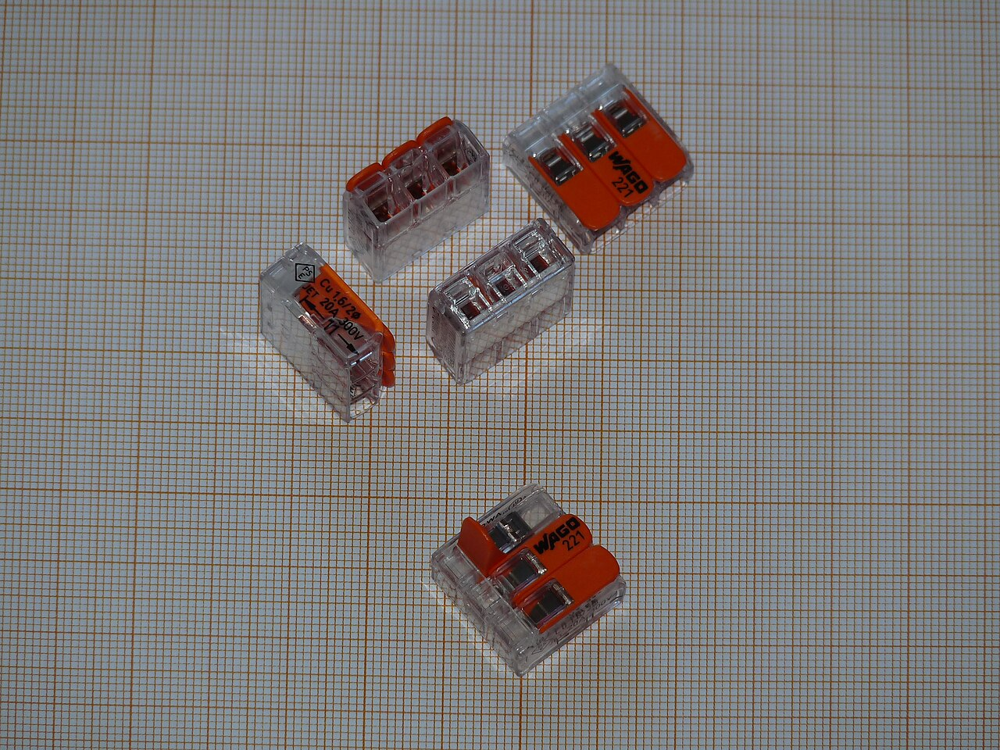

# 06.04 — Złączki i łączenie przewodów — dlaczego nie skręcamy

> **Moduł:** [06 — Osprzęt instalacyjny](README.md) · **Oznaczenia:** 🏠 · **Zakres SEP:** (a) (c) · **Status:** ✅ pełny
>
> **Czytaj:**
>
> - PN-HD 60364-5-52, 526 — połączenia elektryczne
> - PN-EN 60998 — osprzęt połączeniowy (złączki)
> - Instrukcje producentów złączek: zakres przekrojów, długość odizolowania, rodzaj żyły

[← poprzedni temat](06.03-puszki-instalacyjne-i-rozgalezne.md) · [spis modułu](README.md) · [następny temat →](06.05-stopnie-ochrony-ip.md)

## Po co to jest

Połączenie dwóch przewodów to najsłabszy punkt instalacji. Prąd płynie przez mały punkt styku, więc jeśli połączenie jest luźne albo utlenione, grzeje się właśnie tam. Na egzaminie: jak łączy się przewody i dlaczego nie skręca się ich „na zawsze”.

## Po ludzku

**Rodzaje złączek:**

- **Śrubowe** (kostki, listwy zaciskowe) — żyła dociśnięta śrubą. Dobre, jeśli śruba jest dokręcona właściwym momentem i co jakiś czas sprawdzana. Linka wymaga tulejki.
- **Sprężynowe wciskowe** — wsuwasz drut, sprężyna go dociska. Szybkie i pewne, ale zwykle tylko do drutu (nie do linki).
- **Sprężynowe z dźwignią** — podnosisz dźwignię, wkładasz żyłę, zamykasz. Przyjmują drut i linkę, można je otwierać wielokrotnie.
- **Zaciskane (zaprasowywane)** — tuleja zaciśnięta praską. Trwałe, nierozłączne, stosowane też przy przedłużaniu przewodów w ścianie.

**Dlaczego nie skręcać?** Skrętka w dniu wykonania przewodzi dobrze. Po kilku latach drgań, nagrzewania i stygnięcia miedź się luzuje i utlenia. Rezystancja styku rośnie, połączenie się grzeje i utlenia jeszcze szybciej. Norma wymaga, żeby połączenia były wykonane osprzętem odpowiednim do przewodów i zapewniały trwałą ciągłość elektryczną. Taśma izolacyjna na skrętce tego nie zapewnia. Skrętka bez złączki nie jest połączeniem — to prowizorka.

**Lutowanie** w obwodach siłowych instalacji domowej się nie stosuje. Cyna pod naciskiem płynie, a przy zwarciu może się stopić.

**Zasady dla każdej złączki** (są nadrukowane na złączce albo w instrukcji):

1. zakres przekrojów i rodzaj żyły (drut / linka),
2. **długość odizolowania** — zwykle 9–12 mm, często z miarką na obudowie,
3. prąd i napięcie znamionowe,
4. jedna żyła na jeden otwór.

## Jak to wygląda

*Na co patrzeć: przez przezroczystą obudowę widać, czy żyła weszła do końca. Linka nie ma tulejki — w złączce dźwigniowej tulejka nie jest potrzebna, bo sprężyna dociska wszystkie druciki. Dźwignie zamknięte = żyła zaciśnięta.*

*Na co patrzeć: w środku są dwie części — sprężyna (Clamping Spring), która dociska drut, i płytka (Connection Plate), przez którą płynie prąd między żyłami. Drut musi dojść do oporu, żeby sprężyna docisnęła go do płytki na całej szerokości.*

*Na co patrzeć: złączki mają różną liczbę torów. Dobierasz taką, w której każda żyła ma swój otwór — nie wciska się dwóch żył do jednego.*

## Pojęcia

| Pojęcie | Po ludzku | Termin normowy / symbol |
|---------|-----------|-------------------------|
| Złączka | Element do łączenia przewodów | osprzęt połączeniowy (PN-EN 60998) |
| Tulejka | Metalowa rurka zaciśnięta na lince | tulejka kablowa |
| Rezystancja styku | „Opór” w miejscu połączenia | — |
| Długość odizolowania | Ile izolacji zdjąć z końca żyły | podana przez producenta |
| Moment dokręcenia | Siła dokręcenia śruby zacisku | N·m, podany przez producenta |

## Liczby do zapamiętania

| Wielkość | Wartość | Kiedy obowiązuje | Źródło |
|----------|---------|------------------|--------|
| Długość odizolowania | zwykle **9–12 mm** | wg oznaczenia na złączce | instrukcje producentów |
| Żyły w jednym otworze złączki | **1** | złączki sprężynowe | jw. |
| Moc wydzielana na styku | $P = I^2 \cdot R_{styku}$ | — | [01.06](../01-prad-napiecie-opor/01.06-grzanie-przewodow-i-spadek-napiecia.md) |
| Styk 0,1 Ω przy 16 A | ok. **26 W** w jednym punkcie | — | obliczenie |

## W praktyce

- **Dobierz złączkę** do przekroju, rodzaju żyły i liczby przewodów. Złączka „za mała” to złe połączenie.
- **Odizoluj dokładnie tyle, ile trzeba.** Za krótko — sprężyna dociska izolację. Za długo — goła miedź wystaje ze złączki.
- **Wsuń żyłę do oporu** i pociągnij każdą żyłę, żeby sprawdzić, czy trzyma.
- **Linka w zacisku śrubowym — z tulejką.** W złączkach dźwigniowych tulejka nie jest wymagana, o ile producent nie mówi inaczej.
- **Śruby** dokręcaj zalecanym momentem. Przy aparatach modułowych w rozdzielnicy warto użyć wkrętaka dynamometrycznego.
- **Zostaw zapas** żyły w puszce.

## Błędy i zagrożenia

- ⚠️ **Skrętka owinięta taśmą** jako stałe połączenie — po latach przegrzewanie i iskrzenie w ścianie, potencjalne źródło pożaru.
- ⚠️ **Dwie żyły w jednym otworze** złączki albo pod śrubą przeznaczoną na jedną — jedna z nich jest dociśnięta słabo.
- **Linka bez tulejki pod śrubą** — rozchodzące się druciki, luźny styk.
- **Złączka do drutu użyta do linki** — linka wysuwa się spod sprężyny.
- **Za długo odizolowana żyła** — goła miedź wystaje i może dotknąć innej żyły lub obudowy.

## Przykład

**Zadanie.** W puszce jest skrętka, która ma rezystancję styku 0,05 Ω. Obwód zasila grzejnik olejowy 2 kW. Ile mocy grzeje samą skrętkę?

$$I = \frac{2000}{230} \approx 8{,}7\ \mathrm{A} \qquad P = I^2 \cdot R = 8{,}7^2 \cdot 0{,}05 \approx 3{,}8\ \mathrm{W}$$

Wygląda niewiele, ale to moc skupiona w punkcie o wielkości ziarenka ryżu, zamkniętym w puszce bez chłodzenia. Gdy rezystancja wzrośnie dziesięciokrotnie (utlenienie), moc rośnie do ok. 38 W — tyle co lutownica.

**Wniosek.** Dobre połączenie ma rezystancję rzędu miliomów i grzeje się niezauważalnie. Złe może grzać jak lutownica, a zabezpieczenie nadprądowe go nie wykryje, bo prąd w obwodzie jest normalny.

## Pytania SEP

1. **W jaki sposób należy łączyć przewody w instalacji elektrycznej?**

Odpowiedź

Za pomocą osprzętu przeznaczonego do tego celu i dobranego do materiału, przekroju i rodzaju żył oraz liczby łączonych przewodów: złączek śrubowych, sprężynowych, zaciskanych. Połączenia muszą zapewniać trwałą ciągłość elektryczną i wytrzymałość mechaniczną, być umieszczone w puszkach lub obudowach i być dostępne do kontroli. Nie łączy się przewodów przez skręcanie.

2. **Dlaczego luźne połączenie jest niebezpieczne, skoro nie wyłącza go zabezpieczenie?**

Odpowiedź

Na luźnym styku rośnie rezystancja, więc wydziela się na nim ciepło proporcjonalne do kwadratu prądu. Połączenie grzeje się, utlenia i rezystancja rośnie dalej. Może dojść do iskrzenia i zapalenia izolacji lub puszki. Prąd obwodu pozostaje normalny, więc zabezpieczenie nadprądowe nie zadziała.

## Sprawdź się

1. Masz trzy linki 1,5 mm² do połączenia. Którą złączkę wybierzesz: wciskową do drutu, dźwigniową czy kostkę śrubową bez tulejek?

Odpowiedź

Dźwigniową trzytorową, przeznaczoną do linki o tym przekroju. Złączki wciskowe są zwykle tylko do drutu, a kostka śrubowa wymaga tulejek.

## Źródła

- PN-HD 60364-5-52 — 526 (połączenia elektryczne).
- PN-EN 60998-1 i PN-EN 60998-2-2 — osprzęt połączeniowy, złączki bezgwintowe.
- Instrukcje producentów złączek (zakresy przekrojów, długości odizolowania).

---

[← poprzedni temat](06.03-puszki-instalacyjne-i-rozgalezne.md) · [spis modułu](README.md) · [następny temat →](06.05-stopnie-ochrony-ip.md)
