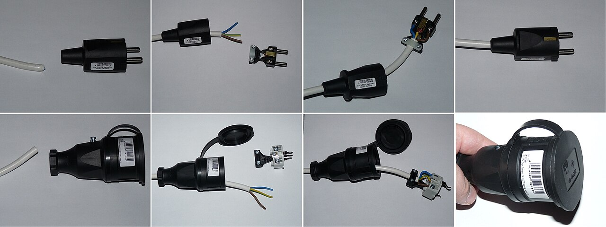
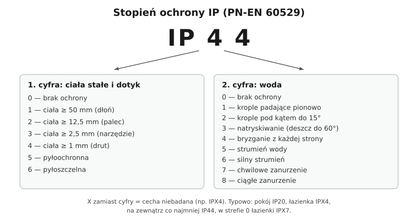

# 06.05 — Stopnie ochrony IP

> **Moduł:** [06 — Osprzęt instalacyjny](README.md) · **Oznaczenia:** 🏠 · **Zakres SEP:** (a) (c) · **Status:** ✅ pełny
>
> **Czytaj:**
>
> - PN-EN 60529 — stopnie ochrony zapewniane przez obudowy (kod IP)
> - Łazienki i strefy: [moduł 17](../17-pomieszczenia-szczegolne/README.md)

[← poprzedni temat](06.04-zlaczki-i-laczenie-przewodow-dlaczego-nie.md) · [spis modułu](README.md) · [następny temat →](06.06-klasy-ochronnosci-urzadzen-0-i-ii-iii.md)

## Po co to jest

Gniazdo w łazience, lampa w ogrodzie, puszka w garażu — każde z tych miejsc wymaga obudowy, która nie wpuści do środka wody i kurzu ani nie pozwoli wsadzić palca do części pod napięciem. Kod IP mówi to w dwóch cyfrach. Na egzaminie: co znaczą cyfry w IP44 i jaki stopień ochrony stosuje się w strefach łazienki.

## Po ludzku

Kod **IP** ma dwie cyfry:

- **pierwsza (0–6)** — ochrona przed ciałami stałymi i przed dotknięciem części niebezpiecznych: od dłoni (1), przez palec (2), narzędzie (3) i drut (4), do kurzu (5 — pyłoochronna, 6 — pyłoszczelna);
- **druga (0–8)** — ochrona przed wodą: od kropli (1, 2), przez deszcz (3) i bryzgi z każdej strony (4), strumień (5, 6), po zanurzenie (7 — chwilowe, 8 — ciągłe).

Jeśli cecha nie była badana, zamiast cyfry pisze się **X**, np. **IPX4**: nie wiadomo nic o pyle, ale bryzgi wody nie zaszkodzą.

**Typowe wymagania:**

- pokój, sypialnia — **IP20** (palec nie dotknie części czynnych);
- łazienka, strefy 1 i 2 — co najmniej **IPX4**, a tam, gdzie myje się strumieniem wody — **IPX5** ([moduł 17](../17-pomieszczenia-szczegolne/README.md));
- strefa 0 łazienki (wnętrze wanny, brodzika) — **IPX7**;
- na zewnątrz, pod zadaszeniem i bez — zwykle **IP44** i więcej, w miejscach zalewanych i zapylonych **IP65–IP67**.

Wyższy stopień nie zawsze oznacza „lepiej”. Obudowa IP67 zamyka wilgoć, która dostanie się do środka przy montażu, i nie pozwala jej wyschnąć.

**Kod IK** (osobny) mówi o odporności na uderzenia, np. IK08 dla oprawy w hali sportowej.

## Jak to wygląda

*Na co patrzeć: gniazdo ma klapkę ze sprężyną, która zamyka otwory, gdy nic nie jest włożone, a wtyczka ma uszczelkę przy wejściu przewodu. Taki osprzęt ma IP44. Po włożeniu zwykłej wtyczki bez uszczelki stopień ochrony całego połączenia spada — IP dotyczy osprzętu w stanie opisanym w instrukcji.*

## Schemat

## Pojęcia

| Pojęcie | Po ludzku | Termin normowy / symbol |
|---------|-----------|-------------------------|
| Stopień ochrony | Na ile obudowa chroni przed dotykiem, pyłem i wodą | IP (PN-EN 60529) |
| X w kodzie IP | Cecha niebadana | np. IPX4, IP2X |
| Bryzgoszczelny | Odporny na bryzgi z każdej strony | IPX4 |
| Pyłoszczelny | Pył w ogóle nie wnika | IP6X |
| Odporność na uderzenia | Jak mocny cios wytrzyma obudowa | IK (PN-EN 62262) |

## Liczby do zapamiętania

| Wielkość | Wartość | Kiedy obowiązuje | Źródło |
|----------|---------|------------------|--------|
| Pokoje mieszkalne | **IP20** | suche pomieszczenia | praktyka |
| Łazienka, strefy 1 i 2 | **IPX4** (IPX5 przy myciu strumieniem) | — | PN-HD 60364-7-701 |
| Łazienka, strefa 0 | **IPX7** | — | jw. |
| Na zewnątrz | zwykle **≥ IP44** | wg warunków | praktyka, projekt |
| 1. cyfra 2 / 4 | palec **12,5 mm** / drut **1 mm** | — | PN-EN 60529 |
| 2. cyfra 4 / 7 | **bryzgi** / **chwilowe zanurzenie** | — | jw. |

## W praktyce

- **Sprawdź IP na tabliczce** albo w karcie osprzętu przed montażem w łazience, na balkonie, w garażu.
- **Montuj zgodnie z instrukcją**: dławiki dokręcone, uszczelki na miejscu, otwory odwodnienia (jeśli są) skierowane w dół. Źle zamontowana obudowa IP65 ma w praktyce IP20.
- **Gniazdo na zewnątrz** — z klapką, najlepiej osłonięte przed deszczem, na wysokości, na której nie zaleje go woda z trawnika.
- **Lampy w ogrodzie** zasilane przewodem w ziemi — szczelne połączenia w puszkach hermetycznych lub w mufach ([05.06](../05-przewody-i-kable/05.06-przewody-bezhalogenowe-i-kable-ziemne.md)).

## Błędy i zagrożenia

- ⚠️ **Zwykłe gniazdo IP20 w strefie łazienki albo na balkonie** — woda w gnieździe, upływ, porażenie.
- **Obudowa hermetyczna z przepustem od góry** — woda spływa po przewodzie do środka.
- **Przedłużacz IP20 na trawniku** — klasyczne źródło wybijania różnicówki po deszczu i porażeń.
- **Zbyt szczelna obudowa w wilgotnym miejscu** — kondensacja w środku, korozja zacisków.

## Przykład

**Zadanie.** Dobierz minimalny stopień ochrony oprawy:

1. nad lustrem w łazience, w strefie 2,
2. pod daszkiem nad wejściem do domu,
3. w myjni samochodowej w garażu, myta myjką ciśnieniową.

**Rozwiązanie.**

1. **IPX4** — strefa 2 łazienki.
2. **IP44** — deszcz i bryzgi, owady i pył (pierwsza cyfra 4 chroni przed drobnymi owadami wchodzącymi do oprawy).
3. Co najmniej **IPX5**, a przy myciu wysokociśnieniowym oprawa o stopniu odpowiednim do strumienia (np. IP65, IP66 lub IPX9K według producenta).

## Pytania SEP

1. **Co oznacza oznaczenie IP44?**

Odpowiedź

Stopień ochrony obudowy wg PN-EN 60529. Pierwsza cyfra 4 — ochrona przed ciałami stałymi o średnicy 1 mm i większej oraz przed dostępem do części niebezpiecznych drutem. Druga cyfra 4 — ochrona przed bryzgami wody padającymi z dowolnego kierunku.

2. **Jaki minimalny stopień ochrony powinien mieć sprzęt w strefach 1 i 2 łazienki?**

Odpowiedź

Co najmniej IPX4, a w miejscach, gdzie do czyszczenia używa się strumienia wody — IPX5 (PN-HD 60364-7-701). W strefie 0 — IPX7.

## Sprawdź się

1. Co oznacza IP2X?

Odpowiedź

Ochrona przed dotknięciem części niebezpiecznych palcem (ciała ≥ 12,5 mm). Ochrona przed wodą nie była badana.

## Źródła

- PN-EN 60529 — stopnie ochrony zapewniane przez obudowy (kod IP).
- PN-HD 60364-7-701 — pomieszczenia wyposażone w wannę lub prysznic (wymagane stopnie ochrony w strefach).
- PN-EN 62262 — kod IK.

---

[← poprzedni temat](06.04-zlaczki-i-laczenie-przewodow-dlaczego-nie.md) · [spis modułu](README.md) · [następny temat →](06.06-klasy-ochronnosci-urzadzen-0-i-ii-iii.md)
