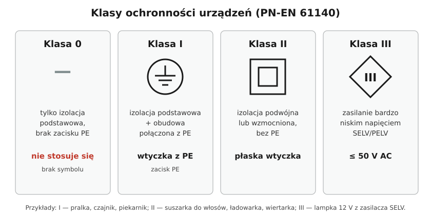

# 06.06 — Klasy ochronności urządzeń: 0, I, II, III

> **Moduł:** [06 — Osprzęt instalacyjny](README.md) · **Oznaczenia:** 🏠 · **Zakres SEP:** (a) (c) · **Status:** ✅ pełny
>
> **Czytaj:**
>
> - PN-EN 61140 — ochrona przed porażeniem, klasy ochronności urządzeń
> - Ochrona przeciwporażeniowa w instalacji: [moduł 12](../12-ochrona-przeciwporazeniowa/README.md)

[← poprzedni temat](06.05-stopnie-ochrony-ip.md) · [spis modułu](README.md) · (koniec modułu) →

## Po co to jest

Klasa ochronności mówi, w jaki sposób urządzenie chroni użytkownika przed porażeniem, gdy uszkodzi się izolacja. Od niej zależy, czy urządzenie wymaga przewodu PE, czy może go nie mieć. Na egzaminie to jedno z najczęstszych pytań.

## Po ludzku

Każde urządzenie ma **izolację podstawową**, która oddziela części pod napięciem od tego, co dotykasz. Klasa mówi, co się dzieje, gdy ta izolacja zawiedzie:

- **Klasa 0** — nic. Jest tylko izolacja podstawowa i nie ma zacisku PE. Po uszkodzeniu izolacji metalowa obudowa może być pod napięciem i nic tego nie wyłączy. W zwykłych instalacjach takich urządzeń się nie stosuje.
- **Klasa I** — metalowa obudowa jest połączona z **PE**. Gdy faza dotknie obudowy, płynie prąd zwarciowy przez PE i zabezpieczenie wyłącza zasilanie ([moduł 12](../12-ochrona-przeciwporazeniowa/README.md)). Wymaga gniazda z PE. Przykłady: pralka, piekarnik, czajnik w metalowej obudowie, lodówka.
- **Klasa II** — **izolacja podwójna lub wzmocniona**. Uszkodzenie jednej warstwy nie odsłania części pod napięciem. Nie ma zacisku PE i nie wolno go podłączać. Przykłady: suszarka do włosów, ładowarka, większość elektronarzędzi, telewizor. Znak: kwadrat w kwadracie.
- **Klasa III** — urządzenie zasilane **bardzo niskim napięciem bezpiecznym** (SELV/PELV, do 50 V AC). Nawet dotknięcie części czynnych nie jest groźne w zwykłych warunkach. Przykłady: lampka 12 V z zasilacza bezpieczeństwa, dzwonek, urządzenia zasilane z USB. Znak: romb z cyfrą III.

**Klasa I potrzebuje instalacji, klasa II nie.** Urządzenie klasy I jest bezpieczne tylko wtedy, gdy w gnieździe jest sprawny PE. Urządzenie klasy II jest bezpieczne samo z siebie.

## Schemat

## Pojęcia

| Pojęcie | Po ludzku | Termin normowy / symbol |
|---------|-----------|-------------------------|
| Izolacja podstawowa | Pierwsza warstwa izolacji na częściach czynnych | — |
| Izolacja dodatkowa | Druga, niezależna warstwa | — |
| Izolacja podwójna | Podstawowa + dodatkowa | klasa II |
| Izolacja wzmocniona | Jedna warstwa równoważna podwójnej | klasa II |
| Część przewodząca dostępna | Metalowa obudowa, której można dotknąć | część przewodząca dostępna |
| SELV / PELV | Bardzo niskie napięcie bezpieczne / ochronne | ≤ 50 V AC, ≤ 120 V DC |

## Liczby do zapamiętania

| Wielkość | Wartość | Kiedy obowiązuje | Źródło |
|----------|---------|------------------|--------|
| Klasa 0 | tylko izolacja podstawowa, **brak PE** | nie stosuje się w zwykłych instalacjach | PN-EN 61140 |
| Klasa I | izolacja podstawowa + **PE** | wymaga gniazda z PE | jw. |
| Klasa II | izolacja **podwójna lub wzmocniona**, bez PE | — | jw. |
| Klasa III | zasilanie **SELV/PELV ≤ 50 V AC** (≤ 120 V DC) | — | jw., PN-HD 60364-4-41 |

## W praktyce

- **Sprawdź tabliczkę znamionową.** Brak symbolu kwadratu w kwadracie przy metalowej obudowie oznacza zwykle klasę I — wtedy potrzebny jest PE.
- **Nie podłączaj PE do urządzenia klasy II**, nawet jeśli ma metalowe elementy. Nie ma do tego zacisku, a „dorobienie” może naruszyć izolację.
- **Przedłużacz bez PE** sprowadza urządzenie klasy I do poziomu klasy 0. Do urządzeń klasy I używaj tylko przedłużaczy z żyłą ochronną.
- **Klasa III** wymaga źródła bezpiecznego (transformator bezpieczeństwa, zasilacz SELV). Zwykły autotransformator albo dzielnik nie zapewnia separacji.

## Błędy i zagrożenia

- ⚠️ **Urządzenie klasy I w gnieździe bez PE** (stara instalacja dwuprzewodowa) — przy uszkodzeniu izolacji obudowa jest pod napięciem i nic go nie wyłącza.
- ⚠️ **Wtyczka z bolcem odcięta i zastąpiona płaską** — zamiana klasy I w klasę 0.
- **Urządzenie klasy II z pękniętą obudową** — izolacja podwójna już nie istnieje, urządzenie trzeba wycofać.
- **Lampa 12 V zasilana z transformatora bez separacji** — nie jest to SELV.

## Przykład

**Sytuacja.** W starym mieszkaniu z instalacją dwuprzewodową (L i N, bez PE) lokator chce podłączyć nową pralkę (klasa I) w łazience.

**Ocena.** Pralka klasy I bez PE nie ma ochrony przy uszkodzeniu. W łazience (mokro, przewodzące podłoże) to sytuacja szczególnie groźna.

**Rozwiązanie.** Doprowadzić do gniazda pralki przewód z żyłą PE z rozdzielnicy i objąć obwód ochroną różnicowoprądową 30 mA ([moduł 21](../21-stare-instalacje/README.md), [moduł 17](../17-pomieszczenia-szczegolne/README.md)). Różnicówka w instalacji bez PE to tylko część rozwiązania — wyłączy dopiero wtedy, gdy prąd popłynie przez człowieka.

## Pytania SEP

1. **Jakie są klasy ochronności urządzeń elektrycznych i czym się charakteryzują?**

Odpowiedź

Klasa 0 — tylko izolacja podstawowa, brak zacisku ochronnego. Klasa I — izolacja podstawowa oraz połączenie części przewodzących dostępnych z przewodem ochronnym PE. Klasa II — izolacja podwójna lub wzmocniona, bez zacisku ochronnego. Klasa III — zasilanie bardzo niskim napięciem bezpiecznym SELV lub ochronnym PELV (do 50 V AC), bez wytwarzania napięć wyższych (PN-EN 61140).

2. **Jak oznacza się urządzenia II i III klasy ochronności?**

Odpowiedź

Klasa II — symbolem dwóch kwadratów, jeden wewnątrz drugiego. Klasa III — symbolem rombu z cyfrą rzymską III w środku. Klasa I ma przy zacisku ochronnym symbol uziemienia ochronnego (znak uziemienia w okręgu).

3. **Czy urządzenie klasy II wymaga przyłączenia przewodu ochronnego?**

Odpowiedź

Nie. Ochronę zapewnia izolacja podwójna lub wzmocniona, a urządzenie nie ma zacisku ochronnego. Przyłączenie PE nie jest wymagane i nie powinno być wykonywane.

## Sprawdź się

1. Do której klasy należy szlifierka z symbolem kwadratu w kwadracie i płaską wtyczką?

Odpowiedź

Do klasy II.

2. Dlaczego urządzenie klasy I jest bezpieczne tylko w sprawnej instalacji?

Odpowiedź

Bo jego ochrona przy uszkodzeniu polega na odprowadzeniu prądu przez PE i samoczynnym wyłączeniu zasilania przez zabezpieczenie. Bez PE albo bez zabezpieczenia o odpowiednich parametrach obudowa pozostaje pod napięciem.

## Źródła

- PN-EN 61140 — ochrona przed porażeniem prądem elektrycznym, wspólne aspekty instalacji i urządzeń, klasy ochronności.
- PN-HD 60364-4-41 — ochrona przeciwporażeniowa, SELV i PELV (414).

---

[← poprzedni temat](06.05-stopnie-ochrony-ip.md) · [spis modułu](README.md) · (koniec modułu) →
