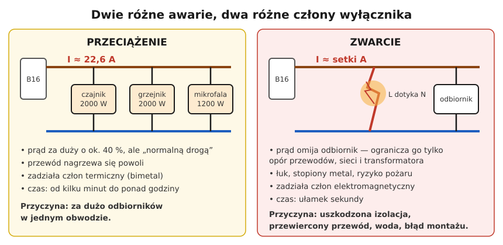

# 07.01 — Przeciążenie i zwarcie z punktu widzenia zabezpieczenia

> **Moduł:** [07 — Zabezpieczenia nadprądowe](README.md) · **Oznaczenia:** 🏠📋 · **Zakres SEP:** (a) (c) · **Status:** ✅ pełny
>
> **Czytaj:**
>
> - Podstawy: [01.07 — przeciążenie a zwarcie](../01-prad-napiecie-opor/01.07-przeciazenie-a-zwarcie-dwie-rozne-awarie.md)
> - PN-HD 60364-4-43 — ochrona przed prądem przetężeniowym
> - [Hager — Podstawy zabezpieczeń w instalacjach elektrycznych (PDF)](https://assets1.sc.hager.com/poland/pdf/25PL025_Podstawy%20zabezpiecze%C5%84%20w%20instalacjach%20elektrycznych%20-%20instrukcja%20techniczna.pdf)

← (początek modułu) · [spis modułu](README.md) · [następny temat →](07.02-bezpieczniki-topikowe-wkladki-gg-gwintowe-i.md)

## Po co to jest

W [01.07](../01-prad-napiecie-opor/01.07-przeciazenie-a-zwarcie-dwie-rozne-awarie.md) przeciążenie i zwarcie były opisane jako dwie różne awarie. Teraz to samo z drugiej strony: czego te awarie wymagają od zabezpieczenia i dlaczego jeden aparat ma w środku dwa różne mechanizmy. Na egzaminie: rodzaje zabezpieczeń nadprądowych i ich zadania.

## Po ludzku

**Prąd przetężeniowy** to każdy prąd większy od znamionowego. Są dwa rodzaje, i każdy wymaga czegoś innego:

**Przeciążenie** — prąd jest za duży, ale niewiele, np. 1,2–2 razy powyżej dopuszczalnego. Płynie przez poprawny obwód, tylko odbiorników jest za dużo. Przewód nagrzewa się powoli, w ciągu minut i godzin. Zabezpieczenie ma tu **czekać**: krótkie przeciążenia są normalne (rozruch silnika, włączenie czajnika i mikrofalówki naraz). Ma zadziałać dopiero wtedy, gdy przeciążenie trwa na tyle długo, że przewód przekroczyłby swoją temperaturę. Działa jak termometr z opóźnieniem.

**Zwarcie** — prąd jest ogromny, setki lub tysiące amperów, bo między L a N (albo PE) nie ma odbiornika, tylko kawałek metalu. Ciepło rośnie z kwadratem prądu, więc przewód w ułamku sekundy osiągnąłby temperaturę, przy której izolacja się topi. Do tego siły elektrodynamiczne wyginają szyny i rozrywają styki. Zabezpieczenie ma **wyłączyć natychmiast**, w milisekundach, i przerwać łuk.

**Dlatego** wyłącznik nadprądowy ma dwa wyzwalacze ([07.03](07.03-wylacznik-nadpradowy-budowa-i-dwa-wyzwalacze.md)), a wkładka topikowa ma topik, który przy małym przeciążeniu nagrzewa się powoli, a przy zwarciu odparowuje natychmiast.

**Trzecie zadanie.** Zwarcie fazy z obudową w układzie TN to też zwarcie (L–PE). Szybkie wyłączenie przez zabezpieczenie nadprądowe jest podstawowym sposobem ochrony przed porażeniem przy uszkodzeniu ([04.04](../04-prad-a-czlowiek/04.04-maksymalne-czasy-samoczynnego-wylaczenia.md), [moduł 12](../12-ochrona-przeciwporazeniowa/README.md)).

**Wartość prądu zwarcia** wynika z prawa Ohma dla pętli zwarcia: $I_k = U_0 / Z_s$. Im bliżej transformatora i im grubsze przewody, tym mniejsza impedancja pętli i większy prąd.

## Schemat

## Pojęcia

| Pojęcie | Po ludzku | Termin normowy / symbol |
|---------|-----------|-------------------------|
| Prąd przetężeniowy | Każdy prąd ponad znamionowy | prąd przetężeniowy |
| Prąd przeciążeniowy | Za duży prąd w poprawnym obwodzie | — |
| Prąd zwarciowy | Prąd przez zwarcie, bez odbiornika | $I_k$ |
| Spodziewany prąd zwarciowy | Jaki prąd popłynąłby, gdyby nic go nie ograniczyło | $I_{cp}$, $I_k$ |
| Impedancja pętli zwarcia | „Opór” drogi prądu zwarcia od źródła i z powrotem | $Z_s$ |
| Całka Joule’a | Miara energii cieplnej przepuszczonej przez zabezpieczenie | $I^2t$ |

## Liczby do zapamiętania

| Wielkość | Wartość | Kiedy obowiązuje | Źródło |
|----------|---------|------------------|--------|
| Prąd zwarcia | $I_k = U_0 / Z_s$ | pętla L–N lub L–PE | prawo Ohma |
| Typowe przeciążenie | ok. **1,1–3 × In** | — | — |
| Typowe zwarcie w mieszkaniu | od **~100 A** do **kilku kA** | zależnie od $Z_s$ | — |
| Czas wyłączenia zwarcia przez wyłącznik | **< 0,1 s** (zwykle kilka ms) | powyżej progu wyzwalacza elektromagnetycznego | PN-EN 60898-1 |
| Czas dopuszczalny zwarcia dla przewodu | $t = (k \cdot S / I)^2$ | $t \le 5$ s; Cu/PVC k = 115 | PN-HD 60364-4-43, 434.5.2 |

## W praktyce

- **Zabezpieczenie dobiera się do przewodu, nie do odbiornika** ([07.06](07.06-koordynacja-zabezpieczenia-z-przewodem.md)). Odbiornik ma swoje zabezpieczenia wewnętrzne.
- **Wyłączenie przy przeciążeniu** (po minutach) — sprawdź, co jest włączone w obwodzie. Zwykle za dużo odbiorników grzejnych naraz.
- **Wyłączenie natychmiastowe przy włączeniu odbiornika** — zwarcie w odbiorniku, przewodzie lub gnieździe, albo bardzo duży prąd rozruchu ([07.04](07.04-charakterystyki-b-c-i-d.md)).
- **Nie załączaj ponownie kilka razy z rzędu** po zwarciu. Każde zwarcie to łuk, który niszczy styki aparatu i miejsce zwarcia. Najpierw znajdź przyczynę ([moduł 20](../20-diagnostyka-usterek/README.md)).

## Błędy i zagrożenia

- ⚠️ **„Wybija, to dam większy”** — większe zabezpieczenie przestaje chronić przewód przed przeciążeniem.
- ⚠️ **Wielokrotne załączanie na zwarcie** — wypalone styki, ryzyko poparzenia łukiem ([04.05](../04-prad-a-czlowiek/04.05-luk-elektryczny-i-oparzenia.md)).
- **Mylenie przeciążenia ze zwarciem** przy szukaniu usterki — inne przyczyny, inne działania.

## Przykład

**Zadanie.** Zmierzona impedancja pętli zwarcia w gnieździe wynosi 0,8 Ω. Jaki prąd popłynie przy zwarciu L–PE w tym gnieździe i który wyzwalacz B16 zadziała?

$$I_k = \frac{230\ \mathrm{V}}{0{,}8\ \Omega} \approx 290\ \mathrm{A}$$

To ok. 18 × In. Próg zadziałania natychmiastowego B16 to 3–5 × In (48–80 A), więc zadziała wyzwalacz elektromagnetyczny w czasie rzędu milisekund.

**Wniosek.** Gdyby impedancja wynosiła 4 Ω, prąd zwarcia miałby tylko 57 A. To mniej niż gwarantowane 80 A, więc wyzwalacz elektromagnetyczny mógłby nie zadziałać, a termiczny wyłączyłby po kilku sekundach. Ochrona przeciwporażeniowa nie byłaby skuteczna.

## Pytania SEP

1. **Jakie zadania spełniają zabezpieczenia nadprądowe w instalacji elektrycznej?**

Odpowiedź

Chronią przewody przed skutkami przeciążeń (długotrwałego nadmiernego nagrzewania izolacji) i zwarć (gwałtownego wzrostu temperatury i sił elektrodynamicznych). W układach TN realizują też samoczynne wyłączenie zasilania w ramach ochrony przeciwporażeniowej przy uszkodzeniu — zwarcie fazy z obudową powoduje przepływ prądu przez PE i zadziałanie zabezpieczenia.

2. **Czym różni się prąd przeciążeniowy od prądu zwarciowego?**

Odpowiedź

Prąd przeciążeniowy płynie w nieuszkodzonym obwodzie, gdy pobór mocy przekracza obciążalność. Jest umiarkowanie większy od znamionowego i powoduje powolne nagrzewanie. Prąd zwarciowy płynie przez połączenie o pomijalnej impedancji między przewodami o różnych potencjałach. Jest wielokrotnie większy (setki, tysiące amperów) i wymaga natychmiastowego wyłączenia.

3. **Od czego zależy wartość prądu zwarciowego?**

Odpowiedź

Od napięcia źródła i impedancji pętli zwarcia, czyli sumy impedancji transformatora, linii zasilającej, przewodów instalacji do miejsca zwarcia i z powrotem oraz styków: $I_k = U_0 / Z_s$. Im dalej od transformatora i im cieńsze i dłuższe przewody, tym prąd zwarcia mniejszy.

## Sprawdź się

1. Dlaczego zabezpieczenie nie może wyłączać natychmiast już przy 1,1 × In?

Odpowiedź

Bo krótkotrwałe niewielkie przeciążenia są normalne (rozruch silnika, chwilowe włączenie kilku urządzeń) i nie szkodzą przewodowi, który nagrzewa się powoli. Natychmiastowe wyłączanie powodowałoby ciągłe, niepotrzebne przerwy w zasilaniu.

## Źródła

- PN-HD 60364-4-43 — ochrona przed prądem przetężeniowym (433 — przeciążenie, 434 — zwarcie).
- PN-EN 60898-1 — wyłączniki do zabezpieczeń przetężeniowych instalacji domowych.
- [Hager — Podstawy zabezpieczeń w instalacjach elektrycznych](https://assets1.sc.hager.com/poland/pdf/25PL025_Podstawy%20zabezpiecze%C5%84%20w%20instalacjach%20elektrycznych%20-%20instrukcja%20techniczna.pdf).

---

← (początek modułu) · [spis modułu](README.md) · [następny temat →](07.02-bezpieczniki-topikowe-wkladki-gg-gwintowe-i.md)
