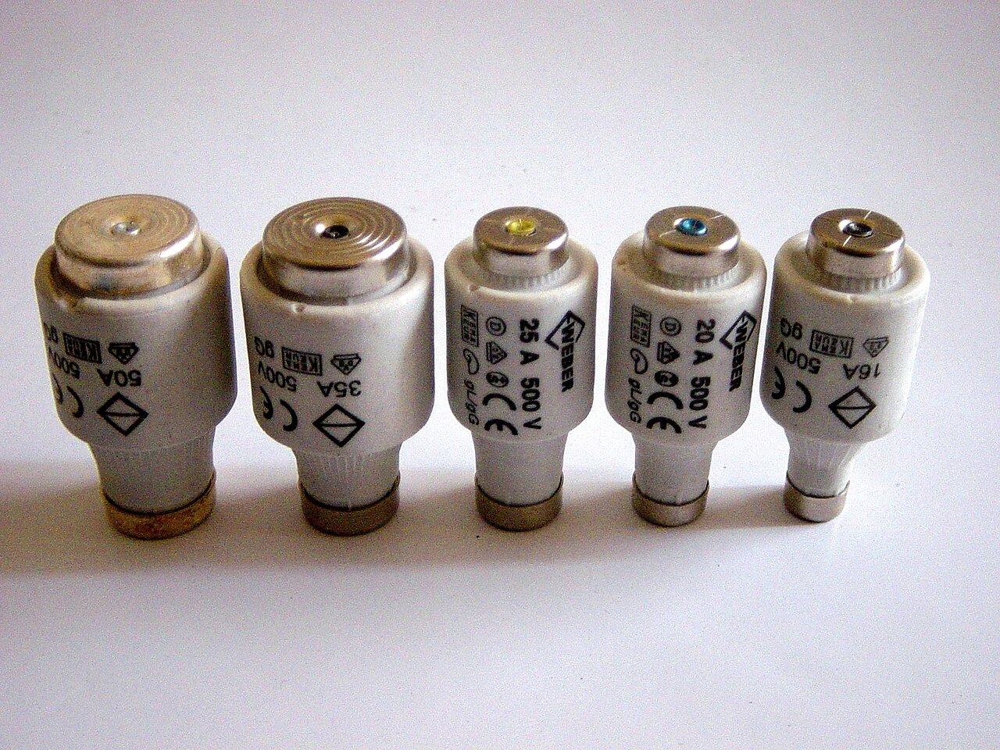
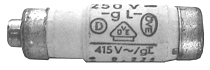
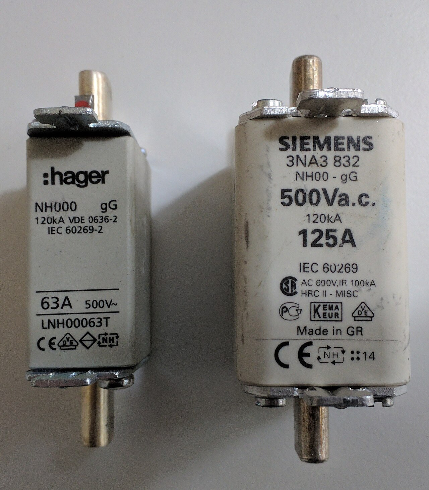
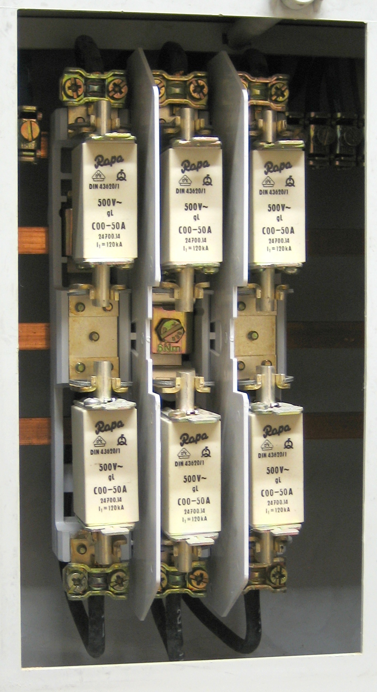

# 07.02 — Bezpieczniki topikowe: wkładki gG, gwintowe i przemysłowe

> **Moduł:** [07 — Zabezpieczenia nadprądowe](README.md) · **Oznaczenia:** 🏠📋 · **Zakres SEP:** (a) (c) · **Status:** ✅ pełny
>
> **Czytaj:**
>
> - PN-EN 60269-1, -2, -3 — bezpieczniki topikowe niskonapięciowe
> - Wymiana wkładek NH: [moduł 28 — BHP](../28-bhp-przy-urzadzeniach/README.md)

[← poprzedni temat](07.01-przeciazenie-i-zwarcie-z-punktu-widzenia.md) · [spis modułu](README.md) · [następny temat →](07.03-wylacznik-nadpradowy-budowa-i-dwa-wyzwalacze.md)

## Po co to jest

Bezpieczniki topikowe są w każdym budynku: w złączu, przed licznikiem, w starych mieszkaniach jako jedyne zabezpieczenie obwodów. Trzeba umieć rozpoznać rodzaj wkładki, odczytać jej prąd i wiedzieć, czego z nią nie robić. Na egzaminie: budowa bezpiecznika, oznaczenia gG i aM, zasady wymiany wkładek.

## Po ludzku

**Wkładka topikowa** to obudowa (zwykle ceramiczna) wypełniona piaskiem kwarcowym, w której jest **topik**, czyli cienki pasek metalu z przewężeniami. Przy przeciążeniu topik nagrzewa się powoli i w końcu przetapia w przewężeniu. Przy zwarciu odparowuje w ułamku milisekundy, a piasek gasi łuk. Wkładka zadziałała = trzeba ją wymienić. Nie da się jej „załączyć” jak wyłącznika.

**Rodzaje według tego, gdzie je spotkasz:**

- **D (DIAZED)** — wkładki gwintowe w starych tablicach mieszkaniowych, z charakterystyczną główką-wskaźnikiem. Wkręca się je w gniazdo główką do przodu.
- **D0 (NEOZED)** — mniejsze i nowsze wkładki gwintowe, często przed licznikiem (np. D02 25 A).
- **NH (nożowe)** — duże wkładki z nożami, w złączach kablowych, rozdzielnicach głównych budynków, stacjach. Na prądy od kilkudziesięciu do setek amperów.
- **Cylindryczne** (np. 10×38, 14×51) — w rozłącznikach bezpiecznikowych na szynę TH35.

**Kolor wskaźnika** wkładek D i D0 mówi o prądzie znamionowym: 6 A zielony, 10 A czerwony, 16 A szary, 20 A niebieski, 25 A żółty, 35 A czarny, 50 A biały, 63 A miedziany. Po zadziałaniu wskaźnik wypada albo ciemnieje.

**Wstawka kalibrowa** w gnieździe wkładki D/D0 ma otwór dopasowany do jednej wartości prądu. Uniemożliwia wkręcenie wkładki o większym prądzie. Jej usuwanie, żeby „zmieściła się dwudziestka piątka”, to proszenie się o pożar.

**Oznaczenia klasy wkładki** (dwie litery):

- pierwsza — zakres wyłączania: **g** (pełnozakresowa — przeciążenia i zwarcia), **a** (niepełnozakresowa — tylko zwarcia);
- druga — obiekt chroniony: **G** (ogólnego przeznaczenia: przewody), **M** (silniki), **R** (półprzewodniki), **PV** (fotowoltaika).

W instalacjach stosuje się prawie zawsze **gG**. Wkładka **aM** chroni obwody silników przed zwarciem, a przed przeciążeniem chroni je przekaźnik termiczny ([moduł 24](../24-silniki-i-napedy/README.md)).

## Jak to wygląda

*Na co patrzeć: kolor wskaźnika w środku główki koduje prąd znamionowy. Wkładki różnią się też średnicą stopki — dzięki temu i dzięki wstawce kalibrowej wkładki o większym prądzie nie da się włożyć w gniazdo przeznaczone na mniejszy.*

*Na co patrzeć: wkładka D0 jest wyraźnie mniejsza od DIAZED. Napis gL to dawne oznaczenie wkładek do ochrony przewodów, dziś gG.*

*Na co patrzeć: na korpusie jest rozmiar (NH00), klasa (gG), prąd znamionowy, napięcie (500 V) i zdolność wyłączania (120 kA). Wkładki NH wymienia się specjalnym uchwytem z osłoną, w rękawicach i osłonie twarzy, tylko bez obciążenia — to praca dla osób z odpowiednimi uprawnieniami.*

*Na co patrzeć: tak wyglądają zabezpieczenia w złączu lub rozdzielnicy głównej. Części przewodzące są blisko siebie, a prąd zwarcia w tym miejscu może sięgać kilku–kilkunastu kiloamperów. Tu nie pracuje się „przy okazji”.*

## Pojęcia

| Pojęcie | Po ludzku | Termin normowy / symbol |
|---------|-----------|-------------------------|
| Wkładka topikowa | Wymienny element z topikiem | wkładka bezpiecznikowa |
| Podstawa / gniazdo | To, w co wkłada się wkładkę | podstawa bezpiecznikowa |
| Wstawka kalibrowa | Pierścień ograniczający prąd wkładki | — |
| gG | Pełnozakresowa, do przewodów | PN-EN 60269-1 |
| aM | Niepełnozakresowa, do silników | jw. |
| Prąd umowny niezadziałania | Przy nim wkładka nie zadziała w czasie umownym | $I_{nf}$ |
| Prąd umowny zadziałania | Przy nim wkładka zadziała w czasie umownym | $I_f$ (= $I_2$) |

## Liczby do zapamiętania

| Wielkość | Wartość | Kiedy obowiązuje | Źródło |
|----------|---------|------------------|--------|
| gG: prąd umowny niezadziałania | **1,25 × In** | In ≥ 16 A, czas umowny 1 h (do 63 A) | PN-EN 60269-1 |
| gG: prąd umowny zadziałania $I_2$ | **1,6 × In** | jw. | jw. |
| gG, 4 A < In < 16 A | $I_{nf}$ = **1,5 × In**, $I_2$ = **1,9 × In** | — | jw. |
| Selektywność wkładek gG | stosunek prądów **≥ 1,6** | wkładki tej samej klasy | jw. |
| Kolor wskaźnika D/D0 | 6 A zielony · 10 A czerwony · 16 A szary · 20 A niebieski · 25 A żółty · 35 A czarny · 63 A miedziany | — | normy wkładek |
| Zdolność wyłączania wkładek | **50 kA** (D/D0), **120 kA** (NH) | typowo | dane producentów |

## W praktyce

- **Wymiana wkładki D/D0:** najpierw wyłącz odbiorniki w obwodzie (wkładki nie przerywają obciążenia jak łącznik), wykręć główkę z wkładką, wymień na **identyczną** (prąd i charakterystyka), wkręć do oporu.
- **Wkładka wciąż się przepala** — przyczyna jest w obwodzie: zwarcie albo przeciążenie. Nie zwiększaj wkładki ([moduł 20](../20-diagnostyka-usterek/README.md)).
- **Wkładki przedlicznikowe** (w złączu lub przed licznikiem) należą do operatora sieci. Ich wymiana i plombowane pokrywy to sprawa OSD ([00.03](../00-bezpieczenstwo-najpierw/00.03-co-wolno-zrobic-samemu-a-co-wymaga-uprawnien-i.md)).
- **Modernizacja starej tablicy:** zamiana wkładek D na wyłączniki nadprądowe i dodanie różnicówek to typowy zakres prac w starym mieszkaniu ([moduł 15](../15-rozdzielnica-mieszkaniowa/README.md), [moduł 21](../21-stare-instalacje/README.md)).

## Błędy i zagrożenia

- ⚠️ **„Drucik” zamiast wkładki** albo zwijka z drutu na przepalonej wkładce — brak zabezpieczenia, przewody grzeją się aż do pożaru.
- ⚠️ **Wyjęta wstawka kalibrowa** i wkładka o większym prądzie — przewód przestaje być chroniony przed przeciążeniem.
- ⚠️ **Wyjmowanie wkładek NH pod obciążeniem lub bez uchwytu i osłon** — łuk w twarz ([04.05](../04-prad-a-czlowiek/04.05-luk-elektryczny-i-oparzenia.md)).
- **Wkładka aM w obwodzie przewodów** — nie chroni przed przeciążeniem.

## Przykład

**Zadanie.** Przewód o obciążalności Iz = 27 A (2,5 mm², sposób C). Jaką największą wkładkę gG można zastosować, żeby chroniła przewód przed przeciążeniem?

Warunek: $I_2 \le 1{,}45 \cdot I_z$, a dla gG $I_2 = 1{,}6 \cdot I_n$:

$$1{,}6 \cdot I_n \le 1{,}45 \cdot 27 \Rightarrow I_n \le 24{,}5\ \mathrm{A}$$

**Odpowiedź.** gG 20 A. Wkładka 25 A nie spełnia warunku, choć 25 < 27. Ten sam przewód z wyłącznikiem nadprądowym może mieć B25 ([07.06](07.06-koordynacja-zabezpieczenia-z-przewodem.md)).

## Pytania SEP

1. **Jak zbudowana jest wkładka bezpiecznikowa i jak działa?**

Odpowiedź

Wkładka ma korpus (zwykle ceramiczny) zakończony stykami, wewnątrz którego jest topik — pasek metalu z przewężeniami — zasypany piaskiem kwarcowym. Przy przeciążeniu topik nagrzewa się i przetapia po pewnym czasie, przy zwarciu odparowuje niemal natychmiast. Piasek chłodzi i gasi łuk. Wskaźnik zadziałania pokazuje, że wkładka się przepaliła.

2. **Co oznaczają symbole gG i aM na wkładkach bezpiecznikowych?**

Odpowiedź

Pierwsza litera to zakres wyłączania: g — pełnozakresowa (wyłącza przeciążenia i zwarcia), a — niepełnozakresowa (tylko zwarcia). Druga litera to obiekt chroniony: G — ogólnego przeznaczenia (przewody i kable), M — obwody silnikowe. gG chroni przewody przed przeciążeniem i zwarciem, aM tylko przed zwarciem, w połączeniu z przekaźnikiem termicznym silnika.

3. **Czy wolno naprawiać przepalone wkładki bezpiecznikowe?**

Odpowiedź

Nie. Wkładkę wymienia się na nową o tym samym prądzie znamionowym i tej samej charakterystyce. Naprawianie (drutem, „zwijką”) i stosowanie wkładek o większym prądzie niż wynika z doboru jest niedopuszczalne, bo likwiduje ochronę przewodów i grozi pożarem.

## Sprawdź się

1. W starej tablicy widzisz wkładkę z żółtym wskaźnikiem. Jaki ma prąd?

Odpowiedź

25 A.

2. Dlaczego przy tej samej obciążalności przewodu wkładka gG musi mieć mniejszy prąd znamionowy niż wyłącznik nadprądowy?

Odpowiedź

Bo prąd umowny zadziałania wkładki gG wynosi 1,6 × In, a wyłącznika 1,45 × In. Warunek $I_2 \le 1{,}45 \cdot I_z$ wymaga więc dla wkładki $I_n \le 0{,}9 \cdot I_z$.

## Źródła

- PN-EN 60269-1 — bezpieczniki topikowe niskonapięciowe, wymagania ogólne (prądy umowne, klasy gG i aM).
- PN-HD 60269-3 — bezpieczniki do użytku przez osoby niewykwalifikowane (system D i D0).
- PN-HD 60364-4-43 — dobór zabezpieczeń do przewodów.

---

[← poprzedni temat](07.01-przeciazenie-i-zwarcie-z-punktu-widzenia.md) · [spis modułu](README.md) · [następny temat →](07.03-wylacznik-nadpradowy-budowa-i-dwa-wyzwalacze.md)
