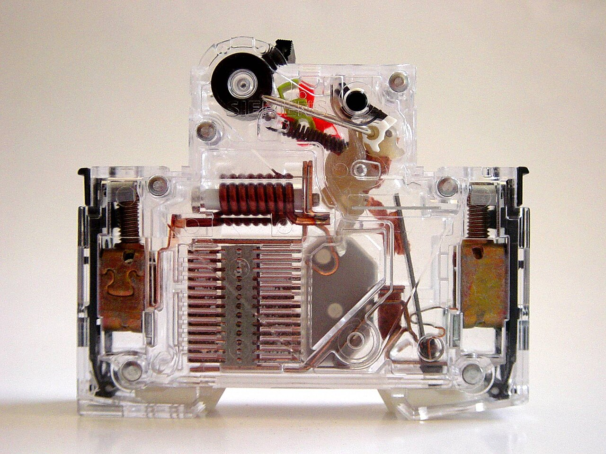
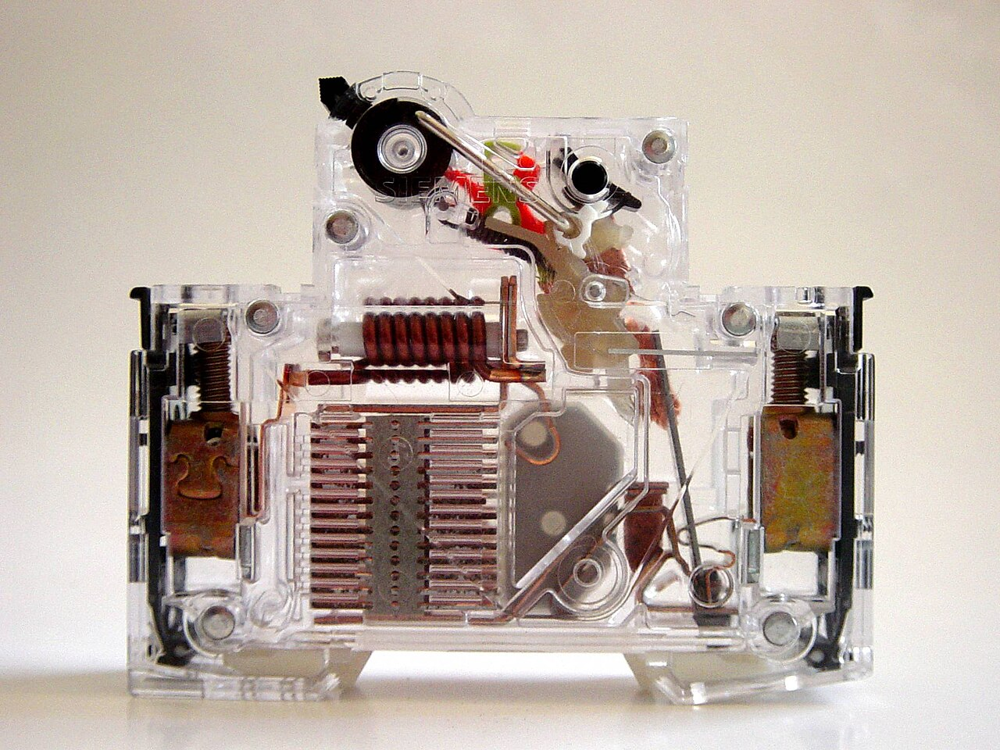
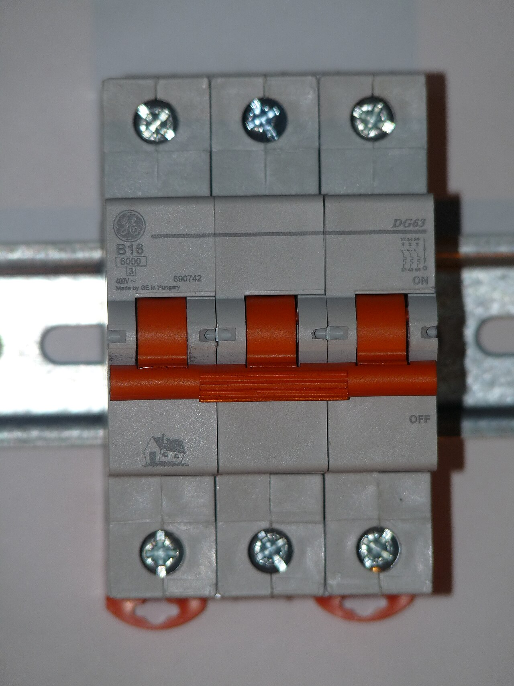

# 07.03 — Wyłącznik nadprądowy — budowa i dwa wyzwalacze

> **Moduł:** [07 — Zabezpieczenia nadprądowe](README.md) · **Oznaczenia:** 🏠📋 · **Zakres SEP:** (a) (c) · **Status:** ✅ pełny
>
> **Czytaj:**
>
> - PN-EN 60898-1 — wyłączniki nadprądowe do instalacji domowych
> - Budowa w przekroju i komora gaszeniowa: [01.07](../01-prad-napiecie-opor/01.07-przeciazenie-a-zwarcie-dwie-rozne-awarie.md)

[← poprzedni temat](07.02-bezpieczniki-topikowe-wkladki-gg-gwintowe-i.md) · [spis modułu](README.md) · [następny temat →](07.04-charakterystyki-b-c-i-d.md)

## Po co to jest

Wyłącznik nadprądowy (potocznie „eska”, „automat”) to podstawowe zabezpieczenie obwodów w każdej nowej rozdzielnicy. Musisz wiedzieć, co jest w środku, żeby rozumieć, dlaczego wyłącza raz po minucie, a raz natychmiast, i co znaczą napisy na jego froncie. Na egzaminie: budowa i zasada działania wyłącznika instalacyjnego.

## Po ludzku

W wyłączniku są dwa niezależne „czujniki” i jeden wspólny mechanizm:

1. **Wyzwalacz termiczny (bimetal).** Pasek z dwóch metali o różnej rozszerzalności, przez który (albo obok którego) płynie prąd. Gdy się nagrzewa, wygina się. Przy przeciążeniu po pewnym czasie wygina się na tyle, że popycha zapadkę zamka. Działa wolno, bo naśladuje nagrzewanie się przewodu.
2. **Wyzwalacz elektromagnetyczny (cewka).** Kilka zwojów grubego drutu z ruchomym rdzeniem. Przy zwarciu prąd jest tak duży, że pole magnetyczne natychmiast wciąga rdzeń. Ten uderza w zamek i często od razu odpycha styk ruchomy. Działa w milisekundach.
3. **Zamek z mechanizmem swobodnego wyzwalania.** Utrzymuje styki zamknięte i otwiera je sprężyną, gdy któryś wyzwalacz go zwolni. „Swobodne wyzwalanie” oznacza, że wyłącznik zadziała nawet wtedy, gdy ktoś trzyma dźwignię w pozycji „załączony”.
4. **Styki i komora gaszeniowa.** Przy otwieraniu styków pod prądem powstaje łuk. Prowadnice wciągają go do komory z płytek, gdzie dzieli się na krótkie łuki i gaśnie ([01.07](../01-prad-napiecie-opor/01.07-przeciazenie-a-zwarcie-dwie-rozne-awarie.md)).

**Napisy na froncie** (przykład: B16, 6000 w prostokącie, 3 w kwadracie):

- **B16** — charakterystyka B, prąd znamionowy 16 A ([07.04](07.04-charakterystyki-b-c-i-d.md));
- **6000** w prostokącie — znamionowa zdolność zwarciowa 6000 A ([07.05](07.05-zdolnosc-zwarciowa-6-ka-10-ka.md));
- **3** w kwadracie — klasa ograniczania energii (3 = najlepsza);
- napięcie, np. 230/400 V, i numer normy PN-EN 60898-1.

## Jak to wygląda

*Na co patrzeć: pozycja załączona. Miedziana cewka (wyzwalacz elektromagnetyczny) jest w środkowej części, pod nią rząd płytek komory gaszeniowej, nad nią mechanizm zamka z dźwignią. Prąd płynie od zacisku z jednej strony, przez cewkę, styki i bimetal, do zacisku z drugiej strony.*

*Na co patrzeć: porównaj z poprzednim zdjęciem — zmieniło się położenie dźwigni i elementów zamka, a styk ruchomy odsunął się od nieruchomego. Przerwa między stykami po wyłączeniu jest mała, dlatego wyłącznik nadprądowy nie zastępuje przy pracach sprawdzenia braku napięcia.*

*Na co patrzeć: pod oznaczeniem B16 jest zdolność zwarciowa 6000 A w prostokącie i klasa ograniczania energii 3 w kwadracie. Trzy bieguny są połączone wspólną dźwignią — zwarcie w jednej fazie wyłącza wszystkie trzy.*

## Pojęcia

| Pojęcie | Po ludzku | Termin normowy / symbol |
|---------|-----------|-------------------------|
| Wyzwalacz termiczny | Bimetal, reaguje na przeciążenie | wyzwalacz przeciążeniowy |
| Wyzwalacz elektromagnetyczny | Cewka, reaguje na zwarcie | wyzwalacz zwarciowy |
| Zamek | Mechanizm trzymający i otwierający styki | — |
| Swobodne wyzwalanie | Wyłącza mimo przytrzymanej dźwigni | — |
| Komora gaszeniowa | Płytki, w których gaśnie łuk | — |
| Klasa ograniczania energii | Jak mało energii przepuszcza przy zwarciu | 1, 2, 3 (3 najlepsza) |

## Liczby do zapamiętania

| Wielkość | Wartość | Kiedy obowiązuje | Źródło |
|----------|---------|------------------|--------|
| Prądy znamionowe (typoszereg) | 6, 10, 13, 16, 20, 25, 32, 40, 50, 63 A | wyłączniki domowe | PN-EN 60898-1 |
| Prąd umowny niezadziałania | **1,13 × In** (≥ 1 h bez zadziałania) | temperatura odniesienia 30 °C | jw. |
| Prąd umowny zadziałania $I_2$ | **1,45 × In** (< 1 h) | jw. | jw. |
| 2,55 × In | **1–60 s** (In ≤ 32 A), 1–120 s (In > 32 A) | jw. | jw. |
| Zdolność zwarciowa | **4500 / 6000 / 10 000 A** | oznaczenie w prostokącie | jw. |

## W praktyce

- **Odczytaj front przed montażem:** charakterystyka, prąd, zdolność zwarciowa, liczba biegunów.
- **Dokręcaj zaciski** momentem podanym przez producenta. Luźny zacisk grzeje się i nagrzewa bimetal — wyłącznik zaczyna wyzwalać „bez powodu”.
- **W ciasnej, gorącej rozdzielnicy** wyłączniki wyzwalają wcześniej, bo bimetal jest skalibrowany przy 30 °C. Producenci podają współczynniki dla wyższych temperatur i dla aparatów montowanych obok siebie.
- **Wyłącznik nadprądowy nie jest aparatem do częstego łączenia** obciążeń. Do sterowania odbiornikami służą łączniki i styczniki ([03.03](../03-elektromagnetyzm-w-praktyce/03.03-elektromagnes-w-pracy-przekaznik-i-stycznik.md)).

## Błędy i zagrożenia

- ⚠️ **Przytrzymywanie dźwigni**, „bo wybija” — zamek i tak wyzwoli, a w obwodzie jest usterka, której trzeba szukać.
- ⚠️ **Traktowanie wyłączonego nadprądowego jako odłączenia do pracy** bez sprawdzenia braku napięcia ([00.02](../00-bezpieczenstwo-najpierw/00.02-sprawdzanie-braku-napiecia-probnik-dwubiegunowy.md)).
- **Wyłącznik o zbyt małej zdolności zwarciowej** w miejscu dużego prądu zwarcia ([07.05](07.05-zdolnosc-zwarciowa-6-ka-10-ka.md)).
- **Mieszanie aparatów różnych producentów na jednym grzebieniu** — grzebień musi pasować do rozstawu zacisków.

## Przykład

**Sytuacja.** Wyłącznik B16 obwodu kuchennego wyłącza się po 20–30 minutach pracy piekarnika (2,5 kW) i zmywarki (2 kW). Po kilku minutach daje się załączyć ponownie.

**Obliczenie.**

$$I = \frac{4500}{230} \approx 19{,}6\ \mathrm{A} \approx 1{,}22 \cdot I_n$$

To przeciążenie. 1,22 × In leży między 1,13 a 1,45, więc wyłącznik może zadziałać po kilkunastu–kilkudziesięciu minutach. Właśnie to się dzieje. Po wyłączeniu bimetal stygnie i pozwala załączyć.

**Wniosek.** Wyłącznik działa prawidłowo i chroni przewód. Rozwiązaniem jest rozdzielenie odbiorników na dwa obwody, a nie większy wyłącznik.

## Pytania SEP

1. **Jak zbudowany jest wyłącznik nadprądowy instalacyjny?**

Odpowiedź

Ma obudowę izolacyjną z zaciskami, układ styków (stały i ruchomy) z komorą gaszeniową, mechanizm napędowy z zamkiem i dźwignią (z mechanizmem swobodnego wyzwalania) oraz dwa wyzwalacze: termiczny (bimetaliczny) reagujący z opóźnieniem na przeciążenia i elektromagnetyczny reagujący bezzwłocznie na zwarcia.

2. **Co oznaczają poszczególne napisy na wyłączniku: B16, 6000 w prostokącie i 3 w kwadracie?**

Odpowiedź

B16 — charakterystyka czasowo-prądowa B, prąd znamionowy 16 A. 6000 w prostokącie — znamionowa zwarciowa zdolność łączeniowa Icn = 6000 A. 3 w kwadracie — trzecia klasa ograniczania energii przenoszonej przy zwarciu.

3. **Na czym polega mechanizm swobodnego wyzwalania wyłącznika?**

Odpowiedź

Wyzwalacze otwierają styki niezależnie od położenia dźwigni. Wyłącznik zadziała przy przeciążeniu lub zwarciu także wtedy, gdy dźwignia jest przytrzymywana w pozycji załączenia, i nie da się go „przytrzymać” na usterce.

## Sprawdź się

1. Wyłącznik wyzwala natychmiast przy każdej próbie załączenia, nawet po odłączeniu wszystkich odbiorników. Który wyzwalacz działa i co to oznacza?

Odpowiedź

Elektromagnetyczny — w obwodzie (przewodzie, puszce, gnieździe) jest zwarcie. Trzeba je znaleźć, a nie ponawiać załączanie.

## Źródła

- PN-EN 60898-1 — wyłączniki do zabezpieczeń przetężeniowych instalacji domowych i podobnych (prądy umowne, oznaczenia).
- [Hager — Podstawy zabezpieczeń w instalacjach elektrycznych](https://assets1.sc.hager.com/poland/pdf/25PL025_Podstawy%20zabezpiecze%C5%84%20w%20instalacjach%20elektrycznych%20-%20instrukcja%20techniczna.pdf) — budowa i wpływ temperatury otoczenia.

---

[← poprzedni temat](07.02-bezpieczniki-topikowe-wkladki-gg-gwintowe-i.md) · [spis modułu](README.md) · [następny temat →](07.04-charakterystyki-b-c-i-d.md)
