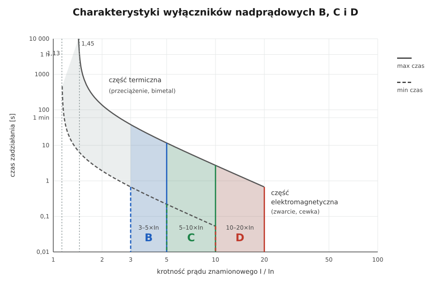

# 07.04 — Charakterystyki B, C i D

> **Moduł:** [07 — Zabezpieczenia nadprądowe](README.md) · **Oznaczenia:** 🏠📋 · **Zakres SEP:** (a) (c) · **Status:** ✅ pełny
>
> **Czytaj:**
>
> - PN-EN 60898-1 — charakterystyki B, C, D
> - Dopuszczalna impedancja pętli dla B i C: [04.04](../04-prad-a-czlowiek/04.04-maksymalne-czasy-samoczynnego-wylaczenia.md)
> - Prądy załączania źródeł LED: [moduł 18](../18-oswietlenie/README.md)

[← poprzedni temat](07.03-wylacznik-nadpradowy-budowa-i-dwa-wyzwalacze.md) · [spis modułu](README.md) · [następny temat →](07.05-zdolnosc-zwarciowa-6-ka-10-ka.md)

## Po co to jest

Litera przed prądem znamionowym (B16, C16) mówi, przy jakim prądzie wyłącznik zadziała natychmiast. Zła litera to albo wyłącznik, który wybija przy każdym włączeniu odbiornika, albo taki, który przy zwarciu nie wyłączy dostatecznie szybko. Na egzaminie: charakterystyki B, C, D i ich zastosowanie.

## Po ludzku

Wszystkie wyłączniki B, C i D mają **taką samą część termiczną**: B16, C16 i D16 tak samo reagują na przeciążenie, bo chronią ten sam przewód.

Różnią się **progiem wyzwalacza elektromagnetycznego**, czyli tym, przy jakiej krotności prądu znamionowego wyłączają natychmiast:

| Charakterystyka | Wyłączenie natychmiastowe | Do czego |
|-----------------|---------------------------|----------|
| **B** | 3–5 × In | obwody gniazd i oświetlenia w mieszkaniach, długie obwody, odbiorniki bez dużych prądów załączania |
| **C** | 5–10 × In | silniki, pompy, sprężarki, transformatory, duże grupy zasilaczy LED i świetlówek |
| **D** | 10–20 × In | bardzo duże prądy załączania: transformatory, spawarki, silniki z ciężkim rozruchem |

Pasmo (np. 3–5) oznacza, że przy 3 × In wyłącznik B **na pewno nie** zadziała natychmiast, a przy 5 × In **na pewno** zadziała w czasie poniżej 0,1 s. Między tymi wartościami może zadziałać albo nie.

**Dlaczego nie dać wszędzie C, „żeby nie wybijało”?** Bo C potrzebuje dwa razy większego prądu zwarcia, żeby wyłączyć natychmiast. Wymaga więc dwa razy mniejszej impedancji pętli zwarcia. W długim obwodzie lub na końcu instalacji C16 może nie spełnić warunku samoczynnego wyłączenia w 0,4 s, a B16 tak ([04.04](../04-prad-a-czlowiek/04.04-maksymalne-czasy-samoczynnego-wylaczenia.md)).

## Schemat

## Pojęcia

| Pojęcie | Po ludzku | Termin normowy / symbol |
|---------|-----------|-------------------------|
| Charakterystyka czasowo-prądowa | Wykres: jaki prąd — po jakim czasie wyłączy | B, C, D |
| Prąd zadziałania natychmiastowego | Prąd, przy którym wyłącza bez zwłoki | 3–5 / 5–10 / 10–20 × In |
| Prąd załączania (rozruchowy) | Chwilowy „szczyt” prądu przy włączeniu odbiornika | udar prądowy |
| Prąd zapewniający zadziałanie | Prąd, przy którym ochrona przeciwporażeniowa jest skuteczna | $I_a$ = 5 / 10 / 20 × In |

## Liczby do zapamiętania

| Wielkość | Wartość | Kiedy obowiązuje | Źródło |
|----------|---------|------------------|--------|
| B — wyłączenie natychmiastowe | **3–5 × In** (< 0,1 s przy 5 × In) | — | PN-EN 60898-1 |
| C — wyłączenie natychmiastowe | **5–10 × In** | — | jw. |
| D — wyłączenie natychmiastowe | **10–20 × In** | — | jw. |
| Część termiczna (wszystkie) | 1,13 × In — nie wyłącza w 1 h; 1,45 × In — wyłącza < 1 h | 30 °C | jw. |
| $Z_s$ max dla B16 / C16 | **2,88 Ω / 1,44 Ω** | TN, 230 V, 0,4 s | PN-HD 60364-4-41 ([04.04](../04-prad-a-czlowiek/04.04-maksymalne-czasy-samoczynnego-wylaczenia.md)) |

## W praktyce

- **W mieszkaniu domyślnie B.** Gniazda B16, oświetlenie B10.
- **C** — gdy w obwodzie jest silnik lub transformator albo gdy B wybija przy włączaniu (np. kilkanaście zasilaczy LED na jednym obwodzie, pompa ciepła, sprężarka). Zawsze sprawdź impedancję pętli ([moduł 23](../23-pomiary-odbiorcze-i-okresowe/README.md)).
- **Zamiast zmiany B na C** przy wybijaniu oświetlenia LED często lepiej podzielić obwód albo zastosować ogranicznik prądu załączania.
- **Wyłączenie po kilkudziesięciu minutach** to nie kwestia charakterystyki, tylko przeciążenia — zmiana B na C nic nie da ([07.03](07.03-wylacznik-nadpradowy-budowa-i-dwa-wyzwalacze.md)).

## Błędy i zagrożenia

- ⚠️ **C zamiast B na długim obwodzie bez pomiaru pętli** — przy zwarciu do obudowy wyłączenie może trwać sekundy zamiast ułamka sekundy.
- **D w instalacji mieszkaniowej** — prawie nigdy nie jest potrzebne, a wymaga bardzo małej impedancji pętli.
- **Szukanie przyczyny wybijania przy włączeniu w charakterystyce**, gdy w rzeczywistości jest to zwarcie w odbiorniku.

## Przykład

**Zadanie.** Obwód zasila sprężarkę o prądzie znamionowym 8 A i prądzie rozruchowym 6 × In silnika (48 A). Czy B10 wystarczy? A C10?

**B10:** próg natychmiastowy 30–50 A. Rozruch 48 A leży w paśmie, więc B10 może wyłączać przy części rozruchów.

**C10:** próg 50–100 A. Rozruch 48 A jest poniżej progu, więc wyłącznik nie zadziała przy rozruchu.

**Wniosek.** C10, pod warunkiem że impedancja pętli w gnieździe sprężarki ≤ 230 / 100 = 2,3 Ω. Jeśli jest większa, trzeba zwiększyć przekrój albo zastosować różnicówkę jako ochronę przy uszkodzeniu ([moduł 12](../12-ochrona-przeciwporazeniowa/README.md)).

## Pytania SEP

1. **Czym różnią się charakterystyki B, C i D wyłączników nadprądowych?**

Odpowiedź

Zakresem prądu zadziałania wyzwalacza elektromagnetycznego (bezzwłocznego): B — 3 do 5 × In, C — 5 do 10 × In, D — 10 do 20 × In. Część przeciążeniowa jest taka sama. B stosuje się w obwodach gniazd i oświetlenia, C dla odbiorników o dużych prądach załączania (silniki, transformatory), D przy bardzo dużych prądach rozruchowych.

2. **Jaki wpływ ma charakterystyka wyłącznika na skuteczność ochrony przeciwporażeniowej?**

Odpowiedź

Im wyższy próg zadziałania natychmiastowego, tym większy prąd zwarciowy jest potrzebny do szybkiego wyłączenia i tym mniejsza musi być impedancja pętli zwarcia: $Z_s \le U_0 / I_a$. Dla B16 ($I_a$ = 80 A) $Z_s$ ≤ 2,88 Ω, a dla C16 ($I_a$ = 160 A) — tylko 1,44 Ω.

## Sprawdź się

1. Na wykresie: przy jakim prądzie wyłącznik C16 na pewno zadziała natychmiast?

Odpowiedź

Przy 10 × 16 = 160 A i więcej.

2. Dlaczego B16 i C16 tak samo chronią przewód przed przeciążeniem?

Odpowiedź

Bo mają taką samą część termiczną (1,13 i 1,45 × In) — różnią się tylko progiem wyzwalacza elektromagnetycznego.

## Źródła

- PN-EN 60898-1 — charakterystyki B, C, D, prądy umowne i czasy zadziałania.
- PN-HD 60364-4-41 — 411.4.4 (warunek samoczynnego wyłączenia w układzie TN).

---

[← poprzedni temat](07.03-wylacznik-nadpradowy-budowa-i-dwa-wyzwalacze.md) · [spis modułu](README.md) · [następny temat →](07.05-zdolnosc-zwarciowa-6-ka-10-ka.md)
