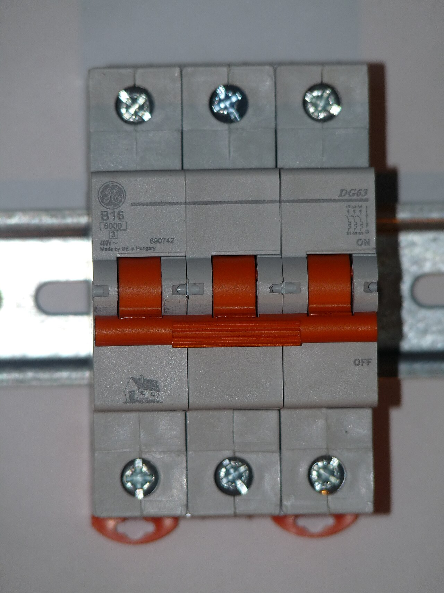

# 07.05 — Zdolność zwarciowa: 6 kA, 10 kA

> **Moduł:** [07 — Zabezpieczenia nadprądowe](README.md) · **Oznaczenia:** 🏠📋 · **Zakres SEP:** (a) (c) · **Status:** ✅ pełny
>
> **Czytaj:**
>
> - PN-EN 60898-1 — znamionowa zdolność zwarciowa Icn i klasa ograniczania energii
> - Pomiar impedancji pętli zwarcia: [moduł 23](../23-pomiary-odbiorcze-i-okresowe/README.md)

[← poprzedni temat](07.04-charakterystyki-b-c-i-d.md) · [spis modułu](README.md) · [następny temat →](07.06-koordynacja-zabezpieczenia-z-przewodem.md)

## Po co to jest

Wyłącznik musi przerwać każdy prąd zwarcia, jaki może wystąpić w miejscu jego zamontowania. Jeśli prąd zwarcia jest większy od jego zdolności zwarciowej, wyłącznik może się zespawać, rozpaść albo zapalić. Na egzaminie: co oznacza 6 kA na wyłączniku i jak sprawdzić, czy wystarczy.

## Po ludzku

**Znamionowa zdolność zwarciowa (Icn)** to największy prąd zwarcia, który wyłącznik potrafi bezpiecznie wyłączyć, i to więcej niż raz. Na froncie jest podana w amperach w prostokącie: **4500**, **6000** albo **10 000**.

**Spodziewany prąd zwarciowy** w danym miejscu instalacji zależy od tego, jak blisko jest transformator i jak grube są przewody po drodze. Liczy się go albo mierzy: $I_k = U_0 / Z_s$.

- W mieszkaniu w bloku daleko od stacji: zwykle kilkaset amperów do 1–2 kA.
- Blisko stacji transformatorowej, w rozdzielnicy głównej dużego budynku: kilka kiloamperów, czasem ponad 6 kA.

Wyłącznik musi mieć **Icn ≥ spodziewany prąd zwarcia** w miejscu montażu. W mieszkaniach stosuje się zwykle 6 kA, a 10 kA tam, gdzie prąd zwarcia jest większy albo nieznany.

**Gdy Icn jest za małe**, ratunkiem może być **ochrona wsteczna (back-up)**: zabezpieczenie przed wyłącznikiem (np. wkładka gG o dużej zdolności wyłączania) ogranicza prąd zwarcia i przejmuje część wyłączania. Działa to tylko dla par aparatów sprawdzonych w tabelach producenta.

**Klasa ograniczania energii** (cyfra w kwadracie, 1–3) mówi, ile energii ($I^2t$) wyłącznik przepuszcza przy zwarciu. Klasa 3 przepuszcza najmniej, więc mniej grzeje przewody i mniej obciąża aparaty dalej w obwodzie.

## Jak to wygląda

*Na co patrzeć: liczba 6000 w prostokącie to zdolność zwarciowa w amperach, a cyfra 3 w kwadracie to klasa ograniczania energii. Wyłącznik z oznaczeniem 4500 spotkasz w starszych lub tańszych rozdzielnicach. Przy wymianie nie wybieraj gorszego niż zamontowany.*

## Pojęcia

| Pojęcie | Po ludzku | Termin normowy / symbol |
|---------|-----------|-------------------------|
| Znamionowa zdolność zwarciowa | Największy prąd zwarcia, który wyłącznik przerwie | $I_{cn}$ |
| Eksploatacyjna zdolność zwarciowa | Prąd, po którego wyłączeniu aparat dalej jest sprawny | $I_{cs}$ |
| Spodziewany prąd zwarciowy | Prąd zwarcia w danym miejscu instalacji | $I_k$, $I_{cp}$ |
| Ochrona wsteczna | Zabezpieczenie wyżej pomaga przy zbyt dużym prądzie | back-up |
| Klasa ograniczania energii | Ile energii przepuszcza przy zwarciu | 1, 2, 3 |

## Liczby do zapamiętania

| Wielkość | Wartość | Kiedy obowiązuje | Źródło |
|----------|---------|------------------|--------|
| Typowe Icn wyłączników domowych | **4,5 / 6 / 10 kA** | — | PN-EN 60898-1 |
| Warunek doboru | $I_{cn} \ge I_k$ w miejscu montażu | lub ochrona wsteczna | PN-HD 60364-4-43, 434.5.1 |
| Spodziewany prąd zwarciowy | $I_k = U_0 / Z_s$ | z pomiaru $Z_s$ | — |
| Zdolność wyłączania wkładek | **50 kA** (D/D0), **120 kA** (NH) | typowo | dane producentów |
| Najlepsza klasa ograniczania energii | **3** | — | PN-EN 60898-1 |

## W praktyce

- **Zmierz impedancję pętli w rozdzielnicy** (na szynie zasilającej aparaty) albo uzyskaj spodziewany prąd zwarciowy od projektanta lub OSD.
- **Przelicz**: $I_k = 230 / Z_s$. Przykład: 0,05 Ω → 4,6 kA; 0,02 Ω → 11,5 kA.
- **Dobierz Icn z zapasem.** Jeśli $I_k$ zbliża się do 6 kA albo go przekracza — 10 kA lub sprawdzona ochrona wsteczna.
- **Wszystkie aparaty w rozdzielnicy** (także różnicówki, rozłączniki) muszą wytrzymać prąd zwarcia, który do nich dopłynie. Dla RCD producenci podają wytrzymałość zwarciową w zestawie z określonym zabezpieczeniem.

## Błędy i zagrożenia

- ⚠️ **Wyłącznik 4,5 kA w rozdzielnicy obok stacji transformatorowej** — przy zwarciu może nie wyłączyć i ulec zniszczeniu z łukiem.
- **Ocena „6 kA zawsze wystarczy”** bez pomiaru — w budynkach blisko stacji bywa inaczej.
- **Różnicówka bez sprawdzonego zabezpieczenia przed nią** — RCD sam nie wyłącza zwarć i ma ograniczoną wytrzymałość zwarciową.

## Przykład

**Zadanie.** W rozdzielnicy domu jednorodzinnego zmierzono impedancję pętli L–PE 0,35 Ω. Czy wystarczą wyłączniki 6 kA?

$$I_k = \frac{230}{0{,}35} \approx 660\ \mathrm{A}$$

660 A ≪ 6000 A. Wyłączniki 6 kA wystarczą z dużym zapasem.

**Dla porównania:** rozdzielnica w budynku przy stacji, $Z_s$ = 0,03 Ω → $I_k$ ≈ 7,7 kA. Wyłączniki 6 kA nie wystarczą — potrzebne 10 kA albo ochrona wsteczna z tabel producenta.

## Pytania SEP

1. **Co oznacza zdolność zwarciowa wyłącznika i jak się ją dobiera?**

Odpowiedź

To największa wartość spodziewanego prądu zwarciowego, który wyłącznik może przerwać w określonych warunkach bez uszkodzenia zagrażającego otoczeniu (znamionowa zwarciowa zdolność łączeniowa Icn, np. 6000 A). Dobiera się ją tak, by była nie mniejsza niż spodziewany prąd zwarciowy w miejscu zainstalowania wyłącznika. Dopuszcza się mniejszą, jeśli przed wyłącznikiem jest zabezpieczenie o wystarczającej zdolności zapewniające ochronę wsteczną (dobór wg danych producenta).

2. **Jak wyznaczyć spodziewany prąd zwarciowy w miejscu montażu zabezpieczenia?**

Odpowiedź

Obliczeniowo z impedancji sieci zasilającej i instalacji albo na podstawie pomiaru impedancji pętli zwarcia: $I_k = U_0 / Z_s$, gdzie $U_0$ = 230 V. Wartość tę porównuje się ze zdolnością zwarciową aparatów.

## Sprawdź się

1. Pomiar pętli w rozdzielnicy daje 0,12 Ω. Jaki jest prąd zwarcia i czy wystarczy wyłącznik 4,5 kA?

Odpowiedź

$230 / 0{,}12 \approx 1,9\ \mathrm{kA}$ — wyłącznik 4,5 kA wystarczy, choć w nowych instalacjach i tak stosuje się zwykle 6 kA.

## Źródła

- PN-EN 60898-1 — znamionowa i eksploatacyjna zdolność zwarciowa, klasy ograniczania energii.
- PN-HD 60364-4-43 — 434.5.1 (zdolność wyłączania zabezpieczenia, ochrona wsteczna).

---

[← poprzedni temat](07.04-charakterystyki-b-c-i-d.md) · [spis modułu](README.md) · [następny temat →](07.06-koordynacja-zabezpieczenia-z-przewodem.md)
