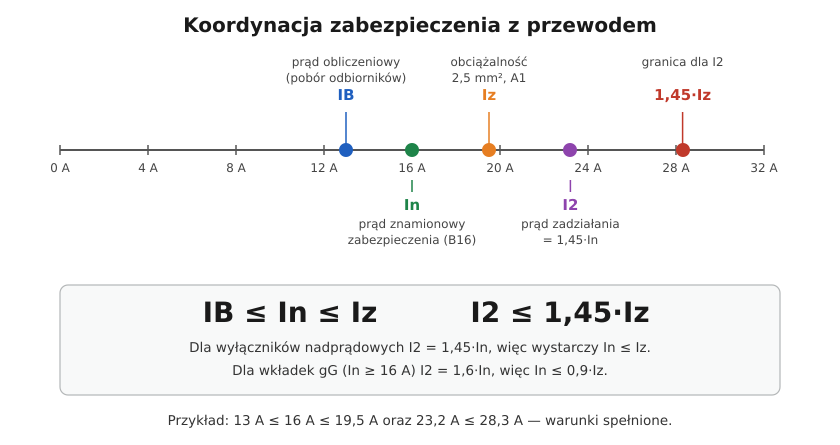

# 07.06 — Koordynacja zabezpieczenia z przewodem

> **Moduł:** [07 — Zabezpieczenia nadprądowe](README.md) · **Oznaczenia:** 🏠📋 · **Zakres SEP:** (a) (c) · **Status:** ✅ pełny
>
> **Czytaj:**
>
> - PN-HD 60364-4-43, 433.1 i 434.5.2 — warunki doboru
> - Obciążalność przewodów: [05.04](../05-przewody-i-kable/05.04-przekroj-i-obciazalnosc-pradowa.md)

[← poprzedni temat](07.05-zdolnosc-zwarciowa-6-ka-10-ka.md) · [spis modułu](README.md) · [następny temat →](07.07-selektywnosc-zabezpieczen.md)

## Po co to jest

To najważniejszy rachunek w projektowaniu obwodu: zabezpieczenie i przewód muszą do siebie pasować. Jeśli zabezpieczenie jest za duże, przewód przegrzewa się, zanim cokolwiek zadziała. Na egzaminie: warunki doboru zabezpieczenia do przewodu.

## Po ludzku

Są trzy prądy, które trzeba ustawić w kolejności:

- **IB** — prąd obliczeniowy: ile naprawdę pobierają odbiorniki,
- **In** — prąd znamionowy zabezpieczenia,
- **Iz** — obciążalność długotrwała przewodu ([05.04](../05-przewody-i-kable/05.04-przekroj-i-obciazalnosc-pradowa.md)).

**Warunek 1:** $I_B \le I_n \le I_z$. Zabezpieczenie ma nie wyłączać przy normalnej pracy i nie przekraczać możliwości przewodu.

**Warunek 2:** $I_2 \le 1{,}45 \cdot I_z$, gdzie $I_2$ to prąd, przy którym zabezpieczenie na pewno zadziała w czasie umownym. Ten warunek pilnuje, żeby przy przeciążeniu przewód nie grzał się długo do temperatury wyraźnie wyższej niż dopuszczalna.

- Dla **wyłączników nadprądowych** $I_2 = 1{,}45 \cdot I_n$, więc warunek 2 sprowadza się do $I_n \le I_z$ — wystarcza warunek 1.
- Dla **wkładek gG** (In ≥ 16 A) $I_2 = 1{,}6 \cdot I_n$, więc $I_n \le 0{,}9 \cdot I_z$.

**Warunek zwarciowy.** Zabezpieczenie musi też wyłączyć zwarcie, zanim żyła nagrzeje się do temperatury granicznej (160 °C dla PVC). Dla czasu do 5 s:

$$t \le \left(\frac{k \cdot S}{I}\right)^2$$

gdzie k = 115 dla Cu w PVC, S — przekrój w mm², I — prąd zwarcia. Przy wyłącznikach nadprądowych i typowych przekrojach w mieszkaniu warunek jest zwykle spełniony z zapasem, a producenci podają dopuszczalne kombinacje.

**Do tego dochodzą:** spadek napięcia ([01.06](../01-prad-napiecie-opor/01.06-grzanie-przewodow-i-spadek-napiecia.md)) i samoczynne wyłączenie przy zwarciu do obudowy ([04.04](../04-prad-a-czlowiek/04.04-maksymalne-czasy-samoczynnego-wylaczenia.md)). Obwód jest dobrze dobrany dopiero wtedy, gdy spełnia wszystkie cztery warunki.

## Schemat

## Pojęcia

| Pojęcie | Po ludzku | Termin normowy / symbol |
|---------|-----------|-------------------------|
| Prąd obliczeniowy | Pobór prądu przez odbiorniki | $I_B$ |
| Prąd znamionowy zabezpieczenia | Liczba na wyłączniku lub wkładce | $I_n$ |
| Obciążalność przewodu | Ile przewód wytrzyma długotrwale | $I_z$ |
| Prąd zadziałania | Prąd, przy którym zabezpieczenie na pewno zadziała w czasie umownym | $I_2$ |
| Współczynnik k | Stała materiałowa żyły i izolacji | k (Cu/PVC = 115) |

## Liczby do zapamiętania

| Wielkość | Wartość | Kiedy obowiązuje | Źródło |
|----------|---------|------------------|--------|
| Warunek przeciążeniowy 1 | $I_B \le I_n \le I_z$ | zawsze | PN-HD 60364-4-43, 433.1 |
| Warunek przeciążeniowy 2 | $I_2 \le 1{,}45 \cdot I_z$ | zawsze | jw. |
| $I_2$ wyłącznika nadprądowego | **1,45 × In** | PN-EN 60898-1 | jw. |
| $I_2$ wkładki gG | **1,6 × In** (In ≥ 16 A) | → $I_n \le 0{,}9 \cdot I_z$ | PN-EN 60269-1 |
| Warunek zwarciowy | $t \le (k S / I)^2$ | t ≤ 5 s | PN-HD 60364-4-43, 434.5.2 |
| k dla żył | Cu/PVC **115**, Cu/XLPE **143**, Al/PVC **76** | przekroje ≤ 300 mm² | jw., tab. 43A |
| Typowo | **1,5 mm² — B10**, **2,5 mm² — B16** | mieszkania, bez niekorzystnych warunków | praktyka |

## W praktyce

- **Zawsze zaczynaj od przewodu**, który już jest w ścianie: jego przekrój i sposób ułożenia wyznaczają największe dopuszczalne zabezpieczenie.
- **Nie znasz przekroju albo sposobu ułożenia?** Przyjmij najgorszy realny przypadek (np. A1 przy ociepleniu) albo zmierz średnicę żyły.
- **B13** to dobry kompromis dla obwodów 1,5 mm², gdzie B10 bywa za mały, a B16 jest niedopuszczalny.
- **Przy zmianie zabezpieczenia** (np. modernizacja rozdzielnicy) sprawdź warunki od nowa. Stare instalacje często mają przewody, które pasowały do dawnych wkładek, ale nie do „szesnastek” wstawionych później.

## Błędy i zagrożenia

- ⚠️ **B16 na 1,5 mm²** — przewód o Iz 14,5–19,5 A (zależnie od ułożenia) bywa niechroniony przed przeciążeniem.
- ⚠️ **Wkładka gG dobierana jak wyłącznik** (In ≤ Iz zamiast 0,9 Iz).
- **Pominięcie poprawek** na grupowanie i temperaturę przy wyznaczaniu Iz.
- **Spełniony warunek przeciążeniowy przy niespełnionym warunku samoczynnego wyłączenia** (za długi obwód) — obwód nadal jest niebezpieczny.

## Przykład

**Zadanie.** Obwód gniazd w kuchni: czajnik 2,2 kW i ekspres 1,3 kW mogą pracować jednocześnie. Przewód YDY 3×2,5 w tynku (C), obok jeszcze jeden obwód (2 obwody, k₂ = 0,80). Dobierz wyłącznik.

1. $I_B = 3500 / 230 \approx 15{,}2\ \mathrm{A}$.
2. $I_z = 27 \cdot 0{,}80 = 21{,}6\ \mathrm{A}$.
3. Wyłącznik: In ≥ 15,2 A i In ≤ 21,6 A → **B16** (albo B20).
4. Warunek 2: $1{,}45 \cdot 16 = 23{,}2 \le 1{,}45 \cdot 21{,}6 = 31{,}3$ — spełniony.

**Wniosek.** B16. B20 też spełnia oba warunki, ale zostawia mniejszy zapas dla przewodu i przy kolejnym dołożonym obwodzie w bruździe przestanie je spełniać. Przy prądzie 15,2 A B16 pracuje blisko granicy — lepiej rozdzielić odbiorniki kuchenne na dwa obwody.

## Pytania SEP

1. **Jakie warunki musi spełniać zabezpieczenie przewodu przed skutkami przeciążeń?**

Odpowiedź

Według PN-HD 60364-4-43: $I_B \le I_n \le I_z$ oraz $I_2 \le 1{,}45 \cdot I_z$, gdzie $I_B$ — prąd obliczeniowy obwodu, $I_n$ — prąd znamionowy zabezpieczenia, $I_z$ — obciążalność długotrwała przewodu, $I_2$ — prąd zapewniający zadziałanie zabezpieczenia w czasie umownym. Dla wyłączników instalacyjnych $I_2 = 1{,}45 \cdot I_n$, więc drugi warunek jest spełniony, gdy spełniony jest pierwszy.

2. **Jaki warunek musi spełnić zabezpieczenie przewodu przed skutkami zwarć?**

Odpowiedź

Musi mieć zdolność wyłączania nie mniejszą niż spodziewany prąd zwarciowy w miejscu zainstalowania (lub ochronę wsteczną) i wyłączyć zwarcie w czasie, w którym żyła nie przekroczy temperatury granicznej: $t \le (k \cdot S / I)^2$ dla t ≤ 5 s, gdzie k — współczynnik materiałowy (np. 115 dla Cu w PVC), S — przekrój, I — prąd zwarcia.

3. **Czy przewód 1,5 mm² Cu można zabezpieczyć wyłącznikiem B16?**

Odpowiedź

Zwykle nie. Obciążalność przewodu 1,5 mm² wynosi od 14,5 A (A1) do 19,5 A (C) przy 30 °C i jednym obwodzie, a po uwzględnieniu grupowania lub temperatury jest mniejsza. Warunek $I_n \le I_z$ jest spełniony dla B16 tylko w korzystnych warunkach ułożenia, dlatego dla 1,5 mm² stosuje się B10 lub B13.

## Sprawdź się

1. Przewód ma Iz = 32 A. Jakie największe: wyłącznik nadprądowy i wkładkę gG możesz zastosować?

Odpowiedź

Wyłącznik: In ≤ 32 A → B32 (lub C32). Wkładka gG: $I_n \le 0{,}9 \cdot 32 = 28{,}8$ A → gG 25 A.

## Źródła

- PN-HD 60364-4-43 — 433.1 (koordynacja przewodu i zabezpieczenia), 434.5 (zwarcia), tab. 43A (współczynnik k).
- PN-EN 60898-1, PN-EN 60269-1 — prądy umowne zadziałania.

---

[← poprzedni temat](07.05-zdolnosc-zwarciowa-6-ka-10-ka.md) · [spis modułu](README.md) · [następny temat →](07.07-selektywnosc-zabezpieczen.md)
