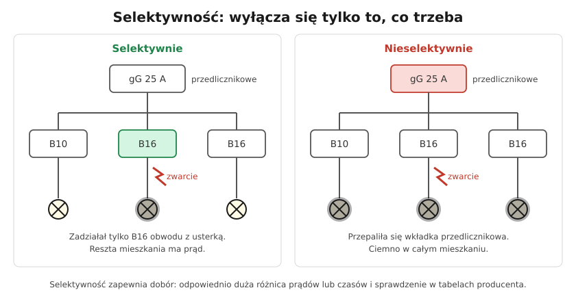

# 07.07 — Selektywność zabezpieczeń

> **Moduł:** [07 — Zabezpieczenia nadprądowe](README.md) · **Oznaczenia:** 🏠📋 · **Zakres SEP:** (a) (c) · **Status:** ✅ pełny
>
> **Czytaj:**
>
> - PN-HD 60364-5-53 — dobór aparatury, selektywność
> - [Hager — Podstawy zabezpieczeń (PDF)](https://assets1.sc.hager.com/poland/pdf/25PL025_Podstawy%20zabezpiecze%C5%84%20w%20instalacjach%20elektrycznych%20-%20instrukcja%20techniczna.pdf) — selektywność, tabele
> - Selektywność różnicówek: [08.07](../08-wylaczniki-roznicowopradowe/08.07-podzial-obwodow-miedzy-wylaczniki.md)

[← poprzedni temat](07.06-koordynacja-zabezpieczenia-z-przewodem.md) · [spis modułu](README.md) · (koniec modułu) →

## Po co to jest

Gdy w jednym gnieździe zdarzy się zwarcie, ma zgasnąć jeden obwód, a nie całe mieszkanie czy cały budynek. To jest selektywność. Nieselektywne zabezpieczenia oznaczają wzywanie pogotowia energetycznego, żeby wymienić wkładkę w złączu po każdym zwarciu w czajniku. Na egzaminie: definicja selektywności i jak się ją zapewnia.

## Po ludzku

Zabezpieczenia w instalacji tworzą drzewo: na początku zabezpieczenie w złączu, potem przedlicznikowe, potem główne w rozdzielnicy mieszkaniowej, a na końcu wyłączniki poszczególnych obwodów. Przy zwarciu na końcu jednej gałęzi prąd zwarcia płynie przez **wszystkie** zabezpieczenia od źródła do miejsca zwarcia.

**Selektywność (wybiórczość)** oznacza, że zadziała tylko to zabezpieczenie, które jest najbliżej usterki, a pozostałe wytrzymają.

Jak to osiągnąć:

- **Różnica prądów.** Zabezpieczenie wyżej ma wyraźnie większy prąd znamionowy. Dla wkładek gG wystarcza stosunek **1,6** (np. 25 A przed 16 A).
- **Różnica czasów.** Zabezpieczenie wyżej celowo czeka chwilę dłużej (wyłączniki selektywne).
- **Tabele producenta.** Przy zwarciach wyłączniki nadprądowe działają w milisekundach, więc sama różnica prądów nie wystarcza. Producent podaje, do jakiego prądu zwarcia dana para aparatów jest selektywna.

**Problem w mieszkaniu.** Zwarcie tuż za B16 daje prąd kilkuset amperów albo więcej. Taki prąd przepala też wkładkę przedlicznikową gG 25 A, jeśli jest dostatecznie duży. Pełnej selektywności między małą wkładką przedlicznikową a wyłącznikami nadprądowymi zwykle się nie osiąga — jest tylko do pewnego prądu zwarcia. Rozwiązania: większa wkładka przedlicznikowa (jeśli pozwala na to przyłącze), albo **wyłącznik selektywny główny** (oznaczany np. „S” lub „E”), który przy zwarciu daje szansę zadziałać najpierw wyłącznikowi obwodu.

## Schemat

## Pojęcia

| Pojęcie | Po ludzku | Termin normowy / symbol |
|---------|-----------|-------------------------|
| Selektywność | Wyłącza tylko zabezpieczenie najbliżej usterki | wybiórczość |
| Selektywność całkowita | Działa przy każdym możliwym prądzie zwarcia | — |
| Selektywność częściowa | Działa tylko do pewnego prądu | prąd graniczny selektywności $I_s$ |
| Zabezpieczenie przedlicznikowe | Zabezpieczenie przed licznikiem energii | zwykle wkładka gG lub wyłącznik selektywny |
| Wyłącznik selektywny | Wyłącznik główny z celowym opóźnieniem przy zwarciu | SMB, „S”, „E” |

## Liczby do zapamiętania

| Wielkość | Wartość | Kiedy obowiązuje | Źródło |
|----------|---------|------------------|--------|
| Selektywność wkładek gG | stosunek In **≥ 1,6** | wkładki tej samej klasy | PN-EN 60269-1 |
| Wyłącznik nadprądowy za wkładką | selektywność do prądu granicznego $I_s$ | wg tabel producenta | dane producentów |
| Wyłącznik nadprądowy za wyłącznikiem nadprądowym | zwykle **brak** selektywności przy zwarciach | — | jw. |
| Typowe zabezpieczenie przedlicznikowe w mieszkaniu | **gG 20–25 A** | zależnie od mocy przyłączeniowej | warunki przyłączenia OSD |

## W praktyce

- **Sprawdź, co jest przed rozdzielnicą mieszkaniową** (wkładki w tablicy licznikowej na klatce, wyłącznik w złączu) i jaki jest ich prąd.
- **Nie stosuj jako głównego** w rozdzielnicy mieszkaniowej zwykłego wyłącznika nadprądowego o tym samym lub mniejszym prądzie niż wyłączniki obwodów. Lepiej rozłącznik izolacyjny (bez wyzwalaczy), a zabezpieczeniem głównym niech będą wkładki przedlicznikowe albo wyłącznik selektywny.
- **Różnicówki** też muszą być selektywne między sobą ([08.07](../08-wylaczniki-roznicowopradowe/08.07-podzial-obwodow-miedzy-wylaczniki.md)).
- **Korzystaj z tabel selektywności producenta** dla par: wkładka przedlicznikowa — wyłącznik obwodu.

## Błędy i zagrożenia

- **Zwykły wyłącznik nadprądowy (np. B20) jako główny przed obwodami B16** — przy zwarciu zadziałają oba albo tylko główny i gaśnie całe mieszkanie. Jako aparat główny lepszy rozłącznik albo wyłącznik selektywny.
- **Brak selektywności zabezpieczenia przedlicznikowego** — po każdym zwarciu wizyta przy plombowanej tablicy na klatce, często wezwanie służb OSD.
- ⚠️ **„Naprawianie” braku selektywności przez zwiększanie wkładki przedlicznikowej** bez zgody OSD i bez sprawdzenia przewodów WLZ — przewody przed licznikiem tracą ochronę.

## Przykład

**Zadanie.** Wkładki gG w rozdzielnicy budynku: 63 A na wlz, 25 A przedlicznikowe w mieszkaniu, potem wyłączniki B10 i B16. Czy wkładki 63 A i 25 A są wzajemnie selektywne? A gdyby przedlicznikowa miała 50 A?

**Rozwiązanie.** 63 / 25 = 2,52 ≥ 1,6 — selektywne. 63 / 50 = 1,26 < 1,6 — selektywność niezapewniona: przy zwarciu w mieszkaniu może się przepalić wkładka wlz i zgasną inne mieszkania.

## Pytania SEP

1. **Na czym polega selektywność zabezpieczeń?**

Odpowiedź

Na takim doborze zabezpieczeń połączonych szeregowo, by przy zwarciu lub przeciążeniu zadziałało tylko zabezpieczenie położone najbliżej miejsca usterki (od strony zasilania), a pozostałe nie zadziałały. Dzięki temu wyłączana jest tylko uszkodzona część instalacji.

2. **Jak zapewnia się selektywność wkładek bezpiecznikowych?**

Odpowiedź

Przez odpowiedni stosunek prądów znamionowych wkładek połączonych szeregowo. Dla wkładek gG tej samej serii selektywność zapewnia stosunek co najmniej 1,6 (np. 16 A i 25 A). W przypadkach wątpliwych porównuje się charakterystyki pasmowe lub wartości $I^2t$ z danych producenta.

## Sprawdź się

1. Czy wkładki gG 20 A i 32 A połączone szeregowo są selektywne?

Odpowiedź

32 / 20 = 1,6 — tak, spełniają warunek.

2. Dlaczego dwa wyłączniki nadprądowe B (np. B25 przed B16) zwykle nie są selektywne przy zwarciu?

Odpowiedź

Bo oba mają wyzwalacze elektromagnetyczne działające bezzwłocznie. Prąd zwarcia większy niż 5 × 25 = 125 A powoduje natychmiastowe zadziałanie obu.

## Źródła

- PN-HD 60364-5-53 — dobór i montaż aparatury, koordynacja zabezpieczeń.
- PN-EN 60269-1 — selektywność wkładek topikowych.
- [Hager — Podstawy zabezpieczeń w instalacjach elektrycznych](https://assets1.sc.hager.com/poland/pdf/25PL025_Podstawy%20zabezpiecze%C5%84%20w%20instalacjach%20elektrycznych%20-%20instrukcja%20techniczna.pdf) — selektywność wyłączników i bezpieczników.

---

[← poprzedni temat](07.06-koordynacja-zabezpieczenia-z-przewodem.md) · [spis modułu](README.md) · (koniec modułu) →
