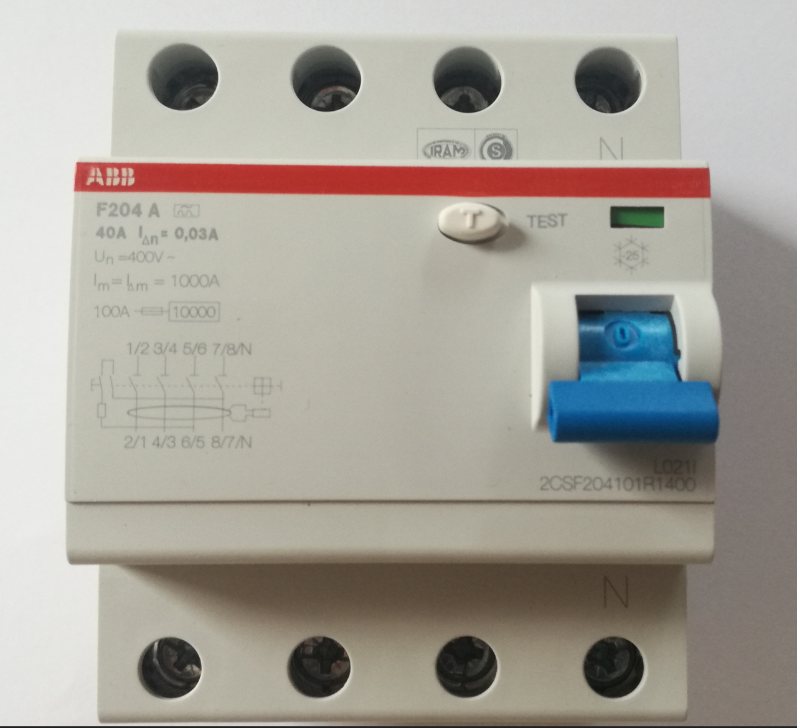
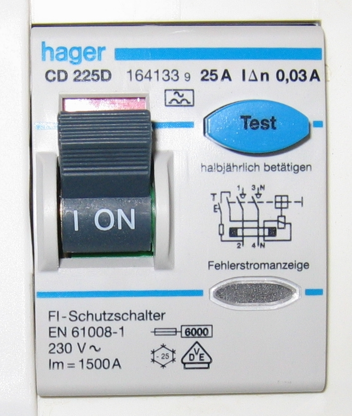

# 08.01 — Zasada działania wyłącznika różnicowoprądowego

> **Moduł:** [08 — Wyłączniki różnicowoprądowe](README.md) · **Oznaczenia:** 🏠📋 · **Zakres SEP:** (a) (b) (c) · **Status:** ✅ pełny
>
> **Czytaj:**
>
> - PN-EN 61008-1 (RCCB), PN-EN 61009-1 (RCBO)
> - [Podstawy doboru wyłączników różnicowoprądowych (Inżynier Budownictwa)](https://inzynierbudownictwa.pl/?p=5443)
> - Progi skutków prądu: [04.01](../04-prad-a-czlowiek/04.01-jak-prad-dziala-na-organizm-progi-odczuwania.md)

← (początek modułu) · [spis modułu](README.md) · [następny temat →](08.02-prad-roznicowy-znamionowy-30-ma-100-ma-300-ma.md)

## Po co to jest

Wyłącznik różnicowoprądowy (RCD, potocznie „różnicówka”) to jedyne zabezpieczenie, które wyłącza przy prądzie płynącym przez człowieka do ziemi, zanim ten prąd zatrzyma serce. Wyłącznik nadprądowy tego nie potrafi, bo 30 mA to dla niego nic. Na egzaminie: zasada działania RCD, co wykrywa i czego nie wykrywa.

## Po ludzku

**Prąd, który wypływa, musi wrócić.** W sprawnym obwodzie prąd płynący fazą L wraca w całości przewodem N. Różnicówka porównuje te dwa prądy. Jeśli się różnią, część prądu ucieka inną drogą: przez uszkodzoną izolację do PE albo przez człowieka do ziemi.

**Jak to porównuje?** Przewody L i N (w wersji trójfazowej L1, L2, L3 i N) przechodzą przez pierścieniowy rdzeń — **przekładnik sumujący**. Prądy w L i N płyną w przeciwnych kierunkach, więc ich pola magnetyczne się znoszą. Gdy prądy się różnią, w rdzeniu pojawia się strumień. Indukuje on napięcie w uzwojeniu wtórnym, a to napięcie zasila **przekaźnik**, który zwalnia zamek i otwiera styki.

**Kluczowa wartość** to **znamionowy prąd różnicowy IΔn**, np. 30 mA. Przy różnicy równej IΔn wyłącznik musi zadziałać, a przy różnicy poniżej 0,5 IΔn nie powinien.

**Czego różnicówka NIE robi:**

- **Nie chroni przed przeciążeniem i zwarciem.** Zwarcie L–N to wielki prąd, ale ten sam w L i w N. Do tego potrzebny jest wyłącznik nadprądowy lub bezpiecznik ([moduł 07](../07-zabezpieczenia-nadpradowe/README.md)). Wyjątek to RCBO, który ma oba człony ([08.04](08.04-rcbo-wylacznik-nadpradowy-z-czlonem.md)).
- **Nie chroni przy dotknięciu jednocześnie L i N** (człowiek jako „odbiornik” między L a N, odizolowany od ziemi). Prąd wraca przez N, więc różnicy nie ma.
- **Nie zadziała, gdy prąd uszkodzenia nie omija przekładnika**, np. gdy N i PE są połączone za różnicówką.

**Gdzie działa:** w układach TN-S i TT. W TN-C (przewód PEN) różnicówka nie może pracować, bo PEN niesie jednocześnie prąd roboczy i prąd uszkodzenia ([moduł 11](../11-uklady-sieci/README.md)).

## Jak to wygląda

*Na co patrzeć: na froncie IΔn = 0,03 A (30 mA), prąd znamionowy 40 A i symbol typu A ([08.03](08.03-typy-ac-a-f-i-b-ktory-do-czego.md)). Zacisk N jest oznaczony osobno — przewód N musi trafić właśnie tam. Przycisk TEST sprawdza mechanizm, a nie całą ochronę ([08.05](08.05-przycisk-test-i-okresowe-sprawdzanie.md)).*

*Na co patrzeć: dwubiegunowy RCD przerywa L i N. Na froncie jest schemat wewnętrzny z przekładnikiem i obwodem testu, IΔn = 0,03 A, prąd znamionowy 25 A oraz zalecenie producenta, żeby naciskać TEST co pół roku.*

## Schemat

## Pojęcia

| Pojęcie | Po ludzku | Termin normowy / symbol |
|---------|-----------|-------------------------|
| Wyłącznik różnicowoprądowy | „Różnicówka” | RCD; RCCB (bez członu nadprądowego) |
| Prąd różnicowy | Różnica prądów L i N (prąd „uciekający”) | $I_\Delta$ |
| Znamionowy prąd różnicowy | Próg, przy którym musi zadziałać | $I_{\Delta n}$ |
| Przekładnik sumujący | Rdzeń, przez który przechodzą L i N | przekładnik Ferrantiego |
| Ochrona uzupełniająca | Dodatkowa ochrona przy dotyku części czynnych | RCD ≤ 30 mA |
| Niezależny od napięcia | Działa bez zasilania elektroniki | RCD typu VI |

## Liczby do zapamiętania

| Wielkość | Wartość | Kiedy obowiązuje | Źródło |
|----------|---------|------------------|--------|
| Zakres zadziałania | **0,5 IΔn – IΔn** | prąd sinusoidalny | PN-EN 61008-1 |
| Czas zadziałania przy IΔn | ≤ **300 ms** | RCD ogólnego typu | jw. |
| Czas przy 2 IΔn / 5 IΔn | ≤ **150 ms** / ≤ **40 ms** | jw. | jw. |
| Czas zadziałania typu S przy IΔn | **130–500 ms** | RCD selektywny | jw. |
| Typ S przy 5 IΔn | **50–150 ms** | jw. | jw. |
| Ochrona uzupełniająca | IΔn ≤ **30 mA** | — | PN-HD 60364-4-41, 415.1 |

## W praktyce

- **Różnicówka zawsze razem z zabezpieczeniem nadprądowym.** Przed RCCB musi być zabezpieczenie, które ochroni go przed przeciążeniem i zwarciem (wartości podaje producent).
- **Wszystkie przewody czynne obwodu przez RCD** — L i N. PE nigdy przez różnicówkę.
- **N za różnicówką jest „jej” N.** Nie wolno go łączyć z N innych obwodów ani z PE ([08.07](08.07-podzial-obwodow-miedzy-wylaczniki.md)).
- **Po montażu:** naciśnij TEST, a przy odbiorze zmierz prąd i czas zadziałania miernikiem ([moduł 23](../23-pomiary-odbiorcze-i-okresowe/README.md)).

## Błędy i zagrożenia

- ⚠️ **„Mam różnicówkę, mogę pracować pod napięciem”** — RCD nie chroni przed porażeniem między L a N i nie zastępuje wyłączenia i sprawdzenia braku napięcia.
- ⚠️ **RCD w instalacji TN-C** albo z PEN przeprowadzonym przez przekładnik — nie działa albo wybija bez sensu.
- **Mostek N–PE za różnicówką** (np. w gnieździe) — wybijanie przy obciążeniu.
- **RCCB bez zabezpieczenia nadprądowego** przed nim lub za nim — przeciążenie lub zwarcie zniszczy aparat.

## Przykład

**Zadanie.** Pralka ma uszkodzoną grzałkę: z fazy do obudowy (z PE) płynie 40 mA. Ile wynosi prąd w L i w N, jeśli pralka pobiera 9 A? Co zrobi różnicówka 30 mA?

- $I_L = 9{,}000 + 0{,}040 = 9{,}040\ \mathrm{A}$
- $I_N = 9{,}000\ \mathrm{A}$
- $I_\Delta = I_L - I_N = 40\ \mathrm{mA} \ge I_{\Delta n} = 30\ \mathrm{mA}$

**Wynik.** Różnicówka wyłączy, i to w czasie poniżej 300 ms. Wyłącznik nadprądowy B16 nie widzi żadnej różnicy: 9,04 A to dla niego normalna praca.

## Pytania SEP

1. **Jak działa wyłącznik różnicowoprądowy?**

Odpowiedź

Przewody robocze obwodu (L i N, w układzie trójfazowym L1, L2, L3 i N) przechodzą przez rdzeń przekładnika sumującego. W stanie normalnym suma prądów jest równa zeru i strumień w rdzeniu się znosi. Przy upływie prądu do ziemi lub przez przewód ochronny suma prądów jest różna od zera, w rdzeniu powstaje strumień, który indukuje napięcie w uzwojeniu wtórnym. Napięcie zasila przekaźnik, który zwalnia zamek i otwiera styki, gdy prąd różnicowy osiągnie wartość zadziałania (najpóźniej przy IΔn).

2. **Przed czym nie chroni wyłącznik różnicowoprądowy?**

Odpowiedź

Przed przeciążeniem i zwarciem (chyba że ma człon nadprądowy — RCBO). Przed porażeniem przy jednoczesnym dotknięciu przewodu fazowego i neutralnego przez człowieka odizolowanego od ziemi, bo prąd nie wypływa wtedy poza obwód. Nie działa w układzie TN-C ani gdy N i PE są połączone za wyłącznikiem.

3. **W jakich układach sieci można stosować wyłączniki różnicowoprądowe?**

Odpowiedź

W układach TN-S (oraz w części TN-S układu TN-C-S, za rozdzieleniem PEN na PE i N) i TT, a w szczególnych przypadkach w IT. Nie stosuje się ich w układzie TN-C, bo przewód PEN pełni funkcję neutralną i ochronną jednocześnie.

## Sprawdź się

1. Dlaczego przez różnicówkę przechodzi N, a nie przechodzi PE?

Odpowiedź

N niesie prąd roboczy z powrotem — musi przejść przez przekładnik, żeby bilans był zerowy. PE ma nieść prąd uszkodzenia, który ma właśnie wywołać różnicę. Gdyby PE przechodził przez przekładnik, prąd upływu wracałby przez rdzeń i różnicówka by go nie zobaczyła.

## Źródła

- PN-EN 61008-1 — wyłączniki różnicowoprądowe bez członu nadprądowego (RCCB), czasy zadziałania.
- PN-HD 60364-4-41 — 411.3.3, 415.1 (ochrona uzupełniająca).
- [Inżynier Budownictwa — Podstawy doboru wyłączników różnicowoprądowych](https://inzynierbudownictwa.pl/?p=5443).

---

← (początek modułu) · [spis modułu](README.md) · [następny temat →](08.02-prad-roznicowy-znamionowy-30-ma-100-ma-300-ma.md)
