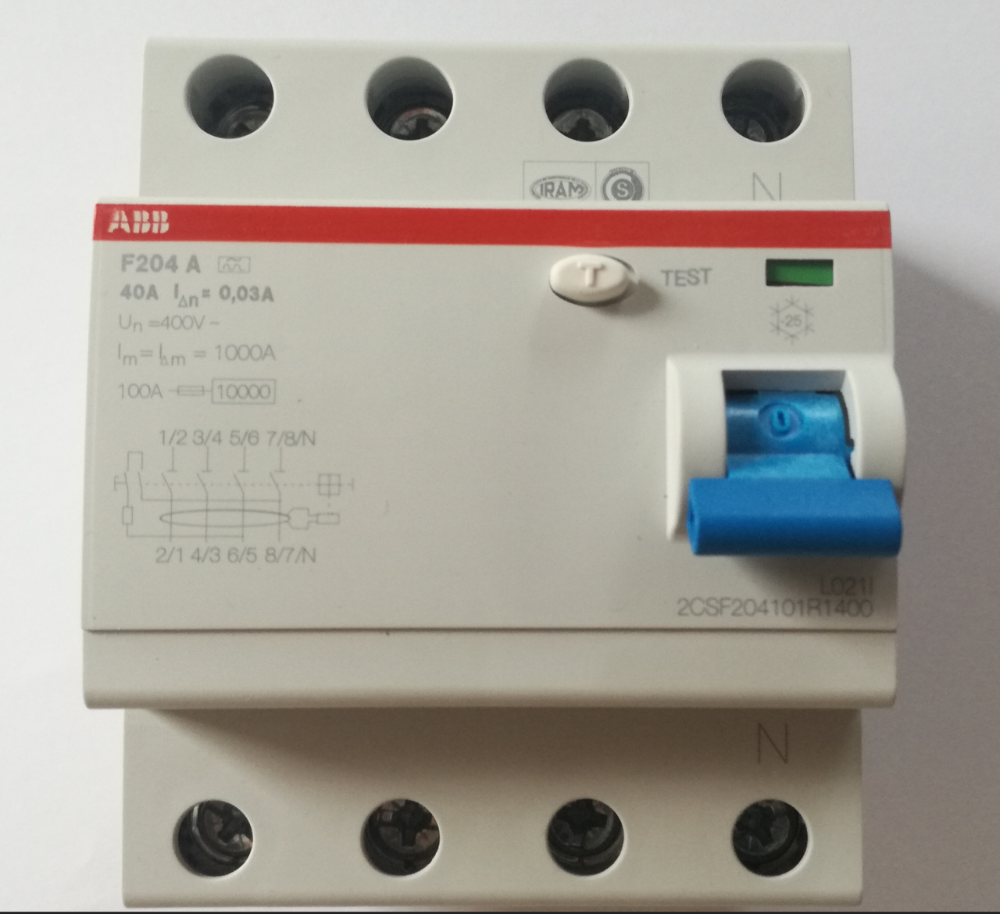
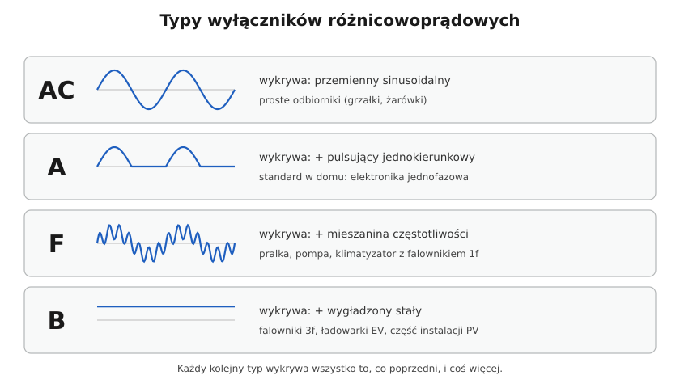

# 08.03 — Typy AC, A, F i B — który do czego

> **Moduł:** [08 — Wyłączniki różnicowoprądowe](README.md) · **Oznaczenia:** 🏠📋 · **Zakres SEP:** (a) (b) (c) · **Status:** ✅ pełny
>
> **Czytaj:**
>
> - PN-EN 61008-1, PN-EN 62423 (typy F i B)
> - [Podstawy doboru wyłączników różnicowoprądowych (Inżynier Budownictwa)](https://inzynierbudownictwa.pl/?p=5443) — typy A i B
> - Odbiorniki nieliniowe: [02.05](../02-prad-przemienny-230-400/02.05-odbiorniki-nieliniowe-i-wyzsze-harmoniczne.md)

[← poprzedni temat](08.02-prad-roznicowy-znamionowy-30-ma-100-ma-300-ma.md) · [spis modułu](README.md) · [następny temat →](08.04-rcbo-wylacznik-nadpradowy-z-czlonem.md)

## Po co to jest

Dawniej prąd upływu był po prostu sinusoidalny. Dziś pralka ma falownik, płyta indukcyjna — prostownik, a ładowarka samochodu — elektronikę mocy. Ich prąd upływu może mieć składową stałą albo wysoką częstotliwość, której prosta różnicówka nie widzi albo przez którą „ślepnie”. Na egzaminie: typy AC, A, F, B i ich zastosowanie.

## Po ludzku

Typ różnicówki mówi, **jakie kształty prądu różnicowego wykrywa**. Każdy kolejny typ wykrywa to samo co poprzedni i coś więcej:

| Typ | Wykrywa | Zastosowanie |
|-----|---------|--------------|
| **AC** | prąd przemienny sinusoidalny | proste odbiorniki: grzałki, żarówki; dziś coraz rzadziej |
| **A** | + prąd pulsujący jednokierunkowy (po prostowniku), z niewielką składową stałą (do 6 mA) | **standard w mieszkaniu** — elektronika jednofazowa, zasilacze, AGD |
| **F** | + prąd o mieszanej częstotliwości (z falowników jednofazowych), składowa stała do 10 mA | pralki, zmywarki, pompy ciepła, klimatyzatory z falownikiem jednofazowym |
| **B** | + prąd stały wygładzony i wysokie częstotliwości | falowniki trójfazowe, ładowarki samochodów, część instalacji PV, maszyny w warsztacie |

**Dlaczego AC już nie wystarcza?** Prąd stały płynący przez przekładnik nasyca jego rdzeń. Nasycony rdzeń słabo przenosi zmiany strumienia, więc różnicówka AC może **nie zadziałać nawet przy zwykłym sinusoidalnym upływie** — dla wszystkich obwodów za nią. Typ A znosi do 6 mA składowej stałej, F do 10 mA. Jeśli w obwodzie może pojawić się więcej, potrzebny jest typ B (albo, dla ładowarek samochodów, urządzenie wykrywające prąd stały 6 mA, wbudowane w ładowarkę).

**Odmiany o zwiększonej odporności.** Producenci oferują różnicówki odporne na udary i zakłócenia (krótkozwłoczne, oznaczane np. G, KV, Hpi, SI). Przydają się w obwodach z dużą liczbą urządzeń elektronicznych i tam, gdzie zwykłe RCD wybijają przy burzach.

## Jak to wygląda

*Na co patrzeć: litera A w oznaczeniu typu (F204 A) i symbol na froncie — sinusoida z dodatkową półfalą — mówią, że to typ A. Typ AC ma symbol z samą sinusoidą. Przy zakupie sprawdzaj symbol, a nie tylko „30 mA”.*

## Schemat

## Pojęcia

| Pojęcie | Po ludzku | Termin normowy / symbol |
|---------|-----------|-------------------------|
| Prąd pulsujący | Prąd po prostowniku, tylko w jedną stronę | — |
| Składowa stała | Część prądu, która nie zmienia kierunku | DC |
| Nasycenie rdzenia | Rdzeń „zapchany” strumieniem stałym | — |
| Typ AC / A / F / B | Kształty prądu, które RCD wykrywa | PN-EN 61008-1, PN-EN 62423 |
| RDC-DD | Urządzenie wykrywające prąd stały 6 mA w ładowarkach EV | IEC 62955 |

## Liczby do zapamiętania

| Wielkość | Wartość | Kiedy obowiązuje | Źródło |
|----------|---------|------------------|--------|
| Typ A — dopuszczalna składowa stała | do **6 mA** | bez utraty działania | PN-EN 61008-1 |
| Typ F — dopuszczalna składowa stała | do **10 mA** | jw. | PN-EN 62423 |
| Typ B | prąd stały wygładzony | — | jw. |
| W mieszkaniu | co najmniej **typ A** | nowe instalacje | praktyka, zalecenia producentów |
| Ładowarka EV | **typ B** albo typ A + wykrywanie DC **6 mA** | — | PN-HD 60364-7-722 |

## W praktyce

- **Nowa instalacja w mieszkaniu** — RCD typu A. Pralka, zmywarka, pompa ciepła z falownikiem — rozważ typ F lub osobne RCBO typu A/F zgodnie z instrukcją urządzenia.
- **Sprawdź instrukcję urządzenia.** Producenci falowników, pomp ciepła, ładowarek EV i falowników PV podają wymagany typ RCD.
- **Typ B nie może stać za typem A lub AC** (patrząc od zasilania). Prąd stały z obwodu „B” płynąłby też przez wcześniejszy RCD A/AC i mógłby go zaślepić.
- **Stare różnicówki AC** przy modernizacji warto wymienić na A.

## Błędy i zagrożenia

- ⚠️ **RCD typu AC przed obwodem z falownikiem lub ładowarką** — składowa stała nasyca rdzeń i różnicówka może nie zadziałać przy upływie także w innych obwodach.
- ⚠️ **RCD typu B za RCD typu A** — ten sam problem dla RCD wyżej.
- **Kupowanie „30 mA” bez sprawdzenia typu.**

## Przykład

**Sytuacja.** W domu jest jedna różnicówka 40 A / 30 mA typu AC. Właściciel montuje pompę ciepła z trójfazowym falownikiem, której instrukcja wymaga RCD typu B.

**Ocena.** Pompy nie wolno podłączyć za istniejącym RCD AC. Prąd stały upływu z falownika mógłby nasycić rdzeń AC i wyłączyć ochronę różnicową dla całego domu.

**Rozwiązanie.** Osobny obwód pompy z własnym RCD typu B, zasilany przed RCD AC (równolegle, nie za nim). Pozostałe obwody — przy okazji wymiana RCD AC na typ A.

## Pytania SEP

1. **Jakie typy wyłączników różnicowoprądowych rozróżniamy i czym się różnią?**

Odpowiedź

AC — reaguje na prąd różnicowy przemienny sinusoidalny. A — dodatkowo na prąd pulsujący jednokierunkowy (także z niewielką składową stałą do 6 mA). F — jak A oraz na prądy o mieszanej częstotliwości wytwarzane przez falowniki jednofazowe (składowa stała do 10 mA). B — jak F oraz na prąd stały wygładzony i prądy o wyższych częstotliwościach, np. z prostowników i falowników trójfazowych.

2. **Dlaczego w obwodach z urządzeniami elektronicznymi nie stosuje się RCD typu AC?**

Odpowiedź

Bo prąd upływu takich urządzeń może mieć składową pulsującą lub stałą, której typ AC nie wykrywa. Składowa stała może dodatkowo nasycić rdzeń przekładnika i zmniejszyć czułość albo uniemożliwić zadziałanie RCD także przy zwykłym sinusoidalnym prądzie upływu.

## Sprawdź się

1. Jaki typ RCD wybierzesz dla obwodu ładowarki samochodu elektrycznego bez wbudowanego wykrywania prądu stałego?

Odpowiedź

Typ B.

## Źródła

- PN-EN 61008-1 — typy AC i A.
- PN-EN 62423 — typy F i B.
- PN-HD 60364-7-722 — zasilanie pojazdów elektrycznych.
- [Inżynier Budownictwa — Podstawy doboru wyłączników różnicowoprądowych](https://inzynierbudownictwa.pl/?p=5443) — dobór typu A i B przy prostownikach.

---

[← poprzedni temat](08.02-prad-roznicowy-znamionowy-30-ma-100-ma-300-ma.md) · [spis modułu](README.md) · [następny temat →](08.04-rcbo-wylacznik-nadpradowy-z-czlonem.md)
