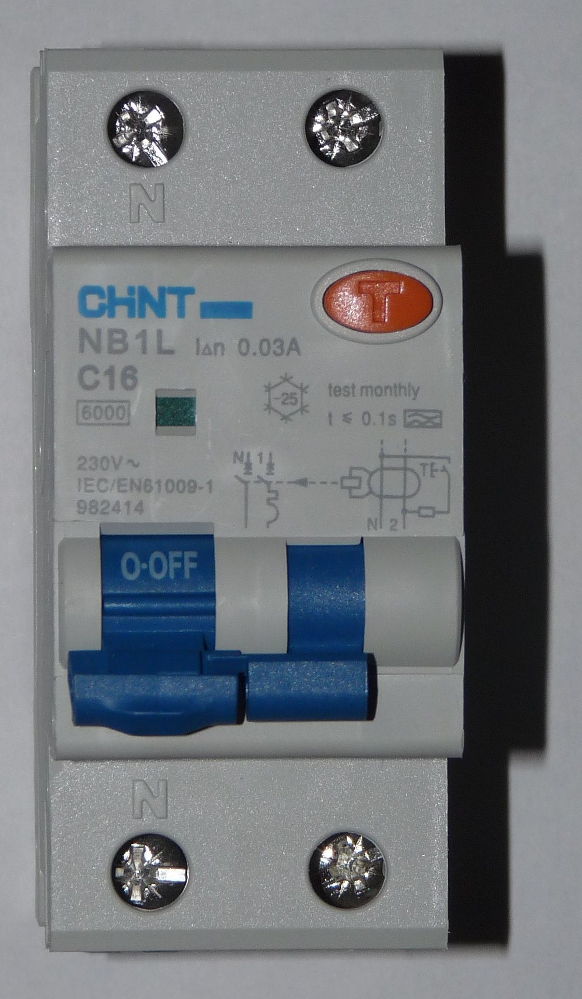
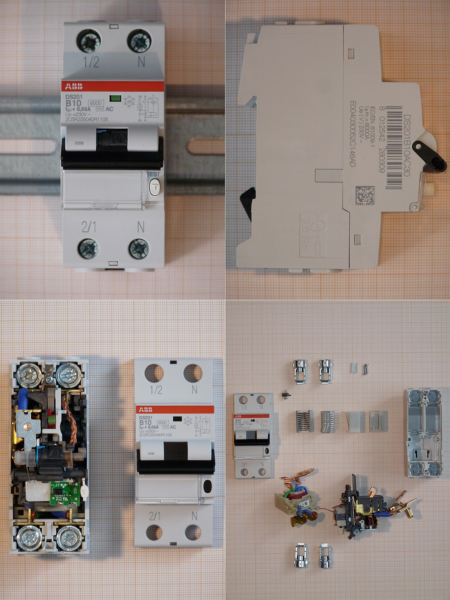

# 08.04 — RCBO — wyłącznik nadprądowy z członem różnicowoprądowym

> **Moduł:** [08 — Wyłączniki różnicowoprądowe](README.md) · **Oznaczenia:** 🏠📋 · **Zakres SEP:** (a) (b) (c) · **Status:** ✅ pełny
>
> **Czytaj:**
>
> - PN-EN 61009-1 — wyłączniki różnicowoprądowe z członem nadprądowym (RCBO)
> - Człon nadprądowy: [07.03](../07-zabezpieczenia-nadpradowe/07.03-wylacznik-nadpradowy-budowa-i-dwa-wyzwalacze.md)

[← poprzedni temat](08.03-typy-ac-a-f-i-b-ktory-do-czego.md) · [spis modułu](README.md) · [następny temat →](08.05-przycisk-test-i-okresowe-sprawdzanie.md)

## Po co to jest

RCBO to jeden aparat zamiast dwóch: wyłącznik nadprądowy i różnicówka w jednej obudowie, dla jednego obwodu. Coraz częściej stosuje się go dla każdego obwodu osobno, żeby usterka w jednym miejscu nie gasiła połowy mieszkania. Trzeba umieć go odczytać i podłączyć.

## Po ludzku

**RCBO = RCD + MCB.** Wewnątrz jest przekładnik sumujący z przekaźnikiem (część różnicowa) oraz bimetal i cewka (część nadprądowa). Aparat wyłącza przy przeciążeniu, przy zwarciu i przy upływie.

**Parametry na froncie** łączą oba światy:

- charakterystyka i prąd znamionowy — np. **B16**,
- znamionowy prąd różnicowy — np. **30 mA**,
- typ — **A**, F, AC,
- zdolność zwarciowa — np. **6000**.

**Zalety:**

- usterka (upływ) w jednym obwodzie wyłącza tylko ten obwód,
- za jednym RCBO jest jeden obwód, więc mniej sumuje się prądów upływu i mniej niepotrzebnych zadziałań,
- łatwiej znaleźć przyczynę zadziałania.

**Wady:** cena i miejsce w rozdzielnicy (wersje 2-modułowe; są też kompaktowe 1-modułowe).

**Podłączenie.** RCBO 1P+N ma zaciski L i N. N obwodu musi wyjść z zacisku N tego RCBO, a nie ze wspólnej listwy N. W przeciwnym razie prąd w L i N się nie zgodzi i aparat będzie wybijał.

## Jak to wygląda

*Na co patrzeć: na froncie charakterystyka i prąd (C16), znamionowy prąd różnicowy (30 mA) i przycisk testu. Wygląda podobnie do wyłącznika nadprądowego, ale ma przycisk TEST i podany prąd różnicowy — to łatwy sposób, żeby je rozróżnić w rozdzielnicy.*

*Na co patrzeć: po rozłożeniu widać, ile mechaniki i elektroniki mieści się w dwóch modułach: tor nadprądowy z wyzwalaczami i komorą gaszeniową oraz pierścieniowy przekładnik sumujący z obwodem wyzwalania różnicowego.*

## Pojęcia

| Pojęcie | Po ludzku | Termin normowy / symbol |
|---------|-----------|-------------------------|
| RCBO | Różnicówka z „eską” w jednym | wyłącznik różnicowoprądowy z członem nadprądowym |
| RCCB | Sama różnicówka | bez członu nadprądowego |
| 1P+N | Jeden biegun chroniony nadprądowo + odłączany N | — |
| Zacisk N aparatu | Wyjście N, które musi zasilać tylko ten obwód | — |

## Liczby do zapamiętania

| Wielkość | Wartość | Kiedy obowiązuje | Źródło |
|----------|---------|------------------|--------|
| Typowe RCBO w mieszkaniu | **B16 / 30 mA / typ A**, 6 kA | obwody gniazd | praktyka |
| Część nadprądowa | jak w wyłączniku nadprądowym (1,13 / 1,45 × In, B/C) | — | PN-EN 61009-1 |
| Część różnicowa | jak w RCD (≤ 300 ms przy IΔn) | — | jw. |
| Szerokość | **1–2 moduły** | 1P+N | katalogi producentów |

## W praktyce

- **Lodówka, zamrażarka, pompa obiegowa, brama, alarm, router** — dobrzy kandydaci na osobne RCBO.
- **Każdy obwód na RCBO** to najwygodniejszy, ale i najdroższy wariant. Kompromis: kilka RCD na grupy plus RCBO dla obwodów krytycznych ([08.07](08.07-podzial-obwodow-miedzy-wylaczniki.md)).
- **Przy montażu RCBO zasilanych z grzebienia** sprawdź, czy N jest doprowadzany zgodnie z instrukcją (osobny przewód N, grzebień z N).
- **Po zadziałaniu** sprawdź wskaźnik (jeśli jest) — niektóre RCBO pokazują, czy wyłączył człon różnicowy, czy nadprądowy.

## Błędy i zagrożenia

- ⚠️ **N obwodu z RCBO podłączony do wspólnej listwy N** — natychmiastowe wybijanie albo, gorzej, połączenie N kilku obwodów i przypadkowe działanie ochrony.
- **Mylenie RCBO z wyłącznikiem nadprądowym** przy wymianie — obwód traci ochronę różnicową.
- **Pominięcie typu** (AC zamiast A).

## Przykład

**Zadanie.** Lodówka i zamrażarka w kuchni są na wspólnej różnicówce z gniazdami kuchennymi i oświetleniem. W czasie urlopu czajnik z zawilgoconą grzałką, zostawiony w gnieździe, wybił różnicówkę i jedzenie się rozmroziło. Jak to zmienić?

**Rozwiązanie.** Wydzielić osobny obwód dla lodówki i zamrażarki zabezpieczony RCBO B16 / 30 mA typu A. Zadziałanie różnicówki gniazd kuchennych nie odetnie wtedy chłodzenia.

## Pytania SEP

1. **Czym różni się wyłącznik RCBO od wyłącznika różnicowoprądowego RCCB?**

Odpowiedź

RCBO (PN-EN 61009-1) ma oprócz członu różnicowoprądowego człon nadprądowy z wyzwalaczem przeciążeniowym i zwarciowym, więc chroni obwód przed przeciążeniem, zwarciem i prądem różnicowym. RCCB (PN-EN 61008-1) reaguje tylko na prąd różnicowy i wymaga osobnego zabezpieczenia nadprądowego.

2. **Jakie parametry podaje się na wyłączniku RCBO?**

Odpowiedź

Charakterystykę i prąd znamionowy członu nadprądowego (np. B16), znamionowy prąd różnicowy (np. 30 mA), typ członu różnicowego (AC, A, F), znamionową zdolność zwarciową (np. 6000 A), napięcie znamionowe i normę.

## Sprawdź się

1. W rozdzielnicy widzisz dwa aparaty B16 — jeden z przyciskiem TEST i napisem 30 mA, drugi bez. Który jest RCBO?

Odpowiedź

Ten z przyciskiem TEST i podanym prądem różnicowym.

## Źródła

- PN-EN 61009-1 — wyłączniki różnicowoprądowe z wbudowanym zabezpieczeniem nadprądowym (RCBO).
- Instrukcje montażu RCBO producentów (podłączenie N, zasilanie z grzebieni).

---

[← poprzedni temat](08.03-typy-ac-a-f-i-b-ktory-do-czego.md) · [spis modułu](README.md) · [następny temat →](08.05-przycisk-test-i-okresowe-sprawdzanie.md)
