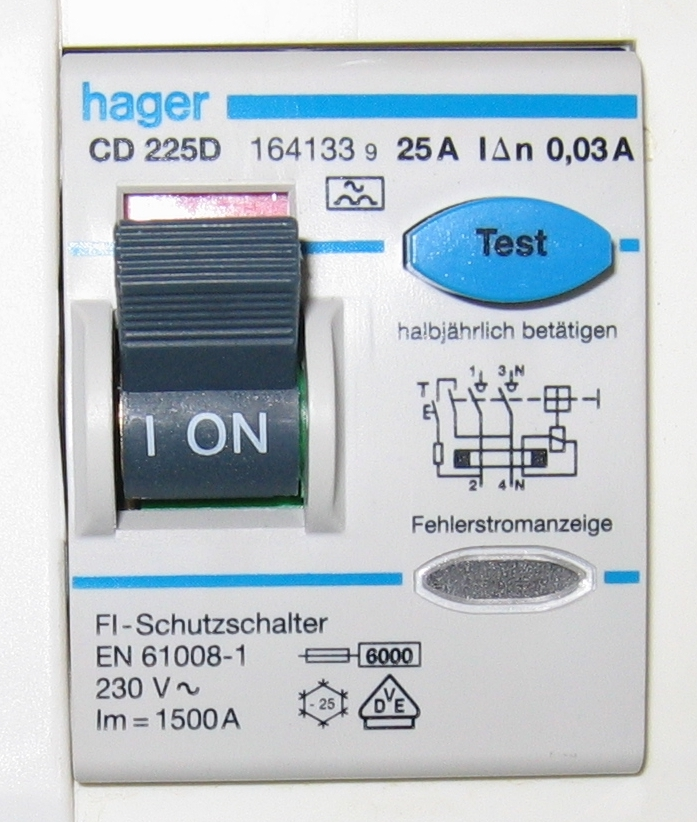

# 08.05 — Przycisk TEST i okresowe sprawdzanie

> **Moduł:** [08 — Wyłączniki różnicowoprądowe](README.md) · **Oznaczenia:** 🏠📋 · **Zakres SEP:** (a) (b) (c) · **Status:** ✅ pełny
>
> **Czytaj:**
>
> - PN-HD 60364-6 — sprawdzanie instalacji (badanie RCD)
> - Pomiary RCD miernikiem: [moduł 23](../23-pomiary-odbiorcze-i-okresowe/README.md)

[← poprzedni temat](08.04-rcbo-wylacznik-nadpradowy-z-czlonem.md) · [spis modułu](README.md) · [następny temat →](08.06-dlaczego-roznicowka-wybija-przyczyny-i-szukanie.md)

## Po co to jest

Różnicówka może się „zastać”: mechanizm, który latami nie był poruszany, zacina się. Przycisk TEST pozwala sprawdzić w kilka sekund, czy aparat w ogóle potrafi zadziałać. Na egzaminie: do czego służy przycisk TEST, co sprawdza, a czego nie, i jak bada się RCD przy pomiarach.

## Po ludzku

**Przycisk TEST** zamyka obwód przez rezystor między przewodem fazowym za przekładnikiem a N przed przekładnikiem (albo odwrotnie). Przez rezystor płynie prąd, który omija przekładnik — sztuczny prąd różnicowy większy niż IΔn. Sprawna różnicówka wyłącza.

**Co TEST sprawdza:** przekładnik, przekaźnik i mechanizm wyzwalania.

**Czego TEST nie sprawdza:**

- czy przewód PE jest podłączony i ciągły (test nie płynie przez PE),
- przy jakim prądzie dokładnie aparat zadziała i w jakim czasie,
- czy cała ochrona w instalacji jest skuteczna.

To robi się **miernikiem do RCD** podczas pomiarów odbiorczych i okresowych ([moduł 23](../23-pomiary-odbiorcze-i-okresowe/README.md)): miernik wymusza prąd różnicowy w gnieździe (L–PE), mierzy prąd zadziałania (powinien być między 0,5 IΔn a IΔn) i czas zadziałania (dla typu ogólnego ≤ 300 ms przy IΔn).

**Jak często naciskać TEST?** Zgodnie z zaleceniem producenta. Na aparatach i w instrukcjach spotyka się zalecenie co miesiąc albo co pół roku. Regularne naciskanie utrzymuje mechanizm w ruchu.

**Uwaga przy RCD czterobiegunowych:** obwód testu jest podłączony do określonych biegunów. Jeśli na tych biegunach nie ma napięcia (np. brak jednej fazy), TEST nie zadziała, choć aparat jest sprawny.

## Jak to wygląda

*Na co patrzeć: przycisk TEST jest wyróżniony kolorem, a obok jest zalecenie producenta („halbjährlich betätigen” — naciskać co pół roku). Na froncie jest też schemat wewnętrzny z rezystorem testu.*

## Pojęcia

| Pojęcie | Po ludzku | Termin normowy / symbol |
|---------|-----------|-------------------------|
| Przycisk TEST | Sztuczny upływ do sprawdzenia mechanizmu | urządzenie probiercze |
| Prąd zadziałania | Przy jakim prądzie RCD wyłączył | $I_\Delta$ |
| Czas zadziałania | Po jakim czasie wyłączył | $t_\Delta$ |
| Napięcie dotykowe przy teście | Napięcie na PE przy wymuszonym prądzie | $U_B$ |

## Liczby do zapamiętania

| Wielkość | Wartość | Kiedy obowiązuje | Źródło |
|----------|---------|------------------|--------|
| Prąd zadziałania (pomiar) | **0,5 IΔn – IΔn** (15–30 mA dla 30 mA) | prąd sinusoidalny | PN-EN 61008-1 |
| Czas zadziałania przy IΔn | ≤ **300 ms** (ogólny), **130–500 ms** (S) | — | jw. |
| Czas przy 5 IΔn | ≤ **40 ms** (ogólny) | — | jw. |
| Naciskanie TEST | wg producenta, zwykle **co 1–6 miesięcy** | użytkownik | instrukcje producentów |

## W praktyce

1. Uprzedź domowników — zgaśnie część mieszkania.
2. Naciśnij TEST. RCD powinien wyłączyć natychmiast.
3. Załącz z powrotem.
4. Jeśli nie wyłączył: sprawdź, czy RCD ma napięcie (świeci światło w jego obwodach). Jeśli ma, a TEST nie działa — aparat do wymiany, a do tego czasu obwody są bez ochrony uzupełniającej.
5. Przy pomiarach okresowych: pomiar prądu i czasu zadziałania miernikiem w każdym obwodzie za RCD ([moduł 23](../23-pomiary-odbiorcze-i-okresowe/README.md)).

## Błędy i zagrożenia

- ⚠️ **„TEST działa, więc wszystko jest w porządku”** — TEST nie sprawdza ciągłości PE ani czasu zadziałania.
- **Nigdy nienaciskany przycisk TEST** — zastały mechanizm, który przy prawdziwym upływie zadziała za późno albo wcale.
- **Testowanie przez zwarcie fazy z PE „kawałkiem drutu”** — niekontrolowany prąd, ryzyko łuku i porażenia. Do tego służy miernik.

## Przykład

**Sytuacja.** Podczas pomiarów okresowych miernik pokazuje dla RCD 30 mA: prąd zadziałania 27 mA, czas przy IΔn 420 ms.

**Ocena.** Prąd zadziałania jest w zakresie 15–30 mA, ale czas 420 ms przekracza 300 ms dopuszczalne dla RCD ogólnego typu. Aparat działa za wolno.

**Działanie.** Sprawdzić, czy to na pewno RCD ogólnego typu (nie S). Jeśli tak — do wymiany. Wpisać wynik negatywny do protokołu.

## Pytania SEP

1. **Do czego służy przycisk TEST w wyłączniku różnicowoprądowym?**

Odpowiedź

Do sprawdzenia sprawności mechanizmu wyzwalającego wyłącznika. Naciśnięcie przycisku powoduje przepływ prądu przez rezystor z pominięciem przekładnika, co wytwarza sztuczny prąd różnicowy większy od IΔn. Sprawny wyłącznik powinien zadziałać. Test nie sprawdza ciągłości przewodu ochronnego ani wartości prądu i czasu zadziałania.

2. **Jak sprawdza się skuteczność działania wyłącznika różnicowoprądowego podczas pomiarów?**

Odpowiedź

Miernikiem do badania RCD włączonym w obwód (np. w gnieździe, między L a PE). Mierzy się prąd zadziałania, który powinien zawierać się między 0,5 IΔn a IΔn, czas zadziałania przy IΔn (dla RCD ogólnego typu do 300 ms) i ewentualnie przy 5 IΔn, a także napięcie dotykowe. Sprawdza się też działanie przycisku TEST.

## Sprawdź się

1. RCD 4P nie reaguje na TEST w budynku, w którym od rana nie ma napięcia w fazie L3. Czy na pewno jest uszkodzony?

Odpowiedź

Niekoniecznie. Obwód testu może być podłączony do bieguna L3, więc bez napięcia na nim test nie zadziała. Trzeba powtórzyć test po przywróceniu zasilania.

## Źródła

- PN-EN 61008-1 — urządzenie probiercze, prądy i czasy zadziałania.
- PN-HD 60364-6 — sprawdzanie instalacji, badanie skuteczności RCD.
- Instrukcje producentów RCD (częstotliwość naciskania TEST).

---

[← poprzedni temat](08.04-rcbo-wylacznik-nadpradowy-z-czlonem.md) · [spis modułu](README.md) · [następny temat →](08.06-dlaczego-roznicowka-wybija-przyczyny-i-szukanie.md)
